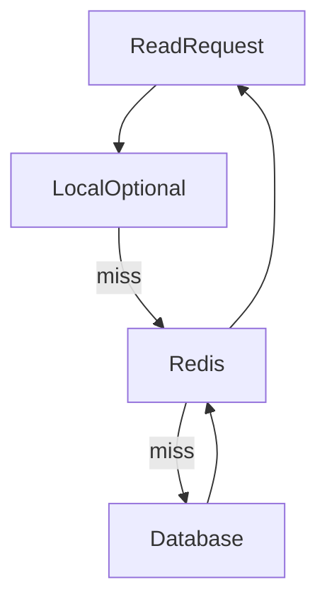

# D11-T001 — Why caching works

Topic ID: `D11-T001`
Domain: Redis and Caching
Subdomain: Why caching works
Importance: core
Complexity: intermediate
Dependencies: `D07-T001`, `D07-T002`, `D05-T001`, `D05-T002`
Execution status of the code in section F: not executed (documentation example)

## A. Topic Overview

Caching stores a copy of expensive-to-compute or expensive-to-fetch data closer to the consumer so repeated work is avoided. It works because real workloads are skewed: a small fraction of keys or pages receive most reads, and RAM is orders of magnitude faster than disk or cross-service RPC for hot data.

In backend interviews, “why caching works” is the setup for hit ratio, consistency, and failure handling; you must separate latency wins from correctness risks. Prerequisites: relational read paths (`D07-T001`) and request lifecycle (`D05-T002`). Later topics assume you can explain a miss versus a hit on the read path.

## B. First-Principles Explanation

Every read has a cost model: CPU to compute, I/O to disk, network to another service, and serialization. Caching trades memory for repeating that cost. Temporal locality means recently used data is likely reused; spatial locality means nearby data may be reused, but application caches usually exploit temporal locality first.

A cache entry is a derived artifact: it can be wrong if the origin changes and the cache is not updated. That is why TTL and invalidation appear later in this domain. The origin database (or service) remains authoritative unless you deliberately design otherwise.

## C. Internal Working and Architecture

Components: origin store (database), cache store (Redis or local), and application logic that checks the cache first on reads. On a hit, the app returns cached bytes without touching the origin. On a miss, the app loads from origin, optionally transforms, then stores in cache with TTL or version metadata.

The same pattern appears at many distances: CPU caches, OS page cache, CDN edge, database buffer pool, and Redis in front of Postgres. Each layer has different latency, capacity, and consistency semantics; interviews ask you to pick the right layer for the problem.

## D. Diagrams and Visual Models



Read path with optional local layer, then shared Redis, then the database on miss.

## E. Examples and Analogies

Analogy: a waiter who remembers today’s specials avoids walking to the kitchen for every table; the kitchen menu is still authoritative if the chef changes the dish. Product catalog pages are classic—10k SKUs but 200 drive most views—so caching those rows cuts database QPS dramatically.

Do not cache without measuring: if hit ratio is 5%, you added complexity and another failure domain for little gain.

## F. Code Examples

File: `examples/d11_t001_cache_read.py`

```python
def get_product(redis, db, product_id: int):
    key = f"product:{product_id}"
    cached = redis.get(key)
    if cached is not None:
        return cached
    row = db.fetch_one("SELECT payload FROM products WHERE id = %s", (product_id,))
    if row is None:
        return None
    redis.setex(key, 300, row["payload"])
    return row["payload"]
```

How to run: integration test with Redis and a DB stub (or fakeredis).

Expected output: first call misses (DB query); second call hits (no DB).

Important lines: check cache before DB; `setex` bounds staleness. Edge case: missing products and penetration are covered in `D11-T009`.

## G. Practical Backend Application

Instrument hits and misses per endpoint. Alert when miss latency drives p99 while mean stays flat. Size Redis memory from the working set of hot keys, not total table size. Use correlation IDs to trace slow miss paths during incidents.

## H. Advantages, Limitations and Trade-offs

| Choice | Benefit | Cost | Choose when | Avoid when |
| --- | --- | --- | --- | --- |
| Redis remote cache | Shared across instances, sub-ms reads | Network hop, ops burden | Read-heavy shared data | Strong consistency without design |
| Local in-process cache | Fastest hit path | Stale per instance, no sharing | Immutable config | User-specific data at scale |
| TTL only | Simple expiry | Herd at expiry | Low-change catalog | Balances without invalidation |
| No cache | Always fresh | DB cost and latency | Rare reads | Viral hot reads unfixed |

Under load, a cache shifts the bottleneck from DB to Redis memory and network; plan eviction before RAM is exhausted.

## I. Common Mistakes and Misconceptions

- Assuming caching fixes a slow query without indexing the origin.
- Caching personalized responses under a key that omits user id.
- Treating Redis as durable primary storage without persistence design.

## J. Debugging and Troubleshooting

Symptom: DB CPU unchanged after adding Redis—check hit ratio and key design. Symptom: sporadic slow requests—large miss payloads or origin pool exhaustion. Log hit/miss with route name and key prefix (redacted) to compare deploys.

## K. Interview Preparation

### Beginner

#### Q1. What problem does a cache solve?

**Answer:** Answer “What problem does a cache solve?” by tying why caching works to a concrete read or write path, not by defining Redis in one sentence. In production, caching shows up when read traffic dominates, when the database is the bottleneck, or when you need shared ephemeral state across instances. A strong answer names what is cached, how long it lives, how it is invalidated, and what happens on a miss or Redis outage. Weak answers stop at “Redis is fast” without hit ratio, consistency bounds, or operational limits.

#### Q2. What is temporal locality?

**Answer:** Answer “What is temporal locality?” by tying why caching works to a concrete read or write path, not by defining Redis in one sentence. In production, caching shows up when read traffic dominates, when the database is the bottleneck, or when you need shared ephemeral state across instances. A strong answer names what is cached, how long it lives, how it is invalidated, and what happens on a miss or Redis outage. Weak answers stop at “Redis is fast” without hit ratio, consistency bounds, or operational limits.

#### Q3. Why is RAM faster than disk for hot reads?

**Answer:** Answer “Why is RAM faster than disk for hot reads?” by tying why caching works to a concrete read or write path, not by defining Redis in one sentence. In production, caching shows up when read traffic dominates, when the database is the bottleneck, or when you need shared ephemeral state across instances. A strong answer names what is cached, how long it lives, how it is invalidated, and what happens on a miss or Redis outage. Weak answers stop at “Redis is fast” without hit ratio, consistency bounds, or operational limits.

#### Q4. What is a cache hit versus a miss?

**Answer:** Answer “What is a cache hit versus a miss?” by tying why caching works to a concrete read or write path, not by defining Redis in one sentence. In production, caching shows up when read traffic dominates, when the database is the bottleneck, or when you need shared ephemeral state across instances. A strong answer names what is cached, how long it lives, how it is invalidated, and what happens on a miss or Redis outage. Weak answers stop at “Redis is fast” without hit ratio, consistency bounds, or operational limits.

#### Q5. When does caching not help?

**Answer:** Answer “When does caching not help?” by tying why caching works to a concrete read or write path, not by defining Redis in one sentence. In production, caching shows up when read traffic dominates, when the database is the bottleneck, or when you need shared ephemeral state across instances. A strong answer names what is cached, how long it lives, how it is invalidated, and what happens on a miss or Redis outage. Weak answers stop at “Redis is fast” without hit ratio, consistency bounds, or operational limits.

### Intermediate

#### Q1. How do you measure whether a cache is worth operating?

**Answer:** To answer “How do you measure whether a cache is worth operating?”, walk the production path for why caching works: client, cache, origin, and how a miss is refilled or invalidated. Name metrics: hit ratio, p99 on the miss path, evictions, used_memory, and Redis error rate from the client library. State the consistency window: what staleness product accepts and whether you invalidate on write, rely on TTL, or use versioning. Close with an operational guardrail—circuit breaker to the database, single-flight on hot keys, or rate limits when Redis is down.

#### Q2. What metrics prove a cache helps?

**Answer:** To answer “What metrics prove a cache helps?”, walk the production path for why caching works: client, cache, origin, and how a miss is refilled or invalidated. Name metrics: hit ratio, p99 on the miss path, evictions, used_memory, and Redis error rate from the client library. State the consistency window: what staleness product accepts and whether you invalidate on write, rely on TTL, or use versioning. Close with an operational guardrail—circuit breaker to the database, single-flight on hot keys, or rate limits when Redis is down.

#### Q3. How does skew affect cache sizing?

**Answer:** To answer “How does skew affect cache sizing?”, walk the production path for why caching works: client, cache, origin, and how a miss is refilled or invalidated. Name metrics: hit ratio, p99 on the miss path, evictions, used_memory, and Redis error rate from the client library. State the consistency window: what staleness product accepts and whether you invalidate on write, rely on TTL, or use versioning. Close with an operational guardrail—circuit breaker to the database, single-flight on hot keys, or rate limits when Redis is down.

#### Q4. What is the working set?

**Answer:** To answer “What is the working set?”, walk the production path for why caching works: client, cache, origin, and how a miss is refilled or invalidated. Name metrics: hit ratio, p99 on the miss path, evictions, used_memory, and Redis error rate from the client library. State the consistency window: what staleness product accepts and whether you invalidate on write, rely on TTL, or use versioning. Close with an operational guardrail—circuit breaker to the database, single-flight on hot keys, or rate limits when Redis is down.

#### Q5. How do you roll out a new cache safely?

**Answer:** To answer “How do you roll out a new cache safely?”, walk the production path for why caching works: client, cache, origin, and how a miss is refilled or invalidated. Name metrics: hit ratio, p99 on the miss path, evictions, used_memory, and Redis error rate from the client library. State the consistency window: what staleness product accepts and whether you invalidate on write, rely on TTL, or use versioning. Close with an operational guardrail—circuit breaker to the database, single-flight on hot keys, or rate limits when Redis is down.

### Advanced

#### Q1. How can caching hide a broken origin?

**Answer:** Advanced why caching works questions probe edge cases: hot keys, cluster slot moves, partial failures, and Lua atomicity boundaries. Discuss failure modes: split brain on locks, stampede after TTL alignment, penetration on random keys, and avalanche when many keys expire together. Compare alternatives: local cache versus Redis, cache-aside versus read-through, Sentinel versus Cluster for scale and HA. Close with testing and rollout: shadow reads, canary TTL, chaos on failover, and dashboards that prove the cache helps rather than masks a broken database.

#### Q2. What is the consistency cost of caching?

**Answer:** Advanced why caching works questions probe edge cases: hot keys, cluster slot moves, partial failures, and Lua atomicity boundaries. Discuss failure modes: split brain on locks, stampede after TTL alignment, penetration on random keys, and avalanche when many keys expire together. Compare alternatives: local cache versus Redis, cache-aside versus read-through, Sentinel versus Cluster for scale and HA. Close with testing and rollout: shadow reads, canary TTL, chaos on failover, and dashboards that prove the cache helps rather than masks a broken database.

#### Q3. Compare CDN, app cache, and DB buffer pool.

**Answer:** Advanced why caching works questions probe edge cases: hot keys, cluster slot moves, partial failures, and Lua atomicity boundaries. Discuss failure modes: split brain on locks, stampede after TTL alignment, penetration on random keys, and avalanche when many keys expire together. Compare alternatives: local cache versus Redis, cache-aside versus read-through, Sentinel versus Cluster for scale and HA. Close with testing and rollout: shadow reads, canary TTL, chaos on failover, and dashboards that prove the cache helps rather than masks a broken database.

#### Q4. How do multi-layer caches interact?

**Answer:** Advanced why caching works questions probe edge cases: hot keys, cluster slot moves, partial failures, and Lua atomicity boundaries. Discuss failure modes: split brain on locks, stampede after TTL alignment, penetration on random keys, and avalanche when many keys expire together. Compare alternatives: local cache versus Redis, cache-aside versus read-through, Sentinel versus Cluster for scale and HA. Close with testing and rollout: shadow reads, canary TTL, chaos on failover, and dashboards that prove the cache helps rather than masks a broken database.

#### Q5. What happens during a cold start?

**Answer:** Advanced why caching works questions probe edge cases: hot keys, cluster slot moves, partial failures, and Lua atomicity boundaries. Discuss failure modes: split brain on locks, stampede after TTL alignment, penetration on random keys, and avalanche when many keys expire together. Compare alternatives: local cache versus Redis, cache-aside versus read-through, Sentinel versus Cluster for scale and HA. Close with testing and rollout: shadow reads, canary TTL, chaos on failover, and dashboards that prove the cache helps rather than masks a broken database.

### Scenarios

#### Q1. DB CPU is high but you added Redis. What do you check?

**Answer:** Scenario questions on why caching works ask you to triage symptoms: rising DB CPU, flat hit ratio, latency spikes at the top of the hour, or inconsistent UI after writes. Start by separating client errors from server overload and checking whether misses increased or evictions spiked. Propose mitigations in order of safety: rate limit, extend TTL, circuit breaker to DB, then fix root cause (invalidation bug, hot key, bad key design). Verify after fix: hit ratio recovered, replication lag acceptable, and staleness within product tolerance.

#### Q2. Latency improved at p50 but not p99. Why?

**Answer:** Scenario questions on why caching works ask you to triage symptoms: rising DB CPU, flat hit ratio, latency spikes at the top of the hour, or inconsistent UI after writes. Start by separating client errors from server overload and checking whether misses increased or evictions spiked. Propose mitigations in order of safety: rate limit, extend TTL, circuit breaker to DB, then fix root cause (invalidation bug, hot key, bad key design). Verify after fix: hit ratio recovered, replication lag acceptable, and staleness within product tolerance.

#### Q3. Marketing launch tomorrow; how do you warm the cache?

**Answer:** Scenario questions on why caching works ask you to triage symptoms: rising DB CPU, flat hit ratio, latency spikes at the top of the hour, or inconsistent UI after writes. Start by separating client errors from server overload and checking whether misses increased or evictions spiked. Propose mitigations in order of safety: rate limit, extend TTL, circuit breaker to DB, then fix root cause (invalidation bug, hot key, bad key design). Verify after fix: hit ratio recovered, replication lag acceptable, and staleness within product tolerance.

#### Q4. Redis memory is full. What breaks first?

**Answer:** Scenario questions on why caching works ask you to triage symptoms: rising DB CPU, flat hit ratio, latency spikes at the top of the hour, or inconsistent UI after writes. Start by separating client errors from server overload and checking whether misses increased or evictions spiked. Propose mitigations in order of safety: rate limit, extend TTL, circuit breaker to DB, then fix root cause (invalidation bug, hot key, bad key design). Verify after fix: hit ratio recovered, replication lag acceptable, and staleness within product tolerance.

#### Q5. Two regions, one database. Where do you cache?

**Answer:** Scenario questions on why caching works ask you to triage symptoms: rising DB CPU, flat hit ratio, latency spikes at the top of the hour, or inconsistent UI after writes. Start by separating client errors from server overload and checking whether misses increased or evictions spiked. Propose mitigations in order of safety: rate limit, extend TTL, circuit breaker to DB, then fix root cause (invalidation bug, hot key, bad key design). Verify after fix: hit ratio recovered, replication lag acceptable, and staleness within product tolerance.

### Follow-ups

#### Q1. How does this connect to database indexes?

**Answer:** This follow-up links why caching works to neighboring topics such as database indexing, API rate limits, or message-driven invalidation. Explain that the primary database remains authoritative unless you adopt write-through with strict contracts. Mention cross-region concerns: local caches, global Redis, and consistency windows product must accept. Point to `D11-T002` hit ratio and `D07-T019` indexes as the natural next study links.

#### Q2. What topic covers invalidation?

**Answer:** This follow-up links why caching works to neighboring topics such as database indexing, API rate limits, or message-driven invalidation. Explain that the primary database remains authoritative unless you adopt write-through with strict contracts. Mention cross-region concerns: local caches, global Redis, and consistency windows product must accept. Point to `D11-T007` cache invalidation and `D11-T024` cache/DB consistency in this domain.

#### Q3. When should you skip caching entirely?

**Answer:** This follow-up links why caching works to neighboring topics such as database indexing, API rate limits, or message-driven invalidation. Explain that the primary database remains authoritative unless you adopt write-through with strict contracts. Mention cross-region concerns: local caches, global Redis, and consistency windows product must accept. Point to `D11-T025` when not to use caching as the capstone contrast to this topic.

## L. Practical Exercises

Solutions are in `EXERCISES/solutions/D11-T001.md`. Try these before opening that file.

### Exercise 1 — implementation

Implement `get_product` cache-aside with metrics counters for hit and miss. Acceptance: second call does not query DB; TTL is 300s.

### Exercise 2 — debugging

Dashboard shows 40% hit ratio on a catalog endpoint that should be 95%. List three concrete checks on keys, TTL, and deployment.

### Exercise 3 — trade-off

Choose local Caffeine versus Redis for feature flags. State consistency and rollout implications.

## M. Revision Notes

- Caches exploit skew and reuse.
- Measure hit ratio before scaling Redis.
- Every cache entry is derived and can be stale.

Flashcards:

- What is a hit? Origin not consulted.
- What is working set? Keys that matter for traffic and fit in memory.

## N. Related Topics

Understand this before: `D07-T001`, `D05-T002`.

This topic supports: `D11-T002` hit ratio, `D11-T003` cache-aside.

Often confused with: CDN edge cache versus application Redis.

Interviewers combine this with: `D07-T019` indexes, `D06-T012` rate limits.

## O. Completion Criteria

- Explain locality and skew without notes.
- Draw read path with hit and miss.
- Name two metrics that prove cache value.
- State when caching fails to help.
