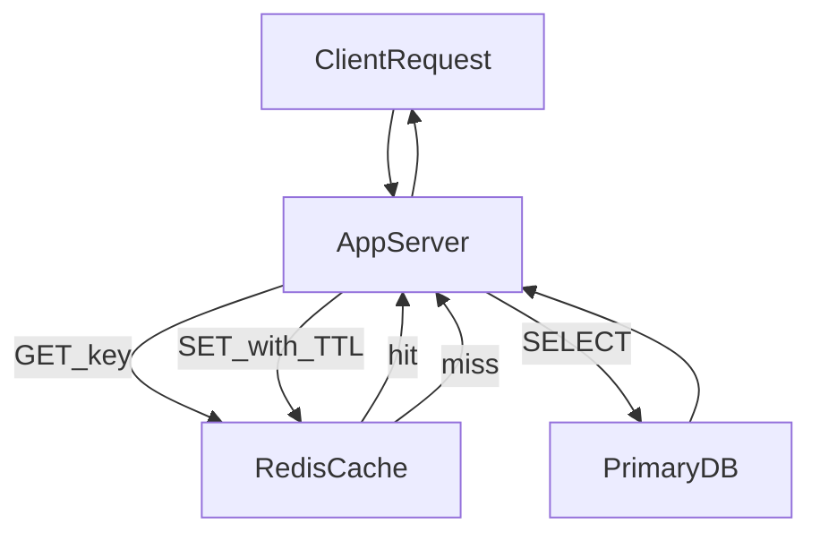

# D11-T002 — Cache hit ratio and cache efficiency

Topic ID: `D11-T002`
Domain: Redis and Caching
Subdomain: Cache hit ratio and cache efficiency
Importance: core
Complexity: intermediate
Dependencies: `D11-T001`, `D07-T001`, `D07-T002`, `D05-T001`, `D05-T002`
Execution status of the code in section F: not executed (documentation example)

## A. Topic Overview

Hit ratio is the fraction of read requests served from the cache without consulting the origin. Cache efficiency connects that ratio to memory used, eviction rate, and how much database load you actually removed.

The metric exists because a cache with a 99% hit ratio on a tiny traffic slice can leave the database unchanged, while a 70% ratio on the hottest endpoint can cut origin QPS in half. Interviewers want you to define the denominator and segment by endpoint.

Prerequisites: `D11-T001` (why caching works). This topic feeds cache-aside sizing (`D11-T003`) and operational dashboards.

## B. First-Principles Explanation

Define hits and misses at the application boundary where you know whether the origin was called. Hit ratio = hits / (hits + misses); misses always pay full origin latency and cost.

Efficiency also asks whether cached values are compact and whether TTL matches how often data changes. A low ratio often means wrong keys, too-short TTL, or data that is not reusable.

Skew means a small key set drives most traffic; your cache should cover that working set, not the entire table row count.

## C. Internal Working and Architecture

Instrument counters on the code path that decides hit versus miss, not only Redis INFO statistics. Break down ratio by key prefix, tenant, and API route.

Pair hit ratio with origin QPS, p99 miss latency, and Redis memory usage. Efficiency improves when bytes stored per removed origin read drops.

Use sampling for large payloads but keep hit/miss counts exact; they are cheap counters.

## D. Diagrams and Visual Models



Measure hits and misses on the same branch that touches Redis and the database.

## E. Examples and Analogies

A library records 90% hit rate on the front desk log, but only 5% of visitors use that desk—the building-wide line is unchanged. Segment metrics the way you segment traffic.

Caching huge JSON blobs for keys that never repeat is efficient in name only; memory rises while ratio stays low.

## F. Code Examples

File: `examples/d11_t002_metrics.py`

```python
hits = metrics.counter("cache_hits")
misses = metrics.counter("cache_misses")

def hit_ratio() -> float:
    h, m = hits.value(), misses.value()
    return h / (h + m) if (h + m) else 0.0
```

How to run: wire counters into your cache-aside wrapper and export to Prometheus.

Expected output: ratio approaches steady state after warm-up.

Important lines: divide only when hits+misses > 0. Log ratio per route label, not globally.

## G. Practical Backend Application

Dashboard hit ratio next to database QPS for the same endpoint. Alert when ratio drops after a deploy (key prefix change) or when miss p99 spikes.

Use ratio experiments to pick TTL: compare 60s versus 300s on staging with production-like skew.

## H. Advantages, Limitations and Trade-offs

| Choice | Benefit | Cost | Choose when | Avoid when |
| --- | --- | --- | --- | --- |
| Redis remote cache | Shared across instances, sub-ms reads | Network hop, ops burden | Read-heavy shared data | Strong consistency requirements without design |
| Local in-process cache | Fastest hit path | Stale per instance, no sharing | Immutable config, JVM metadata | User-specific data at scale |
| TTL only | Simple expiry | Thundering herd at expiry | Low-change catalog | Financial balances without invalidation |
| No cache | Always fresh, simpler mental model | DB cost and latency | Rare reads, tiny tables | Viral hot read endpoints |

High hit ratio with rising Redis memory may mean you cache objects that are too large; optimize payload before adding nodes.

## I. Common Mistakes and Misconceptions

- Reporting ratio without hits+misses denominators per endpoint.
- Using Redis keyspace hits as application hit ratio (misses are invisible).
- Celebrating 99% ratio on health-check keys while product endpoints miss.

## J. Debugging and Troubleshooting

Symptom: ratio dropped after deploy—check cache key schema and serialization. Symptom: ratio high but DB CPU high—you may cache the wrong query or miss a hotter endpoint.

## K. Interview Preparation

### Beginner

#### Q1. Define cache hit ratio.

**Answer:** Answer 'Define cache hit ratio.' by tying cache hit ratio to a concrete read or write path, not by defining Redis in one sentence. In production, cache hit ratio shows up when read traffic dominates, when the database is the bottleneck, or when you need shared ephemeral state across instances. A strong answer names what is cached, how long it lives, how it is invalidated, and what happens on a miss or Redis outage. Weak answers stop at 'Redis is fast' without hit ratio, consistency bounds, or operational limits.

#### Q2. Why can hit ratio be misleading?

**Answer:** Answer 'Why can hit ratio be misleading?' by tying cache hit ratio to a concrete read or write path, not by defining Redis in one sentence. In production, cache hit ratio shows up when read traffic dominates, when the database is the bottleneck, or when you need shared ephemeral state across instances. A strong answer names what is cached, how long it lives, how it is invalidated, and what happens on a miss or Redis outage. Weak answers stop at 'Redis is fast' without hit ratio, consistency bounds, or operational limits.

#### Q3. What is a good hit ratio?

**Answer:** Answer 'What is a good hit ratio?' by tying cache hit ratio to a concrete read or write path, not by defining Redis in one sentence. In production, cache hit ratio shows up when read traffic dominates, when the database is the bottleneck, or when you need shared ephemeral state across instances. A strong answer names what is cached, how long it lives, how it is invalidated, and what happens on a miss or Redis outage. Weak answers stop at 'Redis is fast' without hit ratio, consistency bounds, or operational limits.

#### Q4. How do you measure hits and misses?

**Answer:** Answer 'How do you measure hits and misses?' by tying cache hit ratio to a concrete read or write path, not by defining Redis in one sentence. In production, cache hit ratio shows up when read traffic dominates, when the database is the bottleneck, or when you need shared ephemeral state across instances. A strong answer names what is cached, how long it lives, how it is invalidated, and what happens on a miss or Redis outage. Weak answers stop at 'Redis is fast' without hit ratio, consistency bounds, or operational limits.

#### Q5. What is cache efficiency beyond ratio?

**Answer:** Answer 'What is cache efficiency beyond ratio?' by tying cache hit ratio to a concrete read or write path, not by defining Redis in one sentence. In production, cache hit ratio shows up when read traffic dominates, when the database is the bottleneck, or when you need shared ephemeral state across instances. A strong answer names what is cached, how long it lives, how it is invalidated, and what happens on a miss or Redis outage. Weak answers stop at 'Redis is fast' without hit ratio, consistency bounds, or operational limits.

### Intermediate

#### Q1. How do you size Redis from hit ratio data?

**Answer:** For cache hit ratio, interviewers want the exact sequence: client, cache layer, origin store, and backfill or invalidation. Mention metrics you would watch: hit ratio, p99 on miss path, evictions, memory, and error rate from the cache client. Call out consistency: stale reads, race between write and delete, and whether you accept eventual consistency for that entity. Tie the design to SLAs: a cache is a performance layer, not a second source of truth unless you deliberately make it one.

#### Q2. What SLO uses hit ratio?

**Answer:** For cache hit ratio, interviewers want the exact sequence: client, cache layer, origin store, and backfill or invalidation. Mention metrics you would watch: hit ratio, p99 on miss path, evictions, memory, and error rate from the cache client. Call out consistency: stale reads, race between write and delete, and whether you accept eventual consistency for that entity. Tie the design to SLAs: a cache is a performance layer, not a second source of truth unless you deliberately make it one.

#### Q3. How does object size affect efficiency?

**Answer:** For cache hit ratio, interviewers want the exact sequence: client, cache layer, origin store, and backfill or invalidation. Mention metrics you would watch: hit ratio, p99 on miss path, evictions, memory, and error rate from the cache client. Call out consistency: stale reads, race between write and delete, and whether you accept eventual consistency for that entity. Tie the design to SLAs: a cache is a performance layer, not a second source of truth unless you deliberately make it one.

#### Q4. What is the cost of a miss?

**Answer:** For cache hit ratio, interviewers want the exact sequence: client, cache layer, origin store, and backfill or invalidation. Mention metrics you would watch: hit ratio, p99 on miss path, evictions, memory, and error rate from the cache client. Call out consistency: stale reads, race between write and delete, and whether you accept eventual consistency for that entity. Tie the design to SLAs: a cache is a performance layer, not a second source of truth unless you deliberately make it one.

#### Q5. How do you A/B cache TTL?

**Answer:** For cache hit ratio, interviewers want the exact sequence: client, cache layer, origin store, and backfill or invalidation. Mention metrics you would watch: hit ratio, p99 on miss path, evictions, memory, and error rate from the cache client. Call out consistency: stale reads, race between write and delete, and whether you accept eventual consistency for that entity. Tie the design to SLAs: a cache is a performance layer, not a second source of truth unless you deliberately make it one.

### Advanced

#### Q1. Little's law and cache at scale.

**Answer:** Advanced cache hit ratio questions probe edge cases: hot keys, cluster slot moves, partial failures, and Lua script atomicity boundaries. Discuss failure modes: split brain on locks, stampede after TTL alignment, penetration on random keys, and avalanche when many keys expire together. Compare alternatives: local in-process cache versus Redis, read-through library versus hand-rolled cache-aside, Sentinel versus Cluster for your key size and QPS. Close with how you would test and roll out: shadow reads, canary TTL, chaos on Redis failover, and dashboards that prove the cache helps rather than hides a broken origin.

#### Q2. Hit ratio versus working set fit.

**Answer:** Advanced cache hit ratio questions probe edge cases: hot keys, cluster slot moves, partial failures, and Lua script atomicity boundaries. Discuss failure modes: split brain on locks, stampede after TTL alignment, penetration on random keys, and avalanche when many keys expire together. Compare alternatives: local in-process cache versus Redis, read-through library versus hand-rolled cache-aside, Sentinel versus Cluster for your key size and QPS. Close with how you would test and roll out: shadow reads, canary TTL, chaos on Redis failover, and dashboards that prove the cache helps rather than hides a broken origin.

#### Q3. Multi-tenant fairness in cache.

**Answer:** Advanced cache hit ratio questions probe edge cases: hot keys, cluster slot moves, partial failures, and Lua script atomicity boundaries. Discuss failure modes: split brain on locks, stampede after TTL alignment, penetration on random keys, and avalanche when many keys expire together. Compare alternatives: local in-process cache versus Redis, read-through library versus hand-rolled cache-aside, Sentinel versus Cluster for your key size and QPS. Close with how you would test and roll out: shadow reads, canary TTL, chaos on Redis failover, and dashboards that prove the cache helps rather than hides a broken origin.

#### Q4. When to shard cache by tenant.

**Answer:** Advanced cache hit ratio questions probe edge cases: hot keys, cluster slot moves, partial failures, and Lua script atomicity boundaries. Discuss failure modes: split brain on locks, stampede after TTL alignment, penetration on random keys, and avalanche when many keys expire together. Compare alternatives: local in-process cache versus Redis, read-through library versus hand-rolled cache-aside, Sentinel versus Cluster for your key size and QPS. Close with how you would test and roll out: shadow reads, canary TTL, chaos on Redis failover, and dashboards that prove the cache helps rather than hides a broken origin.

#### Q5. Efficiency of negative caching.

**Answer:** Advanced cache hit ratio questions probe edge cases: hot keys, cluster slot moves, partial failures, and Lua script atomicity boundaries. Discuss failure modes: split brain on locks, stampede after TTL alignment, penetration on random keys, and avalanche when many keys expire together. Compare alternatives: local in-process cache versus Redis, read-through library versus hand-rolled cache-aside, Sentinel versus Cluster for your key size and QPS. Close with how you would test and roll out: shadow reads, canary TTL, chaos on Redis failover, and dashboards that prove the cache helps rather than hides a broken origin.

### Scenarios

#### Q1. Hit ratio 99% but users see stale prices.

**Answer:** Scenario questions on cache hit ratio ask you to triage symptoms: rising DB CPU, flat hit ratio, latency spikes at the top of the hour, or inconsistent UI after writes. Start by separating client errors from server overload and checking whether misses increased or evictions spiked. Propose mitigations in order of safety: stop the bleeding (rate limit, extend TTL, circuit breaker to DB), then fix root cause (invalidation bug, hot key, bad key design). Document what you would verify after the fix: hit ratio recovered, replication lag acceptable, and no stale data past the product's tolerance.

#### Q2. Sudden ratio drop at midnight.

**Answer:** Scenario questions on cache hit ratio ask you to triage symptoms: rising DB CPU, flat hit ratio, latency spikes at the top of the hour, or inconsistent UI after writes. Start by separating client errors from server overload and checking whether misses increased or evictions spiked. Propose mitigations in order of safety: stop the bleeding (rate limit, extend TTL, circuit breaker to DB), then fix root cause (invalidation bug, hot key, bad key design). Document what you would verify after the fix: hit ratio recovered, replication lag acceptable, and no stale data past the product's tolerance.

#### Q3. One pod has low ratio.

**Answer:** Scenario questions on cache hit ratio ask you to triage symptoms: rising DB CPU, flat hit ratio, latency spikes at the top of the hour, or inconsistent UI after writes. Start by separating client errors from server overload and checking whether misses increased or evictions spiked. Propose mitigations in order of safety: stop the bleeding (rate limit, extend TTL, circuit breaker to DB), then fix root cause (invalidation bug, hot key, bad key design). Document what you would verify after the fix: hit ratio recovered, replication lag acceptable, and no stale data past the product's tolerance.

#### Q4. Cache added but DB CPU flat.

**Answer:** Scenario questions on cache hit ratio ask you to triage symptoms: rising DB CPU, flat hit ratio, latency spikes at the top of the hour, or inconsistent UI after writes. Start by separating client errors from server overload and checking whether misses increased or evictions spiked. Propose mitigations in order of safety: stop the bleeding (rate limit, extend TTL, circuit breaker to DB), then fix root cause (invalidation bug, hot key, bad key design). Document what you would verify after the fix: hit ratio recovered, replication lag acceptable, and no stale data past the product's tolerance.

#### Q5. Ratio good on staging, bad in prod.

**Answer:** Scenario questions on cache hit ratio ask you to triage symptoms: rising DB CPU, flat hit ratio, latency spikes at the top of the hour, or inconsistent UI after writes. Start by separating client errors from server overload and checking whether misses increased or evictions spiked. Propose mitigations in order of safety: stop the bleeding (rate limit, extend TTL, circuit breaker to DB), then fix root cause (invalidation bug, hot key, bad key design). Document what you would verify after the fix: hit ratio recovered, replication lag acceptable, and no stale data past the product's tolerance.

### Follow-ups

#### Q1. Link to TTL topic?

**Answer:** This follow-up links cache hit ratio to neighboring topics such as database indexing, API rate limits, or message-driven invalidation. Explain the dependency direction: the primary database remains authoritative unless you adopt write-through with strict contracts. Mention cross-region concerns if relevant: local caches, global Redis, and consistency windows that product must accept. Point to the next study item in domain 11 so the interviewer sees you know the curriculum, not isolated trivia.

#### Q2. How does eviction affect ratio?

**Answer:** This follow-up links cache hit ratio to neighboring topics such as database indexing, API rate limits, or message-driven invalidation. Explain the dependency direction: the primary database remains authoritative unless you adopt write-through with strict contracts. Mention cross-region concerns if relevant: local caches, global Redis, and consistency windows that product must accept. Point to the next study item in domain 11 so the interviewer sees you know the curriculum, not isolated trivia.

#### Q3. Relation to CDN cache metrics?

**Answer:** This follow-up links cache hit ratio to neighboring topics such as database indexing, API rate limits, or message-driven invalidation. Explain the dependency direction: the primary database remains authoritative unless you adopt write-through with strict contracts. Mention cross-region concerns if relevant: local caches, global Redis, and consistency windows that product must accept. Point to the next study item in domain 11 so the interviewer sees you know the curriculum, not isolated trivia.

## L. Practical Exercises

Solutions are in `EXERCISES/solutions/D11-T002.md`. Try these before opening that file.

### Exercise 1 — implementation

Emit hit/miss counters and compute ratio in Grafana.

### Exercise 2 — debugging

Ratio fell after adding a new query param to URLs without updating cache keys.

### Exercise 3 — trade-off

Pick TTL 60s vs 3600s for product metadata given 5-minute admin update SLA.

## M. Revision Notes

- Hit ratio needs hits and misses.
- Segment metrics by endpoint.
- Efficiency includes bytes and origin savings.

Flashcards:

- What is a good ratio? Depends on working set fit, not a universal 95%.

## N. Related Topics

Understand this before: `D11-T001`.

This topic supports: `D11-T003` cache-aside patterns.

Often confused with: Hit rate in Redis INFO versus application hit ratio.

Interviewers combine this with: `D13-T015` observability, `D07-T019` indexes.

## O. Completion Criteria

- Compute hit ratio from app metrics.
- Explain misleading high ratio.
- Pick TTL using SLA.
