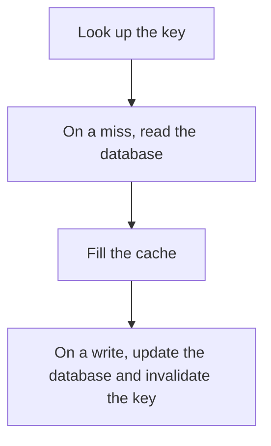

# D11-T003 — Cache-aside

Topic ID: `D11-T003`
Domain: Redis and Caching
Subdomain: Cache-aside
Importance: core
Complexity: intermediate
Dependencies: `D11-T002`, `D11-T001`, `D07-T001`, `D07-T002`, `D05-T001`, `D05-T002`
Execution status of the code in section F: unexecuted

## A. Topic Overview

Cache-aside means the application reads the cache first and, on a miss, reads the database and writes the cache. The database is the source of truth. The cache is filled by readers. A write updates the database and then deletes or updates the cache. The race is a reader refilling the cache with stale data after a writer has deleted it.

In production this shows up as follows: A product page reads Redis, falls back to PostgreSQL, and stores the JSON for 60 seconds. An update deletes the key. A TTL caps how long a lost delete can linger.

Interviewers use Cache-aside to see whether you can state the failure mode, not only the definition. The failure to name is: a stale fill that overwrites a newer invalidation, so the cache serves old data until TTL

Prerequisites: `D11-T002`, `D11-T001`, `D07-T001`, `D07-T002`, `D05-T001`, `D05-T002`. Later notes should link here instead of repeating the mechanism.

## B. First-Principles Explanation

Cache-aside means the application reads the cache first and, on a miss, reads the database and writes the cache. The database is the source of truth. The cache is filled by readers. A write updates the database and then deletes or updates the cache. The race is a reader refilling the cache with stale data after a writer has deleted it.

The useful picture is: Cache-aside is checking your pocket notebook and, if the page is blank, copying it from the official ledger and keeping the copy for a minute.

What has to be true:

1. Look up the key
2. On a miss, read the database
3. Fill the cache
4. On a write, update the database and invalidate the key

It works when those steps preserve one invariant. It fails when a stale fill that overwrites a newer invalidation, so the cache serves old data until TTL. The alternative is: you write only to the cache and call it cache-aside

## C. Internal Working and Architecture

Components involved: the caller, the state Cache-aside mutates or reads, and the observer that reports hit ratio and stale-read incidents after writes.

Execution:

1. Look up the key
2. On a miss, read the database
3. Fill the cache
4. On a write, update the database and invalidate the key

Data moves only along that path. A retry re-enters at step 1, so the operation must say what a duplicate does. Memory and locks stay inside this mechanism. Callers see the result or a typed error, not a half-updated invariant.

State to remember: choose this when reads dominate and the database remains the source of truth. Do not choose it when you write only to the cache and call it cache-aside.

## D. Diagrams and Visual Models



Read the diagram from top to bottom. Each box is one step of Cache-aside. The failure mode (a stale fill that overwrites a newer invalidation, so the cache serves old data until TTL) is what you look for when a later box never happens or happens twice.

## E. Examples and Analogies

Analogy: Cache-aside is checking your pocket notebook and, if the page is blank, copying it from the official ledger and keeping the copy for a minute.

Production example: A product page reads Redis, falls back to PostgreSQL, and stores the JSON for 60 seconds. An update deletes the key. A TTL caps how long a lost delete can linger.

A small counterexample is enough in an interview. Show the input, apply the steps, and show the broken outcome if someone uses the mechanism outside its rule: a stale fill that overwrites a newer invalidation, so the cache serves old data until TTL.

## F. Code Examples

The snippet is labeled unexecuted. It illustrates the shape of the idea. It is not a benchmark and it embeds no secret.

```python
def cache_aside_get(cache, db, key):
    value = cache.get(key)
    if value is None:
        value = db.get(key)
        cache.set(key, value, ttl=60)
    return value
```

After the snippet, check hit ratio and stale-read incidents after writes. If that signal moves the wrong way, the snippet is the wrong tool for the workload.

## G. Practical Backend Application

Use Cache-aside in a service when reads dominate and the database remains the source of truth.

A typical place is the production case already stated: A product page reads Redis, falls back to PostgreSQL, and stores the JSON for 60 seconds. An update deletes the key. A TTL caps how long a lost delete can linger.

Operationally you alert on hit ratio and stale-read incidents after writes. You do not alert only on process uptime. The dashboard should show the failure mode, a success rate, and the saturation signal (queue depth, lock wait, or latency) that predicts it.

## H. Advantages, Limitations and Trade-offs

| Choice | Benefit | Cost | Choose when | Avoid when |
| --- | --- | --- | --- | --- |
| Apply Cache-aside | reads dominate and the database remains the source of truth | Extra moving parts and a new failure mode | The failure you are preventing is already real | you write only to the cache and call it cache-aside |
| Simpler alternative | Less code and fewer dependencies | a stale fill that overwrites a newer invalidation, so the cache serves old data until TTL | The workload does not hit the limit | The invariant must hold under concurrency or failure |

Cache-aside is a trade. State the benefit and the cost in the same sentence when you propose it in a design review.

## I. Common Mistakes and Misconceptions

- No TTL.
- Updating the cache before the database commit.
- Ignoring the stale-fill race.
- Treating a diagram of Cache-aside as proof that the invariant holds in production.
- Copying a default configuration without naming hit ratio and stale-read incidents after writes.

## J. Debugging and Troubleshooting

Symptom: a stale fill that overwrites a newer invalidation, so the cache serves old data until TTL

First check: hit ratio and stale-read incidents after writes.

Then compare one healthy instance against one unhealthy instance. Confirm whether retries are duplicating work. Confirm whether a timeout is shorter than the work. Fix the invariant, then watch the same metric for a full peak, not only for the next minute.

Useful questions: did the step order in section C actually happen, or did a caller skip a step? Did a deploy change the data shape that Cache-aside assumes?

## K. Interview Preparation

### Beginner

#### Q1. What problem does Cache-aside solve?

**Answer:** Cache-aside means the application reads the cache first and, on a miss, reads the database and writes the cache. The database is the source of truth. The cache is filled by readers. A write updates the database and then deletes or updates the cache. The race is a reader refilling the cache with stale data after a writer has deleted it. Without it, the usual backend failure is: a stale fill that overwrites a newer invalidation, so the cache serves old data until TTL.

#### Q2. Where does Cache-aside sit on a request path?

**Answer:** Cache-aside is not a library you sprinkle on every call. reads dominate and the database remains the source of truth You notice it when hit ratio and stale-read incidents after writes. Name the constraint that makes this choice correct. Say what you would measure to confirm it.

#### Q3. Give a concrete example of Cache-aside.

**Answer:** A product page reads Redis, falls back to PostgreSQL, and stores the JSON for 60 seconds. An update deletes the key. A TTL caps how long a lost delete can linger. Walk the input, the state change, and the observable output.

#### Q4. What is a common mix-up around Cache-aside?

**Answer:** a stale fill that overwrites a newer invalidation, so the cache serves old data until TTL The corrective check is hit ratio and stale-read incidents after writes. Name the constraint that makes this choice correct. Say what you would measure to confirm it. Say which alternative you rejected and why.

#### Q5. When would you skip Cache-aside?

**Answer:** you write only to the cache and call it cache-aside Skipping is a decision with a measured cost, not a slogan. Name the constraint that makes this choice correct. Say what you would measure to confirm it. Say which alternative you rejected and why.

### Intermediate

#### Q1. What invariant makes Cache-aside correct?

**Answer:** Cache-aside means the application reads the cache first and, on a miss, reads the database and writes the cache. The database is the source of truth. The cache is filled by readers. A write updates the database and then deletes or updates the cache. The race is a reader refilling the cache with stale data after a writer has deleted it. State the invariant before you name the tool.

#### Q2. How do you test Cache-aside?

**Answer:** Assert the failure mode directly: a stale fill that overwrites a newer invalidation, so the cache serves old data until TTL. The assertion should watch hit ratio and stale-read incidents after writes. Include a concurrent or retry case if the bug only appears then. Name the constraint that makes this choice correct.

#### Q3. What signal tells you Cache-aside is misbehaving in production?

**Answer:** Watch hit ratio and stale-read incidents after writes. The user-visible symptom is usually a stale fill that overwrites a newer invalidation, so the cache serves old data until TTL. Name the constraint that makes this choice correct. Say what you would measure to confirm it.

#### Q4. How would you introduce Cache-aside into a legacy service?

**Answer:** reads dominate and the database remains the source of truth Ship it behind a metric so you can compare the old path. Roll back if a stale fill that overwrites a newer invalidation, so the cache serves old data until TTL gets worse. Name the constraint that makes this choice correct. Say what you would measure to confirm it.

#### Q5. What do you trade away by choosing Cache-aside?

**Answer:** reads dominate and the database remains the source of truth you write only to the cache and call it cache-aside Say the cost in latency, storage, or operational load. Name the constraint that makes this choice correct. Say what you would measure to confirm it. Say which alternative you rejected and why.

### Advanced

#### Q1. What breaks if a dependency of Cache-aside is slow or down?

**Answer:** a stale fill that overwrites a newer invalidation, so the cache serves old data until TTL Degrade using the rule: you write only to the cache and call it cache-aside. Timeouts must be shorter than the caller's deadline. Name the constraint that makes this choice correct. Say what you would measure to confirm it.

#### Q2. How does Cache-aside behave under retries?

**Answer:** Retries repeat work, so Cache-aside must define what a duplicate does. a stale fill that overwrites a newer invalidation, so the cache serves old data until TTL Idempotency keys or fences belong next to the write, not in a comment. Name the constraint that makes this choice correct. Say what you would measure to confirm it.

#### Q3. What is the capacity limit of Cache-aside?

**Answer:** The limit shows up as hit ratio and stale-read incidents after writes. Add capacity only after you know whether the bottleneck is CPU, lock wait, or network. Name the constraint that makes this choice correct. Say what you would measure to confirm it.

#### Q4. How do you evolve Cache-aside without a flag day?

**Answer:** reads dominate and the database remains the source of truth Version the contract or the on-disk format. Readers should tolerate one old and one new shape during the rollout. Name the constraint that makes this choice correct. Say what you would measure to confirm it.

#### Q5. What security or correctness bug hides inside Cache-aside?

**Answer:** a stale fill that overwrites a newer invalidation, so the cache serves old data until TTL Check authorization and tenancy at the same boundary as the mechanism. A cache or queue must not widen who can read the data. Name the constraint that makes this choice correct. Say what you would measure to confirm it.

### Scenario

#### Q1. Incident: a stale fill that overwrites a newer invalidation, so the cache serves old data until TTL. What do you check first?

**Answer:** Start with hit ratio and stale-read incidents after writes. Compare a good host and a bad host before you restart anything. Cache-aside means the application reads the cache first and, on a miss, reads the database and writes the cache. The database is the source of truth. The cache is filled by readers. A write updates the database and then deletes or updates the cache. The race is a reader refilling the cache with stale data after a writer has deleted it.

#### Q2. A reviewer wants the clever version. What data settles it?

**Answer:** reads dominate and the database remains the source of truth you write only to the cache and call it cache-aside Bring hit ratio and stale-read incidents after writes from a load test or from production, not a slogan. Name the constraint that makes this choice correct. Say what you would measure to confirm it. Say which alternative you rejected and why.

#### Q3. You have one hour to explain Cache-aside at a whiteboard.

**Answer:** Draw the happy path in four boxes. Then draw the failure: a stale fill that overwrites a newer invalidation, so the cache serves old data until TTL. End with the metric you would page on. Name the constraint that makes this choice correct.

#### Q4. The bug only appears under two concurrent callers.

**Answer:** a stale fill that overwrites a newer invalidation, so the cache serves old data until TTL Reproduce with a barrier so both sides enter the critical window. Confirm the fix with hit ratio and stale-read incidents after writes. Name the constraint that makes this choice correct. Say what you would measure to confirm it.

#### Q5. Leadership wants this on every service next week.

**Answer:** you write only to the cache and call it cache-aside reads dominate and the database remains the source of truth Roll it out where the failure mode is already hurting users. Name the constraint that makes this choice correct. Say what you would measure to confirm it. Say which alternative you rejected and why.

### Follow-up

#### Q1. What did you assume about the data size or the clock?

**Answer:** Cache-aside means the application reads the cache first and, on a miss, reads the database and writes the cache. The database is the source of truth. The cache is filled by readers. A write updates the database and then deletes or updates the cache. The race is a reader refilling the cache with stale data after a writer has deleted it. Clocks are not a total order across machines. State whether the algorithm needs bounded size or a single leader.

#### Q2. What would you measure after the change ships?

**Answer:** Page on hit ratio and stale-read incidents after writes. Keep a before/after dashboard for one week. Alert on the failure mode, not only on CPU. Name the constraint that makes this choice correct.

#### Q3. Which neighboring topic did you deliberately not re-teach?

**Answer:** This note owns Cache-aside. Related identifiers are in section N. Shared ideas are linked, not copied. Name the constraint that makes this choice correct.

## L. Practical Exercises

Solutions are in `EXERCISES/solutions/D11-T003.md`, not in this section.

1. Whiteboard the four steps of Cache-aside and mark where `a stale fill that overwrites a newer invalidation, so the cache serves old data until TTL` enters.
2. Read the snippet in section F and write the assertion that would catch that failure. The assertion must mention `hit ratio and stale-read incidents after writes`.
3. Argue for or against using Cache-aside on a service you know. Use the choose and avoid rows from section H. Do not appeal to popularity.

## M. Revision Notes

- Mechanism: Cache-aside means the application reads the cache first and, on a miss, reads the database and writes the cache.
- Failure: a stale fill that overwrites a newer invalidation, so the cache serves old data until TTL
- Metric: hit ratio and stale-read incidents after writes
- Choose when: reads dominate and the database remains the source of truth
- Avoid when: you write only to the cache and call it cache-aside

## N. Related Topics

Dependencies to review first: `D11-T002`, `D11-T001`, `D07-T001`, `D07-T002`, `D05-T001`, `D05-T002`.

Shared ideas stay in those notes. This note does not restate them.

## O. Completion Criteria

- You can explain Cache-aside without reading this note, including the failure mode.
- You can draw the diagram in section D from memory.
- You can say when not to use it, using the avoid condition in section H.
- You can name the metric you would watch after shipping it.
