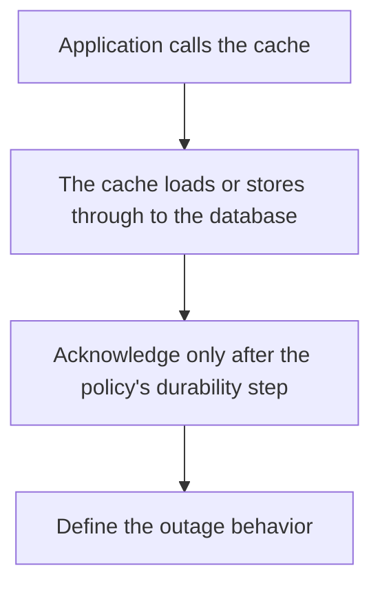

# D11-T004 — Read-through and write-through

Topic ID: `D11-T004`
Domain: Redis and Caching
Subdomain: Read-through and write-through
Importance: core
Complexity: intermediate
Dependencies: `D11-T003`, `D11-T001`, `D07-T001`, `D07-T002`, `D05-T001`, `D05-T002`
Execution status of the code in section F: unexecuted

## A. Topic Overview

Read-through loads a missing key inside the cache layer, which calls the database itself. Write-through writes the cache and the database together before acknowledging. The application talks to the cache as if it were the store. Write-through favors consistency over write latency. Read-through favors a simpler application read path. Both still need a failure policy when the database is down.

In production this shows up as follows: A managed cache in front of a user-profile table uses read-through so every service shares one loader. Write-through is used for a setting that must not acknowledge until the database commit returns.

Interviewers use Read-through and write-through to see whether you can state the failure mode, not only the definition. The failure to name is: write-through latency equal to the database on every write, or a read-through loader that stampedes

Prerequisites: `D11-T003`, `D11-T001`, `D07-T001`, `D07-T002`, `D05-T001`, `D05-T002`. Later notes should link here instead of repeating the mechanism.

## B. First-Principles Explanation

Read-through loads a missing key inside the cache layer, which calls the database itself. Write-through writes the cache and the database together before acknowledging. The application talks to the cache as if it were the store. Write-through favors consistency over write latency. Read-through favors a simpler application read path. Both still need a failure policy when the database is down.

The useful picture is: Read-through is a librarian who fetches the archive copy when the shelf is empty. Write-through is refusing to say the book is filed until both the shelf and the archive are updated.

What has to be true:

1. Application calls the cache
2. The cache loads or stores through to the database
3. Acknowledge only after the policy's durability step
4. Define the outage behavior

It works when those steps preserve one invariant. It fails when write-through latency equal to the database on every write, or a read-through loader that stampedes. The alternative is: the write path cannot afford to wait for the database and you still call it write-through

## C. Internal Working and Architecture

Components involved: the caller, the state Read-through and write-through mutates or reads, and the observer that reports fraction of reads served from memory and write latency added by the database round trip.

Execution:

1. Application calls the cache
2. The cache loads or stores through to the database
3. Acknowledge only after the policy's durability step
4. Define the outage behavior

Data moves only along that path. A retry re-enters at step 1, so the operation must say what a duplicate does. Memory and locks stay inside this mechanism. Callers see the result or a typed error, not a half-updated invariant.

State to remember: choose this when you want one loading policy shared by all callers. Do not choose it when the write path cannot afford to wait for the database and you still call it write-through.

## D. Diagrams and Visual Models



Read the diagram from top to bottom. Each box is one step of Read-through and write-through. The failure mode (write-through latency equal to the database on every write, or a read-through loader that stampedes) is what you look for when a later box never happens or happens twice.

## E. Examples and Analogies

Analogy: Read-through is a librarian who fetches the archive copy when the shelf is empty. Write-through is refusing to say the book is filed until both the shelf and the archive are updated.

Production example: A managed cache in front of a user-profile table uses read-through so every service shares one loader. Write-through is used for a setting that must not acknowledge until the database commit returns.

A small counterexample is enough in an interview. Show the input, apply the steps, and show the broken outcome if someone uses the mechanism outside its rule: write-through latency equal to the database on every write, or a read-through loader that stampedes.

## F. Code Examples

The snippet is labeled unexecuted. It illustrates the shape of the idea. It is not a benchmark and it embeds no secret.

```python
def write_through(cache, db, key, value):
    db.put(key, value)
    cache.set(key, value)
```

After the snippet, check fraction of reads served from memory and write latency added by the database round trip. If that signal moves the wrong way, the snippet is the wrong tool for the workload.

## G. Practical Backend Application

Use Read-through and write-through in a service when you want one loading policy shared by all callers.

A typical place is the production case already stated: A managed cache in front of a user-profile table uses read-through so every service shares one loader. Write-through is used for a setting that must not acknowledge until the database commit returns.

Operationally you alert on fraction of reads served from memory and write latency added by the database round trip. You do not alert only on process uptime. The dashboard should show the failure mode, a success rate, and the saturation signal (queue depth, lock wait, or latency) that predicts it.

## H. Advantages, Limitations and Trade-offs

| Choice | Benefit | Cost | Choose when | Avoid when |
| --- | --- | --- | --- | --- |
| Apply Read-through and write-through | you want one loading policy shared by all callers | Extra moving parts and a new failure mode | The failure you are preventing is already real | the write path cannot afford to wait for the database and you still call it write-through |
| Simpler alternative | Less code and fewer dependencies | write-through latency equal to the database on every write, or a read-through loader that stampedes | The workload does not hit the limit | The invariant must hold under concurrency or failure |

Read-through and write-through is a trade. State the benefit and the cost in the same sentence when you propose it in a design review.

## I. Common Mistakes and Misconceptions

- Acknowledging a write-through before the database commit.
- A loader with no single-flight.
- Hiding database errors behind a cache hit of stale data without saying so.
- Treating a diagram of Read-through and write-through as proof that the invariant holds in production.
- Copying a default configuration without naming fraction of reads served from memory and write latency added by the database round trip.

## J. Debugging and Troubleshooting

Symptom: write-through latency equal to the database on every write, or a read-through loader that stampedes

First check: fraction of reads served from memory and write latency added by the database round trip.

Then compare one healthy instance against one unhealthy instance. Confirm whether retries are duplicating work. Confirm whether a timeout is shorter than the work. Fix the invariant, then watch the same metric for a full peak, not only for the next minute.

Useful questions: did the step order in section C actually happen, or did a caller skip a step? Did a deploy change the data shape that Read-through and write-through assumes?

## K. Interview Preparation

### Beginner

#### Q1. What problem does Read-through and write-through solve?

**Answer:** Read-through loads a missing key inside the cache layer, which calls the database itself. Write-through writes the cache and the database together before acknowledging. The application talks to the cache as if it were the store. Write-through favors consistency over write latency. Read-through favors a simpler application read path. Both still need a failure policy when the database is down. Without it, the usual backend failure is: write-through latency equal to the database on every write, or a read-through loader that stampedes.

#### Q2. Where does Read-through and write-through sit on a request path?

**Answer:** Read-through and write-through is not a library you sprinkle on every call. you want one loading policy shared by all callers You notice it when fraction of reads served from memory and write latency added by the database round trip. Name the constraint that makes this choice correct. Say what you would measure to confirm it.

#### Q3. Give a concrete example of Read-through and write-through.

**Answer:** A managed cache in front of a user-profile table uses read-through so every service shares one loader. Write-through is used for a setting that must not acknowledge until the database commit returns. Walk the input, the state change, and the observable output. Name the constraint that makes this choice correct.

#### Q4. What is a common mix-up around Read-through and write-through?

**Answer:** write-through latency equal to the database on every write, or a read-through loader that stampedes The corrective check is fraction of reads served from memory and write latency added by the database round trip. Name the constraint that makes this choice correct. Say what you would measure to confirm it. Say which alternative you rejected and why.

#### Q5. When would you skip Read-through and write-through?

**Answer:** the write path cannot afford to wait for the database and you still call it write-through Skipping is a decision with a measured cost, not a slogan. Name the constraint that makes this choice correct. Say what you would measure to confirm it. Say which alternative you rejected and why.

### Intermediate

#### Q1. What invariant makes Read-through and write-through correct?

**Answer:** Read-through loads a missing key inside the cache layer, which calls the database itself. Write-through writes the cache and the database together before acknowledging. The application talks to the cache as if it were the store. Write-through favors consistency over write latency. Read-through favors a simpler application read path. Both still need a failure policy when the database is down. State the invariant before you name the tool.

#### Q2. How do you test Read-through and write-through?

**Answer:** Assert the failure mode directly: write-through latency equal to the database on every write, or a read-through loader that stampedes. The assertion should watch fraction of reads served from memory and write latency added by the database round trip. Include a concurrent or retry case if the bug only appears then. Name the constraint that makes this choice correct.

#### Q3. What signal tells you Read-through and write-through is misbehaving in production?

**Answer:** Watch fraction of reads served from memory and write latency added by the database round trip. The user-visible symptom is usually write-through latency equal to the database on every write, or a read-through loader that stampedes. Name the constraint that makes this choice correct. Say what you would measure to confirm it.

#### Q4. How would you introduce Read-through and write-through into a legacy service?

**Answer:** you want one loading policy shared by all callers Ship it behind a metric so you can compare the old path. Roll back if write-through latency equal to the database on every write, or a read-through loader that stampedes gets worse. Name the constraint that makes this choice correct. Say what you would measure to confirm it.

#### Q5. What do you trade away by choosing Read-through and write-through?

**Answer:** you want one loading policy shared by all callers the write path cannot afford to wait for the database and you still call it write-through Say the cost in latency, storage, or operational load. Name the constraint that makes this choice correct. Say what you would measure to confirm it. Say which alternative you rejected and why.

### Advanced

#### Q1. What breaks if a dependency of Read-through and write-through is slow or down?

**Answer:** write-through latency equal to the database on every write, or a read-through loader that stampedes Degrade using the rule: the write path cannot afford to wait for the database and you still call it write-through. Timeouts must be shorter than the caller's deadline. Name the constraint that makes this choice correct. Say what you would measure to confirm it.

#### Q2. How does Read-through and write-through behave under retries?

**Answer:** Retries repeat work, so Read-through and write-through must define what a duplicate does. write-through latency equal to the database on every write, or a read-through loader that stampedes Idempotency keys or fences belong next to the write, not in a comment. Name the constraint that makes this choice correct. Say what you would measure to confirm it.

#### Q3. What is the capacity limit of Read-through and write-through?

**Answer:** The limit shows up as fraction of reads served from memory and write latency added by the database round trip. Add capacity only after you know whether the bottleneck is CPU, lock wait, or network. Name the constraint that makes this choice correct. Say what you would measure to confirm it.

#### Q4. How do you evolve Read-through and write-through without a flag day?

**Answer:** you want one loading policy shared by all callers Version the contract or the on-disk format. Readers should tolerate one old and one new shape during the rollout. Name the constraint that makes this choice correct. Say what you would measure to confirm it.

#### Q5. What security or correctness bug hides inside Read-through and write-through?

**Answer:** write-through latency equal to the database on every write, or a read-through loader that stampedes Check authorization and tenancy at the same boundary as the mechanism. A cache or queue must not widen who can read the data. Name the constraint that makes this choice correct. Say what you would measure to confirm it.

### Scenario

#### Q1. Incident: write-through latency equal to the database on every write, or a read-through loader that stampedes. What do you check first?

**Answer:** Start with fraction of reads served from memory and write latency added by the database round trip. Compare a good host and a bad host before you restart anything. Read-through loads a missing key inside the cache layer, which calls the database itself. Write-through writes the cache and the database together before acknowledging. The application talks to the cache as if it were the store. Write-through favors consistency over write latency. Read-through favors a simpler application read path. Both still need a failure policy when the database is down.

#### Q2. A reviewer wants the clever version. What data settles it?

**Answer:** you want one loading policy shared by all callers the write path cannot afford to wait for the database and you still call it write-through Bring fraction of reads served from memory and write latency added by the database round trip from a load test or from production, not a slogan. Name the constraint that makes this choice correct. Say what you would measure to confirm it. Say which alternative you rejected and why.

#### Q3. You have one hour to explain Read-through and write-through at a whiteboard.

**Answer:** Draw the happy path in four boxes. Then draw the failure: write-through latency equal to the database on every write, or a read-through loader that stampedes. End with the metric you would page on. Name the constraint that makes this choice correct.

#### Q4. The bug only appears under two concurrent callers.

**Answer:** write-through latency equal to the database on every write, or a read-through loader that stampedes Reproduce with a barrier so both sides enter the critical window. Confirm the fix with fraction of reads served from memory and write latency added by the database round trip. Name the constraint that makes this choice correct. Say what you would measure to confirm it.

#### Q5. Leadership wants this on every service next week.

**Answer:** the write path cannot afford to wait for the database and you still call it write-through you want one loading policy shared by all callers Roll it out where the failure mode is already hurting users. Name the constraint that makes this choice correct. Say what you would measure to confirm it. Say which alternative you rejected and why.

### Follow-up

#### Q1. What did you assume about the data size or the clock?

**Answer:** Read-through loads a missing key inside the cache layer, which calls the database itself. Write-through writes the cache and the database together before acknowledging. The application talks to the cache as if it were the store. Write-through favors consistency over write latency. Read-through favors a simpler application read path. Both still need a failure policy when the database is down. Clocks are not a total order across machines. State whether the algorithm needs bounded size or a single leader.

#### Q2. What would you measure after the change ships?

**Answer:** Page on fraction of reads served from memory and write latency added by the database round trip. Keep a before/after dashboard for one week. Alert on the failure mode, not only on CPU. Name the constraint that makes this choice correct.

#### Q3. Which neighboring topic did you deliberately not re-teach?

**Answer:** This note owns Read-through and write-through. Related identifiers are in section N. Shared ideas are linked, not copied. Name the constraint that makes this choice correct.

## L. Practical Exercises

Solutions are in `EXERCISES/solutions/D11-T004.md`, not in this section.

1. Whiteboard the four steps of Read-through and write-through and mark where `write-through latency equal to the database on every write, or a read-through loader that stampedes` enters.
2. Read the snippet in section F and write the assertion that would catch that failure. The assertion must mention `fraction of reads served from memory and write latency added by the database round trip`.
3. Argue for or against using Read-through and write-through on a service you know. Use the choose and avoid rows from section H. Do not appeal to popularity.

## M. Revision Notes

- Mechanism: Read-through loads a missing key inside the cache layer, which calls the database itself.
- Failure: write-through latency equal to the database on every write, or a read-through loader that stampedes
- Metric: fraction of reads served from memory and write latency added by the database round trip
- Choose when: you want one loading policy shared by all callers
- Avoid when: the write path cannot afford to wait for the database and you still call it write-through

## N. Related Topics

Dependencies to review first: `D11-T003`, `D11-T001`, `D07-T001`, `D07-T002`, `D05-T001`, `D05-T002`.

Shared ideas stay in those notes. This note does not restate them.

## O. Completion Criteria

- You can explain Read-through and write-through without reading this note, including the failure mode.
- You can draw the diagram in section D from memory.
- You can say when not to use it, using the avoid condition in section H.
- You can name the metric you would watch after shipping it.
