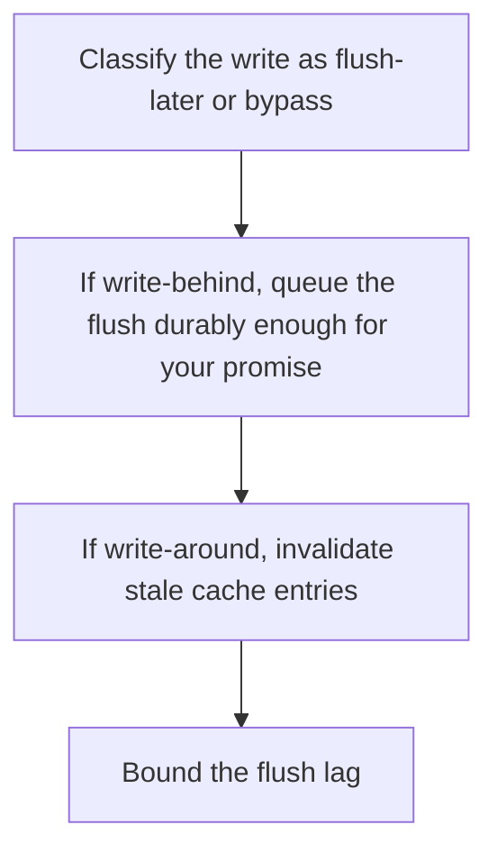

# D11-T005 — Write-behind and write-around

Topic ID: `D11-T005`
Domain: Redis and Caching
Subdomain: Write-behind and write-around
Importance: core
Complexity: intermediate
Dependencies: `D11-T004`, `D11-T001`, `D07-T001`, `D07-T002`, `D05-T001`, `D05-T002`
Execution status of the code in section F: unexecuted

## A. Topic Overview

Write-behind acknowledges the write in the cache and flushes to the database later. Write-around writes only to the database and leaves the cache to be filled by a later read, which avoids polluting the cache with data nobody reads. Write-behind can lose acknowledged writes if the cache dies before the flush. Write-around makes the next read cold on purpose.

In production this shows up as follows: Counters that can be rebuilt may use write-behind. A payment must not. Bulk imports that will not be read soon use write-around so they do not evict the hot catalog.

Interviewers use Write-behind and write-around to see whether you can state the failure mode, not only the definition. The failure to name is: a crashed cache that held acknowledged write-behind data which never reached the database

Prerequisites: `D11-T004`, `D11-T001`, `D07-T001`, `D07-T002`, `D05-T001`, `D05-T002`. Later notes should link here instead of repeating the mechanism.

## B. First-Principles Explanation

Write-behind acknowledges the write in the cache and flushes to the database later. Write-around writes only to the database and leaves the cache to be filled by a later read, which avoids polluting the cache with data nobody reads. Write-behind can lose acknowledged writes if the cache dies before the flush. Write-around makes the next read cold on purpose.

The useful picture is: Write-behind is taking a customer's order on a notepad and filing it in the ledger later. If the notepad burns, the order is gone. Write-around is filing only in the ledger and not cluttering the counter.

What has to be true:

1. Classify the write as flush-later or bypass
2. If write-behind, queue the flush durably enough for your promise
3. If write-around, invalidate stale cache entries
4. Bound the flush lag

It works when those steps preserve one invariant. It fails when a crashed cache that held acknowledged write-behind data which never reached the database. The alternative is: you need the acknowledgment to mean the database has the write

## C. Internal Working and Architecture

Components involved: the caller, the state Write-behind and write-around mutates or reads, and the observer that reports flush lag and data loss on a cache restart.

Execution:

1. Classify the write as flush-later or bypass
2. If write-behind, queue the flush durably enough for your promise
3. If write-around, invalidate stale cache entries
4. Bound the flush lag

Data moves only along that path. A retry re-enters at step 1, so the operation must say what a duplicate does. Memory and locks stay inside this mechanism. Callers see the result or a typed error, not a half-updated invariant.

State to remember: choose this when you have explicitly chosen to risk or to bypass the cache. Do not choose it when you need the acknowledgment to mean the database has the write.

## D. Diagrams and Visual Models



Read the diagram from top to bottom. Each box is one step of Write-behind and write-around. The failure mode (a crashed cache that held acknowledged write-behind data which never reached the database) is what you look for when a later box never happens or happens twice.

## E. Examples and Analogies

Analogy: Write-behind is taking a customer's order on a notepad and filing it in the ledger later. If the notepad burns, the order is gone. Write-around is filing only in the ledger and not cluttering the counter.

Production example: Counters that can be rebuilt may use write-behind. A payment must not. Bulk imports that will not be read soon use write-around so they do not evict the hot catalog.

A small counterexample is enough in an interview. Show the input, apply the steps, and show the broken outcome if someone uses the mechanism outside its rule: a crashed cache that held acknowledged write-behind data which never reached the database.

## F. Code Examples

The snippet is labeled unexecuted. It illustrates the shape of the idea. It is not a benchmark and it embeds no secret.

```python
def write_around(db, cache, key, value):
    db.put(key, value)
    cache.delete(key)
```

After the snippet, check flush lag and data loss on a cache restart. If that signal moves the wrong way, the snippet is the wrong tool for the workload.

## G. Practical Backend Application

Use Write-behind and write-around in a service when you have explicitly chosen to risk or to bypass the cache.

A typical place is the production case already stated: Counters that can be rebuilt may use write-behind. A payment must not. Bulk imports that will not be read soon use write-around so they do not evict the hot catalog.

Operationally you alert on flush lag and data loss on a cache restart. You do not alert only on process uptime. The dashboard should show the failure mode, a success rate, and the saturation signal (queue depth, lock wait, or latency) that predicts it.

## H. Advantages, Limitations and Trade-offs

| Choice | Benefit | Cost | Choose when | Avoid when |
| --- | --- | --- | --- | --- |
| Apply Write-behind and write-around | you have explicitly chosen to risk or to bypass the cache | Extra moving parts and a new failure mode | The failure you are preventing is already real | you need the acknowledgment to mean the database has the write |
| Simpler alternative | Less code and fewer dependencies | a crashed cache that held acknowledged write-behind data which never reached the database | The workload does not hit the limit | The invariant must hold under concurrency or failure |

Write-behind and write-around is a trade. State the benefit and the cost in the same sentence when you propose it in a design review.

## I. Common Mistakes and Misconceptions

- Write-behind for payments.
- An unbounded flush queue.
- Write-around that forgets to invalidate an old cached value.
- Treating a diagram of Write-behind and write-around as proof that the invariant holds in production.
- Copying a default configuration without naming flush lag and data loss on a cache restart.

## J. Debugging and Troubleshooting

Symptom: a crashed cache that held acknowledged write-behind data which never reached the database

First check: flush lag and data loss on a cache restart.

Then compare one healthy instance against one unhealthy instance. Confirm whether retries are duplicating work. Confirm whether a timeout is shorter than the work. Fix the invariant, then watch the same metric for a full peak, not only for the next minute.

Useful questions: did the step order in section C actually happen, or did a caller skip a step? Did a deploy change the data shape that Write-behind and write-around assumes?

## K. Interview Preparation

### Beginner

#### Q1. What problem does Write-behind and write-around solve?

**Answer:** Write-behind acknowledges the write in the cache and flushes to the database later. Write-around writes only to the database and leaves the cache to be filled by a later read, which avoids polluting the cache with data nobody reads. Write-behind can lose acknowledged writes if the cache dies before the flush. Write-around makes the next read cold on purpose. Without it, the usual backend failure is: a crashed cache that held acknowledged write-behind data which never reached the database.

#### Q2. Where does Write-behind and write-around sit on a request path?

**Answer:** Write-behind and write-around is not a library you sprinkle on every call. you have explicitly chosen to risk or to bypass the cache You notice it when flush lag and data loss on a cache restart. Name the constraint that makes this choice correct. Say what you would measure to confirm it.

#### Q3. Give a concrete example of Write-behind and write-around.

**Answer:** Counters that can be rebuilt may use write-behind. A payment must not. Bulk imports that will not be read soon use write-around so they do not evict the hot catalog. Walk the input, the state change, and the observable output.

#### Q4. What is a common mix-up around Write-behind and write-around?

**Answer:** a crashed cache that held acknowledged write-behind data which never reached the database The corrective check is flush lag and data loss on a cache restart. Name the constraint that makes this choice correct. Say what you would measure to confirm it. Say which alternative you rejected and why.

#### Q5. When would you skip Write-behind and write-around?

**Answer:** you need the acknowledgment to mean the database has the write Skipping is a decision with a measured cost, not a slogan. Name the constraint that makes this choice correct. Say what you would measure to confirm it. Say which alternative you rejected and why.

### Intermediate

#### Q1. What invariant makes Write-behind and write-around correct?

**Answer:** Write-behind acknowledges the write in the cache and flushes to the database later. Write-around writes only to the database and leaves the cache to be filled by a later read, which avoids polluting the cache with data nobody reads. Write-behind can lose acknowledged writes if the cache dies before the flush. Write-around makes the next read cold on purpose. State the invariant before you name the tool.

#### Q2. How do you test Write-behind and write-around?

**Answer:** Assert the failure mode directly: a crashed cache that held acknowledged write-behind data which never reached the database. The assertion should watch flush lag and data loss on a cache restart. Include a concurrent or retry case if the bug only appears then. Name the constraint that makes this choice correct.

#### Q3. What signal tells you Write-behind and write-around is misbehaving in production?

**Answer:** Watch flush lag and data loss on a cache restart. The user-visible symptom is usually a crashed cache that held acknowledged write-behind data which never reached the database. Name the constraint that makes this choice correct. Say what you would measure to confirm it.

#### Q4. How would you introduce Write-behind and write-around into a legacy service?

**Answer:** you have explicitly chosen to risk or to bypass the cache Ship it behind a metric so you can compare the old path. Roll back if a crashed cache that held acknowledged write-behind data which never reached the database gets worse. Name the constraint that makes this choice correct. Say what you would measure to confirm it.

#### Q5. What do you trade away by choosing Write-behind and write-around?

**Answer:** you have explicitly chosen to risk or to bypass the cache you need the acknowledgment to mean the database has the write Say the cost in latency, storage, or operational load. Name the constraint that makes this choice correct. Say what you would measure to confirm it. Say which alternative you rejected and why.

### Advanced

#### Q1. What breaks if a dependency of Write-behind and write-around is slow or down?

**Answer:** a crashed cache that held acknowledged write-behind data which never reached the database Degrade using the rule: you need the acknowledgment to mean the database has the write. Timeouts must be shorter than the caller's deadline. Name the constraint that makes this choice correct. Say what you would measure to confirm it.

#### Q2. How does Write-behind and write-around behave under retries?

**Answer:** Retries repeat work, so Write-behind and write-around must define what a duplicate does. a crashed cache that held acknowledged write-behind data which never reached the database Idempotency keys or fences belong next to the write, not in a comment. Name the constraint that makes this choice correct. Say what you would measure to confirm it.

#### Q3. What is the capacity limit of Write-behind and write-around?

**Answer:** The limit shows up as flush lag and data loss on a cache restart. Add capacity only after you know whether the bottleneck is CPU, lock wait, or network. Name the constraint that makes this choice correct. Say what you would measure to confirm it.

#### Q4. How do you evolve Write-behind and write-around without a flag day?

**Answer:** you have explicitly chosen to risk or to bypass the cache Version the contract or the on-disk format. Readers should tolerate one old and one new shape during the rollout. Name the constraint that makes this choice correct. Say what you would measure to confirm it.

#### Q5. What security or correctness bug hides inside Write-behind and write-around?

**Answer:** a crashed cache that held acknowledged write-behind data which never reached the database Check authorization and tenancy at the same boundary as the mechanism. A cache or queue must not widen who can read the data. Name the constraint that makes this choice correct. Say what you would measure to confirm it.

### Scenario

#### Q1. Incident: a crashed cache that held acknowledged write-behind data which never reached the database. What do you check first?

**Answer:** Start with flush lag and data loss on a cache restart. Compare a good host and a bad host before you restart anything. Write-behind acknowledges the write in the cache and flushes to the database later. Write-around writes only to the database and leaves the cache to be filled by a later read, which avoids polluting the cache with data nobody reads. Write-behind can lose acknowledged writes if the cache dies before the flush. Write-around makes the next read cold on purpose.

#### Q2. A reviewer wants the clever version. What data settles it?

**Answer:** you have explicitly chosen to risk or to bypass the cache you need the acknowledgment to mean the database has the write Bring flush lag and data loss on a cache restart from a load test or from production, not a slogan. Name the constraint that makes this choice correct. Say what you would measure to confirm it. Say which alternative you rejected and why.

#### Q3. You have one hour to explain Write-behind and write-around at a whiteboard.

**Answer:** Draw the happy path in four boxes. Then draw the failure: a crashed cache that held acknowledged write-behind data which never reached the database. End with the metric you would page on. Name the constraint that makes this choice correct.

#### Q4. The bug only appears under two concurrent callers.

**Answer:** a crashed cache that held acknowledged write-behind data which never reached the database Reproduce with a barrier so both sides enter the critical window. Confirm the fix with flush lag and data loss on a cache restart. Name the constraint that makes this choice correct. Say what you would measure to confirm it.

#### Q5. Leadership wants this on every service next week.

**Answer:** you need the acknowledgment to mean the database has the write you have explicitly chosen to risk or to bypass the cache Roll it out where the failure mode is already hurting users. Name the constraint that makes this choice correct. Say what you would measure to confirm it. Say which alternative you rejected and why.

### Follow-up

#### Q1. What did you assume about the data size or the clock?

**Answer:** Write-behind acknowledges the write in the cache and flushes to the database later. Write-around writes only to the database and leaves the cache to be filled by a later read, which avoids polluting the cache with data nobody reads. Write-behind can lose acknowledged writes if the cache dies before the flush. Write-around makes the next read cold on purpose. Clocks are not a total order across machines. State whether the algorithm needs bounded size or a single leader.

#### Q2. What would you measure after the change ships?

**Answer:** Page on flush lag and data loss on a cache restart. Keep a before/after dashboard for one week. Alert on the failure mode, not only on CPU. Name the constraint that makes this choice correct.

#### Q3. Which neighboring topic did you deliberately not re-teach?

**Answer:** This note owns Write-behind and write-around. Related identifiers are in section N. Shared ideas are linked, not copied. Name the constraint that makes this choice correct.

## L. Practical Exercises

Solutions are in `EXERCISES/solutions/D11-T005.md`, not in this section.

1. Whiteboard the four steps of Write-behind and write-around and mark where `a crashed cache that held acknowledged write-behind data which never reached the database` enters.
2. Read the snippet in section F and write the assertion that would catch that failure. The assertion must mention `flush lag and data loss on a cache restart`.
3. Argue for or against using Write-behind and write-around on a service you know. Use the choose and avoid rows from section H. Do not appeal to popularity.

## M. Revision Notes

- Mechanism: Write-behind acknowledges the write in the cache and flushes to the database later.
- Failure: a crashed cache that held acknowledged write-behind data which never reached the database
- Metric: flush lag and data loss on a cache restart
- Choose when: you have explicitly chosen to risk or to bypass the cache
- Avoid when: you need the acknowledgment to mean the database has the write

## N. Related Topics

Dependencies to review first: `D11-T004`, `D11-T001`, `D07-T001`, `D07-T002`, `D05-T001`, `D05-T002`.

Shared ideas stay in those notes. This note does not restate them.

## O. Completion Criteria

- You can explain Write-behind and write-around without reading this note, including the failure mode.
- You can draw the diagram in section D from memory.
- You can say when not to use it, using the avoid condition in section H.
- You can name the metric you would watch after shipping it.
