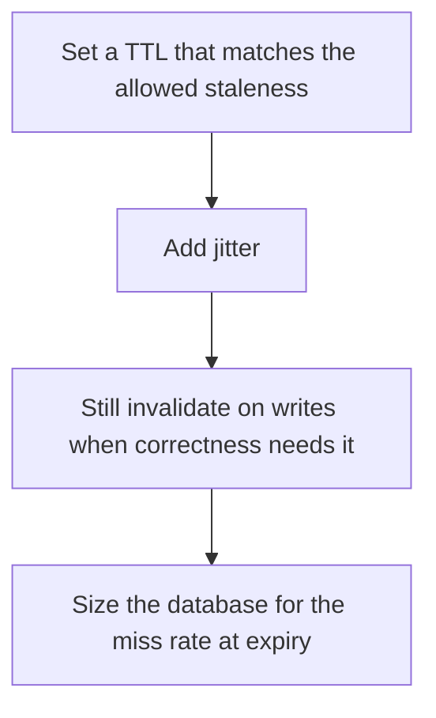

# D11-T006 — TTL and expiration

Topic ID: `D11-T006`
Domain: Redis and Caching
Subdomain: TTL and expiration
Importance: core
Complexity: intermediate
Dependencies: `D11-T005`, `D11-T001`, `D07-T001`, `D07-T002`, `D05-T001`, `D05-T002`
Execution status of the code in section F: unexecuted

## A. Topic Overview

A TTL on a cache entry deletes or ignores it after a duration. It bounds staleness when an invalidation is lost. It does not make the entry correct. A short TTL raises the miss rate and the database load. A long TTL lengthens the stale window. Jitter stops every key from expiring on the same second.

In production this shows up as follows: Feature-flag snapshots live 30 seconds with jitter. A price change also deletes the key. The TTL is the backstop, not the only correctness tool.

Interviewers use TTL and expiration to see whether you can state the failure mode, not only the definition. The failure to name is: every key expiring together and stampeding the database, or a TTL so long that users see yesterday's price

Prerequisites: `D11-T005`, `D11-T001`, `D07-T001`, `D07-T002`, `D05-T001`, `D05-T002`. Later notes should link here instead of repeating the mechanism.

## B. First-Principles Explanation

A TTL on a cache entry deletes or ignores it after a duration. It bounds staleness when an invalidation is lost. It does not make the entry correct. A short TTL raises the miss rate and the database load. A long TTL lengthens the stale window. Jitter stops every key from expiring on the same second.

The useful picture is: TTL is an expiry date on a photocopy. Jitter is not putting the same date on every photocopy, so the crowd does not arrive at the archive together.

What has to be true:

1. Set a TTL that matches the allowed staleness
2. Add jitter
3. Still invalidate on writes when correctness needs it
4. Size the database for the miss rate at expiry

It works when those steps preserve one invariant. It fails when every key expiring together and stampeding the database, or a TTL so long that users see yesterday's price. The alternative is: you set a one-hour TTL on a permission decision

## C. Internal Working and Architecture

Components involved: the caller, the state TTL and expiration mutates or reads, and the observer that reports miss rate at expiry time and the age of the oldest served value.

Execution:

1. Set a TTL that matches the allowed staleness
2. Add jitter
3. Still invalidate on writes when correctness needs it
4. Size the database for the miss rate at expiry

Data moves only along that path. A retry re-enters at step 1, so the operation must say what a duplicate does. Memory and locks stay inside this mechanism. Callers see the result or a typed error, not a half-updated invariant.

State to remember: choose this when you need a bound on staleness even if a delete is lost. Do not choose it when you set a one-hour TTL on a permission decision.

## D. Diagrams and Visual Models



Read the diagram from top to bottom. Each box is one step of TTL and expiration. The failure mode (every key expiring together and stampeding the database, or a TTL so long that users see yesterday's price) is what you look for when a later box never happens or happens twice.

## E. Examples and Analogies

Analogy: TTL is an expiry date on a photocopy. Jitter is not putting the same date on every photocopy, so the crowd does not arrive at the archive together.

Production example: Feature-flag snapshots live 30 seconds with jitter. A price change also deletes the key. The TTL is the backstop, not the only correctness tool.

A small counterexample is enough in an interview. Show the input, apply the steps, and show the broken outcome if someone uses the mechanism outside its rule: every key expiring together and stampeding the database, or a TTL so long that users see yesterday's price.

## F. Code Examples

The snippet is labeled unexecuted. It illustrates the shape of the idea. It is not a benchmark and it embeds no secret.

```python
import random

def ttl_with_jitter(base):
    return base + random.randint(0, base // 10)
```

After the snippet, check miss rate at expiry time and the age of the oldest served value. If that signal moves the wrong way, the snippet is the wrong tool for the workload.

## G. Practical Backend Application

Use TTL and expiration in a service when you need a bound on staleness even if a delete is lost.

A typical place is the production case already stated: Feature-flag snapshots live 30 seconds with jitter. A price change also deletes the key. The TTL is the backstop, not the only correctness tool.

Operationally you alert on miss rate at expiry time and the age of the oldest served value. You do not alert only on process uptime. The dashboard should show the failure mode, a success rate, and the saturation signal (queue depth, lock wait, or latency) that predicts it.

## H. Advantages, Limitations and Trade-offs

| Choice | Benefit | Cost | Choose when | Avoid when |
| --- | --- | --- | --- | --- |
| Apply TTL and expiration | you need a bound on staleness even if a delete is lost | Extra moving parts and a new failure mode | The failure you are preventing is already real | you set a one-hour TTL on a permission decision |
| Simpler alternative | Less code and fewer dependencies | every key expiring together and stampeding the database, or a TTL so long that users see yesterday's price | The workload does not hit the limit | The invariant must hold under concurrency or failure |

TTL and expiration is a trade. State the benefit and the cost in the same sentence when you propose it in a design review.

## I. Common Mistakes and Misconceptions

- Synchronized expiry.
- TTL without invalidation for data that changed.
- A TTL of zero that turns the cache into a hop.
- Treating a diagram of TTL and expiration as proof that the invariant holds in production.
- Copying a default configuration without naming miss rate at expiry time and the age of the oldest served value.

## J. Debugging and Troubleshooting

Symptom: every key expiring together and stampeding the database, or a TTL so long that users see yesterday's price

First check: miss rate at expiry time and the age of the oldest served value.

Then compare one healthy instance against one unhealthy instance. Confirm whether retries are duplicating work. Confirm whether a timeout is shorter than the work. Fix the invariant, then watch the same metric for a full peak, not only for the next minute.

Useful questions: did the step order in section C actually happen, or did a caller skip a step? Did a deploy change the data shape that TTL and expiration assumes?

## K. Interview Preparation

### Beginner

#### Q1. What problem does TTL and expiration solve?

**Answer:** A TTL on a cache entry deletes or ignores it after a duration. It bounds staleness when an invalidation is lost. It does not make the entry correct. A short TTL raises the miss rate and the database load. A long TTL lengthens the stale window. Jitter stops every key from expiring on the same second. Without it, the usual backend failure is: every key expiring together and stampeding the database, or a TTL so long that users see yesterday's price.

#### Q2. Where does TTL and expiration sit on a request path?

**Answer:** TTL and expiration is not a library you sprinkle on every call. you need a bound on staleness even if a delete is lost You notice it when miss rate at expiry time and the age of the oldest served value. Name the constraint that makes this choice correct. Say what you would measure to confirm it.

#### Q3. Give a concrete example of TTL and expiration.

**Answer:** Feature-flag snapshots live 30 seconds with jitter. A price change also deletes the key. The TTL is the backstop, not the only correctness tool. Walk the input, the state change, and the observable output.

#### Q4. What is a common mix-up around TTL and expiration?

**Answer:** every key expiring together and stampeding the database, or a TTL so long that users see yesterday's price The corrective check is miss rate at expiry time and the age of the oldest served value. Name the constraint that makes this choice correct. Say what you would measure to confirm it. Say which alternative you rejected and why.

#### Q5. When would you skip TTL and expiration?

**Answer:** you set a one-hour TTL on a permission decision Skipping is a decision with a measured cost, not a slogan. Name the constraint that makes this choice correct. Say what you would measure to confirm it. Say which alternative you rejected and why.

### Intermediate

#### Q1. What invariant makes TTL and expiration correct?

**Answer:** A TTL on a cache entry deletes or ignores it after a duration. It bounds staleness when an invalidation is lost. It does not make the entry correct. A short TTL raises the miss rate and the database load. A long TTL lengthens the stale window. Jitter stops every key from expiring on the same second. State the invariant before you name the tool.

#### Q2. How do you test TTL and expiration?

**Answer:** Assert the failure mode directly: every key expiring together and stampeding the database, or a TTL so long that users see yesterday's price. The assertion should watch miss rate at expiry time and the age of the oldest served value. Include a concurrent or retry case if the bug only appears then. Name the constraint that makes this choice correct.

#### Q3. What signal tells you TTL and expiration is misbehaving in production?

**Answer:** Watch miss rate at expiry time and the age of the oldest served value. The user-visible symptom is usually every key expiring together and stampeding the database, or a TTL so long that users see yesterday's price. Name the constraint that makes this choice correct. Say what you would measure to confirm it.

#### Q4. How would you introduce TTL and expiration into a legacy service?

**Answer:** you need a bound on staleness even if a delete is lost Ship it behind a metric so you can compare the old path. Roll back if every key expiring together and stampeding the database, or a TTL so long that users see yesterday's price gets worse. Name the constraint that makes this choice correct. Say what you would measure to confirm it.

#### Q5. What do you trade away by choosing TTL and expiration?

**Answer:** you need a bound on staleness even if a delete is lost you set a one-hour TTL on a permission decision Say the cost in latency, storage, or operational load. Name the constraint that makes this choice correct. Say what you would measure to confirm it. Say which alternative you rejected and why.

### Advanced

#### Q1. What breaks if a dependency of TTL and expiration is slow or down?

**Answer:** every key expiring together and stampeding the database, or a TTL so long that users see yesterday's price Degrade using the rule: you set a one-hour TTL on a permission decision. Timeouts must be shorter than the caller's deadline. Name the constraint that makes this choice correct. Say what you would measure to confirm it.

#### Q2. How does TTL and expiration behave under retries?

**Answer:** Retries repeat work, so TTL and expiration must define what a duplicate does. every key expiring together and stampeding the database, or a TTL so long that users see yesterday's price Idempotency keys or fences belong next to the write, not in a comment. Name the constraint that makes this choice correct. Say what you would measure to confirm it.

#### Q3. What is the capacity limit of TTL and expiration?

**Answer:** The limit shows up as miss rate at expiry time and the age of the oldest served value. Add capacity only after you know whether the bottleneck is CPU, lock wait, or network. Name the constraint that makes this choice correct. Say what you would measure to confirm it.

#### Q4. How do you evolve TTL and expiration without a flag day?

**Answer:** you need a bound on staleness even if a delete is lost Version the contract or the on-disk format. Readers should tolerate one old and one new shape during the rollout. Name the constraint that makes this choice correct. Say what you would measure to confirm it.

#### Q5. What security or correctness bug hides inside TTL and expiration?

**Answer:** every key expiring together and stampeding the database, or a TTL so long that users see yesterday's price Check authorization and tenancy at the same boundary as the mechanism. A cache or queue must not widen who can read the data. Name the constraint that makes this choice correct. Say what you would measure to confirm it.

### Scenario

#### Q1. Incident: every key expiring together and stampeding the database, or a TTL so long that users see yesterday's price. What do you check first?

**Answer:** Start with miss rate at expiry time and the age of the oldest served value. Compare a good host and a bad host before you restart anything. A TTL on a cache entry deletes or ignores it after a duration. It bounds staleness when an invalidation is lost. It does not make the entry correct. A short TTL raises the miss rate and the database load. A long TTL lengthens the stale window. Jitter stops every key from expiring on the same second.

#### Q2. A reviewer wants the clever version. What data settles it?

**Answer:** you need a bound on staleness even if a delete is lost you set a one-hour TTL on a permission decision Bring miss rate at expiry time and the age of the oldest served value from a load test or from production, not a slogan. Name the constraint that makes this choice correct. Say what you would measure to confirm it. Say which alternative you rejected and why.

#### Q3. You have one hour to explain TTL and expiration at a whiteboard.

**Answer:** Draw the happy path in four boxes. Then draw the failure: every key expiring together and stampeding the database, or a TTL so long that users see yesterday's price. End with the metric you would page on. Name the constraint that makes this choice correct.

#### Q4. The bug only appears under two concurrent callers.

**Answer:** every key expiring together and stampeding the database, or a TTL so long that users see yesterday's price Reproduce with a barrier so both sides enter the critical window. Confirm the fix with miss rate at expiry time and the age of the oldest served value. Name the constraint that makes this choice correct. Say what you would measure to confirm it.

#### Q5. Leadership wants this on every service next week.

**Answer:** you set a one-hour TTL on a permission decision you need a bound on staleness even if a delete is lost Roll it out where the failure mode is already hurting users. Name the constraint that makes this choice correct. Say what you would measure to confirm it. Say which alternative you rejected and why.

### Follow-up

#### Q1. What did you assume about the data size or the clock?

**Answer:** A TTL on a cache entry deletes or ignores it after a duration. It bounds staleness when an invalidation is lost. It does not make the entry correct. A short TTL raises the miss rate and the database load. A long TTL lengthens the stale window. Jitter stops every key from expiring on the same second. Clocks are not a total order across machines. State whether the algorithm needs bounded size or a single leader.

#### Q2. What would you measure after the change ships?

**Answer:** Page on miss rate at expiry time and the age of the oldest served value. Keep a before/after dashboard for one week. Alert on the failure mode, not only on CPU. Name the constraint that makes this choice correct.

#### Q3. Which neighboring topic did you deliberately not re-teach?

**Answer:** This note owns TTL and expiration. Related identifiers are in section N. Shared ideas are linked, not copied. Name the constraint that makes this choice correct.

## L. Practical Exercises

Solutions are in `EXERCISES/solutions/D11-T006.md`, not in this section.

1. Whiteboard the four steps of TTL and expiration and mark where `every key expiring together and stampeding the database, or a TTL so long that users see yesterday's price` enters.
2. Read the snippet in section F and write the assertion that would catch that failure. The assertion must mention `miss rate at expiry time and the age of the oldest served value`.
3. Argue for or against using TTL and expiration on a service you know. Use the choose and avoid rows from section H. Do not appeal to popularity.

## M. Revision Notes

- Mechanism: A TTL on a cache entry deletes or ignores it after a duration.
- Failure: every key expiring together and stampeding the database, or a TTL so long that users see yesterday's price
- Metric: miss rate at expiry time and the age of the oldest served value
- Choose when: you need a bound on staleness even if a delete is lost
- Avoid when: you set a one-hour TTL on a permission decision

## N. Related Topics

Dependencies to review first: `D11-T005`, `D11-T001`, `D07-T001`, `D07-T002`, `D05-T001`, `D05-T002`.

Shared ideas stay in those notes. This note does not restate them.

## O. Completion Criteria

- You can explain TTL and expiration without reading this note, including the failure mode.
- You can draw the diagram in section D from memory.
- You can say when not to use it, using the avoid condition in section H.
- You can name the metric you would watch after shipping it.
