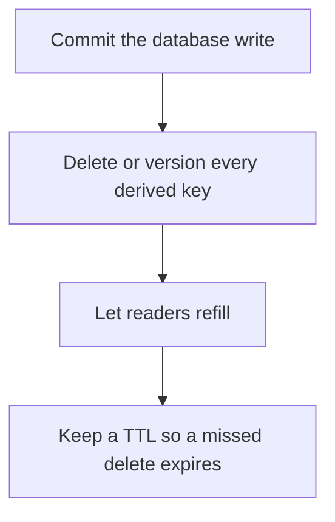

# D11-T007 — Cache invalidation

Topic ID: `D11-T007`
Domain: Redis and Caching
Subdomain: Cache invalidation
Importance: core
Complexity: intermediate
Dependencies: `D11-T006`, `D11-T001`, `D07-T001`, `D07-T002`, `D05-T001`, `D05-T002`
Execution status of the code in section F: unexecuted

## A. Topic Overview

Cache invalidation removes or replaces an entry when the source of truth changes. Delete-on-write is the usual cache-aside policy. Update-on-write stores the new value. The hard parts are knowing every key that contains the changed fact, doing the delete after the database commit, and the race where a reader refills a stale value. Versioned keys make the old key harmless.

In production this shows up as follows: Changing a product price must delete the product key, the category page key, and the search snippet key. Missing the snippet is the bug customers notice.

Interviewers use Cache invalidation to see whether you can state the failure mode, not only the definition. The failure to name is: forgetting a derived key, so one page stays stale, or deleting before the commit so a reader refills the old row

Prerequisites: `D11-T006`, `D11-T001`, `D07-T001`, `D07-T002`, `D05-T001`, `D05-T002`. Later notes should link here instead of repeating the mechanism.

## B. First-Principles Explanation

Cache invalidation removes or replaces an entry when the source of truth changes. Delete-on-write is the usual cache-aside policy. Update-on-write stores the new value. The hard parts are knowing every key that contains the changed fact, doing the delete after the database commit, and the race where a reader refills a stale value. Versioned keys make the old key harmless.

The useful picture is: Invalidation is recalling every photocopy of a page. If you forget the photocopy in the branch office, that office keeps lying.

What has to be true:

1. Commit the database write
2. Delete or version every derived key
3. Let readers refill
4. Keep a TTL so a missed delete expires

It works when those steps preserve one invariant. It fails when forgetting a derived key, so one page stays stale, or deleting before the commit so a reader refills the old row. The alternative is: you cannot name the keys that contain the fact

## C. Internal Working and Architecture

Components involved: the caller, the state Cache invalidation mutates or reads, and the observer that reports stale reads after a write, counted by comparing cache generation to database generation.

Execution:

1. Commit the database write
2. Delete or version every derived key
3. Let readers refill
4. Keep a TTL so a missed delete expires

Data moves only along that path. A retry re-enters at step 1, so the operation must say what a duplicate does. Memory and locks stay inside this mechanism. Callers see the result or a typed error, not a half-updated invariant.

State to remember: choose this when a write changes a fact that has been copied into a cache. Do not choose it when you cannot name the keys that contain the fact.

## D. Diagrams and Visual Models



Read the diagram from top to bottom. Each box is one step of Cache invalidation. The failure mode (forgetting a derived key, so one page stays stale, or deleting before the commit so a reader refills the old row) is what you look for when a later box never happens or happens twice.

## E. Examples and Analogies

Analogy: Invalidation is recalling every photocopy of a page. If you forget the photocopy in the branch office, that office keeps lying.

Production example: Changing a product price must delete the product key, the category page key, and the search snippet key. Missing the snippet is the bug customers notice.

A small counterexample is enough in an interview. Show the input, apply the steps, and show the broken outcome if someone uses the mechanism outside its rule: forgetting a derived key, so one page stays stale, or deleting before the commit so a reader refills the old row.

## F. Code Examples

The snippet is labeled unexecuted. It illustrates the shape of the idea. It is not a benchmark and it embeds no secret.

```python
def invalidate(cache, keys):
    for key in keys:
        cache.delete(key)
```

After the snippet, check stale reads after a write, counted by comparing cache generation to database generation. If that signal moves the wrong way, the snippet is the wrong tool for the workload.

## G. Practical Backend Application

Use Cache invalidation in a service when a write changes a fact that has been copied into a cache.

A typical place is the production case already stated: Changing a product price must delete the product key, the category page key, and the search snippet key. Missing the snippet is the bug customers notice.

Operationally you alert on stale reads after a write, counted by comparing cache generation to database generation. You do not alert only on process uptime. The dashboard should show the failure mode, a success rate, and the saturation signal (queue depth, lock wait, or latency) that predicts it.

## H. Advantages, Limitations and Trade-offs

| Choice | Benefit | Cost | Choose when | Avoid when |
| --- | --- | --- | --- | --- |
| Apply Cache invalidation | a write changes a fact that has been copied into a cache | Extra moving parts and a new failure mode | The failure you are preventing is already real | you cannot name the keys that contain the fact |
| Simpler alternative | Less code and fewer dependencies | forgetting a derived key, so one page stays stale, or deleting before the commit so a reader refills the old row | The workload does not hit the limit | The invariant must hold under concurrency or failure |

Cache invalidation is a trade. State the benefit and the cost in the same sentence when you propose it in a design review.

## I. Common Mistakes and Misconceptions

- Invalidating before commit.
- Naming only the primary key.
- Assuming a delete is visible on every cache node instantly.
- Treating a diagram of Cache invalidation as proof that the invariant holds in production.
- Copying a default configuration without naming stale reads after a write, counted by comparing cache generation to database generation.

## J. Debugging and Troubleshooting

Symptom: forgetting a derived key, so one page stays stale, or deleting before the commit so a reader refills the old row

First check: stale reads after a write, counted by comparing cache generation to database generation.

Then compare one healthy instance against one unhealthy instance. Confirm whether retries are duplicating work. Confirm whether a timeout is shorter than the work. Fix the invariant, then watch the same metric for a full peak, not only for the next minute.

Useful questions: did the step order in section C actually happen, or did a caller skip a step? Did a deploy change the data shape that Cache invalidation assumes?

## K. Interview Preparation

### Beginner

#### Q1. What problem does Cache invalidation solve?

**Answer:** Cache invalidation removes or replaces an entry when the source of truth changes. Delete-on-write is the usual cache-aside policy. Update-on-write stores the new value. The hard parts are knowing every key that contains the changed fact, doing the delete after the database commit, and the race where a reader refills a stale value. Versioned keys make the old key harmless. Without it, the usual backend failure is: forgetting a derived key, so one page stays stale, or deleting before the commit so a reader refills the old row.

#### Q2. Where does Cache invalidation sit on a request path?

**Answer:** Cache invalidation is not a library you sprinkle on every call. a write changes a fact that has been copied into a cache You notice it when stale reads after a write, counted by comparing cache generation to database generation. Name the constraint that makes this choice correct. Say what you would measure to confirm it.

#### Q3. Give a concrete example of Cache invalidation.

**Answer:** Changing a product price must delete the product key, the category page key, and the search snippet key. Missing the snippet is the bug customers notice. Walk the input, the state change, and the observable output. Name the constraint that makes this choice correct.

#### Q4. What is a common mix-up around Cache invalidation?

**Answer:** forgetting a derived key, so one page stays stale, or deleting before the commit so a reader refills the old row The corrective check is stale reads after a write, counted by comparing cache generation to database generation. Name the constraint that makes this choice correct. Say what you would measure to confirm it. Say which alternative you rejected and why.

#### Q5. When would you skip Cache invalidation?

**Answer:** you cannot name the keys that contain the fact Skipping is a decision with a measured cost, not a slogan. Name the constraint that makes this choice correct. Say what you would measure to confirm it. Say which alternative you rejected and why.

### Intermediate

#### Q1. What invariant makes Cache invalidation correct?

**Answer:** Cache invalidation removes or replaces an entry when the source of truth changes. Delete-on-write is the usual cache-aside policy. Update-on-write stores the new value. The hard parts are knowing every key that contains the changed fact, doing the delete after the database commit, and the race where a reader refills a stale value. Versioned keys make the old key harmless. State the invariant before you name the tool.

#### Q2. How do you test Cache invalidation?

**Answer:** Assert the failure mode directly: forgetting a derived key, so one page stays stale, or deleting before the commit so a reader refills the old row. The assertion should watch stale reads after a write, counted by comparing cache generation to database generation. Include a concurrent or retry case if the bug only appears then. Name the constraint that makes this choice correct.

#### Q3. What signal tells you Cache invalidation is misbehaving in production?

**Answer:** Watch stale reads after a write, counted by comparing cache generation to database generation. The user-visible symptom is usually forgetting a derived key, so one page stays stale, or deleting before the commit so a reader refills the old row. Name the constraint that makes this choice correct. Say what you would measure to confirm it.

#### Q4. How would you introduce Cache invalidation into a legacy service?

**Answer:** a write changes a fact that has been copied into a cache Ship it behind a metric so you can compare the old path. Roll back if forgetting a derived key, so one page stays stale, or deleting before the commit so a reader refills the old row gets worse. Name the constraint that makes this choice correct. Say what you would measure to confirm it.

#### Q5. What do you trade away by choosing Cache invalidation?

**Answer:** a write changes a fact that has been copied into a cache you cannot name the keys that contain the fact Say the cost in latency, storage, or operational load. Name the constraint that makes this choice correct. Say what you would measure to confirm it. Say which alternative you rejected and why.

### Advanced

#### Q1. What breaks if a dependency of Cache invalidation is slow or down?

**Answer:** forgetting a derived key, so one page stays stale, or deleting before the commit so a reader refills the old row Degrade using the rule: you cannot name the keys that contain the fact. Timeouts must be shorter than the caller's deadline. Name the constraint that makes this choice correct. Say what you would measure to confirm it.

#### Q2. How does Cache invalidation behave under retries?

**Answer:** Retries repeat work, so Cache invalidation must define what a duplicate does. forgetting a derived key, so one page stays stale, or deleting before the commit so a reader refills the old row Idempotency keys or fences belong next to the write, not in a comment. Name the constraint that makes this choice correct. Say what you would measure to confirm it.

#### Q3. What is the capacity limit of Cache invalidation?

**Answer:** The limit shows up as stale reads after a write, counted by comparing cache generation to database generation. Add capacity only after you know whether the bottleneck is CPU, lock wait, or network. Name the constraint that makes this choice correct. Say what you would measure to confirm it.

#### Q4. How do you evolve Cache invalidation without a flag day?

**Answer:** a write changes a fact that has been copied into a cache Version the contract or the on-disk format. Readers should tolerate one old and one new shape during the rollout. Name the constraint that makes this choice correct. Say what you would measure to confirm it.

#### Q5. What security or correctness bug hides inside Cache invalidation?

**Answer:** forgetting a derived key, so one page stays stale, or deleting before the commit so a reader refills the old row Check authorization and tenancy at the same boundary as the mechanism. A cache or queue must not widen who can read the data. Name the constraint that makes this choice correct. Say what you would measure to confirm it.

### Scenario

#### Q1. Incident: forgetting a derived key, so one page stays stale, or deleting before the commit so a reader refills the old row. What do you check first?

**Answer:** Start with stale reads after a write, counted by comparing cache generation to database generation. Compare a good host and a bad host before you restart anything. Cache invalidation removes or replaces an entry when the source of truth changes. Delete-on-write is the usual cache-aside policy. Update-on-write stores the new value. The hard parts are knowing every key that contains the changed fact, doing the delete after the database commit, and the race where a reader refills a stale value. Versioned keys make the old key harmless.

#### Q2. A reviewer wants the clever version. What data settles it?

**Answer:** a write changes a fact that has been copied into a cache you cannot name the keys that contain the fact Bring stale reads after a write, counted by comparing cache generation to database generation from a load test or from production, not a slogan. Name the constraint that makes this choice correct. Say what you would measure to confirm it. Say which alternative you rejected and why.

#### Q3. You have one hour to explain Cache invalidation at a whiteboard.

**Answer:** Draw the happy path in four boxes. Then draw the failure: forgetting a derived key, so one page stays stale, or deleting before the commit so a reader refills the old row. End with the metric you would page on. Name the constraint that makes this choice correct.

#### Q4. The bug only appears under two concurrent callers.

**Answer:** forgetting a derived key, so one page stays stale, or deleting before the commit so a reader refills the old row Reproduce with a barrier so both sides enter the critical window. Confirm the fix with stale reads after a write, counted by comparing cache generation to database generation. Name the constraint that makes this choice correct. Say what you would measure to confirm it.

#### Q5. Leadership wants this on every service next week.

**Answer:** you cannot name the keys that contain the fact a write changes a fact that has been copied into a cache Roll it out where the failure mode is already hurting users. Name the constraint that makes this choice correct. Say what you would measure to confirm it. Say which alternative you rejected and why.

### Follow-up

#### Q1. What did you assume about the data size or the clock?

**Answer:** Cache invalidation removes or replaces an entry when the source of truth changes. Delete-on-write is the usual cache-aside policy. Update-on-write stores the new value. The hard parts are knowing every key that contains the changed fact, doing the delete after the database commit, and the race where a reader refills a stale value. Versioned keys make the old key harmless. Clocks are not a total order across machines. State whether the algorithm needs bounded size or a single leader.

#### Q2. What would you measure after the change ships?

**Answer:** Page on stale reads after a write, counted by comparing cache generation to database generation. Keep a before/after dashboard for one week. Alert on the failure mode, not only on CPU. Name the constraint that makes this choice correct.

#### Q3. Which neighboring topic did you deliberately not re-teach?

**Answer:** This note owns Cache invalidation. Related identifiers are in section N. Shared ideas are linked, not copied. Name the constraint that makes this choice correct.

## L. Practical Exercises

Solutions are in `EXERCISES/solutions/D11-T007.md`, not in this section.

1. Whiteboard the four steps of Cache invalidation and mark where `forgetting a derived key, so one page stays stale, or deleting before the commit so a reader refills the old row` enters.
2. Read the snippet in section F and write the assertion that would catch that failure. The assertion must mention `stale reads after a write, counted by comparing cache generation to database generation`.
3. Argue for or against using Cache invalidation on a service you know. Use the choose and avoid rows from section H. Do not appeal to popularity.

## M. Revision Notes

- Mechanism: Cache invalidation removes or replaces an entry when the source of truth changes.
- Failure: forgetting a derived key, so one page stays stale, or deleting before the commit so a reader refills the old row
- Metric: stale reads after a write, counted by comparing cache generation to database generation
- Choose when: a write changes a fact that has been copied into a cache
- Avoid when: you cannot name the keys that contain the fact

## N. Related Topics

Dependencies to review first: `D11-T006`, `D11-T001`, `D07-T001`, `D07-T002`, `D05-T001`, `D05-T002`.

Shared ideas stay in those notes. This note does not restate them.

## O. Completion Criteria

- You can explain Cache invalidation without reading this note, including the failure mode.
- You can draw the diagram in section D from memory.
- You can say when not to use it, using the avoid condition in section H.
- You can name the metric you would watch after shipping it.
