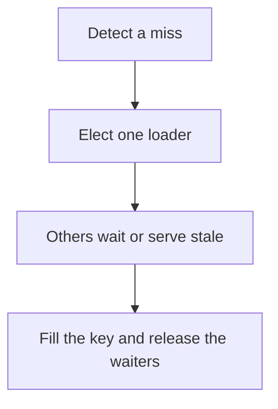

# D11-T008 — Cache stampede

Topic ID: `D11-T008`
Domain: Redis and Caching
Subdomain: Cache stampede
Importance: core
Complexity: intermediate
Dependencies: `D11-T007`, `D11-T001`, `D07-T001`, `D07-T002`, `D05-T001`, `D05-T002`
Execution status of the code in section F: unexecuted

## A. Topic Overview

A cache stampede is many requests missing the same key and all loading the database at once. It happens on expiry, on deploy, or on a cold key that is suddenly hot. Single-flight lets one request load and the others wait. A lock with a short timeout, early refresh, and jitter are the usual controls. The database must still survive one loader.

In production this shows up as follows: A celebrity profile expires and ten thousand requests hit the user service. A single-flight lock plus a slightly stale serve keeps the database at one query.

Interviewers use Cache stampede to see whether you can state the failure mode, not only the definition. The failure to name is: a lock that expires before the load finishes, so several loaders run anyway, or waiters that pile up past the client deadline

Prerequisites: `D11-T007`, `D11-T001`, `D07-T001`, `D07-T002`, `D05-T001`, `D05-T002`. Later notes should link here instead of repeating the mechanism.

## B. First-Principles Explanation

A cache stampede is many requests missing the same key and all loading the database at once. It happens on expiry, on deploy, or on a cold key that is suddenly hot. Single-flight lets one request load and the others wait. A lock with a short timeout, early refresh, and jitter are the usual controls. The database must still survive one loader.

The useful picture is: A stampede is every customer asking the same clerk to fetch the same box at the opening bell. Single-flight is one customer fetching it while the others wait at the counter.

What has to be true:

1. Detect a miss
2. Elect one loader
3. Others wait or serve stale
4. Fill the key and release the waiters

It works when those steps preserve one invariant. It fails when a lock that expires before the load finishes, so several loaders run anyway, or waiters that pile up past the client deadline. The alternative is: you add a lock per key for data that is cheap and cold

## C. Internal Working and Architecture

Components involved: the caller, the state Cache stampede mutates or reads, and the observer that reports database QPS on a single key at expiry, and loader count.

Execution:

1. Detect a miss
2. Elect one loader
3. Others wait or serve stale
4. Fill the key and release the waiters

Data moves only along that path. A retry re-enters at step 1, so the operation must say what a duplicate does. Memory and locks stay inside this mechanism. Callers see the result or a typed error, not a half-updated invariant.

State to remember: choose this when one key is hot and expensive to rebuild. Do not choose it when you add a lock per key for data that is cheap and cold.

## D. Diagrams and Visual Models



Read the diagram from top to bottom. Each box is one step of Cache stampede. The failure mode (a lock that expires before the load finishes, so several loaders run anyway, or waiters that pile up past the client deadline) is what you look for when a later box never happens or happens twice.

## E. Examples and Analogies

Analogy: A stampede is every customer asking the same clerk to fetch the same box at the opening bell. Single-flight is one customer fetching it while the others wait at the counter.

Production example: A celebrity profile expires and ten thousand requests hit the user service. A single-flight lock plus a slightly stale serve keeps the database at one query.

A small counterexample is enough in an interview. Show the input, apply the steps, and show the broken outcome if someone uses the mechanism outside its rule: a lock that expires before the load finishes, so several loaders run anyway, or waiters that pile up past the client deadline.

## F. Code Examples

The snippet is labeled unexecuted. It illustrates the shape of the idea. It is not a benchmark and it embeds no secret.

```python
import threading
locks = {}

def single_flight(key, loader):
    lock = locks.setdefault(key, threading.Lock())
    with lock:
        return loader()
```

After the snippet, check database QPS on a single key at expiry, and loader count. If that signal moves the wrong way, the snippet is the wrong tool for the workload.

## G. Practical Backend Application

Use Cache stampede in a service when one key is hot and expensive to rebuild.

A typical place is the production case already stated: A celebrity profile expires and ten thousand requests hit the user service. A single-flight lock plus a slightly stale serve keeps the database at one query.

Operationally you alert on database QPS on a single key at expiry, and loader count. You do not alert only on process uptime. The dashboard should show the failure mode, a success rate, and the saturation signal (queue depth, lock wait, or latency) that predicts it.

## H. Advantages, Limitations and Trade-offs

| Choice | Benefit | Cost | Choose when | Avoid when |
| --- | --- | --- | --- | --- |
| Apply Cache stampede | one key is hot and expensive to rebuild | Extra moving parts and a new failure mode | The failure you are preventing is already real | you add a lock per key for data that is cheap and cold |
| Simpler alternative | Less code and fewer dependencies | a lock that expires before the load finishes, so several loaders run anyway, or waiters that pile up past the client deadline | The workload does not hit the limit | The invariant must hold under concurrency or failure |

Cache stampede is a trade. State the benefit and the cost in the same sentence when you propose it in a design review.

## I. Common Mistakes and Misconceptions

- A lock TTL shorter than the query.
- No stale-while-revalidate.
- Stampeding on startup by warming nothing.
- Treating a diagram of Cache stampede as proof that the invariant holds in production.
- Copying a default configuration without naming database QPS on a single key at expiry, and loader count.

## J. Debugging and Troubleshooting

Symptom: a lock that expires before the load finishes, so several loaders run anyway, or waiters that pile up past the client deadline

First check: database QPS on a single key at expiry, and loader count.

Then compare one healthy instance against one unhealthy instance. Confirm whether retries are duplicating work. Confirm whether a timeout is shorter than the work. Fix the invariant, then watch the same metric for a full peak, not only for the next minute.

Useful questions: did the step order in section C actually happen, or did a caller skip a step? Did a deploy change the data shape that Cache stampede assumes?

## K. Interview Preparation

### Beginner

#### Q1. What problem does Cache stampede solve?

**Answer:** A cache stampede is many requests missing the same key and all loading the database at once. It happens on expiry, on deploy, or on a cold key that is suddenly hot. Single-flight lets one request load and the others wait. A lock with a short timeout, early refresh, and jitter are the usual controls. The database must still survive one loader. Without it, the usual backend failure is: a lock that expires before the load finishes, so several loaders run anyway, or waiters that pile up past the client deadline.

#### Q2. Where does Cache stampede sit on a request path?

**Answer:** Cache stampede is not a library you sprinkle on every call. one key is hot and expensive to rebuild You notice it when database QPS on a single key at expiry, and loader count. Name the constraint that makes this choice correct. Say what you would measure to confirm it.

#### Q3. Give a concrete example of Cache stampede.

**Answer:** A celebrity profile expires and ten thousand requests hit the user service. A single-flight lock plus a slightly stale serve keeps the database at one query. Walk the input, the state change, and the observable output. Name the constraint that makes this choice correct.

#### Q4. What is a common mix-up around Cache stampede?

**Answer:** a lock that expires before the load finishes, so several loaders run anyway, or waiters that pile up past the client deadline The corrective check is database QPS on a single key at expiry, and loader count. Name the constraint that makes this choice correct. Say what you would measure to confirm it. Say which alternative you rejected and why.

#### Q5. When would you skip Cache stampede?

**Answer:** you add a lock per key for data that is cheap and cold Skipping is a decision with a measured cost, not a slogan. Name the constraint that makes this choice correct. Say what you would measure to confirm it. Say which alternative you rejected and why.

### Intermediate

#### Q1. What invariant makes Cache stampede correct?

**Answer:** A cache stampede is many requests missing the same key and all loading the database at once. It happens on expiry, on deploy, or on a cold key that is suddenly hot. Single-flight lets one request load and the others wait. A lock with a short timeout, early refresh, and jitter are the usual controls. The database must still survive one loader. State the invariant before you name the tool.

#### Q2. How do you test Cache stampede?

**Answer:** Assert the failure mode directly: a lock that expires before the load finishes, so several loaders run anyway, or waiters that pile up past the client deadline. The assertion should watch database QPS on a single key at expiry, and loader count. Include a concurrent or retry case if the bug only appears then. Name the constraint that makes this choice correct.

#### Q3. What signal tells you Cache stampede is misbehaving in production?

**Answer:** Watch database QPS on a single key at expiry, and loader count. The user-visible symptom is usually a lock that expires before the load finishes, so several loaders run anyway, or waiters that pile up past the client deadline. Name the constraint that makes this choice correct. Say what you would measure to confirm it.

#### Q4. How would you introduce Cache stampede into a legacy service?

**Answer:** one key is hot and expensive to rebuild Ship it behind a metric so you can compare the old path. Roll back if a lock that expires before the load finishes, so several loaders run anyway, or waiters that pile up past the client deadline gets worse. Name the constraint that makes this choice correct. Say what you would measure to confirm it.

#### Q5. What do you trade away by choosing Cache stampede?

**Answer:** one key is hot and expensive to rebuild you add a lock per key for data that is cheap and cold Say the cost in latency, storage, or operational load. Name the constraint that makes this choice correct. Say what you would measure to confirm it. Say which alternative you rejected and why.

### Advanced

#### Q1. What breaks if a dependency of Cache stampede is slow or down?

**Answer:** a lock that expires before the load finishes, so several loaders run anyway, or waiters that pile up past the client deadline Degrade using the rule: you add a lock per key for data that is cheap and cold. Timeouts must be shorter than the caller's deadline. Name the constraint that makes this choice correct. Say what you would measure to confirm it.

#### Q2. How does Cache stampede behave under retries?

**Answer:** Retries repeat work, so Cache stampede must define what a duplicate does. a lock that expires before the load finishes, so several loaders run anyway, or waiters that pile up past the client deadline Idempotency keys or fences belong next to the write, not in a comment. Name the constraint that makes this choice correct. Say what you would measure to confirm it.

#### Q3. What is the capacity limit of Cache stampede?

**Answer:** The limit shows up as database QPS on a single key at expiry, and loader count. Add capacity only after you know whether the bottleneck is CPU, lock wait, or network. Name the constraint that makes this choice correct. Say what you would measure to confirm it.

#### Q4. How do you evolve Cache stampede without a flag day?

**Answer:** one key is hot and expensive to rebuild Version the contract or the on-disk format. Readers should tolerate one old and one new shape during the rollout. Name the constraint that makes this choice correct. Say what you would measure to confirm it.

#### Q5. What security or correctness bug hides inside Cache stampede?

**Answer:** a lock that expires before the load finishes, so several loaders run anyway, or waiters that pile up past the client deadline Check authorization and tenancy at the same boundary as the mechanism. A cache or queue must not widen who can read the data. Name the constraint that makes this choice correct. Say what you would measure to confirm it.

### Scenario

#### Q1. Incident: a lock that expires before the load finishes, so several loaders run anyway, or waiters that pile up past the client deadline. What do you check first?

**Answer:** Start with database QPS on a single key at expiry, and loader count. Compare a good host and a bad host before you restart anything. A cache stampede is many requests missing the same key and all loading the database at once. It happens on expiry, on deploy, or on a cold key that is suddenly hot. Single-flight lets one request load and the others wait. A lock with a short timeout, early refresh, and jitter are the usual controls. The database must still survive one loader.

#### Q2. A reviewer wants the clever version. What data settles it?

**Answer:** one key is hot and expensive to rebuild you add a lock per key for data that is cheap and cold Bring database QPS on a single key at expiry, and loader count from a load test or from production, not a slogan. Name the constraint that makes this choice correct. Say what you would measure to confirm it. Say which alternative you rejected and why.

#### Q3. You have one hour to explain Cache stampede at a whiteboard.

**Answer:** Draw the happy path in four boxes. Then draw the failure: a lock that expires before the load finishes, so several loaders run anyway, or waiters that pile up past the client deadline. End with the metric you would page on. Name the constraint that makes this choice correct.

#### Q4. The bug only appears under two concurrent callers.

**Answer:** a lock that expires before the load finishes, so several loaders run anyway, or waiters that pile up past the client deadline Reproduce with a barrier so both sides enter the critical window. Confirm the fix with database QPS on a single key at expiry, and loader count. Name the constraint that makes this choice correct. Say what you would measure to confirm it.

#### Q5. Leadership wants this on every service next week.

**Answer:** you add a lock per key for data that is cheap and cold one key is hot and expensive to rebuild Roll it out where the failure mode is already hurting users. Name the constraint that makes this choice correct. Say what you would measure to confirm it. Say which alternative you rejected and why.

### Follow-up

#### Q1. What did you assume about the data size or the clock?

**Answer:** A cache stampede is many requests missing the same key and all loading the database at once. It happens on expiry, on deploy, or on a cold key that is suddenly hot. Single-flight lets one request load and the others wait. A lock with a short timeout, early refresh, and jitter are the usual controls. The database must still survive one loader. Clocks are not a total order across machines. State whether the algorithm needs bounded size or a single leader.

#### Q2. What would you measure after the change ships?

**Answer:** Page on database QPS on a single key at expiry, and loader count. Keep a before/after dashboard for one week. Alert on the failure mode, not only on CPU. Name the constraint that makes this choice correct.

#### Q3. Which neighboring topic did you deliberately not re-teach?

**Answer:** This note owns Cache stampede. Related identifiers are in section N. Shared ideas are linked, not copied. Name the constraint that makes this choice correct.

## L. Practical Exercises

Solutions are in `EXERCISES/solutions/D11-T008.md`, not in this section.

1. Whiteboard the four steps of Cache stampede and mark where `a lock that expires before the load finishes, so several loaders run anyway, or waiters that pile up past the client deadline` enters.
2. Read the snippet in section F and write the assertion that would catch that failure. The assertion must mention `database QPS on a single key at expiry, and loader count`.
3. Argue for or against using Cache stampede on a service you know. Use the choose and avoid rows from section H. Do not appeal to popularity.

## M. Revision Notes

- Mechanism: A cache stampede is many requests missing the same key and all loading the database at once.
- Failure: a lock that expires before the load finishes, so several loaders run anyway, or waiters that pile up past the client deadline
- Metric: database QPS on a single key at expiry, and loader count
- Choose when: one key is hot and expensive to rebuild
- Avoid when: you add a lock per key for data that is cheap and cold

## N. Related Topics

Dependencies to review first: `D11-T007`, `D11-T001`, `D07-T001`, `D07-T002`, `D05-T001`, `D05-T002`.

Shared ideas stay in those notes. This note does not restate them.

## O. Completion Criteria

- You can explain Cache stampede without reading this note, including the failure mode.
- You can draw the diagram in section D from memory.
- You can say when not to use it, using the avoid condition in section H.
- You can name the metric you would watch after shipping it.
