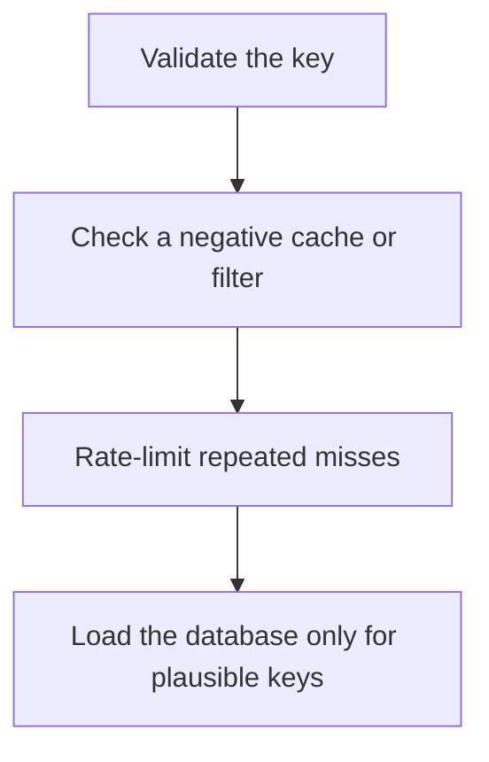

# D11-T009 — Cache penetration

Topic ID: `D11-T009`
Domain: Redis and Caching
Subdomain: Cache penetration
Importance: core
Complexity: intermediate
Dependencies: `D11-T008`, `D11-T001`, `D07-T001`, `D07-T002`, `D05-T001`, `D05-T002`
Execution status of the code in section F: unexecuted

## A. Topic Overview

Cache penetration is a stream of requests for keys that do not exist, so every request misses and hits the database. An attacker or a buggy client can do this on purpose. Caching a short-lived negative result, validating the key shape, and rate-limiting unknown keys close the hole. A bloom filter can reject keys the system has never stored, with false positives that only cause an extra lookup.

In production this shows up as follows: A public GET /products/{id} that accepts any string is used to spray random ids. The service rejects malformed ids, caches 'missing' for 30 seconds, and rate-limits the rest.

Interviewers use Cache penetration to see whether you can state the failure mode, not only the definition. The failure to name is: a database overloaded by random ids that were never going to hit

Prerequisites: `D11-T008`, `D11-T001`, `D07-T001`, `D07-T002`, `D05-T001`, `D05-T002`. Later notes should link here instead of repeating the mechanism.

## B. First-Principles Explanation

Cache penetration is a stream of requests for keys that do not exist, so every request misses and hits the database. An attacker or a buggy client can do this on purpose. Caching a short-lived negative result, validating the key shape, and rate-limiting unknown keys close the hole. A bloom filter can reject keys the system has never stored, with false positives that only cause an extra lookup.

The useful picture is: Penetration is people asking for books the library has never owned, and each question still sending a runner to the archive.

What has to be true:

1. Validate the key
2. Check a negative cache or filter
3. Rate-limit repeated misses
4. Load the database only for plausible keys

It works when those steps preserve one invariant. It fails when a database overloaded by random ids that were never going to hit. The alternative is: you cache every negative forever and pin memory

## C. Internal Working and Architecture

Components involved: the caller, the state Cache penetration mutates or reads, and the observer that reports miss rate on keys that do not exist, and database QPS from those misses.

Execution:

1. Validate the key
2. Check a negative cache or filter
3. Rate-limit repeated misses
4. Load the database only for plausible keys

Data moves only along that path. A retry re-enters at step 1, so the operation must say what a duplicate does. Memory and locks stay inside this mechanism. Callers see the result or a typed error, not a half-updated invariant.

State to remember: choose this when untrusted callers can request arbitrary keys. Do not choose it when you cache every negative forever and pin memory.

## D. Diagrams and Visual Models



Read the diagram from top to bottom. Each box is one step of Cache penetration. The failure mode (a database overloaded by random ids that were never going to hit) is what you look for when a later box never happens or happens twice.

## E. Examples and Analogies

Analogy: Penetration is people asking for books the library has never owned, and each question still sending a runner to the archive.

Production example: A public GET /products/{id} that accepts any string is used to spray random ids. The service rejects malformed ids, caches 'missing' for 30 seconds, and rate-limits the rest.

A small counterexample is enough in an interview. Show the input, apply the steps, and show the broken outcome if someone uses the mechanism outside its rule: a database overloaded by random ids that were never going to hit.

## F. Code Examples

The snippet is labeled unexecuted. It illustrates the shape of the idea. It is not a benchmark and it embeds no secret.

```python
def allow_lookup(key, negative_cache):
    if not key.isalnum():
        return False
    if negative_cache.get(key):
        return False
    return True
```

After the snippet, check miss rate on keys that do not exist, and database QPS from those misses. If that signal moves the wrong way, the snippet is the wrong tool for the workload.

## G. Practical Backend Application

Use Cache penetration in a service when untrusted callers can request arbitrary keys.

A typical place is the production case already stated: A public GET /products/{id} that accepts any string is used to spray random ids. The service rejects malformed ids, caches 'missing' for 30 seconds, and rate-limits the rest.

Operationally you alert on miss rate on keys that do not exist, and database QPS from those misses. You do not alert only on process uptime. The dashboard should show the failure mode, a success rate, and the saturation signal (queue depth, lock wait, or latency) that predicts it.

## H. Advantages, Limitations and Trade-offs

| Choice | Benefit | Cost | Choose when | Avoid when |
| --- | --- | --- | --- | --- |
| Apply Cache penetration | untrusted callers can request arbitrary keys | Extra moving parts and a new failure mode | The failure you are preventing is already real | you cache every negative forever and pin memory |
| Simpler alternative | Less code and fewer dependencies | a database overloaded by random ids that were never going to hit | The workload does not hit the limit | The invariant must hold under concurrency or failure |

Cache penetration is a trade. State the benefit and the cost in the same sentence when you propose it in a design review.

## I. Common Mistakes and Misconceptions

- No validation.
- A negative cache with no TTL.
- Treating penetration as an ordinary miss storm.
- Treating a diagram of Cache penetration as proof that the invariant holds in production.
- Copying a default configuration without naming miss rate on keys that do not exist, and database QPS from those misses.

## J. Debugging and Troubleshooting

Symptom: a database overloaded by random ids that were never going to hit

First check: miss rate on keys that do not exist, and database QPS from those misses.

Then compare one healthy instance against one unhealthy instance. Confirm whether retries are duplicating work. Confirm whether a timeout is shorter than the work. Fix the invariant, then watch the same metric for a full peak, not only for the next minute.

Useful questions: did the step order in section C actually happen, or did a caller skip a step? Did a deploy change the data shape that Cache penetration assumes?

## K. Interview Preparation

### Beginner

#### Q1. What problem does Cache penetration solve?

**Answer:** Cache penetration is a stream of requests for keys that do not exist, so every request misses and hits the database. An attacker or a buggy client can do this on purpose. Caching a short-lived negative result, validating the key shape, and rate-limiting unknown keys close the hole. A bloom filter can reject keys the system has never stored, with false positives that only cause an extra lookup. Without it, the usual backend failure is: a database overloaded by random ids that were never going to hit.

#### Q2. Where does Cache penetration sit on a request path?

**Answer:** Cache penetration is not a library you sprinkle on every call. untrusted callers can request arbitrary keys You notice it when miss rate on keys that do not exist, and database QPS from those misses. Name the constraint that makes this choice correct. Say what you would measure to confirm it.

#### Q3. Give a concrete example of Cache penetration.

**Answer:** A public GET /products/{id} that accepts any string is used to spray random ids. The service rejects malformed ids, caches 'missing' for 30 seconds, and rate-limits the rest. Walk the input, the state change, and the observable output. Name the constraint that makes this choice correct.

#### Q4. What is a common mix-up around Cache penetration?

**Answer:** a database overloaded by random ids that were never going to hit The corrective check is miss rate on keys that do not exist, and database QPS from those misses. Name the constraint that makes this choice correct. Say what you would measure to confirm it. Say which alternative you rejected and why.

#### Q5. When would you skip Cache penetration?

**Answer:** you cache every negative forever and pin memory Skipping is a decision with a measured cost, not a slogan. Name the constraint that makes this choice correct. Say what you would measure to confirm it. Say which alternative you rejected and why.

### Intermediate

#### Q1. What invariant makes Cache penetration correct?

**Answer:** Cache penetration is a stream of requests for keys that do not exist, so every request misses and hits the database. An attacker or a buggy client can do this on purpose. Caching a short-lived negative result, validating the key shape, and rate-limiting unknown keys close the hole. A bloom filter can reject keys the system has never stored, with false positives that only cause an extra lookup. State the invariant before you name the tool.

#### Q2. How do you test Cache penetration?

**Answer:** Assert the failure mode directly: a database overloaded by random ids that were never going to hit. The assertion should watch miss rate on keys that do not exist, and database QPS from those misses. Include a concurrent or retry case if the bug only appears then. Name the constraint that makes this choice correct.

#### Q3. What signal tells you Cache penetration is misbehaving in production?

**Answer:** Watch miss rate on keys that do not exist, and database QPS from those misses. The user-visible symptom is usually a database overloaded by random ids that were never going to hit. Name the constraint that makes this choice correct. Say what you would measure to confirm it.

#### Q4. How would you introduce Cache penetration into a legacy service?

**Answer:** untrusted callers can request arbitrary keys Ship it behind a metric so you can compare the old path. Roll back if a database overloaded by random ids that were never going to hit gets worse. Name the constraint that makes this choice correct. Say what you would measure to confirm it.

#### Q5. What do you trade away by choosing Cache penetration?

**Answer:** untrusted callers can request arbitrary keys you cache every negative forever and pin memory Say the cost in latency, storage, or operational load. Name the constraint that makes this choice correct. Say what you would measure to confirm it. Say which alternative you rejected and why.

### Advanced

#### Q1. What breaks if a dependency of Cache penetration is slow or down?

**Answer:** a database overloaded by random ids that were never going to hit Degrade using the rule: you cache every negative forever and pin memory. Timeouts must be shorter than the caller's deadline. Name the constraint that makes this choice correct. Say what you would measure to confirm it.

#### Q2. How does Cache penetration behave under retries?

**Answer:** Retries repeat work, so Cache penetration must define what a duplicate does. a database overloaded by random ids that were never going to hit Idempotency keys or fences belong next to the write, not in a comment. Name the constraint that makes this choice correct. Say what you would measure to confirm it.

#### Q3. What is the capacity limit of Cache penetration?

**Answer:** The limit shows up as miss rate on keys that do not exist, and database QPS from those misses. Add capacity only after you know whether the bottleneck is CPU, lock wait, or network. Name the constraint that makes this choice correct. Say what you would measure to confirm it.

#### Q4. How do you evolve Cache penetration without a flag day?

**Answer:** untrusted callers can request arbitrary keys Version the contract or the on-disk format. Readers should tolerate one old and one new shape during the rollout. Name the constraint that makes this choice correct. Say what you would measure to confirm it.

#### Q5. What security or correctness bug hides inside Cache penetration?

**Answer:** a database overloaded by random ids that were never going to hit Check authorization and tenancy at the same boundary as the mechanism. A cache or queue must not widen who can read the data. Name the constraint that makes this choice correct. Say what you would measure to confirm it.

### Scenario

#### Q1. Incident: a database overloaded by random ids that were never going to hit. What do you check first?

**Answer:** Start with miss rate on keys that do not exist, and database QPS from those misses. Compare a good host and a bad host before you restart anything. Cache penetration is a stream of requests for keys that do not exist, so every request misses and hits the database. An attacker or a buggy client can do this on purpose. Caching a short-lived negative result, validating the key shape, and rate-limiting unknown keys close the hole. A bloom filter can reject keys the system has never stored, with false positives that only cause an extra lookup.

#### Q2. A reviewer wants the clever version. What data settles it?

**Answer:** untrusted callers can request arbitrary keys you cache every negative forever and pin memory Bring miss rate on keys that do not exist, and database QPS from those misses from a load test or from production, not a slogan. Name the constraint that makes this choice correct. Say what you would measure to confirm it. Say which alternative you rejected and why.

#### Q3. You have one hour to explain Cache penetration at a whiteboard.

**Answer:** Draw the happy path in four boxes. Then draw the failure: a database overloaded by random ids that were never going to hit. End with the metric you would page on. Name the constraint that makes this choice correct.

#### Q4. The bug only appears under two concurrent callers.

**Answer:** a database overloaded by random ids that were never going to hit Reproduce with a barrier so both sides enter the critical window. Confirm the fix with miss rate on keys that do not exist, and database QPS from those misses. Name the constraint that makes this choice correct. Say what you would measure to confirm it.

#### Q5. Leadership wants this on every service next week.

**Answer:** you cache every negative forever and pin memory untrusted callers can request arbitrary keys Roll it out where the failure mode is already hurting users. Name the constraint that makes this choice correct. Say what you would measure to confirm it. Say which alternative you rejected and why.

### Follow-up

#### Q1. What did you assume about the data size or the clock?

**Answer:** Cache penetration is a stream of requests for keys that do not exist, so every request misses and hits the database. An attacker or a buggy client can do this on purpose. Caching a short-lived negative result, validating the key shape, and rate-limiting unknown keys close the hole. A bloom filter can reject keys the system has never stored, with false positives that only cause an extra lookup. Clocks are not a total order across machines. State whether the algorithm needs bounded size or a single leader.

#### Q2. What would you measure after the change ships?

**Answer:** Page on miss rate on keys that do not exist, and database QPS from those misses. Keep a before/after dashboard for one week. Alert on the failure mode, not only on CPU. Name the constraint that makes this choice correct.

#### Q3. Which neighboring topic did you deliberately not re-teach?

**Answer:** This note owns Cache penetration. Related identifiers are in section N. Shared ideas are linked, not copied. Name the constraint that makes this choice correct.

## L. Practical Exercises

Solutions are in `EXERCISES/solutions/D11-T009.md`, not in this section.

1. Whiteboard the four steps of Cache penetration and mark where `a database overloaded by random ids that were never going to hit` enters.
2. Read the snippet in section F and write the assertion that would catch that failure. The assertion must mention `miss rate on keys that do not exist, and database QPS from those misses`.
3. Argue for or against using Cache penetration on a service you know. Use the choose and avoid rows from section H. Do not appeal to popularity.

## M. Revision Notes

- Mechanism: Cache penetration is a stream of requests for keys that do not exist, so every request misses and hits the database.
- Failure: a database overloaded by random ids that were never going to hit
- Metric: miss rate on keys that do not exist, and database QPS from those misses
- Choose when: untrusted callers can request arbitrary keys
- Avoid when: you cache every negative forever and pin memory

## N. Related Topics

Dependencies to review first: `D11-T008`, `D11-T001`, `D07-T001`, `D07-T002`, `D05-T001`, `D05-T002`.

Shared ideas stay in those notes. This note does not restate them.

## O. Completion Criteria

- You can explain Cache penetration without reading this note, including the failure mode.
- You can draw the diagram in section D from memory.
- You can say when not to use it, using the avoid condition in section H.
- You can name the metric you would watch after shipping it.
