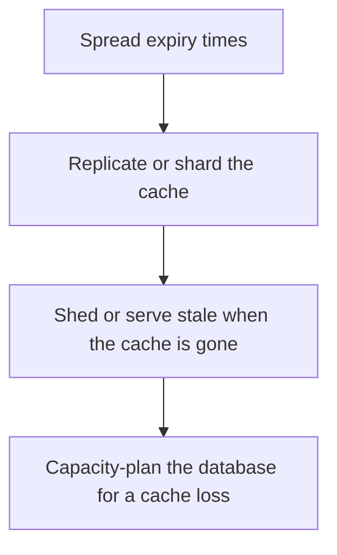

# D11-T010 — Cache avalanche

Topic ID: `D11-T010`
Domain: Redis and Caching
Subdomain: Cache avalanche
Importance: core
Complexity: intermediate
Dependencies: `D11-T009`, `D11-T001`, `D07-T001`, `D07-T002`, `D05-T001`, `D05-T002`
Execution status of the code in section F: unexecuted

## A. Topic Overview

A cache avalanche is a large fraction of keys expiring or a cache node dying at the same time, so the database receives the full read load. It differs from a stampede, which is one key. Prevention is jittered TTLs, replicated cache, multiple shards, and a database that can absorb a partial loss. Serving stale data for a short time is a deliberate degradation.

In production this shows up as follows: A Redis cluster restart with no jitter and no stale-serve sends the entire product catalog at the primary database. The database's connection limit is hit and writes fail too.

Interviewers use Cache avalanche to see whether you can state the failure mode, not only the definition. The failure to name is: a cold restart of the only cache cluster taking the database down with it

Prerequisites: `D11-T009`, `D11-T001`, `D07-T001`, `D07-T002`, `D05-T001`, `D05-T002`. Later notes should link here instead of repeating the mechanism.

## B. First-Principles Explanation

A cache avalanche is a large fraction of keys expiring or a cache node dying at the same time, so the database receives the full read load. It differs from a stampede, which is one key. Prevention is jittered TTLs, replicated cache, multiple shards, and a database that can absorb a partial loss. Serving stale data for a short time is a deliberate degradation.

The useful picture is: An avalanche is every photocopy in the building expiring at noon, not one popular page.

What has to be true:

1. Spread expiry times
2. Replicate or shard the cache
3. Shed or serve stale when the cache is gone
4. Capacity-plan the database for a cache loss

It works when those steps preserve one invariant. It fails when a cold restart of the only cache cluster taking the database down with it. The alternative is: you run a single cache node and no degradation plan

## C. Internal Working and Architecture

Components involved: the caller, the state Cache avalanche mutates or reads, and the observer that reports database QPS when cache hit ratio drops, and the fraction of keys sharing one TTL.

Execution:

1. Spread expiry times
2. Replicate or shard the cache
3. Shed or serve stale when the cache is gone
4. Capacity-plan the database for a cache loss

Data moves only along that path. A retry re-enters at step 1, so the operation must say what a duplicate does. Memory and locks stay inside this mechanism. Callers see the result or a typed error, not a half-updated invariant.

State to remember: choose this when many keys can disappear together. Do not choose it when you run a single cache node and no degradation plan.

## D. Diagrams and Visual Models



Read the diagram from top to bottom. Each box is one step of Cache avalanche. The failure mode (a cold restart of the only cache cluster taking the database down with it) is what you look for when a later box never happens or happens twice.

## E. Examples and Analogies

Analogy: An avalanche is every photocopy in the building expiring at noon, not one popular page.

Production example: A Redis cluster restart with no jitter and no stale-serve sends the entire product catalog at the primary database. The database's connection limit is hit and writes fail too.

A small counterexample is enough in an interview. Show the input, apply the steps, and show the broken outcome if someone uses the mechanism outside its rule: a cold restart of the only cache cluster taking the database down with it.

## F. Code Examples

The snippet is labeled unexecuted. It illustrates the shape of the idea. It is not a benchmark and it embeds no secret.

```python
def db_load(read_qps, hit_ratio):
    return read_qps * (1 - hit_ratio)
```

After the snippet, check database QPS when cache hit ratio drops, and the fraction of keys sharing one TTL. If that signal moves the wrong way, the snippet is the wrong tool for the workload.

## G. Practical Backend Application

Use Cache avalanche in a service when many keys can disappear together.

A typical place is the production case already stated: A Redis cluster restart with no jitter and no stale-serve sends the entire product catalog at the primary database. The database's connection limit is hit and writes fail too.

Operationally you alert on database QPS when cache hit ratio drops, and the fraction of keys sharing one TTL. You do not alert only on process uptime. The dashboard should show the failure mode, a success rate, and the saturation signal (queue depth, lock wait, or latency) that predicts it.

## H. Advantages, Limitations and Trade-offs

| Choice | Benefit | Cost | Choose when | Avoid when |
| --- | --- | --- | --- | --- |
| Apply Cache avalanche | many keys can disappear together | Extra moving parts and a new failure mode | The failure you are preventing is already real | you run a single cache node and no degradation plan |
| Simpler alternative | Less code and fewer dependencies | a cold restart of the only cache cluster taking the database down with it | The workload does not hit the limit | The invariant must hold under concurrency or failure |

Cache avalanche is a trade. State the benefit and the cost in the same sentence when you propose it in a design review.

## I. Common Mistakes and Misconceptions

- Identical TTLs.
- No cache replica.
- Assuming the database 'has headroom' without a number.
- Treating a diagram of Cache avalanche as proof that the invariant holds in production.
- Copying a default configuration without naming database QPS when cache hit ratio drops, and the fraction of keys sharing one TTL.

## J. Debugging and Troubleshooting

Symptom: a cold restart of the only cache cluster taking the database down with it

First check: database QPS when cache hit ratio drops, and the fraction of keys sharing one TTL.

Then compare one healthy instance against one unhealthy instance. Confirm whether retries are duplicating work. Confirm whether a timeout is shorter than the work. Fix the invariant, then watch the same metric for a full peak, not only for the next minute.

Useful questions: did the step order in section C actually happen, or did a caller skip a step? Did a deploy change the data shape that Cache avalanche assumes?

## K. Interview Preparation

### Beginner

#### Q1. What problem does Cache avalanche solve?

**Answer:** A cache avalanche is a large fraction of keys expiring or a cache node dying at the same time, so the database receives the full read load. It differs from a stampede, which is one key. Prevention is jittered TTLs, replicated cache, multiple shards, and a database that can absorb a partial loss. Serving stale data for a short time is a deliberate degradation. Without it, the usual backend failure is: a cold restart of the only cache cluster taking the database down with it.

#### Q2. Where does Cache avalanche sit on a request path?

**Answer:** Cache avalanche is not a library you sprinkle on every call. many keys can disappear together You notice it when database QPS when cache hit ratio drops, and the fraction of keys sharing one TTL. Name the constraint that makes this choice correct. Say what you would measure to confirm it.

#### Q3. Give a concrete example of Cache avalanche.

**Answer:** A Redis cluster restart with no jitter and no stale-serve sends the entire product catalog at the primary database. The database's connection limit is hit and writes fail too. Walk the input, the state change, and the observable output. Name the constraint that makes this choice correct.

#### Q4. What is a common mix-up around Cache avalanche?

**Answer:** a cold restart of the only cache cluster taking the database down with it The corrective check is database QPS when cache hit ratio drops, and the fraction of keys sharing one TTL. Name the constraint that makes this choice correct. Say what you would measure to confirm it. Say which alternative you rejected and why.

#### Q5. When would you skip Cache avalanche?

**Answer:** you run a single cache node and no degradation plan Skipping is a decision with a measured cost, not a slogan. Name the constraint that makes this choice correct. Say what you would measure to confirm it. Say which alternative you rejected and why.

### Intermediate

#### Q1. What invariant makes Cache avalanche correct?

**Answer:** A cache avalanche is a large fraction of keys expiring or a cache node dying at the same time, so the database receives the full read load. It differs from a stampede, which is one key. Prevention is jittered TTLs, replicated cache, multiple shards, and a database that can absorb a partial loss. Serving stale data for a short time is a deliberate degradation. State the invariant before you name the tool.

#### Q2. How do you test Cache avalanche?

**Answer:** Assert the failure mode directly: a cold restart of the only cache cluster taking the database down with it. The assertion should watch database QPS when cache hit ratio drops, and the fraction of keys sharing one TTL. Include a concurrent or retry case if the bug only appears then. Name the constraint that makes this choice correct.

#### Q3. What signal tells you Cache avalanche is misbehaving in production?

**Answer:** Watch database QPS when cache hit ratio drops, and the fraction of keys sharing one TTL. The user-visible symptom is usually a cold restart of the only cache cluster taking the database down with it. Name the constraint that makes this choice correct. Say what you would measure to confirm it.

#### Q4. How would you introduce Cache avalanche into a legacy service?

**Answer:** many keys can disappear together Ship it behind a metric so you can compare the old path. Roll back if a cold restart of the only cache cluster taking the database down with it gets worse. Name the constraint that makes this choice correct. Say what you would measure to confirm it.

#### Q5. What do you trade away by choosing Cache avalanche?

**Answer:** many keys can disappear together you run a single cache node and no degradation plan Say the cost in latency, storage, or operational load. Name the constraint that makes this choice correct. Say what you would measure to confirm it. Say which alternative you rejected and why.

### Advanced

#### Q1. What breaks if a dependency of Cache avalanche is slow or down?

**Answer:** a cold restart of the only cache cluster taking the database down with it Degrade using the rule: you run a single cache node and no degradation plan. Timeouts must be shorter than the caller's deadline. Name the constraint that makes this choice correct. Say what you would measure to confirm it.

#### Q2. How does Cache avalanche behave under retries?

**Answer:** Retries repeat work, so Cache avalanche must define what a duplicate does. a cold restart of the only cache cluster taking the database down with it Idempotency keys or fences belong next to the write, not in a comment. Name the constraint that makes this choice correct. Say what you would measure to confirm it.

#### Q3. What is the capacity limit of Cache avalanche?

**Answer:** The limit shows up as database QPS when cache hit ratio drops, and the fraction of keys sharing one TTL. Add capacity only after you know whether the bottleneck is CPU, lock wait, or network. Name the constraint that makes this choice correct. Say what you would measure to confirm it.

#### Q4. How do you evolve Cache avalanche without a flag day?

**Answer:** many keys can disappear together Version the contract or the on-disk format. Readers should tolerate one old and one new shape during the rollout. Name the constraint that makes this choice correct. Say what you would measure to confirm it.

#### Q5. What security or correctness bug hides inside Cache avalanche?

**Answer:** a cold restart of the only cache cluster taking the database down with it Check authorization and tenancy at the same boundary as the mechanism. A cache or queue must not widen who can read the data. Name the constraint that makes this choice correct. Say what you would measure to confirm it.

### Scenario

#### Q1. Incident: a cold restart of the only cache cluster taking the database down with it. What do you check first?

**Answer:** Start with database QPS when cache hit ratio drops, and the fraction of keys sharing one TTL. Compare a good host and a bad host before you restart anything. A cache avalanche is a large fraction of keys expiring or a cache node dying at the same time, so the database receives the full read load. It differs from a stampede, which is one key. Prevention is jittered TTLs, replicated cache, multiple shards, and a database that can absorb a partial loss. Serving stale data for a short time is a deliberate degradation.

#### Q2. A reviewer wants the clever version. What data settles it?

**Answer:** many keys can disappear together you run a single cache node and no degradation plan Bring database QPS when cache hit ratio drops, and the fraction of keys sharing one TTL from a load test or from production, not a slogan. Name the constraint that makes this choice correct. Say what you would measure to confirm it. Say which alternative you rejected and why.

#### Q3. You have one hour to explain Cache avalanche at a whiteboard.

**Answer:** Draw the happy path in four boxes. Then draw the failure: a cold restart of the only cache cluster taking the database down with it. End with the metric you would page on. Name the constraint that makes this choice correct.

#### Q4. The bug only appears under two concurrent callers.

**Answer:** a cold restart of the only cache cluster taking the database down with it Reproduce with a barrier so both sides enter the critical window. Confirm the fix with database QPS when cache hit ratio drops, and the fraction of keys sharing one TTL. Name the constraint that makes this choice correct. Say what you would measure to confirm it.

#### Q5. Leadership wants this on every service next week.

**Answer:** you run a single cache node and no degradation plan many keys can disappear together Roll it out where the failure mode is already hurting users. Name the constraint that makes this choice correct. Say what you would measure to confirm it. Say which alternative you rejected and why.

### Follow-up

#### Q1. What did you assume about the data size or the clock?

**Answer:** A cache avalanche is a large fraction of keys expiring or a cache node dying at the same time, so the database receives the full read load. It differs from a stampede, which is one key. Prevention is jittered TTLs, replicated cache, multiple shards, and a database that can absorb a partial loss. Serving stale data for a short time is a deliberate degradation. Clocks are not a total order across machines. State whether the algorithm needs bounded size or a single leader.

#### Q2. What would you measure after the change ships?

**Answer:** Page on database QPS when cache hit ratio drops, and the fraction of keys sharing one TTL. Keep a before/after dashboard for one week. Alert on the failure mode, not only on CPU. Name the constraint that makes this choice correct.

#### Q3. Which neighboring topic did you deliberately not re-teach?

**Answer:** This note owns Cache avalanche. Related identifiers are in section N. Shared ideas are linked, not copied. Name the constraint that makes this choice correct.

## L. Practical Exercises

Solutions are in `EXERCISES/solutions/D11-T010.md`, not in this section.

1. Whiteboard the four steps of Cache avalanche and mark where `a cold restart of the only cache cluster taking the database down with it` enters.
2. Read the snippet in section F and write the assertion that would catch that failure. The assertion must mention `database QPS when cache hit ratio drops, and the fraction of keys sharing one TTL`.
3. Argue for or against using Cache avalanche on a service you know. Use the choose and avoid rows from section H. Do not appeal to popularity.

## M. Revision Notes

- Mechanism: A cache avalanche is a large fraction of keys expiring or a cache node dying at the same time, so the database receives the full read load.
- Failure: a cold restart of the only cache cluster taking the database down with it
- Metric: database QPS when cache hit ratio drops, and the fraction of keys sharing one TTL
- Choose when: many keys can disappear together
- Avoid when: you run a single cache node and no degradation plan

## N. Related Topics

Dependencies to review first: `D11-T009`, `D11-T001`, `D07-T001`, `D07-T002`, `D05-T001`, `D05-T002`.

Shared ideas stay in those notes. This note does not restate them.

## O. Completion Criteria

- You can explain Cache avalanche without reading this note, including the failure mode.
- You can draw the diagram in section D from memory.
- You can say when not to use it, using the avoid condition in section H.
- You can name the metric you would watch after shipping it.
