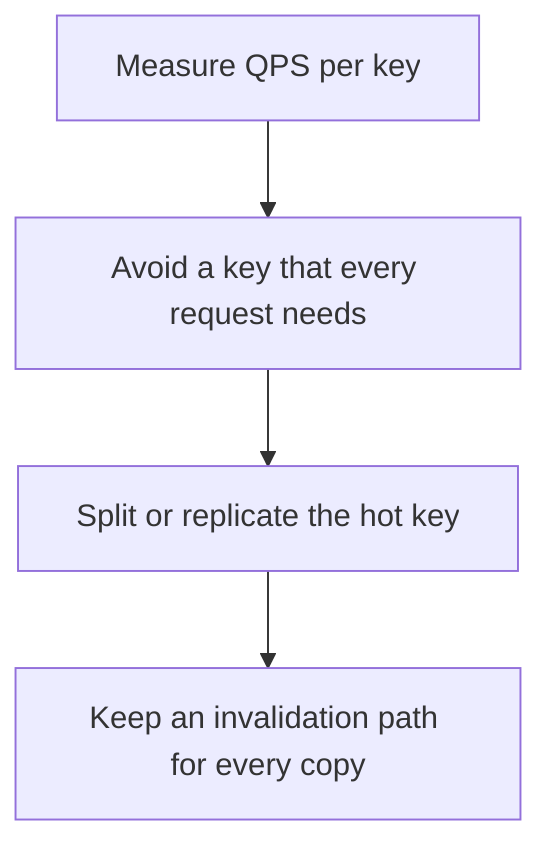

# D11-T011 — Hot keys and key design

Topic ID: `D11-T011`
Domain: Redis and Caching
Subdomain: Hot keys and key design
Importance: core
Complexity: intermediate
Dependencies: `D11-T010`, `D11-T001`, `D07-T001`, `D07-T002`, `D05-T001`, `D05-T002`
Execution status of the code in section F: unexecuted

## A. Topic Overview

A hot key is one key whose traffic does not fit on a single cache shard's CPU or network. Key design decides which data shares a slot. Prefixes that map to one shard, huge values, and a single global counter are the usual causes. Replicas of the hot key, local in-process caches, and splitting the key into partitions spread the load. The key must still be invalidatable.

In production this shows up as follows: A global 'site-config' key is read on every request and pins one shard. An in-process cache with a one-second TTL takes that read off Redis. A per-user feed key is fine until one celebrity is on it.

Interviewers use Hot keys and key design to see whether you can state the failure mode, not only the definition. The failure to name is: one Redis shard at 100 percent CPU while the others are idle

Prerequisites: `D11-T010`, `D11-T001`, `D07-T001`, `D07-T002`, `D05-T001`, `D05-T002`. Later notes should link here instead of repeating the mechanism.

## B. First-Principles Explanation

A hot key is one key whose traffic does not fit on a single cache shard's CPU or network. Key design decides which data shares a slot. Prefixes that map to one shard, huge values, and a single global counter are the usual causes. Replicas of the hot key, local in-process caches, and splitting the key into partitions spread the load. The key must still be invalidatable.

The useful picture is: A hot key is one hook that everyone hangs their coat on until the hook snaps. Extra hooks only help if people use different ones.

What has to be true:

1. Measure QPS per key
2. Avoid a key that every request needs
3. Split or replicate the hot key
4. Keep an invalidation path for every copy

It works when those steps preserve one invariant. It fails when one Redis shard at 100 percent CPU while the others are idle. The alternative is: you split keys and then cannot invalidate all the pieces

## C. Internal Working and Architecture

Components involved: the caller, the state Hot keys and key design mutates or reads, and the observer that reports QPS and bytes per key, and CPU of the hottest shard.

Execution:

1. Measure QPS per key
2. Avoid a key that every request needs
3. Split or replicate the hot key
4. Keep an invalidation path for every copy

Data moves only along that path. A retry re-enters at step 1, so the operation must say what a duplicate does. Memory and locks stay inside this mechanism. Callers see the result or a typed error, not a half-updated invariant.

State to remember: choose this when one key or one shard is hotter than the rest. Do not choose it when you split keys and then cannot invalidate all the pieces.

## D. Diagrams and Visual Models



Read the diagram from top to bottom. Each box is one step of Hot keys and key design. The failure mode (one Redis shard at 100 percent CPU while the others are idle) is what you look for when a later box never happens or happens twice.

## E. Examples and Analogies

Analogy: A hot key is one hook that everyone hangs their coat on until the hook snaps. Extra hooks only help if people use different ones.

Production example: A global 'site-config' key is read on every request and pins one shard. An in-process cache with a one-second TTL takes that read off Redis. A per-user feed key is fine until one celebrity is on it.

A small counterexample is enough in an interview. Show the input, apply the steps, and show the broken outcome if someone uses the mechanism outside its rule: one Redis shard at 100 percent CPU while the others are idle.

## F. Code Examples

The snippet is labeled unexecuted. It illustrates the shape of the idea. It is not a benchmark and it embeds no secret.

```python
def split_counter(user_id, buckets=16):
    return f'likes:{user_id}:{hash(user_id) % buckets}'
```

After the snippet, check QPS and bytes per key, and CPU of the hottest shard. If that signal moves the wrong way, the snippet is the wrong tool for the workload.

## G. Practical Backend Application

Use Hot keys and key design in a service when one key or one shard is hotter than the rest.

A typical place is the production case already stated: A global 'site-config' key is read on every request and pins one shard. An in-process cache with a one-second TTL takes that read off Redis. A per-user feed key is fine until one celebrity is on it.

Operationally you alert on QPS and bytes per key, and CPU of the hottest shard. You do not alert only on process uptime. The dashboard should show the failure mode, a success rate, and the saturation signal (queue depth, lock wait, or latency) that predicts it.

## H. Advantages, Limitations and Trade-offs

| Choice | Benefit | Cost | Choose when | Avoid when |
| --- | --- | --- | --- | --- |
| Apply Hot keys and key design | one key or one shard is hotter than the rest | Extra moving parts and a new failure mode | The failure you are preventing is already real | you split keys and then cannot invalidate all the pieces |
| Simpler alternative | Less code and fewer dependencies | one Redis shard at 100 percent CPU while the others are idle | The workload does not hit the limit | The invariant must hold under concurrency or failure |

Hot keys and key design is a trade. State the benefit and the cost in the same sentence when you propose it in a design review.

## I. Common Mistakes and Misconceptions

- A single global counter on one key.
- A multi-megabyte value.
- Hash tags that force a whole tenant onto one slot.
- Treating a diagram of Hot keys and key design as proof that the invariant holds in production.
- Copying a default configuration without naming QPS and bytes per key, and CPU of the hottest shard.

## J. Debugging and Troubleshooting

Symptom: one Redis shard at 100 percent CPU while the others are idle

First check: QPS and bytes per key, and CPU of the hottest shard.

Then compare one healthy instance against one unhealthy instance. Confirm whether retries are duplicating work. Confirm whether a timeout is shorter than the work. Fix the invariant, then watch the same metric for a full peak, not only for the next minute.

Useful questions: did the step order in section C actually happen, or did a caller skip a step? Did a deploy change the data shape that Hot keys and key design assumes?

## K. Interview Preparation

### Beginner

#### Q1. What problem does Hot keys and key design solve?

**Answer:** A hot key is one key whose traffic does not fit on a single cache shard's CPU or network. Key design decides which data shares a slot. Prefixes that map to one shard, huge values, and a single global counter are the usual causes. Replicas of the hot key, local in-process caches, and splitting the key into partitions spread the load. The key must still be invalidatable. Without it, the usual backend failure is: one Redis shard at 100 percent CPU while the others are idle.

#### Q2. Where does Hot keys and key design sit on a request path?

**Answer:** Hot keys and key design is not a library you sprinkle on every call. one key or one shard is hotter than the rest You notice it when QPS and bytes per key, and CPU of the hottest shard. Name the constraint that makes this choice correct. Say what you would measure to confirm it.

#### Q3. Give a concrete example of Hot keys and key design.

**Answer:** A global 'site-config' key is read on every request and pins one shard. An in-process cache with a one-second TTL takes that read off Redis. A per-user feed key is fine until one celebrity is on it. Walk the input, the state change, and the observable output.

#### Q4. What is a common mix-up around Hot keys and key design?

**Answer:** one Redis shard at 100 percent CPU while the others are idle The corrective check is QPS and bytes per key, and CPU of the hottest shard. Name the constraint that makes this choice correct. Say what you would measure to confirm it. Say which alternative you rejected and why.

#### Q5. When would you skip Hot keys and key design?

**Answer:** you split keys and then cannot invalidate all the pieces Skipping is a decision with a measured cost, not a slogan. Name the constraint that makes this choice correct. Say what you would measure to confirm it. Say which alternative you rejected and why.

### Intermediate

#### Q1. What invariant makes Hot keys and key design correct?

**Answer:** A hot key is one key whose traffic does not fit on a single cache shard's CPU or network. Key design decides which data shares a slot. Prefixes that map to one shard, huge values, and a single global counter are the usual causes. Replicas of the hot key, local in-process caches, and splitting the key into partitions spread the load. The key must still be invalidatable. State the invariant before you name the tool.

#### Q2. How do you test Hot keys and key design?

**Answer:** Assert the failure mode directly: one Redis shard at 100 percent CPU while the others are idle. The assertion should watch QPS and bytes per key, and CPU of the hottest shard. Include a concurrent or retry case if the bug only appears then. Name the constraint that makes this choice correct.

#### Q3. What signal tells you Hot keys and key design is misbehaving in production?

**Answer:** Watch QPS and bytes per key, and CPU of the hottest shard. The user-visible symptom is usually one Redis shard at 100 percent CPU while the others are idle. Name the constraint that makes this choice correct. Say what you would measure to confirm it.

#### Q4. How would you introduce Hot keys and key design into a legacy service?

**Answer:** one key or one shard is hotter than the rest Ship it behind a metric so you can compare the old path. Roll back if one Redis shard at 100 percent CPU while the others are idle gets worse. Name the constraint that makes this choice correct. Say what you would measure to confirm it.

#### Q5. What do you trade away by choosing Hot keys and key design?

**Answer:** one key or one shard is hotter than the rest you split keys and then cannot invalidate all the pieces Say the cost in latency, storage, or operational load. Name the constraint that makes this choice correct. Say what you would measure to confirm it. Say which alternative you rejected and why.

### Advanced

#### Q1. What breaks if a dependency of Hot keys and key design is slow or down?

**Answer:** one Redis shard at 100 percent CPU while the others are idle Degrade using the rule: you split keys and then cannot invalidate all the pieces. Timeouts must be shorter than the caller's deadline. Name the constraint that makes this choice correct. Say what you would measure to confirm it.

#### Q2. How does Hot keys and key design behave under retries?

**Answer:** Retries repeat work, so Hot keys and key design must define what a duplicate does. one Redis shard at 100 percent CPU while the others are idle Idempotency keys or fences belong next to the write, not in a comment. Name the constraint that makes this choice correct. Say what you would measure to confirm it.

#### Q3. What is the capacity limit of Hot keys and key design?

**Answer:** The limit shows up as QPS and bytes per key, and CPU of the hottest shard. Add capacity only after you know whether the bottleneck is CPU, lock wait, or network. Name the constraint that makes this choice correct. Say what you would measure to confirm it.

#### Q4. How do you evolve Hot keys and key design without a flag day?

**Answer:** one key or one shard is hotter than the rest Version the contract or the on-disk format. Readers should tolerate one old and one new shape during the rollout. Name the constraint that makes this choice correct. Say what you would measure to confirm it.

#### Q5. What security or correctness bug hides inside Hot keys and key design?

**Answer:** one Redis shard at 100 percent CPU while the others are idle Check authorization and tenancy at the same boundary as the mechanism. A cache or queue must not widen who can read the data. Name the constraint that makes this choice correct. Say what you would measure to confirm it.

### Scenario

#### Q1. Incident: one Redis shard at 100 percent CPU while the others are idle. What do you check first?

**Answer:** Start with QPS and bytes per key, and CPU of the hottest shard. Compare a good host and a bad host before you restart anything. A hot key is one key whose traffic does not fit on a single cache shard's CPU or network. Key design decides which data shares a slot. Prefixes that map to one shard, huge values, and a single global counter are the usual causes. Replicas of the hot key, local in-process caches, and splitting the key into partitions spread the load. The key must still be invalidatable.

#### Q2. A reviewer wants the clever version. What data settles it?

**Answer:** one key or one shard is hotter than the rest you split keys and then cannot invalidate all the pieces Bring QPS and bytes per key, and CPU of the hottest shard from a load test or from production, not a slogan. Name the constraint that makes this choice correct. Say what you would measure to confirm it. Say which alternative you rejected and why.

#### Q3. You have one hour to explain Hot keys and key design at a whiteboard.

**Answer:** Draw the happy path in four boxes. Then draw the failure: one Redis shard at 100 percent CPU while the others are idle. End with the metric you would page on. Name the constraint that makes this choice correct.

#### Q4. The bug only appears under two concurrent callers.

**Answer:** one Redis shard at 100 percent CPU while the others are idle Reproduce with a barrier so both sides enter the critical window. Confirm the fix with QPS and bytes per key, and CPU of the hottest shard. Name the constraint that makes this choice correct. Say what you would measure to confirm it.

#### Q5. Leadership wants this on every service next week.

**Answer:** you split keys and then cannot invalidate all the pieces one key or one shard is hotter than the rest Roll it out where the failure mode is already hurting users. Name the constraint that makes this choice correct. Say what you would measure to confirm it. Say which alternative you rejected and why.

### Follow-up

#### Q1. What did you assume about the data size or the clock?

**Answer:** A hot key is one key whose traffic does not fit on a single cache shard's CPU or network. Key design decides which data shares a slot. Prefixes that map to one shard, huge values, and a single global counter are the usual causes. Replicas of the hot key, local in-process caches, and splitting the key into partitions spread the load. The key must still be invalidatable. Clocks are not a total order across machines. State whether the algorithm needs bounded size or a single leader.

#### Q2. What would you measure after the change ships?

**Answer:** Page on QPS and bytes per key, and CPU of the hottest shard. Keep a before/after dashboard for one week. Alert on the failure mode, not only on CPU. Name the constraint that makes this choice correct.

#### Q3. Which neighboring topic did you deliberately not re-teach?

**Answer:** This note owns Hot keys and key design. Related identifiers are in section N. Shared ideas are linked, not copied. Name the constraint that makes this choice correct.

## L. Practical Exercises

Solutions are in `EXERCISES/solutions/D11-T011.md`, not in this section.

1. Whiteboard the four steps of Hot keys and key design and mark where `one Redis shard at 100 percent CPU while the others are idle` enters.
2. Read the snippet in section F and write the assertion that would catch that failure. The assertion must mention `QPS and bytes per key, and CPU of the hottest shard`.
3. Argue for or against using Hot keys and key design on a service you know. Use the choose and avoid rows from section H. Do not appeal to popularity.

## M. Revision Notes

- Mechanism: A hot key is one key whose traffic does not fit on a single cache shard's CPU or network.
- Failure: one Redis shard at 100 percent CPU while the others are idle
- Metric: QPS and bytes per key, and CPU of the hottest shard
- Choose when: one key or one shard is hotter than the rest
- Avoid when: you split keys and then cannot invalidate all the pieces

## N. Related Topics

Dependencies to review first: `D11-T010`, `D11-T001`, `D07-T001`, `D07-T002`, `D05-T001`, `D05-T002`.

Shared ideas stay in those notes. This note does not restate them.

## O. Completion Criteria

- You can explain Hot keys and key design without reading this note, including the failure mode.
- You can draw the diagram in section D from memory.
- You can say when not to use it, using the avoid condition in section H.
- You can name the metric you would watch after shipping it.
