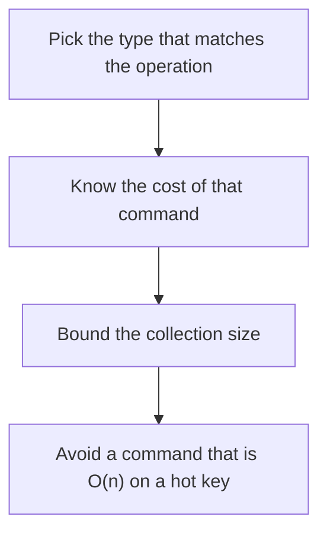

# D11-T012 — Redis strings, hashes, lists, sets, sorted sets

Topic ID: `D11-T012`
Domain: Redis and Caching
Subdomain: Redis strings, hashes, lists, sets, sorted sets
Importance: core
Complexity: intermediate
Dependencies: `D11-T011`, `D11-T001`, `D07-T001`, `D07-T002`, `D05-T001`, `D05-T002`
Execution status of the code in section F: unexecuted

## A. Topic Overview

Redis strings hold bytes, numbers, and bitfields. Hashes hold field maps and fit an object with many small attributes. Lists are ordered linked sequences. Sets are unique unordered members. Sorted sets are members with a score, ordered by that score. The type decides the commands and the cost. A list used as a random-access array is the wrong type.

In production this shows up as follows: A user profile stored as a hash lets you update one field. A leaderboard stored as a sorted set answers top ten. A list of every historical event in one key becomes a blocking read.

Interviewers use Redis strings, hashes, lists, sets, sorted sets to see whether you can state the failure mode, not only the definition. The failure to name is: LRANGE or SMEMBERS on a million-member key blocking the server

Prerequisites: `D11-T011`, `D11-T001`, `D07-T001`, `D07-T002`, `D05-T001`, `D05-T002`. Later notes should link here instead of repeating the mechanism.

## B. First-Principles Explanation

Redis strings hold bytes, numbers, and bitfields. Hashes hold field maps and fit an object with many small attributes. Lists are ordered linked sequences. Sets are unique unordered members. Sorted sets are members with a score, ordered by that score. The type decides the commands and the cost. A list used as a random-access array is the wrong type.

The useful picture is: A string is one labeled jar. A hash is a tray of small jars. A sorted set is a ranked list. You do not pour out a million-name list on every request.

What has to be true:

1. Pick the type that matches the operation
2. Know the cost of that command
3. Bound the collection size
4. Avoid a command that is O(n) on a hot key

It works when those steps preserve one invariant. It fails when LRANGE or SMEMBERS on a million-member key blocking the server. The alternative is: you need a query language or a value larger than a request should wait for

## C. Internal Working and Architecture

Components involved: the caller, the state Redis strings, hashes, lists, sets, sorted sets mutates or reads, and the observer that reports command latency and collection cardinality.

Execution:

1. Pick the type that matches the operation
2. Know the cost of that command
3. Bound the collection size
4. Avoid a command that is O(n) on a hot key

Data moves only along that path. A retry re-enters at step 1, so the operation must say what a duplicate does. Memory and locks stay inside this mechanism. Callers see the result or a typed error, not a half-updated invariant.

State to remember: choose this when the operation matches a Redis type's cheap command. Do not choose it when you need a query language or a value larger than a request should wait for.

## D. Diagrams and Visual Models



Read the diagram from top to bottom. Each box is one step of Redis strings, hashes, lists, sets, sorted sets. The failure mode (LRANGE or SMEMBERS on a million-member key blocking the server) is what you look for when a later box never happens or happens twice.

## E. Examples and Analogies

Analogy: A string is one labeled jar. A hash is a tray of small jars. A sorted set is a ranked list. You do not pour out a million-name list on every request.

Production example: A user profile stored as a hash lets you update one field. A leaderboard stored as a sorted set answers top ten. A list of every historical event in one key becomes a blocking read.

A small counterexample is enough in an interview. Show the input, apply the steps, and show the broken outcome if someone uses the mechanism outside its rule: LRANGE or SMEMBERS on a million-member key blocking the server.

## F. Code Examples

The snippet is labeled unexecuted. It illustrates the shape of the idea. It is not a benchmark and it embeds no secret.

```text
HSET user:1 name ada
ZADD leaderboard 10 user:1
```

After the snippet, check command latency and collection cardinality. If that signal moves the wrong way, the snippet is the wrong tool for the workload.

## G. Practical Backend Application

Use Redis strings, hashes, lists, sets, sorted sets in a service when the operation matches a Redis type's cheap command.

A typical place is the production case already stated: A user profile stored as a hash lets you update one field. A leaderboard stored as a sorted set answers top ten. A list of every historical event in one key becomes a blocking read.

Operationally you alert on command latency and collection cardinality. You do not alert only on process uptime. The dashboard should show the failure mode, a success rate, and the saturation signal (queue depth, lock wait, or latency) that predicts it.

## H. Advantages, Limitations and Trade-offs

| Choice | Benefit | Cost | Choose when | Avoid when |
| --- | --- | --- | --- | --- |
| Apply Redis strings, hashes, lists, sets, sorted sets | the operation matches a Redis type's cheap command | Extra moving parts and a new failure mode | The failure you are preventing is already real | you need a query language or a value larger than a request should wait for |
| Simpler alternative | Less code and fewer dependencies | LRANGE or SMEMBERS on a million-member key blocking the server | The workload does not hit the limit | The invariant must hold under concurrency or failure |

Redis strings, hashes, lists, sets, sorted sets is a trade. State the benefit and the cost in the same sentence when you propose it in a design review.

## I. Common Mistakes and Misconceptions

- One giant list.
- Using KEYS in production.
- Storing JSON in a string and updating it with a lost-update race.
- Treating a diagram of Redis strings, hashes, lists, sets, sorted sets as proof that the invariant holds in production.
- Copying a default configuration without naming command latency and collection cardinality.

## J. Debugging and Troubleshooting

Symptom: LRANGE or SMEMBERS on a million-member key blocking the server

First check: command latency and collection cardinality.

Then compare one healthy instance against one unhealthy instance. Confirm whether retries are duplicating work. Confirm whether a timeout is shorter than the work. Fix the invariant, then watch the same metric for a full peak, not only for the next minute.

Useful questions: did the step order in section C actually happen, or did a caller skip a step? Did a deploy change the data shape that Redis strings, hashes, lists, sets, sorted sets assumes?

## K. Interview Preparation

### Beginner

#### Q1. What problem does Redis strings, hashes, lists, sets, sorted sets solve?

**Answer:** Redis strings hold bytes, numbers, and bitfields. Hashes hold field maps and fit an object with many small attributes. Lists are ordered linked sequences. Sets are unique unordered members. Sorted sets are members with a score, ordered by that score. The type decides the commands and the cost. A list used as a random-access array is the wrong type. Without it, the usual backend failure is: LRANGE or SMEMBERS on a million-member key blocking the server.

#### Q2. Where does Redis strings, hashes, lists, sets, sorted sets sit on a request path?

**Answer:** Redis strings, hashes, lists, sets, sorted sets is not a library you sprinkle on every call. the operation matches a Redis type's cheap command You notice it when command latency and collection cardinality. Name the constraint that makes this choice correct. Say what you would measure to confirm it.

#### Q3. Give a concrete example of Redis strings, hashes, lists, sets, sorted sets.

**Answer:** A user profile stored as a hash lets you update one field. A leaderboard stored as a sorted set answers top ten. A list of every historical event in one key becomes a blocking read. Walk the input, the state change, and the observable output.

#### Q4. What is a common mix-up around Redis strings, hashes, lists, sets, sorted sets?

**Answer:** LRANGE or SMEMBERS on a million-member key blocking the server The corrective check is command latency and collection cardinality. Name the constraint that makes this choice correct. Say what you would measure to confirm it. Say which alternative you rejected and why.

#### Q5. When would you skip Redis strings, hashes, lists, sets, sorted sets?

**Answer:** you need a query language or a value larger than a request should wait for Skipping is a decision with a measured cost, not a slogan. Name the constraint that makes this choice correct. Say what you would measure to confirm it. Say which alternative you rejected and why.

### Intermediate

#### Q1. What invariant makes Redis strings, hashes, lists, sets, sorted sets correct?

**Answer:** Redis strings hold bytes, numbers, and bitfields. Hashes hold field maps and fit an object with many small attributes. Lists are ordered linked sequences. Sets are unique unordered members. Sorted sets are members with a score, ordered by that score. The type decides the commands and the cost. A list used as a random-access array is the wrong type. State the invariant before you name the tool.

#### Q2. How do you test Redis strings, hashes, lists, sets, sorted sets?

**Answer:** Assert the failure mode directly: LRANGE or SMEMBERS on a million-member key blocking the server. The assertion should watch command latency and collection cardinality. Include a concurrent or retry case if the bug only appears then. Name the constraint that makes this choice correct.

#### Q3. What signal tells you Redis strings, hashes, lists, sets, sorted sets is misbehaving in production?

**Answer:** Watch command latency and collection cardinality. The user-visible symptom is usually LRANGE or SMEMBERS on a million-member key blocking the server. Name the constraint that makes this choice correct. Say what you would measure to confirm it.

#### Q4. How would you introduce Redis strings, hashes, lists, sets, sorted sets into a legacy service?

**Answer:** the operation matches a Redis type's cheap command Ship it behind a metric so you can compare the old path. Roll back if LRANGE or SMEMBERS on a million-member key blocking the server gets worse. Name the constraint that makes this choice correct. Say what you would measure to confirm it.

#### Q5. What do you trade away by choosing Redis strings, hashes, lists, sets, sorted sets?

**Answer:** the operation matches a Redis type's cheap command you need a query language or a value larger than a request should wait for Say the cost in latency, storage, or operational load. Name the constraint that makes this choice correct. Say what you would measure to confirm it. Say which alternative you rejected and why.

### Advanced

#### Q1. What breaks if a dependency of Redis strings, hashes, lists, sets, sorted sets is slow or down?

**Answer:** LRANGE or SMEMBERS on a million-member key blocking the server Degrade using the rule: you need a query language or a value larger than a request should wait for. Timeouts must be shorter than the caller's deadline. Name the constraint that makes this choice correct. Say what you would measure to confirm it.

#### Q2. How does Redis strings, hashes, lists, sets, sorted sets behave under retries?

**Answer:** Retries repeat work, so Redis strings, hashes, lists, sets, sorted sets must define what a duplicate does. LRANGE or SMEMBERS on a million-member key blocking the server Idempotency keys or fences belong next to the write, not in a comment. Name the constraint that makes this choice correct. Say what you would measure to confirm it.

#### Q3. What is the capacity limit of Redis strings, hashes, lists, sets, sorted sets?

**Answer:** The limit shows up as command latency and collection cardinality. Add capacity only after you know whether the bottleneck is CPU, lock wait, or network. Name the constraint that makes this choice correct. Say what you would measure to confirm it.

#### Q4. How do you evolve Redis strings, hashes, lists, sets, sorted sets without a flag day?

**Answer:** the operation matches a Redis type's cheap command Version the contract or the on-disk format. Readers should tolerate one old and one new shape during the rollout. Name the constraint that makes this choice correct. Say what you would measure to confirm it.

#### Q5. What security or correctness bug hides inside Redis strings, hashes, lists, sets, sorted sets?

**Answer:** LRANGE or SMEMBERS on a million-member key blocking the server Check authorization and tenancy at the same boundary as the mechanism. A cache or queue must not widen who can read the data. Name the constraint that makes this choice correct. Say what you would measure to confirm it.

### Scenario

#### Q1. Incident: LRANGE or SMEMBERS on a million-member key blocking the server. What do you check first?

**Answer:** Start with command latency and collection cardinality. Compare a good host and a bad host before you restart anything. Redis strings hold bytes, numbers, and bitfields. Hashes hold field maps and fit an object with many small attributes. Lists are ordered linked sequences. Sets are unique unordered members. Sorted sets are members with a score, ordered by that score. The type decides the commands and the cost. A list used as a random-access array is the wrong type.

#### Q2. A reviewer wants the clever version. What data settles it?

**Answer:** the operation matches a Redis type's cheap command you need a query language or a value larger than a request should wait for Bring command latency and collection cardinality from a load test or from production, not a slogan. Name the constraint that makes this choice correct. Say what you would measure to confirm it. Say which alternative you rejected and why.

#### Q3. You have one hour to explain Redis strings, hashes, lists, sets, sorted sets at a whiteboard.

**Answer:** Draw the happy path in four boxes. Then draw the failure: LRANGE or SMEMBERS on a million-member key blocking the server. End with the metric you would page on. Name the constraint that makes this choice correct.

#### Q4. The bug only appears under two concurrent callers.

**Answer:** LRANGE or SMEMBERS on a million-member key blocking the server Reproduce with a barrier so both sides enter the critical window. Confirm the fix with command latency and collection cardinality. Name the constraint that makes this choice correct. Say what you would measure to confirm it.

#### Q5. Leadership wants this on every service next week.

**Answer:** you need a query language or a value larger than a request should wait for the operation matches a Redis type's cheap command Roll it out where the failure mode is already hurting users. Name the constraint that makes this choice correct. Say what you would measure to confirm it. Say which alternative you rejected and why.

### Follow-up

#### Q1. What did you assume about the data size or the clock?

**Answer:** Redis strings hold bytes, numbers, and bitfields. Hashes hold field maps and fit an object with many small attributes. Lists are ordered linked sequences. Sets are unique unordered members. Sorted sets are members with a score, ordered by that score. The type decides the commands and the cost. A list used as a random-access array is the wrong type. Clocks are not a total order across machines. State whether the algorithm needs bounded size or a single leader.

#### Q2. What would you measure after the change ships?

**Answer:** Page on command latency and collection cardinality. Keep a before/after dashboard for one week. Alert on the failure mode, not only on CPU. Name the constraint that makes this choice correct.

#### Q3. Which neighboring topic did you deliberately not re-teach?

**Answer:** This note owns Redis strings, hashes, lists, sets, sorted sets. Related identifiers are in section N. Shared ideas are linked, not copied. Name the constraint that makes this choice correct.

## L. Practical Exercises

Solutions are in `EXERCISES/solutions/D11-T012.md`, not in this section.

1. Whiteboard the four steps of Redis strings, hashes, lists, sets, sorted sets and mark where `LRANGE or SMEMBERS on a million-member key blocking the server` enters.
2. Read the snippet in section F and write the assertion that would catch that failure. The assertion must mention `command latency and collection cardinality`.
3. Argue for or against using Redis strings, hashes, lists, sets, sorted sets on a service you know. Use the choose and avoid rows from section H. Do not appeal to popularity.

## M. Revision Notes

- Mechanism: Redis strings hold bytes, numbers, and bitfields.
- Failure: LRANGE or SMEMBERS on a million-member key blocking the server
- Metric: command latency and collection cardinality
- Choose when: the operation matches a Redis type's cheap command
- Avoid when: you need a query language or a value larger than a request should wait for

## N. Related Topics

Dependencies to review first: `D11-T011`, `D11-T001`, `D07-T001`, `D07-T002`, `D05-T001`, `D05-T002`.

Shared ideas stay in those notes. This note does not restate them.

## O. Completion Criteria

- You can explain Redis strings, hashes, lists, sets, sorted sets without reading this note, including the failure mode.
- You can draw the diagram in section D from memory.
- You can say when not to use it, using the avoid condition in section H.
- You can name the metric you would watch after shipping it.
