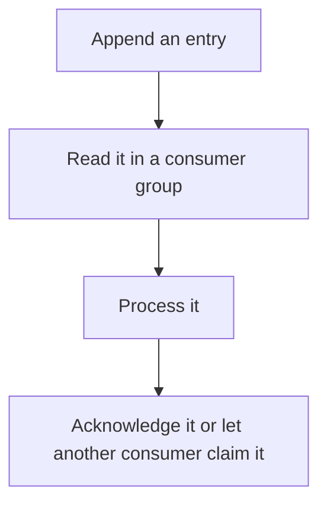

# D11-T013 — Redis Streams

Topic ID: `D11-T013`
Domain: Redis and Caching
Subdomain: Redis Streams
Importance: core
Complexity: intermediate
Dependencies: `D11-T012`, `D11-T001`, `D07-T001`, `D07-T002`, `D05-T001`, `D05-T002`
Execution status of the code in section F: unexecuted

## A. Topic Overview

Redis Streams is an append-only log of entries with ids. Consumer groups track which entries each consumer has pending. Acknowledgments remove an entry from the pending list. Unacked entries can be reclaimed if a consumer dies. Streams are not a durable multi-datacenter bus by themselves. The stream can be trimmed, which drops history.

In production this shows up as follows: A single-node background job channel uses a stream and a consumer group. A crashed worker's pending jobs are claimed after a timeout. The design is wrong if the job must survive the loss of that Redis node without AOF or a replica.

Interviewers use Redis Streams to see whether you can state the failure mode, not only the definition. The failure to name is: trimming a stream before consumers acknowledge, or leaving pending entries forever after a crash

Prerequisites: `D11-T012`, `D11-T001`, `D07-T001`, `D07-T002`, `D05-T001`, `D05-T002`. Later notes should link here instead of repeating the mechanism.

## B. First-Principles Explanation

Redis Streams is an append-only log of entries with ids. Consumer groups track which entries each consumer has pending. Acknowledgments remove an entry from the pending list. Unacked entries can be reclaimed if a consumer dies. Streams are not a durable multi-datacenter bus by themselves. The stream can be trimmed, which drops history.

The useful picture is: A stream is a notebook of jobs. A consumer group is a set of workers with bookmarks. An acknowledgment is crossing a job off. If you tear out pages, the bookmark may point at nothing.

What has to be true:

1. Append an entry
2. Read it in a consumer group
3. Process it
4. Acknowledge it or let another consumer claim it

It works when those steps preserve one invariant. It fails when trimming a stream before consumers acknowledge, or leaving pending entries forever after a crash. The alternative is: you need a durable cross-cluster event bus

## C. Internal Working and Architecture

Components involved: the caller, the state Redis Streams mutates or reads, and the observer that reports pending-entry age and stream length.

Execution:

1. Append an entry
2. Read it in a consumer group
3. Process it
4. Acknowledge it or let another consumer claim it

Data moves only along that path. A retry re-enters at step 1, so the operation must say what a duplicate does. Memory and locks stay inside this mechanism. Callers see the result or a typed error, not a half-updated invariant.

State to remember: choose this when you want a log and competing consumers inside Redis. Do not choose it when you need a durable cross-cluster event bus.

## D. Diagrams and Visual Models



Read the diagram from top to bottom. Each box is one step of Redis Streams. The failure mode (trimming a stream before consumers acknowledge, or leaving pending entries forever after a crash) is what you look for when a later box never happens or happens twice.

## E. Examples and Analogies

Analogy: A stream is a notebook of jobs. A consumer group is a set of workers with bookmarks. An acknowledgment is crossing a job off. If you tear out pages, the bookmark may point at nothing.

Production example: A single-node background job channel uses a stream and a consumer group. A crashed worker's pending jobs are claimed after a timeout. The design is wrong if the job must survive the loss of that Redis node without AOF or a replica.

A small counterexample is enough in an interview. Show the input, apply the steps, and show the broken outcome if someone uses the mechanism outside its rule: trimming a stream before consumers acknowledge, or leaving pending entries forever after a crash.

## F. Code Examples

The snippet is labeled unexecuted. It illustrates the shape of the idea. It is not a benchmark and it embeds no secret.

```text
XADD jobs * type email
XREADGROUP GROUP g1 c1 COUNT 10 STREAMS jobs >
```

After the snippet, check pending-entry age and stream length. If that signal moves the wrong way, the snippet is the wrong tool for the workload.

## G. Practical Backend Application

Use Redis Streams in a service when you want a log and competing consumers inside Redis.

A typical place is the production case already stated: A single-node background job channel uses a stream and a consumer group. A crashed worker's pending jobs are claimed after a timeout. The design is wrong if the job must survive the loss of that Redis node without AOF or a replica.

Operationally you alert on pending-entry age and stream length. You do not alert only on process uptime. The dashboard should show the failure mode, a success rate, and the saturation signal (queue depth, lock wait, or latency) that predicts it.

## H. Advantages, Limitations and Trade-offs

| Choice | Benefit | Cost | Choose when | Avoid when |
| --- | --- | --- | --- | --- |
| Apply Redis Streams | you want a log and competing consumers inside Redis | Extra moving parts and a new failure mode | The failure you are preventing is already real | you need a durable cross-cluster event bus |
| Simpler alternative | Less code and fewer dependencies | trimming a stream before consumers acknowledge, or leaving pending entries forever after a crash | The workload does not hit the limit | The invariant must hold under concurrency or failure |

Redis Streams is a trade. State the benefit and the cost in the same sentence when you propose it in a design review.

## I. Common Mistakes and Misconceptions

- No claim of pending entries.
- Trimming too aggressively.
- Assuming a stream replaces Kafka's retention and replication.
- Treating a diagram of Redis Streams as proof that the invariant holds in production.
- Copying a default configuration without naming pending-entry age and stream length.

## J. Debugging and Troubleshooting

Symptom: trimming a stream before consumers acknowledge, or leaving pending entries forever after a crash

First check: pending-entry age and stream length.

Then compare one healthy instance against one unhealthy instance. Confirm whether retries are duplicating work. Confirm whether a timeout is shorter than the work. Fix the invariant, then watch the same metric for a full peak, not only for the next minute.

Useful questions: did the step order in section C actually happen, or did a caller skip a step? Did a deploy change the data shape that Redis Streams assumes?

## K. Interview Preparation

### Beginner

#### Q1. What problem does Redis Streams solve?

**Answer:** Redis Streams is an append-only log of entries with ids. Consumer groups track which entries each consumer has pending. Acknowledgments remove an entry from the pending list. Unacked entries can be reclaimed if a consumer dies. Streams are not a durable multi-datacenter bus by themselves. The stream can be trimmed, which drops history. Without it, the usual backend failure is: trimming a stream before consumers acknowledge, or leaving pending entries forever after a crash.

#### Q2. Where does Redis Streams sit on a request path?

**Answer:** Redis Streams is not a library you sprinkle on every call. you want a log and competing consumers inside Redis You notice it when pending-entry age and stream length. Name the constraint that makes this choice correct. Say what you would measure to confirm it.

#### Q3. Give a concrete example of Redis Streams.

**Answer:** A single-node background job channel uses a stream and a consumer group. A crashed worker's pending jobs are claimed after a timeout. The design is wrong if the job must survive the loss of that Redis node without AOF or a replica. Walk the input, the state change, and the observable output.

#### Q4. What is a common mix-up around Redis Streams?

**Answer:** trimming a stream before consumers acknowledge, or leaving pending entries forever after a crash The corrective check is pending-entry age and stream length. Name the constraint that makes this choice correct. Say what you would measure to confirm it. Say which alternative you rejected and why.

#### Q5. When would you skip Redis Streams?

**Answer:** you need a durable cross-cluster event bus Skipping is a decision with a measured cost, not a slogan. Name the constraint that makes this choice correct. Say what you would measure to confirm it. Say which alternative you rejected and why.

### Intermediate

#### Q1. What invariant makes Redis Streams correct?

**Answer:** Redis Streams is an append-only log of entries with ids. Consumer groups track which entries each consumer has pending. Acknowledgments remove an entry from the pending list. Unacked entries can be reclaimed if a consumer dies. Streams are not a durable multi-datacenter bus by themselves. The stream can be trimmed, which drops history. State the invariant before you name the tool.

#### Q2. How do you test Redis Streams?

**Answer:** Assert the failure mode directly: trimming a stream before consumers acknowledge, or leaving pending entries forever after a crash. The assertion should watch pending-entry age and stream length. Include a concurrent or retry case if the bug only appears then. Name the constraint that makes this choice correct.

#### Q3. What signal tells you Redis Streams is misbehaving in production?

**Answer:** Watch pending-entry age and stream length. The user-visible symptom is usually trimming a stream before consumers acknowledge, or leaving pending entries forever after a crash. Name the constraint that makes this choice correct. Say what you would measure to confirm it.

#### Q4. How would you introduce Redis Streams into a legacy service?

**Answer:** you want a log and competing consumers inside Redis Ship it behind a metric so you can compare the old path. Roll back if trimming a stream before consumers acknowledge, or leaving pending entries forever after a crash gets worse. Name the constraint that makes this choice correct. Say what you would measure to confirm it.

#### Q5. What do you trade away by choosing Redis Streams?

**Answer:** you want a log and competing consumers inside Redis you need a durable cross-cluster event bus Say the cost in latency, storage, or operational load. Name the constraint that makes this choice correct. Say what you would measure to confirm it. Say which alternative you rejected and why.

### Advanced

#### Q1. What breaks if a dependency of Redis Streams is slow or down?

**Answer:** trimming a stream before consumers acknowledge, or leaving pending entries forever after a crash Degrade using the rule: you need a durable cross-cluster event bus. Timeouts must be shorter than the caller's deadline. Name the constraint that makes this choice correct. Say what you would measure to confirm it.

#### Q2. How does Redis Streams behave under retries?

**Answer:** Retries repeat work, so Redis Streams must define what a duplicate does. trimming a stream before consumers acknowledge, or leaving pending entries forever after a crash Idempotency keys or fences belong next to the write, not in a comment. Name the constraint that makes this choice correct. Say what you would measure to confirm it.

#### Q3. What is the capacity limit of Redis Streams?

**Answer:** The limit shows up as pending-entry age and stream length. Add capacity only after you know whether the bottleneck is CPU, lock wait, or network. Name the constraint that makes this choice correct. Say what you would measure to confirm it.

#### Q4. How do you evolve Redis Streams without a flag day?

**Answer:** you want a log and competing consumers inside Redis Version the contract or the on-disk format. Readers should tolerate one old and one new shape during the rollout. Name the constraint that makes this choice correct. Say what you would measure to confirm it.

#### Q5. What security or correctness bug hides inside Redis Streams?

**Answer:** trimming a stream before consumers acknowledge, or leaving pending entries forever after a crash Check authorization and tenancy at the same boundary as the mechanism. A cache or queue must not widen who can read the data. Name the constraint that makes this choice correct. Say what you would measure to confirm it.

### Scenario

#### Q1. Incident: trimming a stream before consumers acknowledge, or leaving pending entries forever after a crash. What do you check first?

**Answer:** Start with pending-entry age and stream length. Compare a good host and a bad host before you restart anything. Redis Streams is an append-only log of entries with ids. Consumer groups track which entries each consumer has pending. Acknowledgments remove an entry from the pending list. Unacked entries can be reclaimed if a consumer dies. Streams are not a durable multi-datacenter bus by themselves. The stream can be trimmed, which drops history.

#### Q2. A reviewer wants the clever version. What data settles it?

**Answer:** you want a log and competing consumers inside Redis you need a durable cross-cluster event bus Bring pending-entry age and stream length from a load test or from production, not a slogan. Name the constraint that makes this choice correct. Say what you would measure to confirm it. Say which alternative you rejected and why.

#### Q3. You have one hour to explain Redis Streams at a whiteboard.

**Answer:** Draw the happy path in four boxes. Then draw the failure: trimming a stream before consumers acknowledge, or leaving pending entries forever after a crash. End with the metric you would page on. Name the constraint that makes this choice correct.

#### Q4. The bug only appears under two concurrent callers.

**Answer:** trimming a stream before consumers acknowledge, or leaving pending entries forever after a crash Reproduce with a barrier so both sides enter the critical window. Confirm the fix with pending-entry age and stream length. Name the constraint that makes this choice correct. Say what you would measure to confirm it.

#### Q5. Leadership wants this on every service next week.

**Answer:** you need a durable cross-cluster event bus you want a log and competing consumers inside Redis Roll it out where the failure mode is already hurting users. Name the constraint that makes this choice correct. Say what you would measure to confirm it. Say which alternative you rejected and why.

### Follow-up

#### Q1. What did you assume about the data size or the clock?

**Answer:** Redis Streams is an append-only log of entries with ids. Consumer groups track which entries each consumer has pending. Acknowledgments remove an entry from the pending list. Unacked entries can be reclaimed if a consumer dies. Streams are not a durable multi-datacenter bus by themselves. The stream can be trimmed, which drops history. Clocks are not a total order across machines. State whether the algorithm needs bounded size or a single leader.

#### Q2. What would you measure after the change ships?

**Answer:** Page on pending-entry age and stream length. Keep a before/after dashboard for one week. Alert on the failure mode, not only on CPU. Name the constraint that makes this choice correct.

#### Q3. Which neighboring topic did you deliberately not re-teach?

**Answer:** This note owns Redis Streams. Related identifiers are in section N. Shared ideas are linked, not copied. Name the constraint that makes this choice correct.

## L. Practical Exercises

Solutions are in `EXERCISES/solutions/D11-T013.md`, not in this section.

1. Whiteboard the four steps of Redis Streams and mark where `trimming a stream before consumers acknowledge, or leaving pending entries forever after a crash` enters.
2. Read the snippet in section F and write the assertion that would catch that failure. The assertion must mention `pending-entry age and stream length`.
3. Argue for or against using Redis Streams on a service you know. Use the choose and avoid rows from section H. Do not appeal to popularity.

## M. Revision Notes

- Mechanism: Redis Streams is an append-only log of entries with ids.
- Failure: trimming a stream before consumers acknowledge, or leaving pending entries forever after a crash
- Metric: pending-entry age and stream length
- Choose when: you want a log and competing consumers inside Redis
- Avoid when: you need a durable cross-cluster event bus

## N. Related Topics

Dependencies to review first: `D11-T012`, `D11-T001`, `D07-T001`, `D07-T002`, `D05-T001`, `D05-T002`.

Shared ideas stay in those notes. This note does not restate them.

## O. Completion Criteria

- You can explain Redis Streams without reading this note, including the failure mode.
- You can draw the diagram in section D from memory.
- You can say when not to use it, using the avoid condition in section H.
- You can name the metric you would watch after shipping it.
