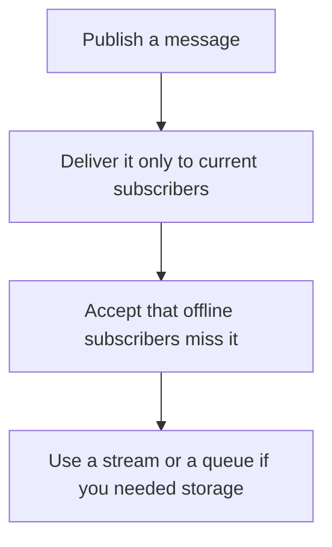

# D11-T014 — Pub/Sub

Topic ID: `D11-T014`
Domain: Redis and Caching
Subdomain: Pub/Sub
Importance: core
Complexity: intermediate
Dependencies: `D11-T013`, `D11-T001`, `D07-T001`, `D07-T002`, `D05-T001`, `D05-T002`
Execution status of the code in section F: unexecuted

## A. Topic Overview

Redis Pub/Sub delivers a message to subscribers that are connected at that moment. It does not store the message. A subscriber that is down misses it. There is no acknowledgment. It fits ephemeral signals such as 'invalidate this key' to live processes. It does not fit a job queue.

In production this shows up as follows: Each API node subscribes to an invalidation channel and drops its local cache entry. A node that restarts loads fresh data on the next request. The channel is not the order pipeline.

Interviewers use Pub/Sub to see whether you can state the failure mode, not only the definition. The failure to name is: using Pub/Sub as a job queue and losing every message published during a deploy

Prerequisites: `D11-T013`, `D11-T001`, `D07-T001`, `D07-T002`, `D05-T001`, `D05-T002`. Later notes should link here instead of repeating the mechanism.

## B. First-Principles Explanation

Redis Pub/Sub delivers a message to subscribers that are connected at that moment. It does not store the message. A subscriber that is down misses it. There is no acknowledgment. It fits ephemeral signals such as 'invalidate this key' to live processes. It does not fit a job queue.

The useful picture is: Pub/Sub is a loudspeaker in a room. People who stepped out do not hear the announcement, and nobody writes it down.

What has to be true:

1. Publish a message
2. Deliver it only to current subscribers
3. Accept that offline subscribers miss it
4. Use a stream or a queue if you needed storage

It works when those steps preserve one invariant. It fails when using Pub/Sub as a job queue and losing every message published during a deploy. The alternative is: the message is work that must be done at least once

## C. Internal Working and Architecture

Components involved: the caller, the state Pub/Sub mutates or reads, and the observer that reports subscriber count and messages published while a subscriber was disconnected.

Execution:

1. Publish a message
2. Deliver it only to current subscribers
3. Accept that offline subscribers miss it
4. Use a stream or a queue if you needed storage

Data moves only along that path. A retry re-enters at step 1, so the operation must say what a duplicate does. Memory and locks stay inside this mechanism. Callers see the result or a typed error, not a half-updated invariant.

State to remember: choose this when every listener that cares is connected, and loss is acceptable. Do not choose it when the message is work that must be done at least once.

## D. Diagrams and Visual Models



Read the diagram from top to bottom. Each box is one step of Pub/Sub. The failure mode (using Pub/Sub as a job queue and losing every message published during a deploy) is what you look for when a later box never happens or happens twice.

## E. Examples and Analogies

Analogy: Pub/Sub is a loudspeaker in a room. People who stepped out do not hear the announcement, and nobody writes it down.

Production example: Each API node subscribes to an invalidation channel and drops its local cache entry. A node that restarts loads fresh data on the next request. The channel is not the order pipeline.

A small counterexample is enough in an interview. Show the input, apply the steps, and show the broken outcome if someone uses the mechanism outside its rule: using Pub/Sub as a job queue and losing every message published during a deploy.

## F. Code Examples

The snippet is labeled unexecuted. It illustrates the shape of the idea. It is not a benchmark and it embeds no secret.

```text
PUBLISH cache-invalidate product:42
```

After the snippet, check subscriber count and messages published while a subscriber was disconnected. If that signal moves the wrong way, the snippet is the wrong tool for the workload.

## G. Practical Backend Application

Use Pub/Sub in a service when every listener that cares is connected, and loss is acceptable.

A typical place is the production case already stated: Each API node subscribes to an invalidation channel and drops its local cache entry. A node that restarts loads fresh data on the next request. The channel is not the order pipeline.

Operationally you alert on subscriber count and messages published while a subscriber was disconnected. You do not alert only on process uptime. The dashboard should show the failure mode, a success rate, and the saturation signal (queue depth, lock wait, or latency) that predicts it.

## H. Advantages, Limitations and Trade-offs

| Choice | Benefit | Cost | Choose when | Avoid when |
| --- | --- | --- | --- | --- |
| Apply Pub/Sub | every listener that cares is connected, and loss is acceptable | Extra moving parts and a new failure mode | The failure you are preventing is already real | the message is work that must be done at least once |
| Simpler alternative | Less code and fewer dependencies | using Pub/Sub as a job queue and losing every message published during a deploy | The workload does not hit the limit | The invariant must hold under concurrency or failure |

Pub/Sub is a trade. State the benefit and the cost in the same sentence when you propose it in a design review.

## I. Common Mistakes and Misconceptions

- Persisting business events only in Pub/Sub.
- Expecting a backlog.
- No other path for a missed invalidation besides TTL.
- Treating a diagram of Pub/Sub as proof that the invariant holds in production.
- Copying a default configuration without naming subscriber count and messages published while a subscriber was disconnected.

## J. Debugging and Troubleshooting

Symptom: using Pub/Sub as a job queue and losing every message published during a deploy

First check: subscriber count and messages published while a subscriber was disconnected.

Then compare one healthy instance against one unhealthy instance. Confirm whether retries are duplicating work. Confirm whether a timeout is shorter than the work. Fix the invariant, then watch the same metric for a full peak, not only for the next minute.

Useful questions: did the step order in section C actually happen, or did a caller skip a step? Did a deploy change the data shape that Pub/Sub assumes?

## K. Interview Preparation

### Beginner

#### Q1. What problem does Pub/Sub solve?

**Answer:** Redis Pub/Sub delivers a message to subscribers that are connected at that moment. It does not store the message. A subscriber that is down misses it. There is no acknowledgment. It fits ephemeral signals such as 'invalidate this key' to live processes. It does not fit a job queue. Without it, the usual backend failure is: using Pub/Sub as a job queue and losing every message published during a deploy.

#### Q2. Where does Pub/Sub sit on a request path?

**Answer:** Pub/Sub is not a library you sprinkle on every call. every listener that cares is connected, and loss is acceptable You notice it when subscriber count and messages published while a subscriber was disconnected. Name the constraint that makes this choice correct. Say what you would measure to confirm it.

#### Q3. Give a concrete example of Pub/Sub.

**Answer:** Each API node subscribes to an invalidation channel and drops its local cache entry. A node that restarts loads fresh data on the next request. The channel is not the order pipeline. Walk the input, the state change, and the observable output.

#### Q4. What is a common mix-up around Pub/Sub?

**Answer:** using Pub/Sub as a job queue and losing every message published during a deploy The corrective check is subscriber count and messages published while a subscriber was disconnected. Name the constraint that makes this choice correct. Say what you would measure to confirm it. Say which alternative you rejected and why.

#### Q5. When would you skip Pub/Sub?

**Answer:** the message is work that must be done at least once Skipping is a decision with a measured cost, not a slogan. Name the constraint that makes this choice correct. Say what you would measure to confirm it. Say which alternative you rejected and why.

### Intermediate

#### Q1. What invariant makes Pub/Sub correct?

**Answer:** Redis Pub/Sub delivers a message to subscribers that are connected at that moment. It does not store the message. A subscriber that is down misses it. There is no acknowledgment. It fits ephemeral signals such as 'invalidate this key' to live processes. It does not fit a job queue. State the invariant before you name the tool.

#### Q2. How do you test Pub/Sub?

**Answer:** Assert the failure mode directly: using Pub/Sub as a job queue and losing every message published during a deploy. The assertion should watch subscriber count and messages published while a subscriber was disconnected. Include a concurrent or retry case if the bug only appears then. Name the constraint that makes this choice correct.

#### Q3. What signal tells you Pub/Sub is misbehaving in production?

**Answer:** Watch subscriber count and messages published while a subscriber was disconnected. The user-visible symptom is usually using Pub/Sub as a job queue and losing every message published during a deploy. Name the constraint that makes this choice correct. Say what you would measure to confirm it.

#### Q4. How would you introduce Pub/Sub into a legacy service?

**Answer:** every listener that cares is connected, and loss is acceptable Ship it behind a metric so you can compare the old path. Roll back if using Pub/Sub as a job queue and losing every message published during a deploy gets worse. Name the constraint that makes this choice correct. Say what you would measure to confirm it.

#### Q5. What do you trade away by choosing Pub/Sub?

**Answer:** every listener that cares is connected, and loss is acceptable the message is work that must be done at least once Say the cost in latency, storage, or operational load. Name the constraint that makes this choice correct. Say what you would measure to confirm it. Say which alternative you rejected and why.

### Advanced

#### Q1. What breaks if a dependency of Pub/Sub is slow or down?

**Answer:** using Pub/Sub as a job queue and losing every message published during a deploy Degrade using the rule: the message is work that must be done at least once. Timeouts must be shorter than the caller's deadline. Name the constraint that makes this choice correct. Say what you would measure to confirm it.

#### Q2. How does Pub/Sub behave under retries?

**Answer:** Retries repeat work, so Pub/Sub must define what a duplicate does. using Pub/Sub as a job queue and losing every message published during a deploy Idempotency keys or fences belong next to the write, not in a comment. Name the constraint that makes this choice correct. Say what you would measure to confirm it.

#### Q3. What is the capacity limit of Pub/Sub?

**Answer:** The limit shows up as subscriber count and messages published while a subscriber was disconnected. Add capacity only after you know whether the bottleneck is CPU, lock wait, or network. Name the constraint that makes this choice correct. Say what you would measure to confirm it.

#### Q4. How do you evolve Pub/Sub without a flag day?

**Answer:** every listener that cares is connected, and loss is acceptable Version the contract or the on-disk format. Readers should tolerate one old and one new shape during the rollout. Name the constraint that makes this choice correct. Say what you would measure to confirm it.

#### Q5. What security or correctness bug hides inside Pub/Sub?

**Answer:** using Pub/Sub as a job queue and losing every message published during a deploy Check authorization and tenancy at the same boundary as the mechanism. A cache or queue must not widen who can read the data. Name the constraint that makes this choice correct. Say what you would measure to confirm it.

### Scenario

#### Q1. Incident: using Pub/Sub as a job queue and losing every message published during a deploy. What do you check first?

**Answer:** Start with subscriber count and messages published while a subscriber was disconnected. Compare a good host and a bad host before you restart anything. Redis Pub/Sub delivers a message to subscribers that are connected at that moment. It does not store the message. A subscriber that is down misses it. There is no acknowledgment. It fits ephemeral signals such as 'invalidate this key' to live processes. It does not fit a job queue.

#### Q2. A reviewer wants the clever version. What data settles it?

**Answer:** every listener that cares is connected, and loss is acceptable the message is work that must be done at least once Bring subscriber count and messages published while a subscriber was disconnected from a load test or from production, not a slogan. Name the constraint that makes this choice correct. Say what you would measure to confirm it. Say which alternative you rejected and why.

#### Q3. You have one hour to explain Pub/Sub at a whiteboard.

**Answer:** Draw the happy path in four boxes. Then draw the failure: using Pub/Sub as a job queue and losing every message published during a deploy. End with the metric you would page on. Name the constraint that makes this choice correct.

#### Q4. The bug only appears under two concurrent callers.

**Answer:** using Pub/Sub as a job queue and losing every message published during a deploy Reproduce with a barrier so both sides enter the critical window. Confirm the fix with subscriber count and messages published while a subscriber was disconnected. Name the constraint that makes this choice correct. Say what you would measure to confirm it.

#### Q5. Leadership wants this on every service next week.

**Answer:** the message is work that must be done at least once every listener that cares is connected, and loss is acceptable Roll it out where the failure mode is already hurting users. Name the constraint that makes this choice correct. Say what you would measure to confirm it. Say which alternative you rejected and why.

### Follow-up

#### Q1. What did you assume about the data size or the clock?

**Answer:** Redis Pub/Sub delivers a message to subscribers that are connected at that moment. It does not store the message. A subscriber that is down misses it. There is no acknowledgment. It fits ephemeral signals such as 'invalidate this key' to live processes. It does not fit a job queue. Clocks are not a total order across machines. State whether the algorithm needs bounded size or a single leader.

#### Q2. What would you measure after the change ships?

**Answer:** Page on subscriber count and messages published while a subscriber was disconnected. Keep a before/after dashboard for one week. Alert on the failure mode, not only on CPU. Name the constraint that makes this choice correct.

#### Q3. Which neighboring topic did you deliberately not re-teach?

**Answer:** This note owns Pub/Sub. Related identifiers are in section N. Shared ideas are linked, not copied. Name the constraint that makes this choice correct.

## L. Practical Exercises

Solutions are in `EXERCISES/solutions/D11-T014.md`, not in this section.

1. Whiteboard the four steps of Pub/Sub and mark where `using Pub/Sub as a job queue and losing every message published during a deploy` enters.
2. Read the snippet in section F and write the assertion that would catch that failure. The assertion must mention `subscriber count and messages published while a subscriber was disconnected`.
3. Argue for or against using Pub/Sub on a service you know. Use the choose and avoid rows from section H. Do not appeal to popularity.

## M. Revision Notes

- Mechanism: Redis Pub/Sub delivers a message to subscribers that are connected at that moment.
- Failure: using Pub/Sub as a job queue and losing every message published during a deploy
- Metric: subscriber count and messages published while a subscriber was disconnected
- Choose when: every listener that cares is connected, and loss is acceptable
- Avoid when: the message is work that must be done at least once

## N. Related Topics

Dependencies to review first: `D11-T013`, `D11-T001`, `D07-T001`, `D07-T002`, `D05-T001`, `D05-T002`.

Shared ideas stay in those notes. This note does not restate them.

## O. Completion Criteria

- You can explain Pub/Sub without reading this note, including the failure mode.
- You can draw the diagram in section D from memory.
- You can say when not to use it, using the avoid condition in section H.
- You can name the metric you would watch after shipping it.
