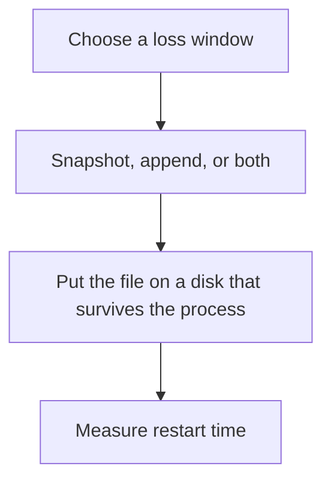

# D11-T015 — Persistence: RDB and AOF

Topic ID: `D11-T015`
Domain: Redis and Caching
Subdomain: Persistence: RDB and AOF
Importance: core
Complexity: intermediate
Dependencies: `D11-T014`, `D11-T001`, `D07-T001`, `D07-T002`, `D05-T001`, `D05-T002`
Execution status of the code in section F: unexecuted

## A. Topic Overview

RDB is a point-in-time snapshot of Redis. AOF logs every write and can fsync on a timer or every command. Snapshots are compact and lose the writes after the last snapshot. AOF loses less and replays more slowly. Neither is a substitute for a replica if the machine is gone and the file was only local. Restart time includes loading the snapshot or replaying the log.

In production this shows up as follows: A cache that can be rebuilt may use a rare snapshot or none. A Redis that holds a job stream needs AOF and a replica, and the team must have timed a restart.

Interviewers use Persistence: RDB and AOF to see whether you can state the failure mode, not only the definition. The failure to name is: an AOF policy of 'every second' that still loses a second of acknowledged writes, or a restart that takes longer than the outage budget

Prerequisites: `D11-T014`, `D11-T001`, `D07-T001`, `D07-T002`, `D05-T001`, `D05-T002`. Later notes should link here instead of repeating the mechanism.

## B. First-Principles Explanation

RDB is a point-in-time snapshot of Redis. AOF logs every write and can fsync on a timer or every command. Snapshots are compact and lose the writes after the last snapshot. AOF loses less and replays more slowly. Neither is a substitute for a replica if the machine is gone and the file was only local. Restart time includes loading the snapshot or replaying the log.

The useful picture is: RDB is a photograph. AOF is a receipt tape. A photograph is quicker to look at and misses everything after the flash. The tape is longer to reread and misses less.

What has to be true:

1. Choose a loss window
2. Snapshot, append, or both
3. Put the file on a disk that survives the process
4. Measure restart time

It works when those steps preserve one invariant. It fails when an AOF policy of 'every second' that still loses a second of acknowledged writes, or a restart that takes longer than the outage budget. The alternative is: you enable AOF and believe a single disk is high availability

## C. Internal Working and Architecture

Components involved: the caller, the state Persistence: RDB and AOF mutates or reads, and the observer that reports seconds of data loss in a kill test, and time to load the dataset.

Execution:

1. Choose a loss window
2. Snapshot, append, or both
3. Put the file on a disk that survives the process
4. Measure restart time

Data moves only along that path. A retry re-enters at step 1, so the operation must say what a duplicate does. Memory and locks stay inside this mechanism. Callers see the result or a typed error, not a half-updated invariant.

State to remember: choose this when you have decided Redis holds data you cannot simply recompute. Do not choose it when you enable AOF and believe a single disk is high availability.

## D. Diagrams and Visual Models



Read the diagram from top to bottom. Each box is one step of Persistence: RDB and AOF. The failure mode (an AOF policy of 'every second' that still loses a second of acknowledged writes, or a restart that takes longer than the outage budget) is what you look for when a later box never happens or happens twice.

## E. Examples and Analogies

Analogy: RDB is a photograph. AOF is a receipt tape. A photograph is quicker to look at and misses everything after the flash. The tape is longer to reread and misses less.

Production example: A cache that can be rebuilt may use a rare snapshot or none. A Redis that holds a job stream needs AOF and a replica, and the team must have timed a restart.

A small counterexample is enough in an interview. Show the input, apply the steps, and show the broken outcome if someone uses the mechanism outside its rule: an AOF policy of 'every second' that still loses a second of acknowledged writes, or a restart that takes longer than the outage budget.

## F. Code Examples

The snippet is labeled unexecuted. It illustrates the shape of the idea. It is not a benchmark and it embeds no secret.

```text
# unexecuted policy sketch
# appendfsync everysec loses up to about one second of writes
```

After the snippet, check seconds of data loss in a kill test, and time to load the dataset. If that signal moves the wrong way, the snippet is the wrong tool for the workload.

## G. Practical Backend Application

Use Persistence: RDB and AOF in a service when you have decided Redis holds data you cannot simply recompute.

A typical place is the production case already stated: A cache that can be rebuilt may use a rare snapshot or none. A Redis that holds a job stream needs AOF and a replica, and the team must have timed a restart.

Operationally you alert on seconds of data loss in a kill test, and time to load the dataset. You do not alert only on process uptime. The dashboard should show the failure mode, a success rate, and the saturation signal (queue depth, lock wait, or latency) that predicts it.

## H. Advantages, Limitations and Trade-offs

| Choice | Benefit | Cost | Choose when | Avoid when |
| --- | --- | --- | --- | --- |
| Apply Persistence: RDB and AOF | you have decided Redis holds data you cannot simply recompute | Extra moving parts and a new failure mode | The failure you are preventing is already real | you enable AOF and believe a single disk is high availability |
| Simpler alternative | Less code and fewer dependencies | an AOF policy of 'every second' that still loses a second of acknowledged writes, or a restart that takes longer than the outage budget | The workload does not hit the limit | The invariant must hold under concurrency or failure |

Persistence: RDB and AOF is a trade. State the benefit and the cost in the same sentence when you propose it in a design review.

## I. Common Mistakes and Misconceptions

- No persistence and no rebuild path.
- Never testing a restart.
- Fsync every command on a hot cache that did not need it.
- Treating a diagram of Persistence: RDB and AOF as proof that the invariant holds in production.
- Copying a default configuration without naming seconds of data loss in a kill test, and time to load the dataset.

## J. Debugging and Troubleshooting

Symptom: an AOF policy of 'every second' that still loses a second of acknowledged writes, or a restart that takes longer than the outage budget

First check: seconds of data loss in a kill test, and time to load the dataset.

Then compare one healthy instance against one unhealthy instance. Confirm whether retries are duplicating work. Confirm whether a timeout is shorter than the work. Fix the invariant, then watch the same metric for a full peak, not only for the next minute.

Useful questions: did the step order in section C actually happen, or did a caller skip a step? Did a deploy change the data shape that Persistence: RDB and AOF assumes?

## K. Interview Preparation

### Beginner

#### Q1. What problem does Persistence: RDB and AOF solve?

**Answer:** RDB is a point-in-time snapshot of Redis. AOF logs every write and can fsync on a timer or every command. Snapshots are compact and lose the writes after the last snapshot. AOF loses less and replays more slowly. Neither is a substitute for a replica if the machine is gone and the file was only local. Restart time includes loading the snapshot or replaying the log. Without it, the usual backend failure is: an AOF policy of 'every second' that still loses a second of acknowledged writes, or a restart that takes longer than the outage budget.

#### Q2. Where does Persistence: RDB and AOF sit on a request path?

**Answer:** Persistence: RDB and AOF is not a library you sprinkle on every call. you have decided Redis holds data you cannot simply recompute You notice it when seconds of data loss in a kill test, and time to load the dataset. Name the constraint that makes this choice correct. Say what you would measure to confirm it.

#### Q3. Give a concrete example of Persistence: RDB and AOF.

**Answer:** A cache that can be rebuilt may use a rare snapshot or none. A Redis that holds a job stream needs AOF and a replica, and the team must have timed a restart. Walk the input, the state change, and the observable output. Name the constraint that makes this choice correct.

#### Q4. What is a common mix-up around Persistence: RDB and AOF?

**Answer:** an AOF policy of 'every second' that still loses a second of acknowledged writes, or a restart that takes longer than the outage budget The corrective check is seconds of data loss in a kill test, and time to load the dataset. Name the constraint that makes this choice correct. Say what you would measure to confirm it. Say which alternative you rejected and why.

#### Q5. When would you skip Persistence: RDB and AOF?

**Answer:** you enable AOF and believe a single disk is high availability Skipping is a decision with a measured cost, not a slogan. Name the constraint that makes this choice correct. Say what you would measure to confirm it. Say which alternative you rejected and why.

### Intermediate

#### Q1. What invariant makes Persistence: RDB and AOF correct?

**Answer:** RDB is a point-in-time snapshot of Redis. AOF logs every write and can fsync on a timer or every command. Snapshots are compact and lose the writes after the last snapshot. AOF loses less and replays more slowly. Neither is a substitute for a replica if the machine is gone and the file was only local. Restart time includes loading the snapshot or replaying the log. State the invariant before you name the tool.

#### Q2. How do you test Persistence: RDB and AOF?

**Answer:** Assert the failure mode directly: an AOF policy of 'every second' that still loses a second of acknowledged writes, or a restart that takes longer than the outage budget. The assertion should watch seconds of data loss in a kill test, and time to load the dataset. Include a concurrent or retry case if the bug only appears then. Name the constraint that makes this choice correct.

#### Q3. What signal tells you Persistence: RDB and AOF is misbehaving in production?

**Answer:** Watch seconds of data loss in a kill test, and time to load the dataset. The user-visible symptom is usually an AOF policy of 'every second' that still loses a second of acknowledged writes, or a restart that takes longer than the outage budget. Name the constraint that makes this choice correct. Say what you would measure to confirm it.

#### Q4. How would you introduce Persistence: RDB and AOF into a legacy service?

**Answer:** you have decided Redis holds data you cannot simply recompute Ship it behind a metric so you can compare the old path. Roll back if an AOF policy of 'every second' that still loses a second of acknowledged writes, or a restart that takes longer than the outage budget gets worse. Name the constraint that makes this choice correct. Say what you would measure to confirm it.

#### Q5. What do you trade away by choosing Persistence: RDB and AOF?

**Answer:** you have decided Redis holds data you cannot simply recompute you enable AOF and believe a single disk is high availability Say the cost in latency, storage, or operational load. Name the constraint that makes this choice correct. Say what you would measure to confirm it. Say which alternative you rejected and why.

### Advanced

#### Q1. What breaks if a dependency of Persistence: RDB and AOF is slow or down?

**Answer:** an AOF policy of 'every second' that still loses a second of acknowledged writes, or a restart that takes longer than the outage budget Degrade using the rule: you enable AOF and believe a single disk is high availability. Timeouts must be shorter than the caller's deadline. Name the constraint that makes this choice correct. Say what you would measure to confirm it.

#### Q2. How does Persistence: RDB and AOF behave under retries?

**Answer:** Retries repeat work, so Persistence: RDB and AOF must define what a duplicate does. an AOF policy of 'every second' that still loses a second of acknowledged writes, or a restart that takes longer than the outage budget Idempotency keys or fences belong next to the write, not in a comment. Name the constraint that makes this choice correct. Say what you would measure to confirm it.

#### Q3. What is the capacity limit of Persistence: RDB and AOF?

**Answer:** The limit shows up as seconds of data loss in a kill test, and time to load the dataset. Add capacity only after you know whether the bottleneck is CPU, lock wait, or network. Name the constraint that makes this choice correct. Say what you would measure to confirm it.

#### Q4. How do you evolve Persistence: RDB and AOF without a flag day?

**Answer:** you have decided Redis holds data you cannot simply recompute Version the contract or the on-disk format. Readers should tolerate one old and one new shape during the rollout. Name the constraint that makes this choice correct. Say what you would measure to confirm it.

#### Q5. What security or correctness bug hides inside Persistence: RDB and AOF?

**Answer:** an AOF policy of 'every second' that still loses a second of acknowledged writes, or a restart that takes longer than the outage budget Check authorization and tenancy at the same boundary as the mechanism. A cache or queue must not widen who can read the data. Name the constraint that makes this choice correct. Say what you would measure to confirm it.

### Scenario

#### Q1. Incident: an AOF policy of 'every second' that still loses a second of acknowledged writes, or a restart that takes longer than the outage budget. What do you check first?

**Answer:** Start with seconds of data loss in a kill test, and time to load the dataset. Compare a good host and a bad host before you restart anything. RDB is a point-in-time snapshot of Redis. AOF logs every write and can fsync on a timer or every command. Snapshots are compact and lose the writes after the last snapshot. AOF loses less and replays more slowly. Neither is a substitute for a replica if the machine is gone and the file was only local. Restart time includes loading the snapshot or replaying the log.

#### Q2. A reviewer wants the clever version. What data settles it?

**Answer:** you have decided Redis holds data you cannot simply recompute you enable AOF and believe a single disk is high availability Bring seconds of data loss in a kill test, and time to load the dataset from a load test or from production, not a slogan. Name the constraint that makes this choice correct. Say what you would measure to confirm it. Say which alternative you rejected and why.

#### Q3. You have one hour to explain Persistence: RDB and AOF at a whiteboard.

**Answer:** Draw the happy path in four boxes. Then draw the failure: an AOF policy of 'every second' that still loses a second of acknowledged writes, or a restart that takes longer than the outage budget. End with the metric you would page on. Name the constraint that makes this choice correct.

#### Q4. The bug only appears under two concurrent callers.

**Answer:** an AOF policy of 'every second' that still loses a second of acknowledged writes, or a restart that takes longer than the outage budget Reproduce with a barrier so both sides enter the critical window. Confirm the fix with seconds of data loss in a kill test, and time to load the dataset. Name the constraint that makes this choice correct. Say what you would measure to confirm it.

#### Q5. Leadership wants this on every service next week.

**Answer:** you enable AOF and believe a single disk is high availability you have decided Redis holds data you cannot simply recompute Roll it out where the failure mode is already hurting users. Name the constraint that makes this choice correct. Say what you would measure to confirm it. Say which alternative you rejected and why.

### Follow-up

#### Q1. What did you assume about the data size or the clock?

**Answer:** RDB is a point-in-time snapshot of Redis. AOF logs every write and can fsync on a timer or every command. Snapshots are compact and lose the writes after the last snapshot. AOF loses less and replays more slowly. Neither is a substitute for a replica if the machine is gone and the file was only local. Restart time includes loading the snapshot or replaying the log. Clocks are not a total order across machines. State whether the algorithm needs bounded size or a single leader.

#### Q2. What would you measure after the change ships?

**Answer:** Page on seconds of data loss in a kill test, and time to load the dataset. Keep a before/after dashboard for one week. Alert on the failure mode, not only on CPU. Name the constraint that makes this choice correct.

#### Q3. Which neighboring topic did you deliberately not re-teach?

**Answer:** This note owns Persistence: RDB and AOF. Related identifiers are in section N. Shared ideas are linked, not copied. Name the constraint that makes this choice correct.

## L. Practical Exercises

Solutions are in `EXERCISES/solutions/D11-T015.md`, not in this section.

1. Whiteboard the four steps of Persistence: RDB and AOF and mark where `an AOF policy of 'every second' that still loses a second of acknowledged writes, or a restart that takes longer than the outage budget` enters.
2. Read the snippet in section F and write the assertion that would catch that failure. The assertion must mention `seconds of data loss in a kill test, and time to load the dataset`.
3. Argue for or against using Persistence: RDB and AOF on a service you know. Use the choose and avoid rows from section H. Do not appeal to popularity.

## M. Revision Notes

- Mechanism: RDB is a point-in-time snapshot of Redis.
- Failure: an AOF policy of 'every second' that still loses a second of acknowledged writes, or a restart that takes longer than the outage budget
- Metric: seconds of data loss in a kill test, and time to load the dataset
- Choose when: you have decided Redis holds data you cannot simply recompute
- Avoid when: you enable AOF and believe a single disk is high availability

## N. Related Topics

Dependencies to review first: `D11-T014`, `D11-T001`, `D07-T001`, `D07-T002`, `D05-T001`, `D05-T002`.

Shared ideas stay in those notes. This note does not restate them.

## O. Completion Criteria

- You can explain Persistence: RDB and AOF without reading this note, including the failure mode.
- You can draw the diagram in section D from memory.
- You can say when not to use it, using the avoid condition in section H.
- You can name the metric you would watch after shipping it.
