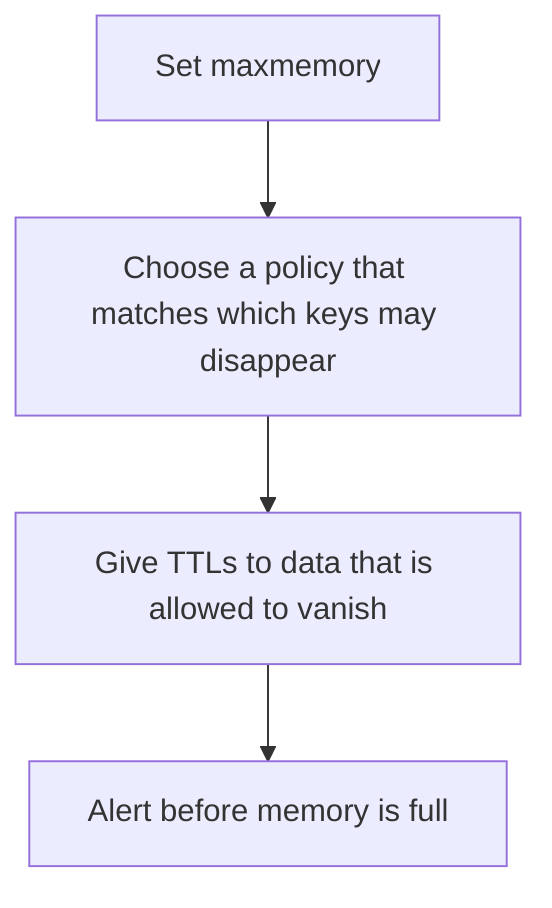

# D11-T016 — Eviction policies

Topic ID: `D11-T016`
Domain: Redis and Caching
Subdomain: Eviction policies
Importance: core
Complexity: intermediate
Dependencies: `D11-T015`, `D11-T001`, `D07-T001`, `D07-T002`, `D05-T001`, `D05-T002`
Execution status of the code in section F: unexecuted

## A. Topic Overview

An eviction policy decides which key to remove when Redis reaches maxmemory. noeviction returns errors on writes. allkeys-lru removes the least recently used key among all keys. volatile-ttl removes keys that have a TTL. A policy that only evicts volatile keys will fill memory if most keys have no TTL. Eviction is not expiration. Expiration follows a TTL. Eviction follows pressure.

In production this shows up as follows: A cache uses allkeys-lru and every key is disposable. A Redis that also stores a lock or a queue must not use a policy that can evict that key, or the lock and the queue must live in another instance.

Interviewers use Eviction policies to see whether you can state the failure mode, not only the definition. The failure to name is: evicting a key the application treated as durable, or refusing writes because the policy is noeviction and memory is full

Prerequisites: `D11-T015`, `D11-T001`, `D07-T001`, `D07-T002`, `D05-T001`, `D05-T002`. Later notes should link here instead of repeating the mechanism.

## B. First-Principles Explanation

An eviction policy decides which key to remove when Redis reaches maxmemory. noeviction returns errors on writes. allkeys-lru removes the least recently used key among all keys. volatile-ttl removes keys that have a TTL. A policy that only evicts volatile keys will fill memory if most keys have no TTL. Eviction is not expiration. Expiration follows a TTL. Eviction follows pressure.

The useful picture is: Eviction is throwing out boxes when the closet is full. Expiration is throwing out a box on the date written on it, even if the closet has room.

What has to be true:

1. Set maxmemory
2. Choose a policy that matches which keys may disappear
3. Give TTLs to data that is allowed to vanish
4. Alert before memory is full

It works when those steps preserve one invariant. It fails when evicting a key the application treated as durable, or refusing writes because the policy is noeviction and memory is full. The alternative is: you store durable jobs and a cache in one instance with eviction on

## C. Internal Working and Architecture

Components involved: the caller, the state Eviction policies mutates or reads, and the observer that reports evicted key count and used memory versus maxmemory.

Execution:

1. Set maxmemory
2. Choose a policy that matches which keys may disappear
3. Give TTLs to data that is allowed to vanish
4. Alert before memory is full

Data moves only along that path. A retry re-enters at step 1, so the operation must say what a duplicate does. Memory and locks stay inside this mechanism. Callers see the result or a typed error, not a half-updated invariant.

State to remember: choose this when the instance is a cache with a memory cap. Do not choose it when you store durable jobs and a cache in one instance with eviction on.

## D. Diagrams and Visual Models



Read the diagram from top to bottom. Each box is one step of Eviction policies. The failure mode (evicting a key the application treated as durable, or refusing writes because the policy is noeviction and memory is full) is what you look for when a later box never happens or happens twice.

## E. Examples and Analogies

Analogy: Eviction is throwing out boxes when the closet is full. Expiration is throwing out a box on the date written on it, even if the closet has room.

Production example: A cache uses allkeys-lru and every key is disposable. A Redis that also stores a lock or a queue must not use a policy that can evict that key, or the lock and the queue must live in another instance.

A small counterexample is enough in an interview. Show the input, apply the steps, and show the broken outcome if someone uses the mechanism outside its rule: evicting a key the application treated as durable, or refusing writes because the policy is noeviction and memory is full.

## F. Code Examples

The snippet is labeled unexecuted. It illustrates the shape of the idea. It is not a benchmark and it embeds no secret.

```python
def may_evict(has_ttl, policy):
    if policy == 'noeviction':
        return False
    if policy.startswith('volatile'):
        return has_ttl
    return True
```

After the snippet, check evicted key count and used memory versus maxmemory. If that signal moves the wrong way, the snippet is the wrong tool for the workload.

## G. Practical Backend Application

Use Eviction policies in a service when the instance is a cache with a memory cap.

A typical place is the production case already stated: A cache uses allkeys-lru and every key is disposable. A Redis that also stores a lock or a queue must not use a policy that can evict that key, or the lock and the queue must live in another instance.

Operationally you alert on evicted key count and used memory versus maxmemory. You do not alert only on process uptime. The dashboard should show the failure mode, a success rate, and the saturation signal (queue depth, lock wait, or latency) that predicts it.

## H. Advantages, Limitations and Trade-offs

| Choice | Benefit | Cost | Choose when | Avoid when |
| --- | --- | --- | --- | --- |
| Apply Eviction policies | the instance is a cache with a memory cap | Extra moving parts and a new failure mode | The failure you are preventing is already real | you store durable jobs and a cache in one instance with eviction on |
| Simpler alternative | Less code and fewer dependencies | evicting a key the application treated as durable, or refusing writes because the policy is noeviction and memory is full | The workload does not hit the limit | The invariant must hold under concurrency or failure |

Eviction policies is a trade. State the benefit and the cost in the same sentence when you propose it in a design review.

## I. Common Mistakes and Misconceptions

- No maxmemory.
- Evicting keys that have no rebuild path.
- Confusing TTL deletes with memory eviction.
- Treating a diagram of Eviction policies as proof that the invariant holds in production.
- Copying a default configuration without naming evicted key count and used memory versus maxmemory.

## J. Debugging and Troubleshooting

Symptom: evicting a key the application treated as durable, or refusing writes because the policy is noeviction and memory is full

First check: evicted key count and used memory versus maxmemory.

Then compare one healthy instance against one unhealthy instance. Confirm whether retries are duplicating work. Confirm whether a timeout is shorter than the work. Fix the invariant, then watch the same metric for a full peak, not only for the next minute.

Useful questions: did the step order in section C actually happen, or did a caller skip a step? Did a deploy change the data shape that Eviction policies assumes?

## K. Interview Preparation

### Beginner

#### Q1. What problem does Eviction policies solve?

**Answer:** An eviction policy decides which key to remove when Redis reaches maxmemory. noeviction returns errors on writes. allkeys-lru removes the least recently used key among all keys. volatile-ttl removes keys that have a TTL. A policy that only evicts volatile keys will fill memory if most keys have no TTL. Eviction is not expiration. Expiration follows a TTL. Eviction follows pressure. Without it, the usual backend failure is: evicting a key the application treated as durable, or refusing writes because the policy is noeviction and memory is full.

#### Q2. Where does Eviction policies sit on a request path?

**Answer:** Eviction policies is not a library you sprinkle on every call. the instance is a cache with a memory cap You notice it when evicted key count and used memory versus maxmemory. Name the constraint that makes this choice correct. Say what you would measure to confirm it.

#### Q3. Give a concrete example of Eviction policies.

**Answer:** A cache uses allkeys-lru and every key is disposable. A Redis that also stores a lock or a queue must not use a policy that can evict that key, or the lock and the queue must live in another instance. Walk the input, the state change, and the observable output. Name the constraint that makes this choice correct.

#### Q4. What is a common mix-up around Eviction policies?

**Answer:** evicting a key the application treated as durable, or refusing writes because the policy is noeviction and memory is full The corrective check is evicted key count and used memory versus maxmemory. Name the constraint that makes this choice correct. Say what you would measure to confirm it. Say which alternative you rejected and why.

#### Q5. When would you skip Eviction policies?

**Answer:** you store durable jobs and a cache in one instance with eviction on Skipping is a decision with a measured cost, not a slogan. Name the constraint that makes this choice correct. Say what you would measure to confirm it. Say which alternative you rejected and why.

### Intermediate

#### Q1. What invariant makes Eviction policies correct?

**Answer:** An eviction policy decides which key to remove when Redis reaches maxmemory. noeviction returns errors on writes. allkeys-lru removes the least recently used key among all keys. volatile-ttl removes keys that have a TTL. A policy that only evicts volatile keys will fill memory if most keys have no TTL. Eviction is not expiration. Expiration follows a TTL. Eviction follows pressure. State the invariant before you name the tool.

#### Q2. How do you test Eviction policies?

**Answer:** Assert the failure mode directly: evicting a key the application treated as durable, or refusing writes because the policy is noeviction and memory is full. The assertion should watch evicted key count and used memory versus maxmemory. Include a concurrent or retry case if the bug only appears then. Name the constraint that makes this choice correct.

#### Q3. What signal tells you Eviction policies is misbehaving in production?

**Answer:** Watch evicted key count and used memory versus maxmemory. The user-visible symptom is usually evicting a key the application treated as durable, or refusing writes because the policy is noeviction and memory is full. Name the constraint that makes this choice correct. Say what you would measure to confirm it.

#### Q4. How would you introduce Eviction policies into a legacy service?

**Answer:** the instance is a cache with a memory cap Ship it behind a metric so you can compare the old path. Roll back if evicting a key the application treated as durable, or refusing writes because the policy is noeviction and memory is full gets worse. Name the constraint that makes this choice correct. Say what you would measure to confirm it.

#### Q5. What do you trade away by choosing Eviction policies?

**Answer:** the instance is a cache with a memory cap you store durable jobs and a cache in one instance with eviction on Say the cost in latency, storage, or operational load. Name the constraint that makes this choice correct. Say what you would measure to confirm it. Say which alternative you rejected and why.

### Advanced

#### Q1. What breaks if a dependency of Eviction policies is slow or down?

**Answer:** evicting a key the application treated as durable, or refusing writes because the policy is noeviction and memory is full Degrade using the rule: you store durable jobs and a cache in one instance with eviction on. Timeouts must be shorter than the caller's deadline. Name the constraint that makes this choice correct. Say what you would measure to confirm it.

#### Q2. How does Eviction policies behave under retries?

**Answer:** Retries repeat work, so Eviction policies must define what a duplicate does. evicting a key the application treated as durable, or refusing writes because the policy is noeviction and memory is full Idempotency keys or fences belong next to the write, not in a comment. Name the constraint that makes this choice correct. Say what you would measure to confirm it.

#### Q3. What is the capacity limit of Eviction policies?

**Answer:** The limit shows up as evicted key count and used memory versus maxmemory. Add capacity only after you know whether the bottleneck is CPU, lock wait, or network. Name the constraint that makes this choice correct. Say what you would measure to confirm it.

#### Q4. How do you evolve Eviction policies without a flag day?

**Answer:** the instance is a cache with a memory cap Version the contract or the on-disk format. Readers should tolerate one old and one new shape during the rollout. Name the constraint that makes this choice correct. Say what you would measure to confirm it.

#### Q5. What security or correctness bug hides inside Eviction policies?

**Answer:** evicting a key the application treated as durable, or refusing writes because the policy is noeviction and memory is full Check authorization and tenancy at the same boundary as the mechanism. A cache or queue must not widen who can read the data. Name the constraint that makes this choice correct. Say what you would measure to confirm it.

### Scenario

#### Q1. Incident: evicting a key the application treated as durable, or refusing writes because the policy is noeviction and memory is full. What do you check first?

**Answer:** Start with evicted key count and used memory versus maxmemory. Compare a good host and a bad host before you restart anything. An eviction policy decides which key to remove when Redis reaches maxmemory. noeviction returns errors on writes. allkeys-lru removes the least recently used key among all keys. volatile-ttl removes keys that have a TTL. A policy that only evicts volatile keys will fill memory if most keys have no TTL. Eviction is not expiration. Expiration follows a TTL. Eviction follows pressure.

#### Q2. A reviewer wants the clever version. What data settles it?

**Answer:** the instance is a cache with a memory cap you store durable jobs and a cache in one instance with eviction on Bring evicted key count and used memory versus maxmemory from a load test or from production, not a slogan. Name the constraint that makes this choice correct. Say what you would measure to confirm it. Say which alternative you rejected and why.

#### Q3. You have one hour to explain Eviction policies at a whiteboard.

**Answer:** Draw the happy path in four boxes. Then draw the failure: evicting a key the application treated as durable, or refusing writes because the policy is noeviction and memory is full. End with the metric you would page on. Name the constraint that makes this choice correct.

#### Q4. The bug only appears under two concurrent callers.

**Answer:** evicting a key the application treated as durable, or refusing writes because the policy is noeviction and memory is full Reproduce with a barrier so both sides enter the critical window. Confirm the fix with evicted key count and used memory versus maxmemory. Name the constraint that makes this choice correct. Say what you would measure to confirm it.

#### Q5. Leadership wants this on every service next week.

**Answer:** you store durable jobs and a cache in one instance with eviction on the instance is a cache with a memory cap Roll it out where the failure mode is already hurting users. Name the constraint that makes this choice correct. Say what you would measure to confirm it. Say which alternative you rejected and why.

### Follow-up

#### Q1. What did you assume about the data size or the clock?

**Answer:** An eviction policy decides which key to remove when Redis reaches maxmemory. noeviction returns errors on writes. allkeys-lru removes the least recently used key among all keys. volatile-ttl removes keys that have a TTL. A policy that only evicts volatile keys will fill memory if most keys have no TTL. Eviction is not expiration. Expiration follows a TTL. Eviction follows pressure. Clocks are not a total order across machines. State whether the algorithm needs bounded size or a single leader.

#### Q2. What would you measure after the change ships?

**Answer:** Page on evicted key count and used memory versus maxmemory. Keep a before/after dashboard for one week. Alert on the failure mode, not only on CPU. Name the constraint that makes this choice correct.

#### Q3. Which neighboring topic did you deliberately not re-teach?

**Answer:** This note owns Eviction policies. Related identifiers are in section N. Shared ideas are linked, not copied. Name the constraint that makes this choice correct.

## L. Practical Exercises

Solutions are in `EXERCISES/solutions/D11-T016.md`, not in this section.

1. Whiteboard the four steps of Eviction policies and mark where `evicting a key the application treated as durable, or refusing writes because the policy is noeviction and memory is full` enters.
2. Read the snippet in section F and write the assertion that would catch that failure. The assertion must mention `evicted key count and used memory versus maxmemory`.
3. Argue for or against using Eviction policies on a service you know. Use the choose and avoid rows from section H. Do not appeal to popularity.

## M. Revision Notes

- Mechanism: An eviction policy decides which key to remove when Redis reaches maxmemory.
- Failure: evicting a key the application treated as durable, or refusing writes because the policy is noeviction and memory is full
- Metric: evicted key count and used memory versus maxmemory
- Choose when: the instance is a cache with a memory cap
- Avoid when: you store durable jobs and a cache in one instance with eviction on

## N. Related Topics

Dependencies to review first: `D11-T015`, `D11-T001`, `D07-T001`, `D07-T002`, `D05-T001`, `D05-T002`.

Shared ideas stay in those notes. This note does not restate them.

## O. Completion Criteria

- You can explain Eviction policies without reading this note, including the failure mode.
- You can draw the diagram in section D from memory.
- You can say when not to use it, using the avoid condition in section H.
- You can name the metric you would watch after shipping it.
