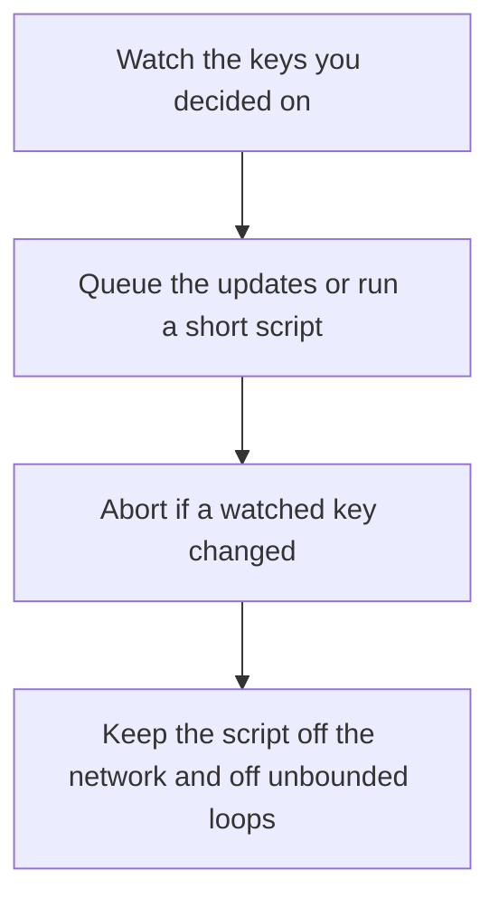

# D11-T017 — Redis transactions and Lua scripts

Topic ID: `D11-T017`
Domain: Redis and Caching
Subdomain: Redis transactions and Lua scripts
Importance: core
Complexity: intermediate
Dependencies: `D11-T016`, `D11-T001`, `D07-T001`, `D07-T002`, `D05-T001`, `D05-T002`
Execution status of the code in section F: unexecuted

## A. Topic Overview

A Redis transaction with MULTI/EXEC queues commands and runs them without another client interleaved. It is not a rollback journal. A command can still fail and the rest still run. WATCH provides optimistic concurrency: if the watched key changes, EXEC aborts. A Lua script runs atomically on the server and can branch. Scripts must be short because they block the single thread.

In production this shows up as follows: A rate-limit check-and-increment is a Lua script so two clients cannot both read under the limit and both increment. A script that scans a million-member set blocks the node.

Interviewers use Redis transactions and Lua scripts to see whether you can state the failure mode, not only the definition. The failure to name is: a Lua script that loops over a huge set and stalls every other command, or assuming MULTI rolls back

Prerequisites: `D11-T016`, `D11-T001`, `D07-T001`, `D07-T002`, `D05-T001`, `D05-T002`. Later notes should link here instead of repeating the mechanism.

## B. First-Principles Explanation

A Redis transaction with MULTI/EXEC queues commands and runs them without another client interleaved. It is not a rollback journal. A command can still fail and the rest still run. WATCH provides optimistic concurrency: if the watched key changes, EXEC aborts. A Lua script runs atomically on the server and can branch. Scripts must be short because they block the single thread.

The useful picture is: MULTI is a stack of sticky notes the clerk applies without serving anyone else, but a bad note does not undo the earlier notes. Lua is handing the clerk one small card to follow without interruption.

What has to be true:

1. Watch the keys you decided on
2. Queue the updates or run a short script
3. Abort if a watched key changed
4. Keep the script off the network and off unbounded loops

It works when those steps preserve one invariant. It fails when a Lua script that loops over a huge set and stalls every other command, or assuming MULTI rolls back. The alternative is: you need a multi-key transaction across shards, which a single script does not give you

## C. Internal Working and Architecture

Components involved: the caller, the state Redis transactions and Lua scripts mutates or reads, and the observer that reports script duration and EXEC abort rate.

Execution:

1. Watch the keys you decided on
2. Queue the updates or run a short script
3. Abort if a watched key changed
4. Keep the script off the network and off unbounded loops

Data moves only along that path. A retry re-enters at step 1, so the operation must say what a duplicate does. Memory and locks stay inside this mechanism. Callers see the result or a typed error, not a half-updated invariant.

State to remember: choose this when the invariant is a few keys and a few commands. Do not choose it when you need a multi-key transaction across shards, which a single script does not give you.

## D. Diagrams and Visual Models



Read the diagram from top to bottom. Each box is one step of Redis transactions and Lua scripts. The failure mode (a Lua script that loops over a huge set and stalls every other command, or assuming MULTI rolls back) is what you look for when a later box never happens or happens twice.

## E. Examples and Analogies

Analogy: MULTI is a stack of sticky notes the clerk applies without serving anyone else, but a bad note does not undo the earlier notes. Lua is handing the clerk one small card to follow without interruption.

Production example: A rate-limit check-and-increment is a Lua script so two clients cannot both read under the limit and both increment. A script that scans a million-member set blocks the node.

A small counterexample is enough in an interview. Show the input, apply the steps, and show the broken outcome if someone uses the mechanism outside its rule: a Lua script that loops over a huge set and stalls every other command, or assuming MULTI rolls back.

## F. Code Examples

The snippet is labeled unexecuted. It illustrates the shape of the idea. It is not a benchmark and it embeds no secret.

```lua
local cur = tonumber(redis.call('GET', KEYS[1]) or '0')
if cur >= tonumber(ARGV[1]) then return 0 end
redis.call('INCR', KEYS[1])
return 1
```

After the snippet, check script duration and EXEC abort rate. If that signal moves the wrong way, the snippet is the wrong tool for the workload.

## G. Practical Backend Application

Use Redis transactions and Lua scripts in a service when the invariant is a few keys and a few commands.

A typical place is the production case already stated: A rate-limit check-and-increment is a Lua script so two clients cannot both read under the limit and both increment. A script that scans a million-member set blocks the node.

Operationally you alert on script duration and EXEC abort rate. You do not alert only on process uptime. The dashboard should show the failure mode, a success rate, and the saturation signal (queue depth, lock wait, or latency) that predicts it.

## H. Advantages, Limitations and Trade-offs

| Choice | Benefit | Cost | Choose when | Avoid when |
| --- | --- | --- | --- | --- |
| Apply Redis transactions and Lua scripts | the invariant is a few keys and a few commands | Extra moving parts and a new failure mode | The failure you are preventing is already real | you need a multi-key transaction across shards, which a single script does not give you |
| Simpler alternative | Less code and fewer dependencies | a Lua script that loops over a huge set and stalls every other command, or assuming MULTI rolls back | The workload does not hit the limit | The invariant must hold under concurrency or failure |

Redis transactions and Lua scripts is a trade. State the benefit and the cost in the same sentence when you propose it in a design review.

## I. Common Mistakes and Misconceptions

- Long scripts.
- Expecting rollback.
- Forgetting WATCH and losing an update.
- Treating a diagram of Redis transactions and Lua scripts as proof that the invariant holds in production.
- Copying a default configuration without naming script duration and EXEC abort rate.

## J. Debugging and Troubleshooting

Symptom: a Lua script that loops over a huge set and stalls every other command, or assuming MULTI rolls back

First check: script duration and EXEC abort rate.

Then compare one healthy instance against one unhealthy instance. Confirm whether retries are duplicating work. Confirm whether a timeout is shorter than the work. Fix the invariant, then watch the same metric for a full peak, not only for the next minute.

Useful questions: did the step order in section C actually happen, or did a caller skip a step? Did a deploy change the data shape that Redis transactions and Lua scripts assumes?

## K. Interview Preparation

### Beginner

#### Q1. What problem does Redis transactions and Lua scripts solve?

**Answer:** A Redis transaction with MULTI/EXEC queues commands and runs them without another client interleaved. It is not a rollback journal. A command can still fail and the rest still run. WATCH provides optimistic concurrency: if the watched key changes, EXEC aborts. A Lua script runs atomically on the server and can branch. Scripts must be short because they block the single thread. Without it, the usual backend failure is: a Lua script that loops over a huge set and stalls every other command, or assuming MULTI rolls back.

#### Q2. Where does Redis transactions and Lua scripts sit on a request path?

**Answer:** Redis transactions and Lua scripts is not a library you sprinkle on every call. the invariant is a few keys and a few commands You notice it when script duration and EXEC abort rate. Name the constraint that makes this choice correct. Say what you would measure to confirm it.

#### Q3. Give a concrete example of Redis transactions and Lua scripts.

**Answer:** A rate-limit check-and-increment is a Lua script so two clients cannot both read under the limit and both increment. A script that scans a million-member set blocks the node. Walk the input, the state change, and the observable output. Name the constraint that makes this choice correct.

#### Q4. What is a common mix-up around Redis transactions and Lua scripts?

**Answer:** a Lua script that loops over a huge set and stalls every other command, or assuming MULTI rolls back The corrective check is script duration and EXEC abort rate. Name the constraint that makes this choice correct. Say what you would measure to confirm it. Say which alternative you rejected and why.

#### Q5. When would you skip Redis transactions and Lua scripts?

**Answer:** you need a multi-key transaction across shards, which a single script does not give you Skipping is a decision with a measured cost, not a slogan. Name the constraint that makes this choice correct. Say what you would measure to confirm it. Say which alternative you rejected and why.

### Intermediate

#### Q1. What invariant makes Redis transactions and Lua scripts correct?

**Answer:** A Redis transaction with MULTI/EXEC queues commands and runs them without another client interleaved. It is not a rollback journal. A command can still fail and the rest still run. WATCH provides optimistic concurrency: if the watched key changes, EXEC aborts. A Lua script runs atomically on the server and can branch. Scripts must be short because they block the single thread. State the invariant before you name the tool.

#### Q2. How do you test Redis transactions and Lua scripts?

**Answer:** Assert the failure mode directly: a Lua script that loops over a huge set and stalls every other command, or assuming MULTI rolls back. The assertion should watch script duration and EXEC abort rate. Include a concurrent or retry case if the bug only appears then. Name the constraint that makes this choice correct.

#### Q3. What signal tells you Redis transactions and Lua scripts is misbehaving in production?

**Answer:** Watch script duration and EXEC abort rate. The user-visible symptom is usually a Lua script that loops over a huge set and stalls every other command, or assuming MULTI rolls back. Name the constraint that makes this choice correct. Say what you would measure to confirm it.

#### Q4. How would you introduce Redis transactions and Lua scripts into a legacy service?

**Answer:** the invariant is a few keys and a few commands Ship it behind a metric so you can compare the old path. Roll back if a Lua script that loops over a huge set and stalls every other command, or assuming MULTI rolls back gets worse. Name the constraint that makes this choice correct. Say what you would measure to confirm it.

#### Q5. What do you trade away by choosing Redis transactions and Lua scripts?

**Answer:** the invariant is a few keys and a few commands you need a multi-key transaction across shards, which a single script does not give you Say the cost in latency, storage, or operational load. Name the constraint that makes this choice correct. Say what you would measure to confirm it. Say which alternative you rejected and why.

### Advanced

#### Q1. What breaks if a dependency of Redis transactions and Lua scripts is slow or down?

**Answer:** a Lua script that loops over a huge set and stalls every other command, or assuming MULTI rolls back Degrade using the rule: you need a multi-key transaction across shards, which a single script does not give you. Timeouts must be shorter than the caller's deadline. Name the constraint that makes this choice correct. Say what you would measure to confirm it.

#### Q2. How does Redis transactions and Lua scripts behave under retries?

**Answer:** Retries repeat work, so Redis transactions and Lua scripts must define what a duplicate does. a Lua script that loops over a huge set and stalls every other command, or assuming MULTI rolls back Idempotency keys or fences belong next to the write, not in a comment. Name the constraint that makes this choice correct. Say what you would measure to confirm it.

#### Q3. What is the capacity limit of Redis transactions and Lua scripts?

**Answer:** The limit shows up as script duration and EXEC abort rate. Add capacity only after you know whether the bottleneck is CPU, lock wait, or network. Name the constraint that makes this choice correct. Say what you would measure to confirm it.

#### Q4. How do you evolve Redis transactions and Lua scripts without a flag day?

**Answer:** the invariant is a few keys and a few commands Version the contract or the on-disk format. Readers should tolerate one old and one new shape during the rollout. Name the constraint that makes this choice correct. Say what you would measure to confirm it.

#### Q5. What security or correctness bug hides inside Redis transactions and Lua scripts?

**Answer:** a Lua script that loops over a huge set and stalls every other command, or assuming MULTI rolls back Check authorization and tenancy at the same boundary as the mechanism. A cache or queue must not widen who can read the data. Name the constraint that makes this choice correct. Say what you would measure to confirm it.

### Scenario

#### Q1. Incident: a Lua script that loops over a huge set and stalls every other command, or assuming MULTI rolls back. What do you check first?

**Answer:** Start with script duration and EXEC abort rate. Compare a good host and a bad host before you restart anything. A Redis transaction with MULTI/EXEC queues commands and runs them without another client interleaved. It is not a rollback journal. A command can still fail and the rest still run. WATCH provides optimistic concurrency: if the watched key changes, EXEC aborts. A Lua script runs atomically on the server and can branch. Scripts must be short because they block the single thread.

#### Q2. A reviewer wants the clever version. What data settles it?

**Answer:** the invariant is a few keys and a few commands you need a multi-key transaction across shards, which a single script does not give you Bring script duration and EXEC abort rate from a load test or from production, not a slogan. Name the constraint that makes this choice correct. Say what you would measure to confirm it. Say which alternative you rejected and why.

#### Q3. You have one hour to explain Redis transactions and Lua scripts at a whiteboard.

**Answer:** Draw the happy path in four boxes. Then draw the failure: a Lua script that loops over a huge set and stalls every other command, or assuming MULTI rolls back. End with the metric you would page on. Name the constraint that makes this choice correct.

#### Q4. The bug only appears under two concurrent callers.

**Answer:** a Lua script that loops over a huge set and stalls every other command, or assuming MULTI rolls back Reproduce with a barrier so both sides enter the critical window. Confirm the fix with script duration and EXEC abort rate. Name the constraint that makes this choice correct. Say what you would measure to confirm it.

#### Q5. Leadership wants this on every service next week.

**Answer:** you need a multi-key transaction across shards, which a single script does not give you the invariant is a few keys and a few commands Roll it out where the failure mode is already hurting users. Name the constraint that makes this choice correct. Say what you would measure to confirm it. Say which alternative you rejected and why.

### Follow-up

#### Q1. What did you assume about the data size or the clock?

**Answer:** A Redis transaction with MULTI/EXEC queues commands and runs them without another client interleaved. It is not a rollback journal. A command can still fail and the rest still run. WATCH provides optimistic concurrency: if the watched key changes, EXEC aborts. A Lua script runs atomically on the server and can branch. Scripts must be short because they block the single thread. Clocks are not a total order across machines. State whether the algorithm needs bounded size or a single leader.

#### Q2. What would you measure after the change ships?

**Answer:** Page on script duration and EXEC abort rate. Keep a before/after dashboard for one week. Alert on the failure mode, not only on CPU. Name the constraint that makes this choice correct.

#### Q3. Which neighboring topic did you deliberately not re-teach?

**Answer:** This note owns Redis transactions and Lua scripts. Related identifiers are in section N. Shared ideas are linked, not copied. Name the constraint that makes this choice correct.

## L. Practical Exercises

Solutions are in `EXERCISES/solutions/D11-T017.md`, not in this section.

1. Whiteboard the four steps of Redis transactions and Lua scripts and mark where `a Lua script that loops over a huge set and stalls every other command, or assuming MULTI rolls back` enters.
2. Read the snippet in section F and write the assertion that would catch that failure. The assertion must mention `script duration and EXEC abort rate`.
3. Argue for or against using Redis transactions and Lua scripts on a service you know. Use the choose and avoid rows from section H. Do not appeal to popularity.

## M. Revision Notes

- Mechanism: A Redis transaction with MULTI/EXEC queues commands and runs them without another client interleaved.
- Failure: a Lua script that loops over a huge set and stalls every other command, or assuming MULTI rolls back
- Metric: script duration and EXEC abort rate
- Choose when: the invariant is a few keys and a few commands
- Avoid when: you need a multi-key transaction across shards, which a single script does not give you

## N. Related Topics

Dependencies to review first: `D11-T016`, `D11-T001`, `D07-T001`, `D07-T002`, `D05-T001`, `D05-T002`.

Shared ideas stay in those notes. This note does not restate them.

## O. Completion Criteria

- You can explain Redis transactions and Lua scripts without reading this note, including the failure mode.
- You can draw the diagram in section D from memory.
- You can say when not to use it, using the avoid condition in section H.
- You can name the metric you would watch after shipping it.
