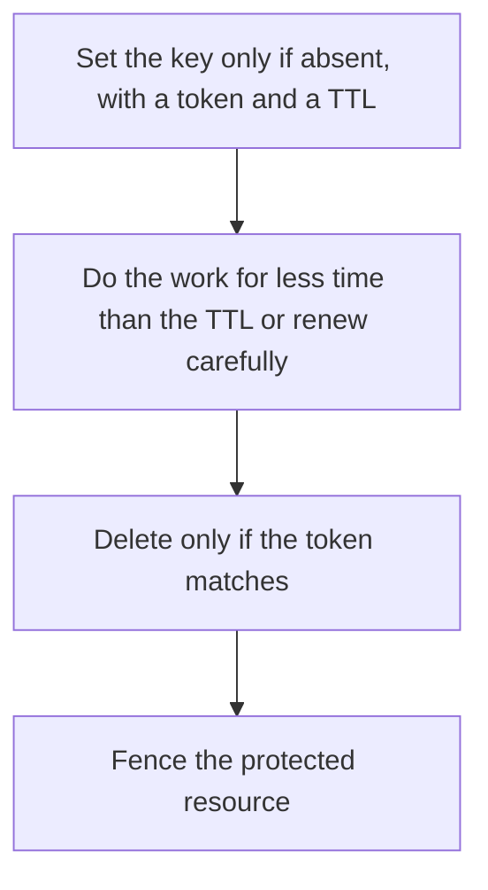

# D11-T018 — Distributed locks and their limitations

Topic ID: `D11-T018`
Domain: Redis and Caching
Subdomain: Distributed locks and their limitations
Importance: core
Complexity: intermediate
Dependencies: `D11-T017`, `D11-T001`, `D07-T001`, `D07-T002`, `D05-T001`, `D05-T002`
Execution status of the code in section F: unexecuted

## A. Topic Overview

A distributed lock using Redis usually sets a key with a unique token and an expiry so a crashed holder does not keep the lock forever. The holder must only delete the key if the token still matches, typically in a script. Expiry can release the lock while the holder is still working. Redlock across several nodes is an attempt to reduce that window and is still not a consensus system. The resource needs fencing if two holders would corrupt data.

In production this shows up as follows: A job worker sets lock:job:42 with a 30-second TTL. The job takes two minutes. Another worker starts the job at second 31. A database fence token stops the late worker from committing.

Interviewers use Distributed locks and their limitations to see whether you can state the failure mode, not only the definition. The failure to name is: two workers both acting because the lock expired before the work finished

Prerequisites: `D11-T017`, `D11-T001`, `D07-T001`, `D07-T002`, `D05-T001`, `D05-T002`. Later notes should link here instead of repeating the mechanism.

## B. First-Principles Explanation

A distributed lock using Redis usually sets a key with a unique token and an expiry so a crashed holder does not keep the lock forever. The holder must only delete the key if the token still matches, typically in a script. Expiry can release the lock while the holder is still working. Redlock across several nodes is an attempt to reduce that window and is still not a consensus system. The resource needs fencing if two holders would corrupt data.

The useful picture is: A Redis lock is a coat-check ticket that expires. If you are still wearing the coat when the ticket expires, the clerk may hand the same hook to someone else.

What has to be true:

1. Set the key only if absent, with a token and a TTL
2. Do the work for less time than the TTL or renew carefully
3. Delete only if the token matches
4. Fence the protected resource

It works when those steps preserve one invariant. It fails when two workers both acting because the lock expired before the work finished. The alternative is: you treat a single Redis lock as a proof that two writers cannot commit

## C. Internal Working and Architecture

Components involved: the caller, the state Distributed locks and their limitations mutates or reads, and the observer that reports lock TTL versus work duration, and double-execution count.

Execution:

1. Set the key only if absent, with a token and a TTL
2. Do the work for less time than the TTL or renew carefully
3. Delete only if the token matches
4. Fence the protected resource

Data moves only along that path. A retry re-enters at step 1, so the operation must say what a duplicate does. Memory and locks stay inside this mechanism. Callers see the result or a typed error, not a half-updated invariant.

State to remember: choose this when you need to reduce duplicate work and you have a fence on the real resource. Do not choose it when you treat a single Redis lock as a proof that two writers cannot commit.

## D. Diagrams and Visual Models



Read the diagram from top to bottom. Each box is one step of Distributed locks and their limitations. The failure mode (two workers both acting because the lock expired before the work finished) is what you look for when a later box never happens or happens twice.

## E. Examples and Analogies

Analogy: A Redis lock is a coat-check ticket that expires. If you are still wearing the coat when the ticket expires, the clerk may hand the same hook to someone else.

Production example: A job worker sets lock:job:42 with a 30-second TTL. The job takes two minutes. Another worker starts the job at second 31. A database fence token stops the late worker from committing.

A small counterexample is enough in an interview. Show the input, apply the steps, and show the broken outcome if someone uses the mechanism outside its rule: two workers both acting because the lock expired before the work finished.

## F. Code Examples

The snippet is labeled unexecuted. It illustrates the shape of the idea. It is not a benchmark and it embeds no secret.

```lua
if redis.call('get', KEYS[1]) == ARGV[1] then
  return redis.call('del', KEYS[1])
end
return 0
```

After the snippet, check lock TTL versus work duration, and double-execution count. If that signal moves the wrong way, the snippet is the wrong tool for the workload.

## G. Practical Backend Application

Use Distributed locks and their limitations in a service when you need to reduce duplicate work and you have a fence on the real resource.

A typical place is the production case already stated: A job worker sets lock:job:42 with a 30-second TTL. The job takes two minutes. Another worker starts the job at second 31. A database fence token stops the late worker from committing.

Operationally you alert on lock TTL versus work duration, and double-execution count. You do not alert only on process uptime. The dashboard should show the failure mode, a success rate, and the saturation signal (queue depth, lock wait, or latency) that predicts it.

## H. Advantages, Limitations and Trade-offs

| Choice | Benefit | Cost | Choose when | Avoid when |
| --- | --- | --- | --- | --- |
| Apply Distributed locks and their limitations | you need to reduce duplicate work and you have a fence on the real resource | Extra moving parts and a new failure mode | The failure you are preventing is already real | you treat a single Redis lock as a proof that two writers cannot commit |
| Simpler alternative | Less code and fewer dependencies | two workers both acting because the lock expired before the work finished | The workload does not hit the limit | The invariant must hold under concurrency or failure |

Distributed locks and their limitations is a trade. State the benefit and the cost in the same sentence when you propose it in a design review.

## I. Common Mistakes and Misconceptions

- No token on delete.
- TTL shorter than the work.
- No fencing token on the database write.
- Treating a diagram of Distributed locks and their limitations as proof that the invariant holds in production.
- Copying a default configuration without naming lock TTL versus work duration, and double-execution count.

## J. Debugging and Troubleshooting

Symptom: two workers both acting because the lock expired before the work finished

First check: lock TTL versus work duration, and double-execution count.

Then compare one healthy instance against one unhealthy instance. Confirm whether retries are duplicating work. Confirm whether a timeout is shorter than the work. Fix the invariant, then watch the same metric for a full peak, not only for the next minute.

Useful questions: did the step order in section C actually happen, or did a caller skip a step? Did a deploy change the data shape that Distributed locks and their limitations assumes?

## K. Interview Preparation

### Beginner

#### Q1. What problem does Distributed locks and their limitations solve?

**Answer:** A distributed lock using Redis usually sets a key with a unique token and an expiry so a crashed holder does not keep the lock forever. The holder must only delete the key if the token still matches, typically in a script. Expiry can release the lock while the holder is still working. Redlock across several nodes is an attempt to reduce that window and is still not a consensus system. The resource needs fencing if two holders would corrupt data. Without it, the usual backend failure is: two workers both acting because the lock expired before the work finished.

#### Q2. Where does Distributed locks and their limitations sit on a request path?

**Answer:** Distributed locks and their limitations is not a library you sprinkle on every call. you need to reduce duplicate work and you have a fence on the real resource You notice it when lock TTL versus work duration, and double-execution count. Name the constraint that makes this choice correct. Say what you would measure to confirm it.

#### Q3. Give a concrete example of Distributed locks and their limitations.

**Answer:** A job worker sets lock:job:42 with a 30-second TTL. The job takes two minutes. Another worker starts the job at second 31. A database fence token stops the late worker from committing. Walk the input, the state change, and the observable output.

#### Q4. What is a common mix-up around Distributed locks and their limitations?

**Answer:** two workers both acting because the lock expired before the work finished The corrective check is lock TTL versus work duration, and double-execution count. Name the constraint that makes this choice correct. Say what you would measure to confirm it. Say which alternative you rejected and why.

#### Q5. When would you skip Distributed locks and their limitations?

**Answer:** you treat a single Redis lock as a proof that two writers cannot commit Skipping is a decision with a measured cost, not a slogan. Name the constraint that makes this choice correct. Say what you would measure to confirm it. Say which alternative you rejected and why.

### Intermediate

#### Q1. What invariant makes Distributed locks and their limitations correct?

**Answer:** A distributed lock using Redis usually sets a key with a unique token and an expiry so a crashed holder does not keep the lock forever. The holder must only delete the key if the token still matches, typically in a script. Expiry can release the lock while the holder is still working. Redlock across several nodes is an attempt to reduce that window and is still not a consensus system. The resource needs fencing if two holders would corrupt data. State the invariant before you name the tool.

#### Q2. How do you test Distributed locks and their limitations?

**Answer:** Assert the failure mode directly: two workers both acting because the lock expired before the work finished. The assertion should watch lock TTL versus work duration, and double-execution count. Include a concurrent or retry case if the bug only appears then. Name the constraint that makes this choice correct.

#### Q3. What signal tells you Distributed locks and their limitations is misbehaving in production?

**Answer:** Watch lock TTL versus work duration, and double-execution count. The user-visible symptom is usually two workers both acting because the lock expired before the work finished. Name the constraint that makes this choice correct. Say what you would measure to confirm it.

#### Q4. How would you introduce Distributed locks and their limitations into a legacy service?

**Answer:** you need to reduce duplicate work and you have a fence on the real resource Ship it behind a metric so you can compare the old path. Roll back if two workers both acting because the lock expired before the work finished gets worse. Name the constraint that makes this choice correct. Say what you would measure to confirm it.

#### Q5. What do you trade away by choosing Distributed locks and their limitations?

**Answer:** you need to reduce duplicate work and you have a fence on the real resource you treat a single Redis lock as a proof that two writers cannot commit Say the cost in latency, storage, or operational load. Name the constraint that makes this choice correct. Say what you would measure to confirm it. Say which alternative you rejected and why.

### Advanced

#### Q1. What breaks if a dependency of Distributed locks and their limitations is slow or down?

**Answer:** two workers both acting because the lock expired before the work finished Degrade using the rule: you treat a single Redis lock as a proof that two writers cannot commit. Timeouts must be shorter than the caller's deadline. Name the constraint that makes this choice correct. Say what you would measure to confirm it.

#### Q2. How does Distributed locks and their limitations behave under retries?

**Answer:** Retries repeat work, so Distributed locks and their limitations must define what a duplicate does. two workers both acting because the lock expired before the work finished Idempotency keys or fences belong next to the write, not in a comment. Name the constraint that makes this choice correct. Say what you would measure to confirm it.

#### Q3. What is the capacity limit of Distributed locks and their limitations?

**Answer:** The limit shows up as lock TTL versus work duration, and double-execution count. Add capacity only after you know whether the bottleneck is CPU, lock wait, or network. Name the constraint that makes this choice correct. Say what you would measure to confirm it.

#### Q4. How do you evolve Distributed locks and their limitations without a flag day?

**Answer:** you need to reduce duplicate work and you have a fence on the real resource Version the contract or the on-disk format. Readers should tolerate one old and one new shape during the rollout. Name the constraint that makes this choice correct. Say what you would measure to confirm it.

#### Q5. What security or correctness bug hides inside Distributed locks and their limitations?

**Answer:** two workers both acting because the lock expired before the work finished Check authorization and tenancy at the same boundary as the mechanism. A cache or queue must not widen who can read the data. Name the constraint that makes this choice correct. Say what you would measure to confirm it.

### Scenario

#### Q1. Incident: two workers both acting because the lock expired before the work finished. What do you check first?

**Answer:** Start with lock TTL versus work duration, and double-execution count. Compare a good host and a bad host before you restart anything. A distributed lock using Redis usually sets a key with a unique token and an expiry so a crashed holder does not keep the lock forever. The holder must only delete the key if the token still matches, typically in a script. Expiry can release the lock while the holder is still working. Redlock across several nodes is an attempt to reduce that window and is still not a consensus system. The resource needs fencing if two holders would corrupt data.

#### Q2. A reviewer wants the clever version. What data settles it?

**Answer:** you need to reduce duplicate work and you have a fence on the real resource you treat a single Redis lock as a proof that two writers cannot commit Bring lock TTL versus work duration, and double-execution count from a load test or from production, not a slogan. Name the constraint that makes this choice correct. Say what you would measure to confirm it. Say which alternative you rejected and why.

#### Q3. You have one hour to explain Distributed locks and their limitations at a whiteboard.

**Answer:** Draw the happy path in four boxes. Then draw the failure: two workers both acting because the lock expired before the work finished. End with the metric you would page on. Name the constraint that makes this choice correct.

#### Q4. The bug only appears under two concurrent callers.

**Answer:** two workers both acting because the lock expired before the work finished Reproduce with a barrier so both sides enter the critical window. Confirm the fix with lock TTL versus work duration, and double-execution count. Name the constraint that makes this choice correct. Say what you would measure to confirm it.

#### Q5. Leadership wants this on every service next week.

**Answer:** you treat a single Redis lock as a proof that two writers cannot commit you need to reduce duplicate work and you have a fence on the real resource Roll it out where the failure mode is already hurting users. Name the constraint that makes this choice correct. Say what you would measure to confirm it. Say which alternative you rejected and why.

### Follow-up

#### Q1. What did you assume about the data size or the clock?

**Answer:** A distributed lock using Redis usually sets a key with a unique token and an expiry so a crashed holder does not keep the lock forever. The holder must only delete the key if the token still matches, typically in a script. Expiry can release the lock while the holder is still working. Redlock across several nodes is an attempt to reduce that window and is still not a consensus system. The resource needs fencing if two holders would corrupt data. Clocks are not a total order across machines. State whether the algorithm needs bounded size or a single leader.

#### Q2. What would you measure after the change ships?

**Answer:** Page on lock TTL versus work duration, and double-execution count. Keep a before/after dashboard for one week. Alert on the failure mode, not only on CPU. Name the constraint that makes this choice correct.

#### Q3. Which neighboring topic did you deliberately not re-teach?

**Answer:** This note owns Distributed locks and their limitations. Related identifiers are in section N. Shared ideas are linked, not copied. Name the constraint that makes this choice correct.

## L. Practical Exercises

Solutions are in `EXERCISES/solutions/D11-T018.md`, not in this section.

1. Whiteboard the four steps of Distributed locks and their limitations and mark where `two workers both acting because the lock expired before the work finished` enters.
2. Read the snippet in section F and write the assertion that would catch that failure. The assertion must mention `lock TTL versus work duration, and double-execution count`.
3. Argue for or against using Distributed locks and their limitations on a service you know. Use the choose and avoid rows from section H. Do not appeal to popularity.

## M. Revision Notes

- Mechanism: A distributed lock using Redis usually sets a key with a unique token and an expiry so a crashed holder does not keep the lock forever.
- Failure: two workers both acting because the lock expired before the work finished
- Metric: lock TTL versus work duration, and double-execution count
- Choose when: you need to reduce duplicate work and you have a fence on the real resource
- Avoid when: you treat a single Redis lock as a proof that two writers cannot commit

## N. Related Topics

Dependencies to review first: `D11-T017`, `D11-T001`, `D07-T001`, `D07-T002`, `D05-T001`, `D05-T002`.

Shared ideas stay in those notes. This note does not restate them.

## O. Completion Criteria

- You can explain Distributed locks and their limitations without reading this note, including the failure mode.
- You can draw the diagram in section D from memory.
- You can say when not to use it, using the avoid condition in section H.
- You can name the metric you would watch after shipping it.
