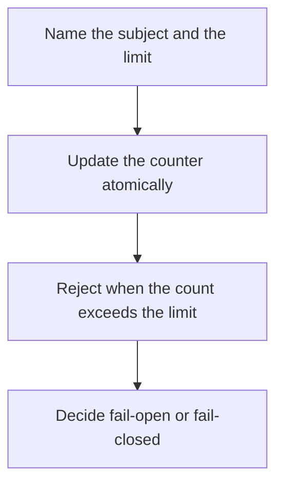

# D11-T019 — Rate limiting with Redis

Topic ID: `D11-T019`
Domain: Redis and Caching
Subdomain: Rate limiting with Redis
Importance: core
Complexity: intermediate
Dependencies: `D11-T018`, `D11-T001`, `D07-T001`, `D07-T002`, `D05-T001`, `D05-T002`
Execution status of the code in section F: unexecuted

## A. Topic Overview

Rate limiting with Redis counts actions per key in a window using INCR and a TTL, a token bucket in a hash, or a sorted set of timestamps. The script must do the check and the update atomically. The limiter fails open or closed when Redis is down, and that choice is a product decision. Limits are per user, token, or IP, and a NAT can make many users share an IP.

In production this shows up as follows: A public API increments rl:token:{id} inside a Lua script and returns 429 when the count passes 100 per second. If Redis is unreachable, the gateway fails open for reads and closed for writes.

Interviewers use Rate limiting with Redis to see whether you can state the failure mode, not only the definition. The failure to name is: a non-atomic read and increment that lets a burst through, or a limit keyed only by IP behind a carrier NAT

Prerequisites: `D11-T018`, `D11-T001`, `D07-T001`, `D07-T002`, `D05-T001`, `D05-T002`. Later notes should link here instead of repeating the mechanism.

## B. First-Principles Explanation

Rate limiting with Redis counts actions per key in a window using INCR and a TTL, a token bucket in a hash, or a sorted set of timestamps. The script must do the check and the update atomically. The limiter fails open or closed when Redis is down, and that choice is a product decision. Limits are per user, token, or IP, and a NAT can make many users share an IP.

The useful picture is: A rate limiter is a turnstile that counts people per minute. If two attendants both glance at the counter before either clicks it, extra people slip through.

What has to be true:

1. Name the subject and the limit
2. Update the counter atomically
3. Reject when the count exceeds the limit
4. Decide fail-open or fail-closed

It works when those steps preserve one invariant. It fails when a non-atomic read and increment that lets a burst through, or a limit keyed only by IP behind a carrier NAT. The alternative is: you count only inside one process and call it global

## C. Internal Working and Architecture

Components involved: the caller, the state Rate limiting with Redis mutates or reads, and the observer that reports rejected request rate and Redis errors treated as allow or deny.

Execution:

1. Name the subject and the limit
2. Update the counter atomically
3. Reject when the count exceeds the limit
4. Decide fail-open or fail-closed

Data moves only along that path. A retry re-enters at step 1, so the operation must say what a duplicate does. Memory and locks stay inside this mechanism. Callers see the result or a typed error, not a half-updated invariant.

State to remember: choose this when you need a shared count across many API nodes. Do not choose it when you count only inside one process and call it global.

## D. Diagrams and Visual Models



Read the diagram from top to bottom. Each box is one step of Rate limiting with Redis. The failure mode (a non-atomic read and increment that lets a burst through, or a limit keyed only by IP behind a carrier NAT) is what you look for when a later box never happens or happens twice.

## E. Examples and Analogies

Analogy: A rate limiter is a turnstile that counts people per minute. If two attendants both glance at the counter before either clicks it, extra people slip through.

Production example: A public API increments rl:token:{id} inside a Lua script and returns 429 when the count passes 100 per second. If Redis is unreachable, the gateway fails open for reads and closed for writes.

A small counterexample is enough in an interview. Show the input, apply the steps, and show the broken outcome if someone uses the mechanism outside its rule: a non-atomic read and increment that lets a burst through, or a limit keyed only by IP behind a carrier NAT.

## F. Code Examples

The snippet is labeled unexecuted. It illustrates the shape of the idea. It is not a benchmark and it embeds no secret.

```lua
local n = redis.call('INCR', KEYS[1])
if n == 1 then redis.call('PEXPIRE', KEYS[1], ARGV[1]) end
return n
```

After the snippet, check rejected request rate and Redis errors treated as allow or deny. If that signal moves the wrong way, the snippet is the wrong tool for the workload.

## G. Practical Backend Application

Use Rate limiting with Redis in a service when you need a shared count across many API nodes.

A typical place is the production case already stated: A public API increments rl:token:{id} inside a Lua script and returns 429 when the count passes 100 per second. If Redis is unreachable, the gateway fails open for reads and closed for writes.

Operationally you alert on rejected request rate and Redis errors treated as allow or deny. You do not alert only on process uptime. The dashboard should show the failure mode, a success rate, and the saturation signal (queue depth, lock wait, or latency) that predicts it.

## H. Advantages, Limitations and Trade-offs

| Choice | Benefit | Cost | Choose when | Avoid when |
| --- | --- | --- | --- | --- |
| Apply Rate limiting with Redis | you need a shared count across many API nodes | Extra moving parts and a new failure mode | The failure you are preventing is already real | you count only inside one process and call it global |
| Simpler alternative | Less code and fewer dependencies | a non-atomic read and increment that lets a burst through, or a limit keyed only by IP behind a carrier NAT | The workload does not hit the limit | The invariant must hold under concurrency or failure |

Rate limiting with Redis is a trade. State the benefit and the cost in the same sentence when you propose it in a design review.

## I. Common Mistakes and Misconceptions

- GET then INCR as two round trips.
- No TTL so the key lives forever.
- One limit for all customers.
- Treating a diagram of Rate limiting with Redis as proof that the invariant holds in production.
- Copying a default configuration without naming rejected request rate and Redis errors treated as allow or deny.

## J. Debugging and Troubleshooting

Symptom: a non-atomic read and increment that lets a burst through, or a limit keyed only by IP behind a carrier NAT

First check: rejected request rate and Redis errors treated as allow or deny.

Then compare one healthy instance against one unhealthy instance. Confirm whether retries are duplicating work. Confirm whether a timeout is shorter than the work. Fix the invariant, then watch the same metric for a full peak, not only for the next minute.

Useful questions: did the step order in section C actually happen, or did a caller skip a step? Did a deploy change the data shape that Rate limiting with Redis assumes?

## K. Interview Preparation

### Beginner

#### Q1. What problem does Rate limiting with Redis solve?

**Answer:** Rate limiting with Redis counts actions per key in a window using INCR and a TTL, a token bucket in a hash, or a sorted set of timestamps. The script must do the check and the update atomically. The limiter fails open or closed when Redis is down, and that choice is a product decision. Limits are per user, token, or IP, and a NAT can make many users share an IP. Without it, the usual backend failure is: a non-atomic read and increment that lets a burst through, or a limit keyed only by IP behind a carrier NAT.

#### Q2. Where does Rate limiting with Redis sit on a request path?

**Answer:** Rate limiting with Redis is not a library you sprinkle on every call. you need a shared count across many API nodes You notice it when rejected request rate and Redis errors treated as allow or deny. Name the constraint that makes this choice correct. Say what you would measure to confirm it.

#### Q3. Give a concrete example of Rate limiting with Redis.

**Answer:** A public API increments rl:token:{id} inside a Lua script and returns 429 when the count passes 100 per second. If Redis is unreachable, the gateway fails open for reads and closed for writes. Walk the input, the state change, and the observable output. Name the constraint that makes this choice correct.

#### Q4. What is a common mix-up around Rate limiting with Redis?

**Answer:** a non-atomic read and increment that lets a burst through, or a limit keyed only by IP behind a carrier NAT The corrective check is rejected request rate and Redis errors treated as allow or deny. Name the constraint that makes this choice correct. Say what you would measure to confirm it. Say which alternative you rejected and why.

#### Q5. When would you skip Rate limiting with Redis?

**Answer:** you count only inside one process and call it global Skipping is a decision with a measured cost, not a slogan. Name the constraint that makes this choice correct. Say what you would measure to confirm it. Say which alternative you rejected and why.

### Intermediate

#### Q1. What invariant makes Rate limiting with Redis correct?

**Answer:** Rate limiting with Redis counts actions per key in a window using INCR and a TTL, a token bucket in a hash, or a sorted set of timestamps. The script must do the check and the update atomically. The limiter fails open or closed when Redis is down, and that choice is a product decision. Limits are per user, token, or IP, and a NAT can make many users share an IP. State the invariant before you name the tool.

#### Q2. How do you test Rate limiting with Redis?

**Answer:** Assert the failure mode directly: a non-atomic read and increment that lets a burst through, or a limit keyed only by IP behind a carrier NAT. The assertion should watch rejected request rate and Redis errors treated as allow or deny. Include a concurrent or retry case if the bug only appears then. Name the constraint that makes this choice correct.

#### Q3. What signal tells you Rate limiting with Redis is misbehaving in production?

**Answer:** Watch rejected request rate and Redis errors treated as allow or deny. The user-visible symptom is usually a non-atomic read and increment that lets a burst through, or a limit keyed only by IP behind a carrier NAT. Name the constraint that makes this choice correct. Say what you would measure to confirm it.

#### Q4. How would you introduce Rate limiting with Redis into a legacy service?

**Answer:** you need a shared count across many API nodes Ship it behind a metric so you can compare the old path. Roll back if a non-atomic read and increment that lets a burst through, or a limit keyed only by IP behind a carrier NAT gets worse. Name the constraint that makes this choice correct. Say what you would measure to confirm it.

#### Q5. What do you trade away by choosing Rate limiting with Redis?

**Answer:** you need a shared count across many API nodes you count only inside one process and call it global Say the cost in latency, storage, or operational load. Name the constraint that makes this choice correct. Say what you would measure to confirm it. Say which alternative you rejected and why.

### Advanced

#### Q1. What breaks if a dependency of Rate limiting with Redis is slow or down?

**Answer:** a non-atomic read and increment that lets a burst through, or a limit keyed only by IP behind a carrier NAT Degrade using the rule: you count only inside one process and call it global. Timeouts must be shorter than the caller's deadline. Name the constraint that makes this choice correct. Say what you would measure to confirm it.

#### Q2. How does Rate limiting with Redis behave under retries?

**Answer:** Retries repeat work, so Rate limiting with Redis must define what a duplicate does. a non-atomic read and increment that lets a burst through, or a limit keyed only by IP behind a carrier NAT Idempotency keys or fences belong next to the write, not in a comment. Name the constraint that makes this choice correct. Say what you would measure to confirm it.

#### Q3. What is the capacity limit of Rate limiting with Redis?

**Answer:** The limit shows up as rejected request rate and Redis errors treated as allow or deny. Add capacity only after you know whether the bottleneck is CPU, lock wait, or network. Name the constraint that makes this choice correct. Say what you would measure to confirm it.

#### Q4. How do you evolve Rate limiting with Redis without a flag day?

**Answer:** you need a shared count across many API nodes Version the contract or the on-disk format. Readers should tolerate one old and one new shape during the rollout. Name the constraint that makes this choice correct. Say what you would measure to confirm it.

#### Q5. What security or correctness bug hides inside Rate limiting with Redis?

**Answer:** a non-atomic read and increment that lets a burst through, or a limit keyed only by IP behind a carrier NAT Check authorization and tenancy at the same boundary as the mechanism. A cache or queue must not widen who can read the data. Name the constraint that makes this choice correct. Say what you would measure to confirm it.

### Scenario

#### Q1. Incident: a non-atomic read and increment that lets a burst through, or a limit keyed only by IP behind a carrier NAT. What do you check first?

**Answer:** Start with rejected request rate and Redis errors treated as allow or deny. Compare a good host and a bad host before you restart anything. Rate limiting with Redis counts actions per key in a window using INCR and a TTL, a token bucket in a hash, or a sorted set of timestamps. The script must do the check and the update atomically. The limiter fails open or closed when Redis is down, and that choice is a product decision. Limits are per user, token, or IP, and a NAT can make many users share an IP.

#### Q2. A reviewer wants the clever version. What data settles it?

**Answer:** you need a shared count across many API nodes you count only inside one process and call it global Bring rejected request rate and Redis errors treated as allow or deny from a load test or from production, not a slogan. Name the constraint that makes this choice correct. Say what you would measure to confirm it. Say which alternative you rejected and why.

#### Q3. You have one hour to explain Rate limiting with Redis at a whiteboard.

**Answer:** Draw the happy path in four boxes. Then draw the failure: a non-atomic read and increment that lets a burst through, or a limit keyed only by IP behind a carrier NAT. End with the metric you would page on. Name the constraint that makes this choice correct.

#### Q4. The bug only appears under two concurrent callers.

**Answer:** a non-atomic read and increment that lets a burst through, or a limit keyed only by IP behind a carrier NAT Reproduce with a barrier so both sides enter the critical window. Confirm the fix with rejected request rate and Redis errors treated as allow or deny. Name the constraint that makes this choice correct. Say what you would measure to confirm it.

#### Q5. Leadership wants this on every service next week.

**Answer:** you count only inside one process and call it global you need a shared count across many API nodes Roll it out where the failure mode is already hurting users. Name the constraint that makes this choice correct. Say what you would measure to confirm it. Say which alternative you rejected and why.

### Follow-up

#### Q1. What did you assume about the data size or the clock?

**Answer:** Rate limiting with Redis counts actions per key in a window using INCR and a TTL, a token bucket in a hash, or a sorted set of timestamps. The script must do the check and the update atomically. The limiter fails open or closed when Redis is down, and that choice is a product decision. Limits are per user, token, or IP, and a NAT can make many users share an IP. Clocks are not a total order across machines. State whether the algorithm needs bounded size or a single leader.

#### Q2. What would you measure after the change ships?

**Answer:** Page on rejected request rate and Redis errors treated as allow or deny. Keep a before/after dashboard for one week. Alert on the failure mode, not only on CPU. Name the constraint that makes this choice correct.

#### Q3. Which neighboring topic did you deliberately not re-teach?

**Answer:** This note owns Rate limiting with Redis. Related identifiers are in section N. Shared ideas are linked, not copied. Name the constraint that makes this choice correct.

## L. Practical Exercises

Solutions are in `EXERCISES/solutions/D11-T019.md`, not in this section.

1. Whiteboard the four steps of Rate limiting with Redis and mark where `a non-atomic read and increment that lets a burst through, or a limit keyed only by IP behind a carrier NAT` enters.
2. Read the snippet in section F and write the assertion that would catch that failure. The assertion must mention `rejected request rate and Redis errors treated as allow or deny`.
3. Argue for or against using Rate limiting with Redis on a service you know. Use the choose and avoid rows from section H. Do not appeal to popularity.

## M. Revision Notes

- Mechanism: Rate limiting with Redis counts actions per key in a window using INCR and a TTL, a token bucket in a hash, or a sorted set of timestamps.
- Failure: a non-atomic read and increment that lets a burst through, or a limit keyed only by IP behind a carrier NAT
- Metric: rejected request rate and Redis errors treated as allow or deny
- Choose when: you need a shared count across many API nodes
- Avoid when: you count only inside one process and call it global

## N. Related Topics

Dependencies to review first: `D11-T018`, `D11-T001`, `D07-T001`, `D07-T002`, `D05-T001`, `D05-T002`.

Shared ideas stay in those notes. This note does not restate them.

## O. Completion Criteria

- You can explain Rate limiting with Redis without reading this note, including the failure mode.
- You can draw the diagram in section D from memory.
- You can say when not to use it, using the avoid condition in section H.
- You can name the metric you would watch after shipping it.
