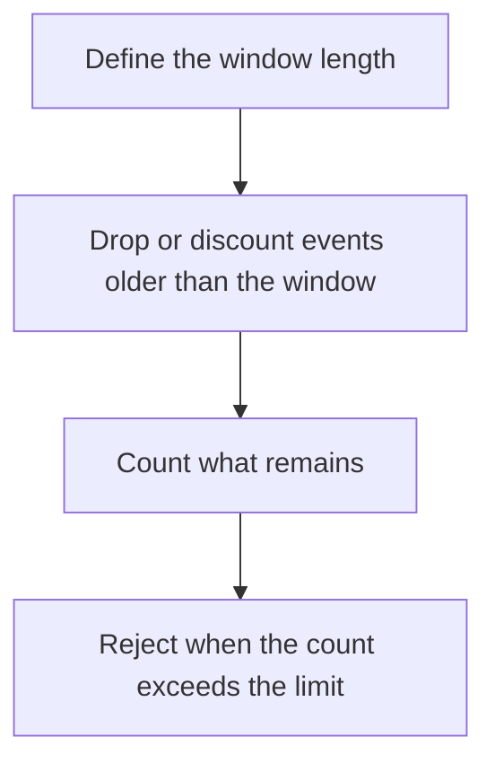

# D11-T020 — Sliding-window counters

Topic ID: `D11-T020`
Domain: Redis and Caching
Subdomain: Sliding-window counters
Importance: core
Complexity: intermediate
Dependencies: `D11-T019`, `D11-T001`, `D07-T001`, `D07-T002`, `D05-T001`, `D05-T002`
Execution status of the code in section F: unexecuted

## A. Topic Overview

A sliding-window counter estimates how many events fell in the last T seconds by weighting the previous fixed window and the current one, or by storing each event's timestamp in a sorted set and dropping those older than T. The sorted-set version is exact and costs memory per event. The weighted-counter version is small and approximate. Both beat a fixed window's boundary burst, where a client sends twice the limit around the reset.

In production this shows up as follows: An API that allowed 100 calls per clock minute saw 200 calls in two seconds around the minute mark. A sliding window of 60 seconds removes that seam.

Interviewers use Sliding-window counters to see whether you can state the failure mode, not only the definition. The failure to name is: a fixed window that allows two bursts back to back at the boundary, or a sorted set that stores every request and fills memory

Prerequisites: `D11-T019`, `D11-T001`, `D07-T001`, `D07-T002`, `D05-T001`, `D05-T002`. Later notes should link here instead of repeating the mechanism.

## B. First-Principles Explanation

A sliding-window counter estimates how many events fell in the last T seconds by weighting the previous fixed window and the current one, or by storing each event's timestamp in a sorted set and dropping those older than T. The sorted-set version is exact and costs memory per event. The weighted-counter version is small and approximate. Both beat a fixed window's boundary burst, where a client sends twice the limit around the reset.

The useful picture is: A fixed window is a counter that resets every minute, so a rude guest spends the whole allowance at 0:59 and again at 1:00. A sliding window keeps looking at the last sixty seconds only.

What has to be true:

1. Define the window length
2. Drop or discount events older than the window
3. Count what remains
4. Reject when the count exceeds the limit

It works when those steps preserve one invariant. It fails when a fixed window that allows two bursts back to back at the boundary, or a sorted set that stores every request and fills memory. The alternative is: a coarse fixed window is enough and the extra memory is not

## C. Internal Working and Architecture

Components involved: the caller, the state Sliding-window counters mutates or reads, and the observer that reports allowed bursts at the window boundary, and memory per limited key.

Execution:

1. Define the window length
2. Drop or discount events older than the window
3. Count what remains
4. Reject when the count exceeds the limit

Data moves only along that path. A retry re-enters at step 1, so the operation must say what a duplicate does. Memory and locks stay inside this mechanism. Callers see the result or a typed error, not a half-updated invariant.

State to remember: choose this when the burst at a fixed boundary is a real abuse or fairness problem. Do not choose it when a coarse fixed window is enough and the extra memory is not.

## D. Diagrams and Visual Models



Read the diagram from top to bottom. Each box is one step of Sliding-window counters. The failure mode (a fixed window that allows two bursts back to back at the boundary, or a sorted set that stores every request and fills memory) is what you look for when a later box never happens or happens twice.

## E. Examples and Analogies

Analogy: A fixed window is a counter that resets every minute, so a rude guest spends the whole allowance at 0:59 and again at 1:00. A sliding window keeps looking at the last sixty seconds only.

Production example: An API that allowed 100 calls per clock minute saw 200 calls in two seconds around the minute mark. A sliding window of 60 seconds removes that seam.

A small counterexample is enough in an interview. Show the input, apply the steps, and show the broken outcome if someone uses the mechanism outside its rule: a fixed window that allows two bursts back to back at the boundary, or a sorted set that stores every request and fills memory.

## F. Code Examples

The snippet is labeled unexecuted. It illustrates the shape of the idea. It is not a benchmark and it embeds no secret.

```python
def weighted(prev, curr, elapsed, window):
    return prev * (1 - elapsed / window) + curr
```

After the snippet, check allowed bursts at the window boundary, and memory per limited key. If that signal moves the wrong way, the snippet is the wrong tool for the workload.

## G. Practical Backend Application

Use Sliding-window counters in a service when the burst at a fixed boundary is a real abuse or fairness problem.

A typical place is the production case already stated: An API that allowed 100 calls per clock minute saw 200 calls in two seconds around the minute mark. A sliding window of 60 seconds removes that seam.

Operationally you alert on allowed bursts at the window boundary, and memory per limited key. You do not alert only on process uptime. The dashboard should show the failure mode, a success rate, and the saturation signal (queue depth, lock wait, or latency) that predicts it.

## H. Advantages, Limitations and Trade-offs

| Choice | Benefit | Cost | Choose when | Avoid when |
| --- | --- | --- | --- | --- |
| Apply Sliding-window counters | the burst at a fixed boundary is a real abuse or fairness problem | Extra moving parts and a new failure mode | The failure you are preventing is already real | a coarse fixed window is enough and the extra memory is not |
| Simpler alternative | Less code and fewer dependencies | a fixed window that allows two bursts back to back at the boundary, or a sorted set that stores every request and fills memory | The workload does not hit the limit | The invariant must hold under concurrency or failure |

Sliding-window counters is a trade. State the benefit and the cost in the same sentence when you propose it in a design review.

## I. Common Mistakes and Misconceptions

- Calling a fixed window sliding.
- Storing unbounded timestamps.
- Forgetting the approximation error of the weighted formula.
- Treating a diagram of Sliding-window counters as proof that the invariant holds in production.
- Copying a default configuration without naming allowed bursts at the window boundary, and memory per limited key.

## J. Debugging and Troubleshooting

Symptom: a fixed window that allows two bursts back to back at the boundary, or a sorted set that stores every request and fills memory

First check: allowed bursts at the window boundary, and memory per limited key.

Then compare one healthy instance against one unhealthy instance. Confirm whether retries are duplicating work. Confirm whether a timeout is shorter than the work. Fix the invariant, then watch the same metric for a full peak, not only for the next minute.

Useful questions: did the step order in section C actually happen, or did a caller skip a step? Did a deploy change the data shape that Sliding-window counters assumes?

## K. Interview Preparation

### Beginner

#### Q1. What problem does Sliding-window counters solve?

**Answer:** A sliding-window counter estimates how many events fell in the last T seconds by weighting the previous fixed window and the current one, or by storing each event's timestamp in a sorted set and dropping those older than T. The sorted-set version is exact and costs memory per event. The weighted-counter version is small and approximate. Both beat a fixed window's boundary burst, where a client sends twice the limit around the reset. Without it, the usual backend failure is: a fixed window that allows two bursts back to back at the boundary, or a sorted set that stores every request and fills memory.

#### Q2. Where does Sliding-window counters sit on a request path?

**Answer:** Sliding-window counters is not a library you sprinkle on every call. the burst at a fixed boundary is a real abuse or fairness problem You notice it when allowed bursts at the window boundary, and memory per limited key. Name the constraint that makes this choice correct. Say what you would measure to confirm it.

#### Q3. Give a concrete example of Sliding-window counters.

**Answer:** An API that allowed 100 calls per clock minute saw 200 calls in two seconds around the minute mark. A sliding window of 60 seconds removes that seam. Walk the input, the state change, and the observable output. Name the constraint that makes this choice correct.

#### Q4. What is a common mix-up around Sliding-window counters?

**Answer:** a fixed window that allows two bursts back to back at the boundary, or a sorted set that stores every request and fills memory The corrective check is allowed bursts at the window boundary, and memory per limited key. Name the constraint that makes this choice correct. Say what you would measure to confirm it. Say which alternative you rejected and why.

#### Q5. When would you skip Sliding-window counters?

**Answer:** a coarse fixed window is enough and the extra memory is not Skipping is a decision with a measured cost, not a slogan. Name the constraint that makes this choice correct. Say what you would measure to confirm it. Say which alternative you rejected and why.

### Intermediate

#### Q1. What invariant makes Sliding-window counters correct?

**Answer:** A sliding-window counter estimates how many events fell in the last T seconds by weighting the previous fixed window and the current one, or by storing each event's timestamp in a sorted set and dropping those older than T. The sorted-set version is exact and costs memory per event. The weighted-counter version is small and approximate. Both beat a fixed window's boundary burst, where a client sends twice the limit around the reset. State the invariant before you name the tool.

#### Q2. How do you test Sliding-window counters?

**Answer:** Assert the failure mode directly: a fixed window that allows two bursts back to back at the boundary, or a sorted set that stores every request and fills memory. The assertion should watch allowed bursts at the window boundary, and memory per limited key. Include a concurrent or retry case if the bug only appears then. Name the constraint that makes this choice correct.

#### Q3. What signal tells you Sliding-window counters is misbehaving in production?

**Answer:** Watch allowed bursts at the window boundary, and memory per limited key. The user-visible symptom is usually a fixed window that allows two bursts back to back at the boundary, or a sorted set that stores every request and fills memory. Name the constraint that makes this choice correct. Say what you would measure to confirm it.

#### Q4. How would you introduce Sliding-window counters into a legacy service?

**Answer:** the burst at a fixed boundary is a real abuse or fairness problem Ship it behind a metric so you can compare the old path. Roll back if a fixed window that allows two bursts back to back at the boundary, or a sorted set that stores every request and fills memory gets worse. Name the constraint that makes this choice correct. Say what you would measure to confirm it.

#### Q5. What do you trade away by choosing Sliding-window counters?

**Answer:** the burst at a fixed boundary is a real abuse or fairness problem a coarse fixed window is enough and the extra memory is not Say the cost in latency, storage, or operational load. Name the constraint that makes this choice correct. Say what you would measure to confirm it. Say which alternative you rejected and why.

### Advanced

#### Q1. What breaks if a dependency of Sliding-window counters is slow or down?

**Answer:** a fixed window that allows two bursts back to back at the boundary, or a sorted set that stores every request and fills memory Degrade using the rule: a coarse fixed window is enough and the extra memory is not. Timeouts must be shorter than the caller's deadline. Name the constraint that makes this choice correct. Say what you would measure to confirm it.

#### Q2. How does Sliding-window counters behave under retries?

**Answer:** Retries repeat work, so Sliding-window counters must define what a duplicate does. a fixed window that allows two bursts back to back at the boundary, or a sorted set that stores every request and fills memory Idempotency keys or fences belong next to the write, not in a comment. Name the constraint that makes this choice correct. Say what you would measure to confirm it.

#### Q3. What is the capacity limit of Sliding-window counters?

**Answer:** The limit shows up as allowed bursts at the window boundary, and memory per limited key. Add capacity only after you know whether the bottleneck is CPU, lock wait, or network. Name the constraint that makes this choice correct. Say what you would measure to confirm it.

#### Q4. How do you evolve Sliding-window counters without a flag day?

**Answer:** the burst at a fixed boundary is a real abuse or fairness problem Version the contract or the on-disk format. Readers should tolerate one old and one new shape during the rollout. Name the constraint that makes this choice correct. Say what you would measure to confirm it.

#### Q5. What security or correctness bug hides inside Sliding-window counters?

**Answer:** a fixed window that allows two bursts back to back at the boundary, or a sorted set that stores every request and fills memory Check authorization and tenancy at the same boundary as the mechanism. A cache or queue must not widen who can read the data. Name the constraint that makes this choice correct. Say what you would measure to confirm it.

### Scenario

#### Q1. Incident: a fixed window that allows two bursts back to back at the boundary, or a sorted set that stores every request and fills memory. What do you check first?

**Answer:** Start with allowed bursts at the window boundary, and memory per limited key. Compare a good host and a bad host before you restart anything. A sliding-window counter estimates how many events fell in the last T seconds by weighting the previous fixed window and the current one, or by storing each event's timestamp in a sorted set and dropping those older than T. The sorted-set version is exact and costs memory per event. The weighted-counter version is small and approximate. Both beat a fixed window's boundary burst, where a client sends twice the limit around the reset.

#### Q2. A reviewer wants the clever version. What data settles it?

**Answer:** the burst at a fixed boundary is a real abuse or fairness problem a coarse fixed window is enough and the extra memory is not Bring allowed bursts at the window boundary, and memory per limited key from a load test or from production, not a slogan. Name the constraint that makes this choice correct. Say what you would measure to confirm it. Say which alternative you rejected and why.

#### Q3. You have one hour to explain Sliding-window counters at a whiteboard.

**Answer:** Draw the happy path in four boxes. Then draw the failure: a fixed window that allows two bursts back to back at the boundary, or a sorted set that stores every request and fills memory. End with the metric you would page on. Name the constraint that makes this choice correct.

#### Q4. The bug only appears under two concurrent callers.

**Answer:** a fixed window that allows two bursts back to back at the boundary, or a sorted set that stores every request and fills memory Reproduce with a barrier so both sides enter the critical window. Confirm the fix with allowed bursts at the window boundary, and memory per limited key. Name the constraint that makes this choice correct. Say what you would measure to confirm it.

#### Q5. Leadership wants this on every service next week.

**Answer:** a coarse fixed window is enough and the extra memory is not the burst at a fixed boundary is a real abuse or fairness problem Roll it out where the failure mode is already hurting users. Name the constraint that makes this choice correct. Say what you would measure to confirm it. Say which alternative you rejected and why.

### Follow-up

#### Q1. What did you assume about the data size or the clock?

**Answer:** A sliding-window counter estimates how many events fell in the last T seconds by weighting the previous fixed window and the current one, or by storing each event's timestamp in a sorted set and dropping those older than T. The sorted-set version is exact and costs memory per event. The weighted-counter version is small and approximate. Both beat a fixed window's boundary burst, where a client sends twice the limit around the reset. Clocks are not a total order across machines. State whether the algorithm needs bounded size or a single leader.

#### Q2. What would you measure after the change ships?

**Answer:** Page on allowed bursts at the window boundary, and memory per limited key. Keep a before/after dashboard for one week. Alert on the failure mode, not only on CPU. Name the constraint that makes this choice correct.

#### Q3. Which neighboring topic did you deliberately not re-teach?

**Answer:** This note owns Sliding-window counters. Related identifiers are in section N. Shared ideas are linked, not copied. Name the constraint that makes this choice correct.

## L. Practical Exercises

Solutions are in `EXERCISES/solutions/D11-T020.md`, not in this section.

1. Whiteboard the four steps of Sliding-window counters and mark where `a fixed window that allows two bursts back to back at the boundary, or a sorted set that stores every request and fills memory` enters.
2. Read the snippet in section F and write the assertion that would catch that failure. The assertion must mention `allowed bursts at the window boundary, and memory per limited key`.
3. Argue for or against using Sliding-window counters on a service you know. Use the choose and avoid rows from section H. Do not appeal to popularity.

## M. Revision Notes

- Mechanism: A sliding-window counter estimates how many events fell in the last T seconds by weighting the previous fixed window and the current one, or by storing each event's timestamp in a sorted set and dropping those older than T.
- Failure: a fixed window that allows two bursts back to back at the boundary, or a sorted set that stores every request and fills memory
- Metric: allowed bursts at the window boundary, and memory per limited key
- Choose when: the burst at a fixed boundary is a real abuse or fairness problem
- Avoid when: a coarse fixed window is enough and the extra memory is not

## N. Related Topics

Dependencies to review first: `D11-T019`, `D11-T001`, `D07-T001`, `D07-T002`, `D05-T001`, `D05-T002`.

Shared ideas stay in those notes. This note does not restate them.

## O. Completion Criteria

- You can explain Sliding-window counters without reading this note, including the failure mode.
- You can draw the diagram in section D from memory.
- You can say when not to use it, using the avoid condition in section H.
- You can name the metric you would watch after shipping it.
