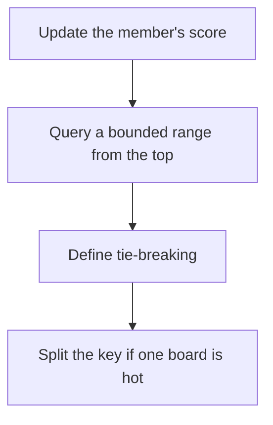

# D11-T021 — Leaderboards and ranking

Topic ID: `D11-T021`
Domain: Redis and Caching
Subdomain: Leaderboards and ranking
Importance: core
Complexity: intermediate
Dependencies: `D11-T020`, `D11-T001`, `D07-T001`, `D07-T002`, `D05-T001`, `D05-T002`
Execution status of the code in section F: unexecuted

## A. Topic Overview

A leaderboard maps a member to a score and asks for rank and the top of the range. Redis sorted sets do this with ZADD, ZREVRANGE, and ZREVRANK. Rank is the index in score order. Ties need a second key in the score or the member id so order is stable. A global sorted set is a hot key. Sharding by time or by cohort splits the heat and makes a true global rank a merge.

In production this shows up as follows: A game stores daily scores in a sorted set per region per day. The global top ten merges a handful of regional tops. One worldwide key for every player update melts a shard.

Interviewers use Leaderboards and ranking to see whether you can state the failure mode, not only the definition. The failure to name is: a single global key so large or so hot that one shard stalls, or unstable ordering when scores tie

Prerequisites: `D11-T020`, `D11-T001`, `D07-T001`, `D07-T002`, `D05-T001`, `D05-T002`. Later notes should link here instead of repeating the mechanism.

## B. First-Principles Explanation

A leaderboard maps a member to a score and asks for rank and the top of the range. Redis sorted sets do this with ZADD, ZREVRANGE, and ZREVRANK. Rank is the index in score order. Ties need a second key in the score or the member id so order is stable. A global sorted set is a hot key. Sharding by time or by cohort splits the heat and makes a true global rank a merge.

The useful picture is: A leaderboard is a ranked notice board. Asking for the top ten is easy. Asking for your exact rank in a billion names is a bigger piece of cardboard, and one nail may not hold it.

What has to be true:

1. Update the member's score
2. Query a bounded range from the top
3. Define tie-breaking
4. Split the key if one board is hot

It works when those steps preserve one invariant. It fails when a single global key so large or so hot that one shard stalls, or unstable ordering when scores tie. The alternative is: you need arbitrary filters, which is a query, not a sorted set

## C. Internal Working and Architecture

Components involved: the caller, the state Leaderboards and ranking mutates or reads, and the observer that reports sorted-set cardinality, top-query latency, and CPU of the shard that owns the board.

Execution:

1. Update the member's score
2. Query a bounded range from the top
3. Define tie-breaking
4. Split the key if one board is hot

Data moves only along that path. A retry re-enters at step 1, so the operation must say what a duplicate does. Memory and locks stay inside this mechanism. Callers see the result or a typed error, not a half-updated invariant.

State to remember: choose this when you need rank or top-k by a numeric score. Do not choose it when you need arbitrary filters, which is a query, not a sorted set.

## D. Diagrams and Visual Models



Read the diagram from top to bottom. Each box is one step of Leaderboards and ranking. The failure mode (a single global key so large or so hot that one shard stalls, or unstable ordering when scores tie) is what you look for when a later box never happens or happens twice.

## E. Examples and Analogies

Analogy: A leaderboard is a ranked notice board. Asking for the top ten is easy. Asking for your exact rank in a billion names is a bigger piece of cardboard, and one nail may not hold it.

Production example: A game stores daily scores in a sorted set per region per day. The global top ten merges a handful of regional tops. One worldwide key for every player update melts a shard.

A small counterexample is enough in an interview. Show the input, apply the steps, and show the broken outcome if someone uses the mechanism outside its rule: a single global key so large or so hot that one shard stalls, or unstable ordering when scores tie.

## F. Code Examples

The snippet is labeled unexecuted. It illustrates the shape of the idea. It is not a benchmark and it embeds no secret.

```text
ZADD board 100 user:1
ZREVRANGE board 0 9 WITHSCORES
```

After the snippet, check sorted-set cardinality, top-query latency, and CPU of the shard that owns the board. If that signal moves the wrong way, the snippet is the wrong tool for the workload.

## G. Practical Backend Application

Use Leaderboards and ranking in a service when you need rank or top-k by a numeric score.

A typical place is the production case already stated: A game stores daily scores in a sorted set per region per day. The global top ten merges a handful of regional tops. One worldwide key for every player update melts a shard.

Operationally you alert on sorted-set cardinality, top-query latency, and CPU of the shard that owns the board. You do not alert only on process uptime. The dashboard should show the failure mode, a success rate, and the saturation signal (queue depth, lock wait, or latency) that predicts it.

## H. Advantages, Limitations and Trade-offs

| Choice | Benefit | Cost | Choose when | Avoid when |
| --- | --- | --- | --- | --- |
| Apply Leaderboards and ranking | you need rank or top-k by a numeric score | Extra moving parts and a new failure mode | The failure you are preventing is already real | you need arbitrary filters, which is a query, not a sorted set |
| Simpler alternative | Less code and fewer dependencies | a single global key so large or so hot that one shard stalls, or unstable ordering when scores tie | The workload does not hit the limit | The invariant must hold under concurrency or failure |

Leaderboards and ranking is a trade. State the benefit and the cost in the same sentence when you propose it in a design review.

## I. Common Mistakes and Misconceptions

- One key for the world.
- Unstable ties.
- ZRANGE of the entire set to the client.
- Treating a diagram of Leaderboards and ranking as proof that the invariant holds in production.
- Copying a default configuration without naming sorted-set cardinality, top-query latency, and CPU of the shard that owns the board.

## J. Debugging and Troubleshooting

Symptom: a single global key so large or so hot that one shard stalls, or unstable ordering when scores tie

First check: sorted-set cardinality, top-query latency, and CPU of the shard that owns the board.

Then compare one healthy instance against one unhealthy instance. Confirm whether retries are duplicating work. Confirm whether a timeout is shorter than the work. Fix the invariant, then watch the same metric for a full peak, not only for the next minute.

Useful questions: did the step order in section C actually happen, or did a caller skip a step? Did a deploy change the data shape that Leaderboards and ranking assumes?

## K. Interview Preparation

### Beginner

#### Q1. What problem does Leaderboards and ranking solve?

**Answer:** A leaderboard maps a member to a score and asks for rank and the top of the range. Redis sorted sets do this with ZADD, ZREVRANGE, and ZREVRANK. Rank is the index in score order. Ties need a second key in the score or the member id so order is stable. A global sorted set is a hot key. Sharding by time or by cohort splits the heat and makes a true global rank a merge. Without it, the usual backend failure is: a single global key so large or so hot that one shard stalls, or unstable ordering when scores tie.

#### Q2. Where does Leaderboards and ranking sit on a request path?

**Answer:** Leaderboards and ranking is not a library you sprinkle on every call. you need rank or top-k by a numeric score You notice it when sorted-set cardinality, top-query latency, and CPU of the shard that owns the board. Name the constraint that makes this choice correct. Say what you would measure to confirm it.

#### Q3. Give a concrete example of Leaderboards and ranking.

**Answer:** A game stores daily scores in a sorted set per region per day. The global top ten merges a handful of regional tops. One worldwide key for every player update melts a shard. Walk the input, the state change, and the observable output.

#### Q4. What is a common mix-up around Leaderboards and ranking?

**Answer:** a single global key so large or so hot that one shard stalls, or unstable ordering when scores tie The corrective check is sorted-set cardinality, top-query latency, and CPU of the shard that owns the board. Name the constraint that makes this choice correct. Say what you would measure to confirm it. Say which alternative you rejected and why.

#### Q5. When would you skip Leaderboards and ranking?

**Answer:** you need arbitrary filters, which is a query, not a sorted set Skipping is a decision with a measured cost, not a slogan. Name the constraint that makes this choice correct. Say what you would measure to confirm it. Say which alternative you rejected and why.

### Intermediate

#### Q1. What invariant makes Leaderboards and ranking correct?

**Answer:** A leaderboard maps a member to a score and asks for rank and the top of the range. Redis sorted sets do this with ZADD, ZREVRANGE, and ZREVRANK. Rank is the index in score order. Ties need a second key in the score or the member id so order is stable. A global sorted set is a hot key. Sharding by time or by cohort splits the heat and makes a true global rank a merge. State the invariant before you name the tool.

#### Q2. How do you test Leaderboards and ranking?

**Answer:** Assert the failure mode directly: a single global key so large or so hot that one shard stalls, or unstable ordering when scores tie. The assertion should watch sorted-set cardinality, top-query latency, and CPU of the shard that owns the board. Include a concurrent or retry case if the bug only appears then. Name the constraint that makes this choice correct.

#### Q3. What signal tells you Leaderboards and ranking is misbehaving in production?

**Answer:** Watch sorted-set cardinality, top-query latency, and CPU of the shard that owns the board. The user-visible symptom is usually a single global key so large or so hot that one shard stalls, or unstable ordering when scores tie. Name the constraint that makes this choice correct. Say what you would measure to confirm it.

#### Q4. How would you introduce Leaderboards and ranking into a legacy service?

**Answer:** you need rank or top-k by a numeric score Ship it behind a metric so you can compare the old path. Roll back if a single global key so large or so hot that one shard stalls, or unstable ordering when scores tie gets worse. Name the constraint that makes this choice correct. Say what you would measure to confirm it.

#### Q5. What do you trade away by choosing Leaderboards and ranking?

**Answer:** you need rank or top-k by a numeric score you need arbitrary filters, which is a query, not a sorted set Say the cost in latency, storage, or operational load. Name the constraint that makes this choice correct. Say what you would measure to confirm it. Say which alternative you rejected and why.

### Advanced

#### Q1. What breaks if a dependency of Leaderboards and ranking is slow or down?

**Answer:** a single global key so large or so hot that one shard stalls, or unstable ordering when scores tie Degrade using the rule: you need arbitrary filters, which is a query, not a sorted set. Timeouts must be shorter than the caller's deadline. Name the constraint that makes this choice correct. Say what you would measure to confirm it.

#### Q2. How does Leaderboards and ranking behave under retries?

**Answer:** Retries repeat work, so Leaderboards and ranking must define what a duplicate does. a single global key so large or so hot that one shard stalls, or unstable ordering when scores tie Idempotency keys or fences belong next to the write, not in a comment. Name the constraint that makes this choice correct. Say what you would measure to confirm it.

#### Q3. What is the capacity limit of Leaderboards and ranking?

**Answer:** The limit shows up as sorted-set cardinality, top-query latency, and CPU of the shard that owns the board. Add capacity only after you know whether the bottleneck is CPU, lock wait, or network. Name the constraint that makes this choice correct. Say what you would measure to confirm it.

#### Q4. How do you evolve Leaderboards and ranking without a flag day?

**Answer:** you need rank or top-k by a numeric score Version the contract or the on-disk format. Readers should tolerate one old and one new shape during the rollout. Name the constraint that makes this choice correct. Say what you would measure to confirm it.

#### Q5. What security or correctness bug hides inside Leaderboards and ranking?

**Answer:** a single global key so large or so hot that one shard stalls, or unstable ordering when scores tie Check authorization and tenancy at the same boundary as the mechanism. A cache or queue must not widen who can read the data. Name the constraint that makes this choice correct. Say what you would measure to confirm it.

### Scenario

#### Q1. Incident: a single global key so large or so hot that one shard stalls, or unstable ordering when scores tie. What do you check first?

**Answer:** Start with sorted-set cardinality, top-query latency, and CPU of the shard that owns the board. Compare a good host and a bad host before you restart anything. A leaderboard maps a member to a score and asks for rank and the top of the range. Redis sorted sets do this with ZADD, ZREVRANGE, and ZREVRANK. Rank is the index in score order. Ties need a second key in the score or the member id so order is stable. A global sorted set is a hot key. Sharding by time or by cohort splits the heat and makes a true global rank a merge.

#### Q2. A reviewer wants the clever version. What data settles it?

**Answer:** you need rank or top-k by a numeric score you need arbitrary filters, which is a query, not a sorted set Bring sorted-set cardinality, top-query latency, and CPU of the shard that owns the board from a load test or from production, not a slogan. Name the constraint that makes this choice correct. Say what you would measure to confirm it. Say which alternative you rejected and why.

#### Q3. You have one hour to explain Leaderboards and ranking at a whiteboard.

**Answer:** Draw the happy path in four boxes. Then draw the failure: a single global key so large or so hot that one shard stalls, or unstable ordering when scores tie. End with the metric you would page on. Name the constraint that makes this choice correct.

#### Q4. The bug only appears under two concurrent callers.

**Answer:** a single global key so large or so hot that one shard stalls, or unstable ordering when scores tie Reproduce with a barrier so both sides enter the critical window. Confirm the fix with sorted-set cardinality, top-query latency, and CPU of the shard that owns the board. Name the constraint that makes this choice correct. Say what you would measure to confirm it.

#### Q5. Leadership wants this on every service next week.

**Answer:** you need arbitrary filters, which is a query, not a sorted set you need rank or top-k by a numeric score Roll it out where the failure mode is already hurting users. Name the constraint that makes this choice correct. Say what you would measure to confirm it. Say which alternative you rejected and why.

### Follow-up

#### Q1. What did you assume about the data size or the clock?

**Answer:** A leaderboard maps a member to a score and asks for rank and the top of the range. Redis sorted sets do this with ZADD, ZREVRANGE, and ZREVRANK. Rank is the index in score order. Ties need a second key in the score or the member id so order is stable. A global sorted set is a hot key. Sharding by time or by cohort splits the heat and makes a true global rank a merge. Clocks are not a total order across machines. State whether the algorithm needs bounded size or a single leader.

#### Q2. What would you measure after the change ships?

**Answer:** Page on sorted-set cardinality, top-query latency, and CPU of the shard that owns the board. Keep a before/after dashboard for one week. Alert on the failure mode, not only on CPU. Name the constraint that makes this choice correct.

#### Q3. Which neighboring topic did you deliberately not re-teach?

**Answer:** This note owns Leaderboards and ranking. Related identifiers are in section N. Shared ideas are linked, not copied. Name the constraint that makes this choice correct.

## L. Practical Exercises

Solutions are in `EXERCISES/solutions/D11-T021.md`, not in this section.

1. Whiteboard the four steps of Leaderboards and ranking and mark where `a single global key so large or so hot that one shard stalls, or unstable ordering when scores tie` enters.
2. Read the snippet in section F and write the assertion that would catch that failure. The assertion must mention `sorted-set cardinality, top-query latency, and CPU of the shard that owns the board`.
3. Argue for or against using Leaderboards and ranking on a service you know. Use the choose and avoid rows from section H. Do not appeal to popularity.

## M. Revision Notes

- Mechanism: A leaderboard maps a member to a score and asks for rank and the top of the range.
- Failure: a single global key so large or so hot that one shard stalls, or unstable ordering when scores tie
- Metric: sorted-set cardinality, top-query latency, and CPU of the shard that owns the board
- Choose when: you need rank or top-k by a numeric score
- Avoid when: you need arbitrary filters, which is a query, not a sorted set

## N. Related Topics

Dependencies to review first: `D11-T020`, `D11-T001`, `D07-T001`, `D07-T002`, `D05-T001`, `D05-T002`.

Shared ideas stay in those notes. This note does not restate them.

## O. Completion Criteria

- You can explain Leaderboards and ranking without reading this note, including the failure mode.
- You can draw the diagram in section D from memory.
- You can say when not to use it, using the avoid condition in section H.
- You can name the metric you would watch after shipping it.
