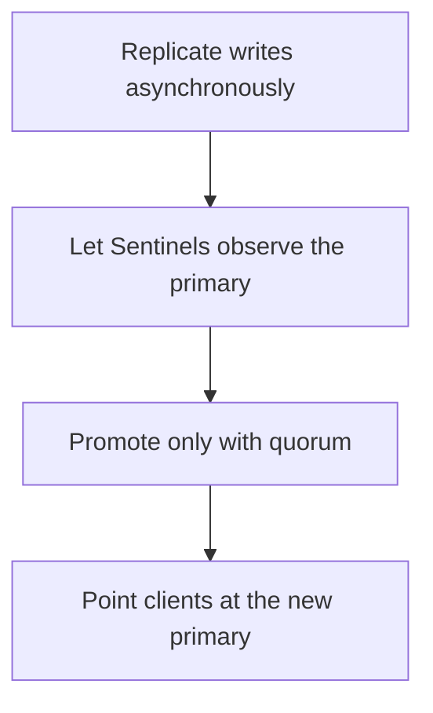

# D11-T022 — Redis replication and Sentinel

Topic ID: `D11-T022`
Domain: Redis and Caching
Subdomain: Redis replication and Sentinel
Importance: core
Complexity: intermediate
Dependencies: `D11-T021`, `D11-T001`, `D07-T001`, `D07-T002`, `D05-T001`, `D05-T002`
Execution status of the code in section F: unexecuted

## A. Topic Overview

Redis replication copies the primary's writes to replicas, asynchronously by default. A replica can serve stale reads. Sentinel watches nodes and starts a failover by promoting a replica when it decides the primary is unreachable. Failover can lose the writes the replica had not received. A quorum of Sentinels must agree so one unlucky network blip does not promote. Clients must learn the new primary.

In production this shows up as follows: A cache's replica set fails over with Sentinel and the application reconnects via the Sentinel endpoint. A rate-limit counter may go backward by the lost writes. A lock key may vanish. The design has to tolerate that.

Interviewers use Redis replication and Sentinel to see whether you can state the failure mode, not only the definition. The failure to name is: split brain or lost writes on failover, or clients still writing to the old primary

Prerequisites: `D11-T021`, `D11-T001`, `D07-T001`, `D07-T002`, `D05-T001`, `D05-T002`. Later notes should link here instead of repeating the mechanism.

## B. First-Principles Explanation

Redis replication copies the primary's writes to replicas, asynchronously by default. A replica can serve stale reads. Sentinel watches nodes and starts a failover by promoting a replica when it decides the primary is unreachable. Failover can lose the writes the replica had not received. A quorum of Sentinels must agree so one unlucky network blip does not promote. Clients must learn the new primary.

The useful picture is: Replication is an apprentice copying the ledger a few lines behind. Sentinel is a committee that hands the apprentice the official pen when the master disappears. Lines not yet copied are lost.

What has to be true:

1. Replicate writes asynchronously
2. Let Sentinels observe the primary
3. Promote only with quorum
4. Point clients at the new primary

It works when those steps preserve one invariant. It fails when split brain or lost writes on failover, or clients still writing to the old primary. The alternative is: you need zero lost writes, which async replication does not promise

## C. Internal Working and Architecture

Components involved: the caller, the state Redis replication and Sentinel mutates or reads, and the observer that reports replication offset lag and failover time in a drill.

Execution:

1. Replicate writes asynchronously
2. Let Sentinels observe the primary
3. Promote only with quorum
4. Point clients at the new primary

Data moves only along that path. A retry re-enters at step 1, so the operation must say what a duplicate does. Memory and locks stay inside this mechanism. Callers see the result or a typed error, not a half-updated invariant.

State to remember: choose this when you need automatic failover of one Redis primary. Do not choose it when you need zero lost writes, which async replication does not promise.

## D. Diagrams and Visual Models



Read the diagram from top to bottom. Each box is one step of Redis replication and Sentinel. The failure mode (split brain or lost writes on failover, or clients still writing to the old primary) is what you look for when a later box never happens or happens twice.

## E. Examples and Analogies

Analogy: Replication is an apprentice copying the ledger a few lines behind. Sentinel is a committee that hands the apprentice the official pen when the master disappears. Lines not yet copied are lost.

Production example: A cache's replica set fails over with Sentinel and the application reconnects via the Sentinel endpoint. A rate-limit counter may go backward by the lost writes. A lock key may vanish. The design has to tolerate that.

A small counterexample is enough in an interview. Show the input, apply the steps, and show the broken outcome if someone uses the mechanism outside its rule: split brain or lost writes on failover, or clients still writing to the old primary.

## F. Code Examples

The snippet is labeled unexecuted. It illustrates the shape of the idea. It is not a benchmark and it embeds no secret.

```python
def may_promote(sentinels_agreeing, quorum, lag_ok):
    return sentinels_agreeing >= quorum and lag_ok
```

After the snippet, check replication offset lag and failover time in a drill. If that signal moves the wrong way, the snippet is the wrong tool for the workload.

## G. Practical Backend Application

Use Redis replication and Sentinel in a service when you need automatic failover of one Redis primary.

A typical place is the production case already stated: A cache's replica set fails over with Sentinel and the application reconnects via the Sentinel endpoint. A rate-limit counter may go backward by the lost writes. A lock key may vanish. The design has to tolerate that.

Operationally you alert on replication offset lag and failover time in a drill. You do not alert only on process uptime. The dashboard should show the failure mode, a success rate, and the saturation signal (queue depth, lock wait, or latency) that predicts it.

## H. Advantages, Limitations and Trade-offs

| Choice | Benefit | Cost | Choose when | Avoid when |
| --- | --- | --- | --- | --- |
| Apply Redis replication and Sentinel | you need automatic failover of one Redis primary | Extra moving parts and a new failure mode | The failure you are preventing is already real | you need zero lost writes, which async replication does not promise |
| Simpler alternative | Less code and fewer dependencies | split brain or lost writes on failover, or clients still writing to the old primary | The workload does not hit the limit | The invariant must hold under concurrency or failure |

Redis replication and Sentinel is a trade. State the benefit and the cost in the same sentence when you propose it in a design review.

## I. Common Mistakes and Misconceptions

- One Sentinel.
- Ignoring client rediscovery.
- Reading a replica and expecting the write you just acknowledged.
- Treating a diagram of Redis replication and Sentinel as proof that the invariant holds in production.
- Copying a default configuration without naming replication offset lag and failover time in a drill.

## J. Debugging and Troubleshooting

Symptom: split brain or lost writes on failover, or clients still writing to the old primary

First check: replication offset lag and failover time in a drill.

Then compare one healthy instance against one unhealthy instance. Confirm whether retries are duplicating work. Confirm whether a timeout is shorter than the work. Fix the invariant, then watch the same metric for a full peak, not only for the next minute.

Useful questions: did the step order in section C actually happen, or did a caller skip a step? Did a deploy change the data shape that Redis replication and Sentinel assumes?

## K. Interview Preparation

### Beginner

#### Q1. What problem does Redis replication and Sentinel solve?

**Answer:** Redis replication copies the primary's writes to replicas, asynchronously by default. A replica can serve stale reads. Sentinel watches nodes and starts a failover by promoting a replica when it decides the primary is unreachable. Failover can lose the writes the replica had not received. A quorum of Sentinels must agree so one unlucky network blip does not promote. Clients must learn the new primary. Without it, the usual backend failure is: split brain or lost writes on failover, or clients still writing to the old primary.

#### Q2. Where does Redis replication and Sentinel sit on a request path?

**Answer:** Redis replication and Sentinel is not a library you sprinkle on every call. you need automatic failover of one Redis primary You notice it when replication offset lag and failover time in a drill. Name the constraint that makes this choice correct. Say what you would measure to confirm it.

#### Q3. Give a concrete example of Redis replication and Sentinel.

**Answer:** A cache's replica set fails over with Sentinel and the application reconnects via the Sentinel endpoint. A rate-limit counter may go backward by the lost writes. A lock key may vanish. The design has to tolerate that. Walk the input, the state change, and the observable output.

#### Q4. What is a common mix-up around Redis replication and Sentinel?

**Answer:** split brain or lost writes on failover, or clients still writing to the old primary The corrective check is replication offset lag and failover time in a drill. Name the constraint that makes this choice correct. Say what you would measure to confirm it. Say which alternative you rejected and why.

#### Q5. When would you skip Redis replication and Sentinel?

**Answer:** you need zero lost writes, which async replication does not promise Skipping is a decision with a measured cost, not a slogan. Name the constraint that makes this choice correct. Say what you would measure to confirm it. Say which alternative you rejected and why.

### Intermediate

#### Q1. What invariant makes Redis replication and Sentinel correct?

**Answer:** Redis replication copies the primary's writes to replicas, asynchronously by default. A replica can serve stale reads. Sentinel watches nodes and starts a failover by promoting a replica when it decides the primary is unreachable. Failover can lose the writes the replica had not received. A quorum of Sentinels must agree so one unlucky network blip does not promote. Clients must learn the new primary. State the invariant before you name the tool.

#### Q2. How do you test Redis replication and Sentinel?

**Answer:** Assert the failure mode directly: split brain or lost writes on failover, or clients still writing to the old primary. The assertion should watch replication offset lag and failover time in a drill. Include a concurrent or retry case if the bug only appears then. Name the constraint that makes this choice correct.

#### Q3. What signal tells you Redis replication and Sentinel is misbehaving in production?

**Answer:** Watch replication offset lag and failover time in a drill. The user-visible symptom is usually split brain or lost writes on failover, or clients still writing to the old primary. Name the constraint that makes this choice correct. Say what you would measure to confirm it.

#### Q4. How would you introduce Redis replication and Sentinel into a legacy service?

**Answer:** you need automatic failover of one Redis primary Ship it behind a metric so you can compare the old path. Roll back if split brain or lost writes on failover, or clients still writing to the old primary gets worse. Name the constraint that makes this choice correct. Say what you would measure to confirm it.

#### Q5. What do you trade away by choosing Redis replication and Sentinel?

**Answer:** you need automatic failover of one Redis primary you need zero lost writes, which async replication does not promise Say the cost in latency, storage, or operational load. Name the constraint that makes this choice correct. Say what you would measure to confirm it. Say which alternative you rejected and why.

### Advanced

#### Q1. What breaks if a dependency of Redis replication and Sentinel is slow or down?

**Answer:** split brain or lost writes on failover, or clients still writing to the old primary Degrade using the rule: you need zero lost writes, which async replication does not promise. Timeouts must be shorter than the caller's deadline. Name the constraint that makes this choice correct. Say what you would measure to confirm it.

#### Q2. How does Redis replication and Sentinel behave under retries?

**Answer:** Retries repeat work, so Redis replication and Sentinel must define what a duplicate does. split brain or lost writes on failover, or clients still writing to the old primary Idempotency keys or fences belong next to the write, not in a comment. Name the constraint that makes this choice correct. Say what you would measure to confirm it.

#### Q3. What is the capacity limit of Redis replication and Sentinel?

**Answer:** The limit shows up as replication offset lag and failover time in a drill. Add capacity only after you know whether the bottleneck is CPU, lock wait, or network. Name the constraint that makes this choice correct. Say what you would measure to confirm it.

#### Q4. How do you evolve Redis replication and Sentinel without a flag day?

**Answer:** you need automatic failover of one Redis primary Version the contract or the on-disk format. Readers should tolerate one old and one new shape during the rollout. Name the constraint that makes this choice correct. Say what you would measure to confirm it.

#### Q5. What security or correctness bug hides inside Redis replication and Sentinel?

**Answer:** split brain or lost writes on failover, or clients still writing to the old primary Check authorization and tenancy at the same boundary as the mechanism. A cache or queue must not widen who can read the data. Name the constraint that makes this choice correct. Say what you would measure to confirm it.

### Scenario

#### Q1. Incident: split brain or lost writes on failover, or clients still writing to the old primary. What do you check first?

**Answer:** Start with replication offset lag and failover time in a drill. Compare a good host and a bad host before you restart anything. Redis replication copies the primary's writes to replicas, asynchronously by default. A replica can serve stale reads. Sentinel watches nodes and starts a failover by promoting a replica when it decides the primary is unreachable. Failover can lose the writes the replica had not received. A quorum of Sentinels must agree so one unlucky network blip does not promote. Clients must learn the new primary.

#### Q2. A reviewer wants the clever version. What data settles it?

**Answer:** you need automatic failover of one Redis primary you need zero lost writes, which async replication does not promise Bring replication offset lag and failover time in a drill from a load test or from production, not a slogan. Name the constraint that makes this choice correct. Say what you would measure to confirm it. Say which alternative you rejected and why.

#### Q3. You have one hour to explain Redis replication and Sentinel at a whiteboard.

**Answer:** Draw the happy path in four boxes. Then draw the failure: split brain or lost writes on failover, or clients still writing to the old primary. End with the metric you would page on. Name the constraint that makes this choice correct.

#### Q4. The bug only appears under two concurrent callers.

**Answer:** split brain or lost writes on failover, or clients still writing to the old primary Reproduce with a barrier so both sides enter the critical window. Confirm the fix with replication offset lag and failover time in a drill. Name the constraint that makes this choice correct. Say what you would measure to confirm it.

#### Q5. Leadership wants this on every service next week.

**Answer:** you need zero lost writes, which async replication does not promise you need automatic failover of one Redis primary Roll it out where the failure mode is already hurting users. Name the constraint that makes this choice correct. Say what you would measure to confirm it. Say which alternative you rejected and why.

### Follow-up

#### Q1. What did you assume about the data size or the clock?

**Answer:** Redis replication copies the primary's writes to replicas, asynchronously by default. A replica can serve stale reads. Sentinel watches nodes and starts a failover by promoting a replica when it decides the primary is unreachable. Failover can lose the writes the replica had not received. A quorum of Sentinels must agree so one unlucky network blip does not promote. Clients must learn the new primary. Clocks are not a total order across machines. State whether the algorithm needs bounded size or a single leader.

#### Q2. What would you measure after the change ships?

**Answer:** Page on replication offset lag and failover time in a drill. Keep a before/after dashboard for one week. Alert on the failure mode, not only on CPU. Name the constraint that makes this choice correct.

#### Q3. Which neighboring topic did you deliberately not re-teach?

**Answer:** This note owns Redis replication and Sentinel. Related identifiers are in section N. Shared ideas are linked, not copied. Name the constraint that makes this choice correct.

## L. Practical Exercises

Solutions are in `EXERCISES/solutions/D11-T022.md`, not in this section.

1. Whiteboard the four steps of Redis replication and Sentinel and mark where `split brain or lost writes on failover, or clients still writing to the old primary` enters.
2. Read the snippet in section F and write the assertion that would catch that failure. The assertion must mention `replication offset lag and failover time in a drill`.
3. Argue for or against using Redis replication and Sentinel on a service you know. Use the choose and avoid rows from section H. Do not appeal to popularity.

## M. Revision Notes

- Mechanism: Redis replication copies the primary's writes to replicas, asynchronously by default.
- Failure: split brain or lost writes on failover, or clients still writing to the old primary
- Metric: replication offset lag and failover time in a drill
- Choose when: you need automatic failover of one Redis primary
- Avoid when: you need zero lost writes, which async replication does not promise

## N. Related Topics

Dependencies to review first: `D11-T021`, `D11-T001`, `D07-T001`, `D07-T002`, `D05-T001`, `D05-T002`.

Shared ideas stay in those notes. This note does not restate them.

## O. Completion Criteria

- You can explain Redis replication and Sentinel without reading this note, including the failure mode.
- You can draw the diagram in section D from memory.
- You can say when not to use it, using the avoid condition in section H.
- You can name the metric you would watch after shipping it.
