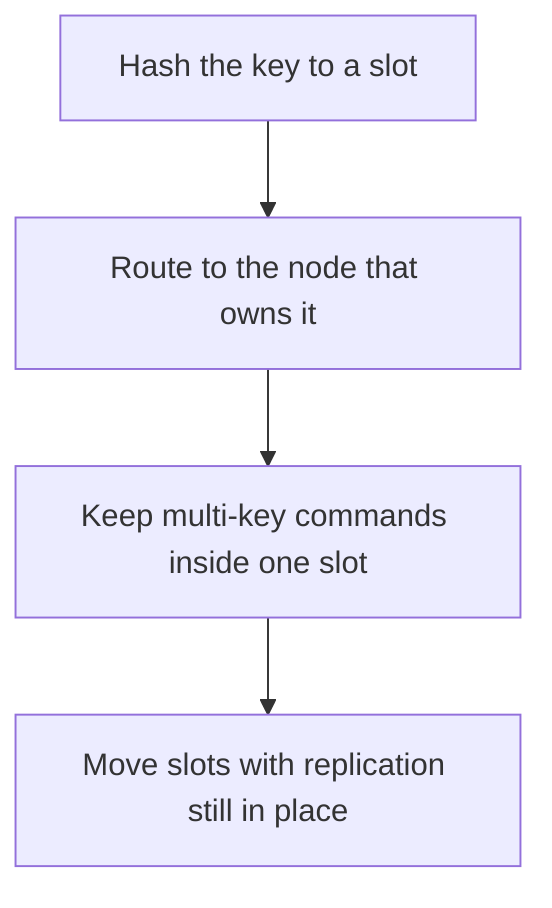

# D11-T023 — Redis Cluster

Topic ID: `D11-T023`
Domain: Redis and Caching
Subdomain: Redis Cluster
Importance: core
Complexity: intermediate
Dependencies: `D11-T022`, `D11-T001`, `D07-T001`, `D07-T002`, `D05-T001`, `D05-T002`
Execution status of the code in section F: unexecuted

## A. Topic Overview

Redis Cluster shards the keyspace into 16384 hash slots. A node owns a range of slots. Multi-key commands work only when every key is in the same slot, which hash tags force by hashing the substring inside braces. Resharding moves slots. During a move, a client may get an ASK or MOVED redirect. The cluster survives a minority of node failures only if replicas exist for the slots those nodes owned.

In production this shows up as follows: A rate limiter that does INCR on one key is fine. A script that updates a user and a global counter crosses slots and fails. The global counter needs another design.

Interviewers use Redis Cluster to see whether you can state the failure mode, not only the definition. The failure to name is: a multi-key transaction across slots, or a hot slot because every key used the same hash tag

Prerequisites: `D11-T022`, `D11-T001`, `D07-T001`, `D07-T002`, `D05-T001`, `D05-T002`. Later notes should link here instead of repeating the mechanism.

## B. First-Principles Explanation

Redis Cluster shards the keyspace into 16384 hash slots. A node owns a range of slots. Multi-key commands work only when every key is in the same slot, which hash tags force by hashing the substring inside braces. Resharding moves slots. During a move, a client may get an ASK or MOVED redirect. The cluster survives a minority of node failures only if replicas exist for the slots those nodes owned.

The useful picture is: Cluster mode is 16384 pigeonholes and several mailboxes. A letter goes to the mailbox that owns its pigeonhole. Two letters are handled together only if they share a pigeonhole.

What has to be true:

1. Hash the key to a slot
2. Route to the node that owns it
3. Keep multi-key commands inside one slot
4. Move slots with replication still in place

It works when those steps preserve one invariant. It fails when a multi-key transaction across slots, or a hot slot because every key used the same hash tag. The alternative is: you need frequent multi-key transactions across arbitrary keys

## C. Internal Working and Architecture

Components involved: the caller, the state Redis Cluster mutates or reads, and the observer that reports keys per slot, redirect rate, and whether every slot has a replica.

Execution:

1. Hash the key to a slot
2. Route to the node that owns it
3. Keep multi-key commands inside one slot
4. Move slots with replication still in place

Data moves only along that path. A retry re-enters at step 1, so the operation must say what a duplicate does. Memory and locks stay inside this mechanism. Callers see the result or a typed error, not a half-updated invariant.

State to remember: choose this when the dataset or the write rate exceeds one Redis node. Do not choose it when you need frequent multi-key transactions across arbitrary keys.

## D. Diagrams and Visual Models



Read the diagram from top to bottom. Each box is one step of Redis Cluster. The failure mode (a multi-key transaction across slots, or a hot slot because every key used the same hash tag) is what you look for when a later box never happens or happens twice.

## E. Examples and Analogies

Analogy: Cluster mode is 16384 pigeonholes and several mailboxes. A letter goes to the mailbox that owns its pigeonhole. Two letters are handled together only if they share a pigeonhole.

Production example: A rate limiter that does INCR on one key is fine. A script that updates a user and a global counter crosses slots and fails. The global counter needs another design.

A small counterexample is enough in an interview. Show the input, apply the steps, and show the broken outcome if someone uses the mechanism outside its rule: a multi-key transaction across slots, or a hot slot because every key used the same hash tag.

## F. Code Examples

The snippet is labeled unexecuted. It illustrates the shape of the idea. It is not a benchmark and it embeds no secret.

```python
def same_slot(a, b):
    # hash tags: {user42}:a and {user42}:b share a slot
    return '{user42}' in a and '{user42}' in b
```

After the snippet, check keys per slot, redirect rate, and whether every slot has a replica. If that signal moves the wrong way, the snippet is the wrong tool for the workload.

## G. Practical Backend Application

Use Redis Cluster in a service when the dataset or the write rate exceeds one Redis node.

A typical place is the production case already stated: A rate limiter that does INCR on one key is fine. A script that updates a user and a global counter crosses slots and fails. The global counter needs another design.

Operationally you alert on keys per slot, redirect rate, and whether every slot has a replica. You do not alert only on process uptime. The dashboard should show the failure mode, a success rate, and the saturation signal (queue depth, lock wait, or latency) that predicts it.

## H. Advantages, Limitations and Trade-offs

| Choice | Benefit | Cost | Choose when | Avoid when |
| --- | --- | --- | --- | --- |
| Apply Redis Cluster | the dataset or the write rate exceeds one Redis node | Extra moving parts and a new failure mode | The failure you are preventing is already real | you need frequent multi-key transactions across arbitrary keys |
| Simpler alternative | Less code and fewer dependencies | a multi-key transaction across slots, or a hot slot because every key used the same hash tag | The workload does not hit the limit | The invariant must hold under concurrency or failure |

Redis Cluster is a trade. State the benefit and the cost in the same sentence when you propose it in a design review.

## I. Common Mistakes and Misconceptions

- Hash tags that pin a tenant to one slot forever.
- No replicas.
- Assuming a Lua script can touch every node.
- Treating a diagram of Redis Cluster as proof that the invariant holds in production.
- Copying a default configuration without naming keys per slot, redirect rate, and whether every slot has a replica.

## J. Debugging and Troubleshooting

Symptom: a multi-key transaction across slots, or a hot slot because every key used the same hash tag

First check: keys per slot, redirect rate, and whether every slot has a replica.

Then compare one healthy instance against one unhealthy instance. Confirm whether retries are duplicating work. Confirm whether a timeout is shorter than the work. Fix the invariant, then watch the same metric for a full peak, not only for the next minute.

Useful questions: did the step order in section C actually happen, or did a caller skip a step? Did a deploy change the data shape that Redis Cluster assumes?

## K. Interview Preparation

### Beginner

#### Q1. What problem does Redis Cluster solve?

**Answer:** Redis Cluster shards the keyspace into 16384 hash slots. A node owns a range of slots. Multi-key commands work only when every key is in the same slot, which hash tags force by hashing the substring inside braces. Resharding moves slots. During a move, a client may get an ASK or MOVED redirect. The cluster survives a minority of node failures only if replicas exist for the slots those nodes owned. Without it, the usual backend failure is: a multi-key transaction across slots, or a hot slot because every key used the same hash tag.

#### Q2. Where does Redis Cluster sit on a request path?

**Answer:** Redis Cluster is not a library you sprinkle on every call. the dataset or the write rate exceeds one Redis node You notice it when keys per slot, redirect rate, and whether every slot has a replica. Name the constraint that makes this choice correct. Say what you would measure to confirm it.

#### Q3. Give a concrete example of Redis Cluster.

**Answer:** A rate limiter that does INCR on one key is fine. A script that updates a user and a global counter crosses slots and fails. The global counter needs another design. Walk the input, the state change, and the observable output.

#### Q4. What is a common mix-up around Redis Cluster?

**Answer:** a multi-key transaction across slots, or a hot slot because every key used the same hash tag The corrective check is keys per slot, redirect rate, and whether every slot has a replica. Name the constraint that makes this choice correct. Say what you would measure to confirm it. Say which alternative you rejected and why.

#### Q5. When would you skip Redis Cluster?

**Answer:** you need frequent multi-key transactions across arbitrary keys Skipping is a decision with a measured cost, not a slogan. Name the constraint that makes this choice correct. Say what you would measure to confirm it. Say which alternative you rejected and why.

### Intermediate

#### Q1. What invariant makes Redis Cluster correct?

**Answer:** Redis Cluster shards the keyspace into 16384 hash slots. A node owns a range of slots. Multi-key commands work only when every key is in the same slot, which hash tags force by hashing the substring inside braces. Resharding moves slots. During a move, a client may get an ASK or MOVED redirect. The cluster survives a minority of node failures only if replicas exist for the slots those nodes owned. State the invariant before you name the tool.

#### Q2. How do you test Redis Cluster?

**Answer:** Assert the failure mode directly: a multi-key transaction across slots, or a hot slot because every key used the same hash tag. The assertion should watch keys per slot, redirect rate, and whether every slot has a replica. Include a concurrent or retry case if the bug only appears then. Name the constraint that makes this choice correct.

#### Q3. What signal tells you Redis Cluster is misbehaving in production?

**Answer:** Watch keys per slot, redirect rate, and whether every slot has a replica. The user-visible symptom is usually a multi-key transaction across slots, or a hot slot because every key used the same hash tag. Name the constraint that makes this choice correct. Say what you would measure to confirm it.

#### Q4. How would you introduce Redis Cluster into a legacy service?

**Answer:** the dataset or the write rate exceeds one Redis node Ship it behind a metric so you can compare the old path. Roll back if a multi-key transaction across slots, or a hot slot because every key used the same hash tag gets worse. Name the constraint that makes this choice correct. Say what you would measure to confirm it.

#### Q5. What do you trade away by choosing Redis Cluster?

**Answer:** the dataset or the write rate exceeds one Redis node you need frequent multi-key transactions across arbitrary keys Say the cost in latency, storage, or operational load. Name the constraint that makes this choice correct. Say what you would measure to confirm it. Say which alternative you rejected and why.

### Advanced

#### Q1. What breaks if a dependency of Redis Cluster is slow or down?

**Answer:** a multi-key transaction across slots, or a hot slot because every key used the same hash tag Degrade using the rule: you need frequent multi-key transactions across arbitrary keys. Timeouts must be shorter than the caller's deadline. Name the constraint that makes this choice correct. Say what you would measure to confirm it.

#### Q2. How does Redis Cluster behave under retries?

**Answer:** Retries repeat work, so Redis Cluster must define what a duplicate does. a multi-key transaction across slots, or a hot slot because every key used the same hash tag Idempotency keys or fences belong next to the write, not in a comment. Name the constraint that makes this choice correct. Say what you would measure to confirm it.

#### Q3. What is the capacity limit of Redis Cluster?

**Answer:** The limit shows up as keys per slot, redirect rate, and whether every slot has a replica. Add capacity only after you know whether the bottleneck is CPU, lock wait, or network. Name the constraint that makes this choice correct. Say what you would measure to confirm it.

#### Q4. How do you evolve Redis Cluster without a flag day?

**Answer:** the dataset or the write rate exceeds one Redis node Version the contract or the on-disk format. Readers should tolerate one old and one new shape during the rollout. Name the constraint that makes this choice correct. Say what you would measure to confirm it.

#### Q5. What security or correctness bug hides inside Redis Cluster?

**Answer:** a multi-key transaction across slots, or a hot slot because every key used the same hash tag Check authorization and tenancy at the same boundary as the mechanism. A cache or queue must not widen who can read the data. Name the constraint that makes this choice correct. Say what you would measure to confirm it.

### Scenario

#### Q1. Incident: a multi-key transaction across slots, or a hot slot because every key used the same hash tag. What do you check first?

**Answer:** Start with keys per slot, redirect rate, and whether every slot has a replica. Compare a good host and a bad host before you restart anything. Redis Cluster shards the keyspace into 16384 hash slots. A node owns a range of slots. Multi-key commands work only when every key is in the same slot, which hash tags force by hashing the substring inside braces. Resharding moves slots. During a move, a client may get an ASK or MOVED redirect. The cluster survives a minority of node failures only if replicas exist for the slots those nodes owned.

#### Q2. A reviewer wants the clever version. What data settles it?

**Answer:** the dataset or the write rate exceeds one Redis node you need frequent multi-key transactions across arbitrary keys Bring keys per slot, redirect rate, and whether every slot has a replica from a load test or from production, not a slogan. Name the constraint that makes this choice correct. Say what you would measure to confirm it. Say which alternative you rejected and why.

#### Q3. You have one hour to explain Redis Cluster at a whiteboard.

**Answer:** Draw the happy path in four boxes. Then draw the failure: a multi-key transaction across slots, or a hot slot because every key used the same hash tag. End with the metric you would page on. Name the constraint that makes this choice correct.

#### Q4. The bug only appears under two concurrent callers.

**Answer:** a multi-key transaction across slots, or a hot slot because every key used the same hash tag Reproduce with a barrier so both sides enter the critical window. Confirm the fix with keys per slot, redirect rate, and whether every slot has a replica. Name the constraint that makes this choice correct. Say what you would measure to confirm it.

#### Q5. Leadership wants this on every service next week.

**Answer:** you need frequent multi-key transactions across arbitrary keys the dataset or the write rate exceeds one Redis node Roll it out where the failure mode is already hurting users. Name the constraint that makes this choice correct. Say what you would measure to confirm it. Say which alternative you rejected and why.

### Follow-up

#### Q1. What did you assume about the data size or the clock?

**Answer:** Redis Cluster shards the keyspace into 16384 hash slots. A node owns a range of slots. Multi-key commands work only when every key is in the same slot, which hash tags force by hashing the substring inside braces. Resharding moves slots. During a move, a client may get an ASK or MOVED redirect. The cluster survives a minority of node failures only if replicas exist for the slots those nodes owned. Clocks are not a total order across machines. State whether the algorithm needs bounded size or a single leader.

#### Q2. What would you measure after the change ships?

**Answer:** Page on keys per slot, redirect rate, and whether every slot has a replica. Keep a before/after dashboard for one week. Alert on the failure mode, not only on CPU. Name the constraint that makes this choice correct.

#### Q3. Which neighboring topic did you deliberately not re-teach?

**Answer:** This note owns Redis Cluster. Related identifiers are in section N. Shared ideas are linked, not copied. Name the constraint that makes this choice correct.

## L. Practical Exercises

Solutions are in `EXERCISES/solutions/D11-T023.md`, not in this section.

1. Whiteboard the four steps of Redis Cluster and mark where `a multi-key transaction across slots, or a hot slot because every key used the same hash tag` enters.
2. Read the snippet in section F and write the assertion that would catch that failure. The assertion must mention `keys per slot, redirect rate, and whether every slot has a replica`.
3. Argue for or against using Redis Cluster on a service you know. Use the choose and avoid rows from section H. Do not appeal to popularity.

## M. Revision Notes

- Mechanism: Redis Cluster shards the keyspace into 16384 hash slots.
- Failure: a multi-key transaction across slots, or a hot slot because every key used the same hash tag
- Metric: keys per slot, redirect rate, and whether every slot has a replica
- Choose when: the dataset or the write rate exceeds one Redis node
- Avoid when: you need frequent multi-key transactions across arbitrary keys

## N. Related Topics

Dependencies to review first: `D11-T022`, `D11-T001`, `D07-T001`, `D07-T002`, `D05-T001`, `D05-T002`.

Shared ideas stay in those notes. This note does not restate them.

## O. Completion Criteria

- You can explain Redis Cluster without reading this note, including the failure mode.
- You can draw the diagram in section D from memory.
- You can say when not to use it, using the avoid condition in section H.
- You can name the metric you would watch after shipping it.
