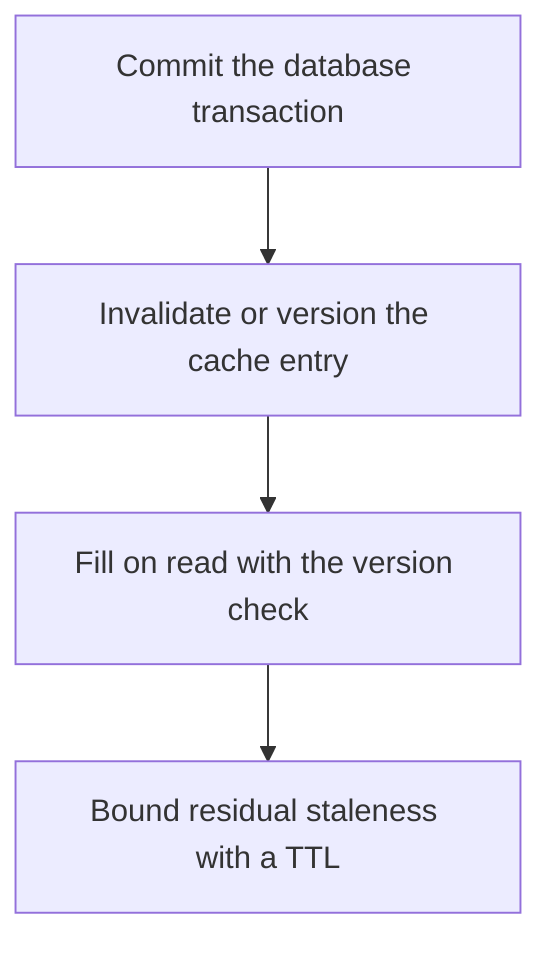

# D11-T024 — Cache consistency with a primary database

Topic ID: `D11-T024`
Domain: Redis and Caching
Subdomain: Cache consistency with a primary database
Importance: core
Complexity: intermediate
Dependencies: `D11-T023`, `D11-T001`, `D07-T001`, `D07-T002`, `D05-T001`, `D05-T002`
Execution status of the code in section F: unexecuted

## A. Topic Overview

Cache consistency with a primary database means a reader should not observe a value older than a write the system has acknowledged, within the policy you stated. The usual policy is cache-aside with delete-after-commit plus a TTL. Stronger policies version the row and store the version in the cache so an old fill cannot overwrite a new one. The cache is not in the database transaction unless you use a pattern that makes the database the only acknowledgment point.

In production this shows up as follows: An order status update commits in PostgreSQL, then deletes the Redis key. A concurrent reader may refill from a replica that has not caught up. Reading the fill from the primary, or storing the row version, closes that hole.

Interviewers use Cache consistency with a primary database to see whether you can state the failure mode, not only the definition. The failure to name is: a cache entry newer in time but older in version that overwrites the fresh value

Prerequisites: `D11-T023`, `D11-T001`, `D07-T001`, `D07-T002`, `D05-T001`, `D05-T002`. Later notes should link here instead of repeating the mechanism.

## B. First-Principles Explanation

Cache consistency with a primary database means a reader should not observe a value older than a write the system has acknowledged, within the policy you stated. The usual policy is cache-aside with delete-after-commit plus a TTL. Stronger policies version the row and store the version in the cache so an old fill cannot overwrite a new one. The cache is not in the database transaction unless you use a pattern that makes the database the only acknowledgment point.

The useful picture is: Consistency is refusing to glue an older photocopy on top of a newer one. The version number is the edition printed on the page.

What has to be true:

1. Commit the database transaction
2. Invalidate or version the cache entry
3. Fill on read with the version check
4. Bound residual staleness with a TTL

It works when those steps preserve one invariant. It fails when a cache entry newer in time but older in version that overwrites the fresh value. The alternative is: you update the cache first and treat that as the commit

## C. Internal Working and Architecture

Components involved: the caller, the state Cache consistency with a primary database mutates or reads, and the observer that reports reads that return a version older than the latest committed version.

Execution:

1. Commit the database transaction
2. Invalidate or version the cache entry
3. Fill on read with the version check
4. Bound residual staleness with a TTL

Data moves only along that path. A retry re-enters at step 1, so the operation must say what a duplicate does. Memory and locks stay inside this mechanism. Callers see the result or a typed error, not a half-updated invariant.

State to remember: choose this when the cache copies database state that users write. Do not choose it when you update the cache first and treat that as the commit.

## D. Diagrams and Visual Models



Read the diagram from top to bottom. Each box is one step of Cache consistency with a primary database. The failure mode (a cache entry newer in time but older in version that overwrites the fresh value) is what you look for when a later box never happens or happens twice.

## E. Examples and Analogies

Analogy: Consistency is refusing to glue an older photocopy on top of a newer one. The version number is the edition printed on the page.

Production example: An order status update commits in PostgreSQL, then deletes the Redis key. A concurrent reader may refill from a replica that has not caught up. Reading the fill from the primary, or storing the row version, closes that hole.

A small counterexample is enough in an interview. Show the input, apply the steps, and show the broken outcome if someone uses the mechanism outside its rule: a cache entry newer in time but older in version that overwrites the fresh value.

## F. Code Examples

The snippet is labeled unexecuted. It illustrates the shape of the idea. It is not a benchmark and it embeds no secret.

```python
def fill(cache, key, value, version):
    current = cache.get_version(key)
    if current is None or version >= current:
        cache.set(key, value, version)
```

After the snippet, check reads that return a version older than the latest committed version. If that signal moves the wrong way, the snippet is the wrong tool for the workload.

## G. Practical Backend Application

Use Cache consistency with a primary database in a service when the cache copies database state that users write.

A typical place is the production case already stated: An order status update commits in PostgreSQL, then deletes the Redis key. A concurrent reader may refill from a replica that has not caught up. Reading the fill from the primary, or storing the row version, closes that hole.

Operationally you alert on reads that return a version older than the latest committed version. You do not alert only on process uptime. The dashboard should show the failure mode, a success rate, and the saturation signal (queue depth, lock wait, or latency) that predicts it.

## H. Advantages, Limitations and Trade-offs

| Choice | Benefit | Cost | Choose when | Avoid when |
| --- | --- | --- | --- | --- |
| Apply Cache consistency with a primary database | the cache copies database state that users write | Extra moving parts and a new failure mode | The failure you are preventing is already real | you update the cache first and treat that as the commit |
| Simpler alternative | Less code and fewer dependencies | a cache entry newer in time but older in version that overwrites the fresh value | The workload does not hit the limit | The invariant must hold under concurrency or failure |

Cache consistency with a primary database is a trade. State the benefit and the cost in the same sentence when you propose it in a design review.

## I. Common Mistakes and Misconceptions

- No version and no TTL.
- Filling from a lagged replica.
- Two writers with no order.
- Treating a diagram of Cache consistency with a primary database as proof that the invariant holds in production.
- Copying a default configuration without naming reads that return a version older than the latest committed version.

## J. Debugging and Troubleshooting

Symptom: a cache entry newer in time but older in version that overwrites the fresh value

First check: reads that return a version older than the latest committed version.

Then compare one healthy instance against one unhealthy instance. Confirm whether retries are duplicating work. Confirm whether a timeout is shorter than the work. Fix the invariant, then watch the same metric for a full peak, not only for the next minute.

Useful questions: did the step order in section C actually happen, or did a caller skip a step? Did a deploy change the data shape that Cache consistency with a primary database assumes?

## K. Interview Preparation

### Beginner

#### Q1. What problem does Cache consistency with a primary database solve?

**Answer:** Cache consistency with a primary database means a reader should not observe a value older than a write the system has acknowledged, within the policy you stated. The usual policy is cache-aside with delete-after-commit plus a TTL. Stronger policies version the row and store the version in the cache so an old fill cannot overwrite a new one. The cache is not in the database transaction unless you use a pattern that makes the database the only acknowledgment point. Without it, the usual backend failure is: a cache entry newer in time but older in version that overwrites the fresh value.

#### Q2. Where does Cache consistency with a primary database sit on a request path?

**Answer:** Cache consistency with a primary database is not a library you sprinkle on every call. the cache copies database state that users write You notice it when reads that return a version older than the latest committed version. Name the constraint that makes this choice correct. Say what you would measure to confirm it.

#### Q3. Give a concrete example of Cache consistency with a primary database.

**Answer:** An order status update commits in PostgreSQL, then deletes the Redis key. A concurrent reader may refill from a replica that has not caught up. Reading the fill from the primary, or storing the row version, closes that hole. Walk the input, the state change, and the observable output.

#### Q4. What is a common mix-up around Cache consistency with a primary database?

**Answer:** a cache entry newer in time but older in version that overwrites the fresh value The corrective check is reads that return a version older than the latest committed version. Name the constraint that makes this choice correct. Say what you would measure to confirm it. Say which alternative you rejected and why.

#### Q5. When would you skip Cache consistency with a primary database?

**Answer:** you update the cache first and treat that as the commit Skipping is a decision with a measured cost, not a slogan. Name the constraint that makes this choice correct. Say what you would measure to confirm it. Say which alternative you rejected and why.

### Intermediate

#### Q1. What invariant makes Cache consistency with a primary database correct?

**Answer:** Cache consistency with a primary database means a reader should not observe a value older than a write the system has acknowledged, within the policy you stated. The usual policy is cache-aside with delete-after-commit plus a TTL. Stronger policies version the row and store the version in the cache so an old fill cannot overwrite a new one. The cache is not in the database transaction unless you use a pattern that makes the database the only acknowledgment point. State the invariant before you name the tool.

#### Q2. How do you test Cache consistency with a primary database?

**Answer:** Assert the failure mode directly: a cache entry newer in time but older in version that overwrites the fresh value. The assertion should watch reads that return a version older than the latest committed version. Include a concurrent or retry case if the bug only appears then. Name the constraint that makes this choice correct.

#### Q3. What signal tells you Cache consistency with a primary database is misbehaving in production?

**Answer:** Watch reads that return a version older than the latest committed version. The user-visible symptom is usually a cache entry newer in time but older in version that overwrites the fresh value. Name the constraint that makes this choice correct. Say what you would measure to confirm it.

#### Q4. How would you introduce Cache consistency with a primary database into a legacy service?

**Answer:** the cache copies database state that users write Ship it behind a metric so you can compare the old path. Roll back if a cache entry newer in time but older in version that overwrites the fresh value gets worse. Name the constraint that makes this choice correct. Say what you would measure to confirm it.

#### Q5. What do you trade away by choosing Cache consistency with a primary database?

**Answer:** the cache copies database state that users write you update the cache first and treat that as the commit Say the cost in latency, storage, or operational load. Name the constraint that makes this choice correct. Say what you would measure to confirm it. Say which alternative you rejected and why.

### Advanced

#### Q1. What breaks if a dependency of Cache consistency with a primary database is slow or down?

**Answer:** a cache entry newer in time but older in version that overwrites the fresh value Degrade using the rule: you update the cache first and treat that as the commit. Timeouts must be shorter than the caller's deadline. Name the constraint that makes this choice correct. Say what you would measure to confirm it.

#### Q2. How does Cache consistency with a primary database behave under retries?

**Answer:** Retries repeat work, so Cache consistency with a primary database must define what a duplicate does. a cache entry newer in time but older in version that overwrites the fresh value Idempotency keys or fences belong next to the write, not in a comment. Name the constraint that makes this choice correct. Say what you would measure to confirm it.

#### Q3. What is the capacity limit of Cache consistency with a primary database?

**Answer:** The limit shows up as reads that return a version older than the latest committed version. Add capacity only after you know whether the bottleneck is CPU, lock wait, or network. Name the constraint that makes this choice correct. Say what you would measure to confirm it.

#### Q4. How do you evolve Cache consistency with a primary database without a flag day?

**Answer:** the cache copies database state that users write Version the contract or the on-disk format. Readers should tolerate one old and one new shape during the rollout. Name the constraint that makes this choice correct. Say what you would measure to confirm it.

#### Q5. What security or correctness bug hides inside Cache consistency with a primary database?

**Answer:** a cache entry newer in time but older in version that overwrites the fresh value Check authorization and tenancy at the same boundary as the mechanism. A cache or queue must not widen who can read the data. Name the constraint that makes this choice correct. Say what you would measure to confirm it.

### Scenario

#### Q1. Incident: a cache entry newer in time but older in version that overwrites the fresh value. What do you check first?

**Answer:** Start with reads that return a version older than the latest committed version. Compare a good host and a bad host before you restart anything. Cache consistency with a primary database means a reader should not observe a value older than a write the system has acknowledged, within the policy you stated. The usual policy is cache-aside with delete-after-commit plus a TTL. Stronger policies version the row and store the version in the cache so an old fill cannot overwrite a new one. The cache is not in the database transaction unless you use a pattern that makes the database the only acknowledgment point.

#### Q2. A reviewer wants the clever version. What data settles it?

**Answer:** the cache copies database state that users write you update the cache first and treat that as the commit Bring reads that return a version older than the latest committed version from a load test or from production, not a slogan. Name the constraint that makes this choice correct. Say what you would measure to confirm it. Say which alternative you rejected and why.

#### Q3. You have one hour to explain Cache consistency with a primary database at a whiteboard.

**Answer:** Draw the happy path in four boxes. Then draw the failure: a cache entry newer in time but older in version that overwrites the fresh value. End with the metric you would page on. Name the constraint that makes this choice correct.

#### Q4. The bug only appears under two concurrent callers.

**Answer:** a cache entry newer in time but older in version that overwrites the fresh value Reproduce with a barrier so both sides enter the critical window. Confirm the fix with reads that return a version older than the latest committed version. Name the constraint that makes this choice correct. Say what you would measure to confirm it.

#### Q5. Leadership wants this on every service next week.

**Answer:** you update the cache first and treat that as the commit the cache copies database state that users write Roll it out where the failure mode is already hurting users. Name the constraint that makes this choice correct. Say what you would measure to confirm it. Say which alternative you rejected and why.

### Follow-up

#### Q1. What did you assume about the data size or the clock?

**Answer:** Cache consistency with a primary database means a reader should not observe a value older than a write the system has acknowledged, within the policy you stated. The usual policy is cache-aside with delete-after-commit plus a TTL. Stronger policies version the row and store the version in the cache so an old fill cannot overwrite a new one. The cache is not in the database transaction unless you use a pattern that makes the database the only acknowledgment point. Clocks are not a total order across machines. State whether the algorithm needs bounded size or a single leader.

#### Q2. What would you measure after the change ships?

**Answer:** Page on reads that return a version older than the latest committed version. Keep a before/after dashboard for one week. Alert on the failure mode, not only on CPU. Name the constraint that makes this choice correct.

#### Q3. Which neighboring topic did you deliberately not re-teach?

**Answer:** This note owns Cache consistency with a primary database. Related identifiers are in section N. Shared ideas are linked, not copied. Name the constraint that makes this choice correct.

## L. Practical Exercises

Solutions are in `EXERCISES/solutions/D11-T024.md`, not in this section.

1. Whiteboard the four steps of Cache consistency with a primary database and mark where `a cache entry newer in time but older in version that overwrites the fresh value` enters.
2. Read the snippet in section F and write the assertion that would catch that failure. The assertion must mention `reads that return a version older than the latest committed version`.
3. Argue for or against using Cache consistency with a primary database on a service you know. Use the choose and avoid rows from section H. Do not appeal to popularity.

## M. Revision Notes

- Mechanism: Cache consistency with a primary database means a reader should not observe a value older than a write the system has acknowledged, within the policy you stated.
- Failure: a cache entry newer in time but older in version that overwrites the fresh value
- Metric: reads that return a version older than the latest committed version
- Choose when: the cache copies database state that users write
- Avoid when: you update the cache first and treat that as the commit

## N. Related Topics

Dependencies to review first: `D11-T023`, `D11-T001`, `D07-T001`, `D07-T002`, `D05-T001`, `D05-T002`.

Shared ideas stay in those notes. This note does not restate them.

## O. Completion Criteria

- You can explain Cache consistency with a primary database without reading this note, including the failure mode.
- You can draw the diagram in section D from memory.
- You can say when not to use it, using the avoid condition in section H.
- You can name the metric you would watch after shipping it.
