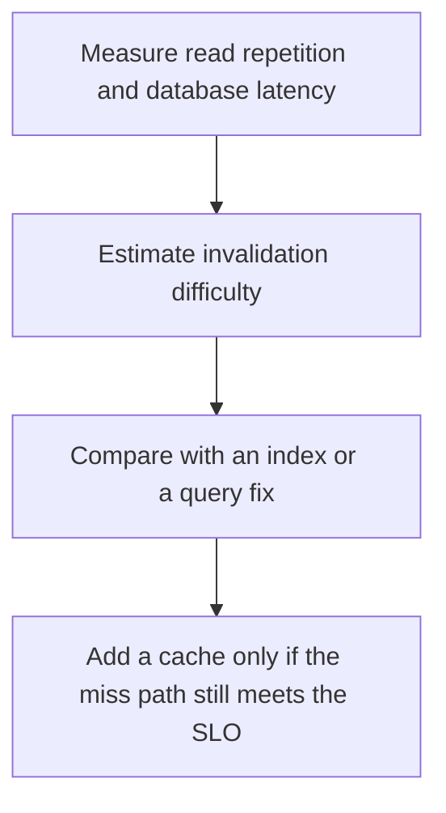

# D11-T025 — When not to use caching

Topic ID: `D11-T025`
Domain: Redis and Caching
Subdomain: When not to use caching
Importance: core
Complexity: intermediate
Dependencies: `D11-T024`, `D11-T001`, `D07-T001`, `D07-T002`, `D05-T001`, `D05-T002`
Execution status of the code in section F: unexecuted

## A. Topic Overview

A cache is the wrong tool when the data is rarely reread, must be strongly consistent on every read, is larger than memory, or is cheaper to compute than to store and invalidate. Caching adds staleness, invalidation, and an outage mode. A database with a good index may already meet the latency. Measure a miss path before you add a tier that can fail.

In production this shows up as follows: An internal report run once an hour should be a SQL query or a materialized view, not a Redis key nobody knows how to invalidate. A product page read a thousand times a second is the opposite.

Interviewers use When not to use caching to see whether you can state the failure mode, not only the definition. The failure to name is: a cache in front of a write-heavy, rarely reread admin page that is now stale and more complex

Prerequisites: `D11-T024`, `D11-T001`, `D07-T001`, `D07-T002`, `D05-T001`, `D05-T002`. Later notes should link here instead of repeating the mechanism.

## B. First-Principles Explanation

A cache is the wrong tool when the data is rarely reread, must be strongly consistent on every read, is larger than memory, or is cheaper to compute than to store and invalidate. Caching adds staleness, invalidation, and an outage mode. A database with a good index may already meet the latency. Measure a miss path before you add a tier that can fail.

The useful picture is: A cache is a photocopy machine. It is a waste when you print each page once and then correct the original.

What has to be true:

1. Measure read repetition and database latency
2. Estimate invalidation difficulty
3. Compare with an index or a query fix
4. Add a cache only if the miss path still meets the SLO

It works when those steps preserve one invariant. It fails when a cache in front of a write-heavy, rarely reread admin page that is now stale and more complex. The alternative is: the working set does not fit, the data is write-heavy, or correctness cannot tolerate staleness

## C. Internal Working and Architecture

Components involved: the caller, the state When not to use caching mutates or reads, and the observer that reports hit ratio and the latency of the uncached query after an index.

Execution:

1. Measure read repetition and database latency
2. Estimate invalidation difficulty
3. Compare with an index or a query fix
4. Add a cache only if the miss path still meets the SLO

Data moves only along that path. A retry re-enters at step 1, so the operation must say what a duplicate does. Memory and locks stay inside this mechanism. Callers see the result or a typed error, not a half-updated invariant.

State to remember: choose this when the same read is hot and the source is too slow after a fair query plan. Do not choose it when the working set does not fit, the data is write-heavy, or correctness cannot tolerate staleness.

## D. Diagrams and Visual Models



Read the diagram from top to bottom. Each box is one step of When not to use caching. The failure mode (a cache in front of a write-heavy, rarely reread admin page that is now stale and more complex) is what you look for when a later box never happens or happens twice.

## E. Examples and Analogies

Analogy: A cache is a photocopy machine. It is a waste when you print each page once and then correct the original.

Production example: An internal report run once an hour should be a SQL query or a materialized view, not a Redis key nobody knows how to invalidate. A product page read a thousand times a second is the opposite.

A small counterexample is enough in an interview. Show the input, apply the steps, and show the broken outcome if someone uses the mechanism outside its rule: a cache in front of a write-heavy, rarely reread admin page that is now stale and more complex.

## F. Code Examples

The snippet is labeled unexecuted. It illustrates the shape of the idea. It is not a benchmark and it embeds no secret.

```python
def worth_caching(reads_per_write, db_ms, target_ms):
    return reads_per_write > 10 and db_ms > target_ms
```

After the snippet, check hit ratio and the latency of the uncached query after an index. If that signal moves the wrong way, the snippet is the wrong tool for the workload.

## G. Practical Backend Application

Use When not to use caching in a service when the same read is hot and the source is too slow after a fair query plan.

A typical place is the production case already stated: An internal report run once an hour should be a SQL query or a materialized view, not a Redis key nobody knows how to invalidate. A product page read a thousand times a second is the opposite.

Operationally you alert on hit ratio and the latency of the uncached query after an index. You do not alert only on process uptime. The dashboard should show the failure mode, a success rate, and the saturation signal (queue depth, lock wait, or latency) that predicts it.

## H. Advantages, Limitations and Trade-offs

| Choice | Benefit | Cost | Choose when | Avoid when |
| --- | --- | --- | --- | --- |
| Apply When not to use caching | the same read is hot and the source is too slow after a fair query plan | Extra moving parts and a new failure mode | The failure you are preventing is already real | the working set does not fit, the data is write-heavy, or correctness cannot tolerate staleness |
| Simpler alternative | Less code and fewer dependencies | a cache in front of a write-heavy, rarely reread admin page that is now stale and more complex | The workload does not hit the limit | The invariant must hold under concurrency or failure |

When not to use caching is a trade. State the benefit and the cost in the same sentence when you propose it in a design review.

## I. Common Mistakes and Misconceptions

- Caching to avoid an index.
- No hit-ratio goal.
- A cache that can fail and no plan for the database load.
- Treating a diagram of When not to use caching as proof that the invariant holds in production.
- Copying a default configuration without naming hit ratio and the latency of the uncached query after an index.

## J. Debugging and Troubleshooting

Symptom: a cache in front of a write-heavy, rarely reread admin page that is now stale and more complex

First check: hit ratio and the latency of the uncached query after an index.

Then compare one healthy instance against one unhealthy instance. Confirm whether retries are duplicating work. Confirm whether a timeout is shorter than the work. Fix the invariant, then watch the same metric for a full peak, not only for the next minute.

Useful questions: did the step order in section C actually happen, or did a caller skip a step? Did a deploy change the data shape that When not to use caching assumes?

## K. Interview Preparation

### Beginner

#### Q1. What problem does When not to use caching solve?

**Answer:** A cache is the wrong tool when the data is rarely reread, must be strongly consistent on every read, is larger than memory, or is cheaper to compute than to store and invalidate. Caching adds staleness, invalidation, and an outage mode. A database with a good index may already meet the latency. Measure a miss path before you add a tier that can fail. Without it, the usual backend failure is: a cache in front of a write-heavy, rarely reread admin page that is now stale and more complex.

#### Q2. Where does When not to use caching sit on a request path?

**Answer:** When not to use caching is not a library you sprinkle on every call. the same read is hot and the source is too slow after a fair query plan You notice it when hit ratio and the latency of the uncached query after an index. Name the constraint that makes this choice correct. Say what you would measure to confirm it.

#### Q3. Give a concrete example of When not to use caching.

**Answer:** An internal report run once an hour should be a SQL query or a materialized view, not a Redis key nobody knows how to invalidate. A product page read a thousand times a second is the opposite. Walk the input, the state change, and the observable output. Name the constraint that makes this choice correct.

#### Q4. What is a common mix-up around When not to use caching?

**Answer:** a cache in front of a write-heavy, rarely reread admin page that is now stale and more complex The corrective check is hit ratio and the latency of the uncached query after an index. Name the constraint that makes this choice correct. Say what you would measure to confirm it. Say which alternative you rejected and why.

#### Q5. When would you skip When not to use caching?

**Answer:** the working set does not fit, the data is write-heavy, or correctness cannot tolerate staleness Skipping is a decision with a measured cost, not a slogan. Name the constraint that makes this choice correct. Say what you would measure to confirm it. Say which alternative you rejected and why.

### Intermediate

#### Q1. What invariant makes When not to use caching correct?

**Answer:** A cache is the wrong tool when the data is rarely reread, must be strongly consistent on every read, is larger than memory, or is cheaper to compute than to store and invalidate. Caching adds staleness, invalidation, and an outage mode. A database with a good index may already meet the latency. Measure a miss path before you add a tier that can fail. State the invariant before you name the tool.

#### Q2. How do you test When not to use caching?

**Answer:** Assert the failure mode directly: a cache in front of a write-heavy, rarely reread admin page that is now stale and more complex. The assertion should watch hit ratio and the latency of the uncached query after an index. Include a concurrent or retry case if the bug only appears then. Name the constraint that makes this choice correct.

#### Q3. What signal tells you When not to use caching is misbehaving in production?

**Answer:** Watch hit ratio and the latency of the uncached query after an index. The user-visible symptom is usually a cache in front of a write-heavy, rarely reread admin page that is now stale and more complex. Name the constraint that makes this choice correct. Say what you would measure to confirm it.

#### Q4. How would you introduce When not to use caching into a legacy service?

**Answer:** the same read is hot and the source is too slow after a fair query plan Ship it behind a metric so you can compare the old path. Roll back if a cache in front of a write-heavy, rarely reread admin page that is now stale and more complex gets worse. Name the constraint that makes this choice correct. Say what you would measure to confirm it.

#### Q5. What do you trade away by choosing When not to use caching?

**Answer:** the same read is hot and the source is too slow after a fair query plan the working set does not fit, the data is write-heavy, or correctness cannot tolerate staleness Say the cost in latency, storage, or operational load. Name the constraint that makes this choice correct. Say what you would measure to confirm it. Say which alternative you rejected and why.

### Advanced

#### Q1. What breaks if a dependency of When not to use caching is slow or down?

**Answer:** a cache in front of a write-heavy, rarely reread admin page that is now stale and more complex Degrade using the rule: the working set does not fit, the data is write-heavy, or correctness cannot tolerate staleness. Timeouts must be shorter than the caller's deadline. Name the constraint that makes this choice correct. Say what you would measure to confirm it.

#### Q2. How does When not to use caching behave under retries?

**Answer:** Retries repeat work, so When not to use caching must define what a duplicate does. a cache in front of a write-heavy, rarely reread admin page that is now stale and more complex Idempotency keys or fences belong next to the write, not in a comment. Name the constraint that makes this choice correct. Say what you would measure to confirm it.

#### Q3. What is the capacity limit of When not to use caching?

**Answer:** The limit shows up as hit ratio and the latency of the uncached query after an index. Add capacity only after you know whether the bottleneck is CPU, lock wait, or network. Name the constraint that makes this choice correct. Say what you would measure to confirm it.

#### Q4. How do you evolve When not to use caching without a flag day?

**Answer:** the same read is hot and the source is too slow after a fair query plan Version the contract or the on-disk format. Readers should tolerate one old and one new shape during the rollout. Name the constraint that makes this choice correct. Say what you would measure to confirm it.

#### Q5. What security or correctness bug hides inside When not to use caching?

**Answer:** a cache in front of a write-heavy, rarely reread admin page that is now stale and more complex Check authorization and tenancy at the same boundary as the mechanism. A cache or queue must not widen who can read the data. Name the constraint that makes this choice correct. Say what you would measure to confirm it.

### Scenario

#### Q1. Incident: a cache in front of a write-heavy, rarely reread admin page that is now stale and more complex. What do you check first?

**Answer:** Start with hit ratio and the latency of the uncached query after an index. Compare a good host and a bad host before you restart anything. A cache is the wrong tool when the data is rarely reread, must be strongly consistent on every read, is larger than memory, or is cheaper to compute than to store and invalidate. Caching adds staleness, invalidation, and an outage mode. A database with a good index may already meet the latency. Measure a miss path before you add a tier that can fail.

#### Q2. A reviewer wants the clever version. What data settles it?

**Answer:** the same read is hot and the source is too slow after a fair query plan the working set does not fit, the data is write-heavy, or correctness cannot tolerate staleness Bring hit ratio and the latency of the uncached query after an index from a load test or from production, not a slogan. Name the constraint that makes this choice correct. Say what you would measure to confirm it. Say which alternative you rejected and why.

#### Q3. You have one hour to explain When not to use caching at a whiteboard.

**Answer:** Draw the happy path in four boxes. Then draw the failure: a cache in front of a write-heavy, rarely reread admin page that is now stale and more complex. End with the metric you would page on. Name the constraint that makes this choice correct.

#### Q4. The bug only appears under two concurrent callers.

**Answer:** a cache in front of a write-heavy, rarely reread admin page that is now stale and more complex Reproduce with a barrier so both sides enter the critical window. Confirm the fix with hit ratio and the latency of the uncached query after an index. Name the constraint that makes this choice correct. Say what you would measure to confirm it.

#### Q5. Leadership wants this on every service next week.

**Answer:** the working set does not fit, the data is write-heavy, or correctness cannot tolerate staleness the same read is hot and the source is too slow after a fair query plan Roll it out where the failure mode is already hurting users. Name the constraint that makes this choice correct. Say what you would measure to confirm it. Say which alternative you rejected and why.

### Follow-up

#### Q1. What did you assume about the data size or the clock?

**Answer:** A cache is the wrong tool when the data is rarely reread, must be strongly consistent on every read, is larger than memory, or is cheaper to compute than to store and invalidate. Caching adds staleness, invalidation, and an outage mode. A database with a good index may already meet the latency. Measure a miss path before you add a tier that can fail. Clocks are not a total order across machines. State whether the algorithm needs bounded size or a single leader.

#### Q2. What would you measure after the change ships?

**Answer:** Page on hit ratio and the latency of the uncached query after an index. Keep a before/after dashboard for one week. Alert on the failure mode, not only on CPU. Name the constraint that makes this choice correct.

#### Q3. Which neighboring topic did you deliberately not re-teach?

**Answer:** This note owns When not to use caching. Related identifiers are in section N. Shared ideas are linked, not copied. Name the constraint that makes this choice correct.

## L. Practical Exercises

Solutions are in `EXERCISES/solutions/D11-T025.md`, not in this section.

1. Whiteboard the four steps of When not to use caching and mark where `a cache in front of a write-heavy, rarely reread admin page that is now stale and more complex` enters.
2. Read the snippet in section F and write the assertion that would catch that failure. The assertion must mention `hit ratio and the latency of the uncached query after an index`.
3. Argue for or against using When not to use caching on a service you know. Use the choose and avoid rows from section H. Do not appeal to popularity.

## M. Revision Notes

- Mechanism: A cache is the wrong tool when the data is rarely reread, must be strongly consistent on every read, is larger than memory, or is cheaper to compute than to store and invalidate.
- Failure: a cache in front of a write-heavy, rarely reread admin page that is now stale and more complex
- Metric: hit ratio and the latency of the uncached query after an index
- Choose when: the same read is hot and the source is too slow after a fair query plan
- Avoid when: the working set does not fit, the data is write-heavy, or correctness cannot tolerate staleness

## N. Related Topics

Dependencies to review first: `D11-T024`, `D11-T001`, `D07-T001`, `D07-T002`, `D05-T001`, `D05-T002`.

Shared ideas stay in those notes. This note does not restate them.

## O. Completion Criteria

- You can explain When not to use caching without reading this note, including the failure mode.
- You can draw the diagram in section D from memory.
- You can say when not to use it, using the avoid condition in section H.
- You can name the metric you would watch after shipping it.
