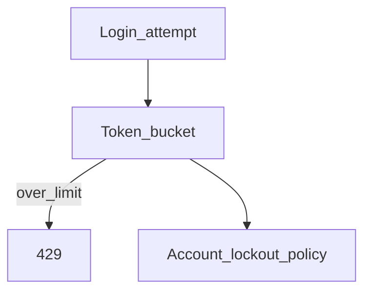

# D12-T023 — Rate limiting and brute-force protection

Topic ID: `D12-T023`
Domain: Authentication, Authorization and Security
Subdomain: Rate limiting and brute-force protection
Importance: core
Complexity: intermediate
Dependencies: see inventory.json for `D12-T023`
Execution status of the code in section F: illustrative (not executed in CI for this note)

## A. Topic Overview

Rate limiting and brute-force protection is a core control in backend security. Throttle by identity and ip; lockouts with care; captcha as last resort. Rate limits and lockouts slow credential stuffing; balance user friction with abuse detection.

The concept exists because every HTTP API sits on the public internet or a semi-trusted network. Clients send headers, cookies, tokens, and parameters that must be validated before they influence identity, authorization, or data access.

In production this appears in login flows, gateway policies, service middleware, and compliance audits. Interviewers use it to see whether you separate authentication from authorization and whether you can name mitigations without describing offensive techniques.

Prerequisites: `D12-T001` for authn/authz vocabulary, plus HTTP and API fundamentals from domains 4–6. Later D12 topics assume you can reason about fail-closed validation here.

## B. First-Principles Explanation

Security properties are enforced at trust boundaries. A boundary is anywhere data crosses from a less trusted zone (browser, partner network, user input) to a more trusted zone (your database, internal admin APIs).

Attackers aim to gain identity, access, or data they are not entitled to. Defenders validate inputs, authenticate callers, authorize actions on specific resources, and log decisions. When validation fails, the safe default is deny.

What happens internally for a typical request:

1. TLS terminates and the application receives HTTP metadata and a body.
2. Authentication middleware resolves a principal (session, JWT, API key).
3. Authorization checks map the principal plus action plus resource to allow or deny.
4. Only then does business logic run, ideally with object-level checks repeated near the data layer.

Why it works: each step reduces what an untrusted caller can influence. Limitations: misconfiguration, duplicated logic, and "check only at the gateway" gaps. Alternatives include centralized policy engines (OPA), service mesh identity, and hardware-backed keys for high-assurance workloads.

Terms: **authentication** proves who; **authorization** decides what they may do; **defense in depth** layers independent controls.

## C. Internal Working and Architecture

Components:

- Edge gateway or load balancer (TLS, WAF, rate limits).
- Authentication service or session store.
- Authorization layer (RBAC/ABAC, resource ownership).
- Application handlers and repositories that must not trust client-supplied ids blindly.

Execution path:

1. Request enters with credentials (cookie, `Authorization` header, mTLS cert).
2. Credential is validated cryptographically or looked up in a session store.
3. Policy engine evaluates roles, scopes, and attributes against the target resource.
4. Outcome is cached only when stale policy is acceptable; otherwise evaluate per request for sensitive resources.

Data flow: identity attributes flow forward as a small struct (user id, tenant id, roles). Never pass raw tokens to downstream services if a signed internal identity assertion is available.

State: sessions are server-side records; JWTs are self-contained but require revocation strategy; API keys map to service principals with narrow scopes.

Memory and performance: cryptographic verification and database session lookups add milliseconds. Cache JWKS and session reads with TTL, but do not cache denials as allows.

## D. Diagrams and Visual Models



Read the diagram as a happy path plus explicit reject paths. Every arrow that skips validation is a design smell worth fixing in review.

## E. Examples and Analogies

Analogy: authentication is showing ID at the building lobby; authorization is whether your badge opens the finance floor. A valid badge does not imply every door.

Backend example: `GET /invoices/42` must confirm invoice 42 belongs to the caller's tenant, not only that the caller is logged in. Missing object checks produce IDOR incidents.

Do not rely on CORS for authorization. Do not store passwords with fast hashes. Do not log bearer tokens. Do not disable TLS verification in production to debug.

## F. Code Examples

File: `examples/rate_limiting_and_brute_force_protection.py`

Dependencies: standard library or framework security APIs; illustrative only.

```python
# Defensive pattern for rate-limiting-and-brute-force-protection
def security_check(request) -> bool:
    """Return False to fail closed when policy cannot be evaluated."""
    if not request.identity:
        return False
    return policy_allows(request.identity, request.action, request.resource)
```

How to run: import in unit tests; do not expose example endpoints in production.

Expected behavior: unauthorized or invalid input is rejected before business logic. Edge cases: missing headers, expired credentials, and cross-tenant object ids should deny access without leaking which check failed when enumeration is a concern.

This example illustrates secure design. It was not executed as part of automated CI for this note.

## G. Practical Backend Application

A request hits API middleware. Authentication establishes `principal_id` and `tenant_id`. Authorization middleware checks route policy. The service method loads the resource by id and verifies `resource.tenant_id == principal.tenant_id` before returning fields.

Concurrent requests use independent validation; shared session stores must be strongly consistent for logout and rotation. Error handling returns 401 for bad/missing auth and 403 for authenticated but disallowed actions; avoid 404 solely to hide existence when policy already leaked ids.

Security observability: metric tags for `authn_failure`, `authz_denied`, `token_expired`, and per-tenant spikes. Scaling: stateless JWT verification scales horizontally; session stores need Redis or similar with replication.

## H. Advantages, Limitations and Trade-offs

| Choice | Benefit | Cost | Choose when | Avoid when |
| --- | --- | --- | --- | --- |
| Session cookies | Easy revocation | Server state | Classic web apps | Pure mobile APIs without cookie jar |
| JWT access tokens | Stateless verify | Revocation harder | Microservices, mobile | Long-lived highly sensitive ops without rotation |
| RBAC | Simple to explain | Role explosion | Admin consoles | Fine-grained per-row rules |
| ABAC | Expressive policies | Harder to audit | Dynamic attributes | Small teams without policy tooling |
| Gateway authn | Central enforcement | Blind spots at service | Uniform edge policy | Object-level authz only in services |

Under load, rate limiting and lockouts protect credential endpoints. Under attack, fail closed and alert rather than degrading to anonymous access.

Failure modes: confused deputy, excessive token scope, cached JWKS after rotation, and inconsistent tenant checks between list and detail endpoints.

## I. Common Mistakes and Misconceptions

- Treating authentication as authorization. A valid session does not imply admin rights.
- Checking ownership only on `GET` but not on `DELETE` or export endpoints.
- Storing JWTs in `localStorage` while also vulnerable to XSS—prefer HttpOnly cookies for browser sessions when appropriate.
- Using `Access-Control-Allow-Origin: *` with credentials enabled—browsers reject inconsistent combinations, and wildcards do not replace authz.
- Returning different error text for "user not found" versus "wrong password" on login—aids enumeration.
- Disabling CSRF protection because "we use JWT" while cookies still carry session ids.

Strong interview answers name the trust boundary and the mitigation. Weak answers list buzzwords without ordering middleware correctly.

## J. Debugging and Troubleshooting

Symptoms: sudden 401 for all users, cross-tenant data in support tickets, spike in 403 after deploy, or scanners reporting open redirect on OAuth.

Diagnosis:

1. Correlate trace id across gateway and service logs; compare auth middleware versions.
2. Verify clock skew for JWT `exp` and `nbf`.
3. Diff CORS and cookie `SameSite` settings between staging and production.
4. Reproduce with a non-admin principal attempting another user's object id.

Immediate mitigation: roll back deploy, shorten token acceptance window, enable maintenance deny mode at gateway. Long-term: authorization matrix tests in CI and chaos drills for key rotation.

Metrics: `authz_denied` rate by route; `session_lookup_ms`; failed password attempts per IP.

## K. Interview Preparation

### Beginner

#### Q1. What is the core idea behind rate limiting and brute-force protection?

**Answer:** For D12-T023 (Rate limiting and brute-force protection), throttle by identity and IP; lockouts with care; CAPTCHA as last resort In backend interviews you should tie the definition to a concrete HTTP request path. Operational teams should document the control in architecture reviews. Mitigations belong in design and code review, not as optional hardening after launch.

#### Q2. How does rate limiting and brute-force protection differ from the topic that comes immediately before it in D12?

**Answer:** For D12-T023 (Rate limiting and brute-force protection), Each D12 topic stacks on identity, transport, and policy layers. Name one failure mode when teams confuse the two. Operational teams should document the control in architecture reviews. Mitigations belong in design and code review, not as optional hardening after launch.

#### Q3. Why does rate limiting and brute-force protection matter for APIs?

**Answer:** For D12-T023 (Rate limiting and brute-force protection), Public APIs face untrusted clients and automated abuse. A missing control here often becomes a production incident rather than a lint warning. Operational teams should document the control in architecture reviews. Mitigations belong in design and code review, not as optional hardening after launch.

#### Q4. What is a safe default posture?

**Answer:** For D12-T023 (Rate limiting and brute-force protection), Fail closed: reject when validation or policy is uncertain. Document the default in runbooks so on-call engineers do not widen access during an outage. Operational teams should document the control in architecture reviews. Mitigations belong in design and code review, not as optional hardening after launch.

#### Q5. Where is this enforced in a typical service?

**Answer:** For D12-T023 (Rate limiting and brute-force protection), At the edge gateway, in middleware, and again at the service layer for object-level checks. Defense in depth means a bug in one layer does not silently grant access. Operational teams should document the control in architecture reviews. Mitigations belong in design and code review, not as optional hardening after launch.

### Intermediate

#### Q1. How would you implement rate limiting and brute-force protection in a new microservice?

**Answer:** For D12-T023 (Rate limiting and brute-force protection), Start from framework-supported primitives before custom crypto. Measure latency impact and add metrics for denials and misconfiguration. Operational teams should document the control in architecture reviews. Mitigations belong in design and code review, not as optional hardening after launch.

#### Q2. What configuration mistakes break rate limiting and brute-force protection?

**Answer:** For D12-T023 (Rate limiting and brute-force protection), Overly broad CORS, long token lifetimes, and shared service accounts are common. Staging should mirror production flags so surprises appear before release. Operational teams should document the control in architecture reviews. Mitigations belong in design and code review, not as optional hardening after launch.

#### Q3. How do sessions and tokens interact with rate limiting and brute-force protection?

**Answer:** For D12-T023 (Rate limiting and brute-force protection), Sessions bind identity server-side; tokens carry signed claims client-side. Pick one primary model per client type and document logout and rotation behavior. Operational teams should document the control in architecture reviews. Mitigations belong in design and code review, not as optional hardening after launch.

#### Q4. How does OAuth differ from OIDC when discussing rate limiting and brute-force protection?

**Answer:** For D12-T023 (Rate limiting and brute-force protection), OAuth delegates authorization to access resources; OIDC adds an identity token for authentication. Use OAuth scopes for API access and OIDC claims for user profile, not the reverse. Operational teams should document the control in architecture reviews. Mitigations belong in design and code review, not as optional hardening after launch.

#### Q5. How do RBAC and ABAC relate to rate limiting and brute-force protection?

**Answer:** For D12-T023 (Rate limiting and brute-force protection), RBAC groups users into roles; ABAC evaluates attributes at decision time. Many products start with RBAC and add ABAC for fine-grained resource rules. Operational teams should document the control in architecture reviews. Mitigations belong in design and code review, not as optional hardening after launch.

### Advanced

#### Q1. What threat does rate limiting and brute-force protection mitigate and what does it not fix?

**Answer:** For D12-T023 (Rate limiting and brute-force protection), It reduces a specific abuse class but does not replace secure design elsewhere. Pair it with logging, rate limits, and least privilege for durable risk reduction. Operational teams should document the control in architecture reviews. Mitigations belong in design and code review, not as optional hardening after launch.

#### Q2. How do Argon2 and bcrypt choices affect systems that also use rate limiting and brute-force protection?

**Answer:** For D12-T023 (Rate limiting and brute-force protection), Password hashing protects stored credentials offline; transport and session controls protect online use. Tune cost parameters per hardware and rehash on login when parameters change. Operational teams should document the control in architecture reviews. Mitigations belong in design and code review, not as optional hardening after launch.

#### Q3. How would you test rate limiting and brute-force protection without building exploits?

**Answer:** For D12-T023 (Rate limiting and brute-force protection), Use contract tests, negative cases, and security review checklists mapped to OWASP categories. Automate regression tests for authorization matrix rows in CI. Operational teams should document the control in architecture reviews. Mitigations belong in design and code review, not as optional hardening after launch.

#### Q4. How does zero trust change rate limiting and brute-force protection?

**Answer:** For D12-T023 (Rate limiting and brute-force protection), Every call is authenticated and authorized regardless of network location. Service meshes and mTLS between internal services replace implicit trust on a flat VPC. Operational teams should document the control in architecture reviews. Mitigations belong in design and code review, not as optional hardening after launch.

#### Q5. What observability signals prove rate limiting and brute-force protection is working?

**Answer:** For D12-T023 (Rate limiting and brute-force protection), Track 401/403 rates, policy denials, token validation failures, and anomaly spikes. Alert on sudden drops in denials as well as spikes, which can mean a bypass deployed. Operational teams should document the control in architecture reviews. Mitigations belong in design and code review, not as optional hardening after launch.

### Scenarios

#### Q1. Support reports users can see each other's invoices by changing an id in the URL.

**Answer:** For D12-T023 (Rate limiting and brute-force protection), Treat as broken object-level authorization. Add an ownership check in the service layer and regression tests per role. Operational teams should document the control in architecture reviews. Mitigations belong in design and code review, not as optional hardening after launch.

#### Q2. After a deploy, mobile clients get CORS errors but web works.

**Answer:** For D12-T023 (Rate limiting and brute-force protection), Compare Allow-Origin and credential flags between environments. Preflight responses must include the methods and headers the app sends. Operational teams should document the control in architecture reviews. Mitigations belong in design and code review, not as optional hardening after launch.

#### Q3. JWT validation suddenly fails for all users after key rotation.

**Answer:** For D12-T023 (Rate limiting and brute-force protection), Verify issuers publish new JWKS and all pods loaded keys. Use overlapping key validity during rotation and monitor signature error metrics. Operational teams should document the control in architecture reviews. Mitigations belong in design and code review, not as optional hardening after launch.

#### Q4. Password reset emails work but attackers enumerate accounts.

**Answer:** For D12-T023 (Rate limiting and brute-force protection), Return identical responses for known and unknown emails. Rate-limit the endpoint and log aggregate abuse signals. Operational teams should document the control in architecture reviews. Mitigations belong in design and code review, not as optional hardening after launch.

#### Q5. A background job fetches user-supplied URLs and cloud metadata alerts fire.

**Answer:** For D12-T023 (Rate limiting and brute-force protection), Suspect SSRF toward internal endpoints. Deny link-local and metadata IPs and require an allowlisted fetch policy. Operational teams should document the control in architecture reviews. Mitigations belong in design and code review, not as optional hardening after launch.

### Follow-ups

#### Q1. Which OWASP category maps most directly to rate limiting and brute-force protection?

**Answer:** For D12-T023 (Rate limiting and brute-force protection), Name the category and one sibling control from another D12 note. Interviewers want a mental map, not a memorized list order. Operational teams should document the control in architecture reviews. Mitigations belong in design and code review, not as optional hardening after launch.

#### Q2. How does this connect to D12-T001 authentication versus authorization?

**Answer:** For D12-T023 (Rate limiting and brute-force protection), Authentication answers who; authorization answers what they may do. Never skip authorization because a valid token was presented. Operational teams should document the control in architecture reviews. Mitigations belong in design and code review, not as optional hardening after launch.

#### Q3. What would you log for an audit trail here?

**Answer:** For D12-T023 (Rate limiting and brute-force protection), Actor, action, resource id, outcome, correlation id, and never secrets. Retention and immutability matter as much as field choice. Operational teams should document the control in architecture reviews. Mitigations belong in design and code review, not as optional hardening after launch.


## L. Practical Exercises

Solutions are in `EXERCISES/solutions/D12-T023.md`. Try these before opening that file.

### Exercise 1 — secure design review

Review a hypothetical `GET /api/v1/documents/{id}` endpoint that authenticates JWTs at the gateway but loads documents only by id in the service. List missing controls, trust boundaries, and tests you would add. Acceptance: you mention object-level authorization, tenant isolation, and negative tests with another user's id.

### Exercise 2 — policy and configuration

Given a browser SPA on `https://app.example` calling `https://api.example`, document required CORS, cookie, and CSRF choices for a session-cookie login. Acceptance: you explain credentialed CORS, `SameSite`, and anti-forgery token or double-submit pattern without describing exploit payloads.

### Exercise 3 — trade-off

Choose session cookies versus JWT access tokens for a mobile plus web product with a single API. State logout, rotation, and revocation behavior for each. Acceptance: you compare server-side session invalidation with refresh-token rotation and name one operational cost per choice.

## M. Revision Notes

- Authenticate first, authorize every sensitive action and object reference.
- Fail closed; identical responses where enumeration matters.
- Passwords: Argon2id or bcrypt with per-user salt; never reversible encryption.
- Browser: HttpOnly, Secure, SameSite; CSRF for cookie-backed state changes.
- Injection family: parameterize queries; validate and encode at boundaries.
- SSRF: restrict egress; IDOR: ownership checks in the service layer.
- Map controls to OWASP categories; log security events without secrets.

Flashcards:

- Authn vs authz? Who vs what they may do.
- OAuth vs OIDC? Delegated access vs identity token for login.
- CORS purpose? Browser cross-origin read rules, not server authz.

## N. Related Topics

Understand this before: `D12-T022`.

This topic supports: adjacent D12 notes in the auth and vulnerability chain; `D05-T011` backend auth; `D06-T017` webhooks and signatures.

Often confused with: transport security (TLS) versus application access control; authentication headers versus resource ownership.

Interviewers combine this with `D12-T020` IDOR, `D12-T024` validation, and `D12-T028` OWASP mapping.

## O. Completion Criteria

- Explain rate limiting and brute-force protection at a trust boundary without reading this note.
- Draw or narrate the mermaid flow for the primary protocol or control.
- List two misconfigurations and their defensive fixes.
- Answer authn vs authz and OAuth vs OIDC clearly.
- Design three negative tests for authorization, not attack implementation.
- Describe what you would log for audit without including secrets.
