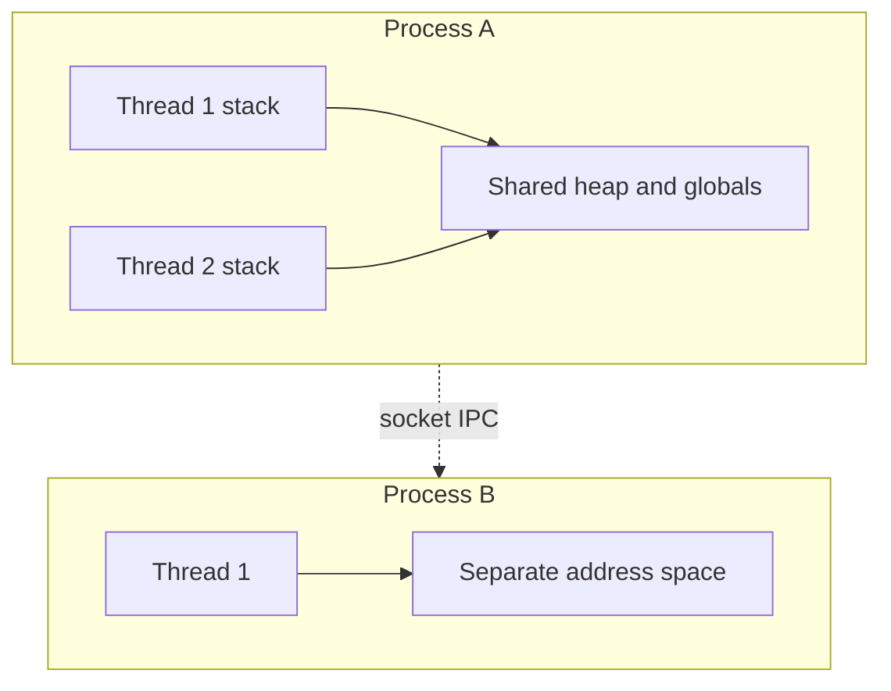

# D13-T001 — Threads vs processes

Topic ID: `D13-T001`
Domain: Concurrency and Parallel Processing
Subdomain: Threads vs processes
Importance: core
Complexity: advanced
Dependencies: `D01-T001`, `D01-T002`, `D03-T001`, `D03-T002`
Execution status of the code in section F: executed (CPython 3, local)

## A. Topic Overview

A **process** is an OS-managed execution unit with its own virtual address space, file descriptors, and security context. A **thread** is a schedulable unit of execution inside a process that shares that process memory and resources.

The distinction exists because isolation (processes) and cheap sharing (threads) pull in opposite directions. Backend services use both: multiple worker processes for crash isolation and CPU parallelism, and threads inside a process for concurrent I/O and request handling.

Interviewers use this topic to see whether you confuse “concurrent” with “parallel,” whether you know what is shared versus copied on `fork`, and whether you pick threads or processes for CPU work in Python versus Java.

Prerequisites: OS process basics (`D03-T001`, `D03-T002`). This note is the root of domain 13; later topics assume you can name isolation boundaries.

## B. First-Principles Explanation

The kernel schedules threads (and, on some systems, processes) onto CPU cores. Each process has a page table mapping virtual addresses to physical frames. Threads in the same process use one page table, so a pointer valid in thread A is valid in thread B unless you introduce synchronization.

Creating a process traditionally allocates a new address space (copy-on-write after `fork` on Unix, or explicit creation on Windows). Creating a thread allocates a stack and thread control block but reuses the heap and globals.

What happens on a context switch between threads in one process: the kernel saves registers and stack pointer, picks another runnable thread, restores its state, and resumes. The switch is cheaper than switching processes because the MMU context often stays the same.

Why it works: the OS enforces protection between processes and cooperative sharing inside them. Limitations: shared memory makes data races possible; process boundaries make large shared caches expensive. Alternatives are message passing between processes (pipes, sockets, gRPC) and async single-threaded event loops (`D13-T002`, `D13-T003`).

Terms: **address space** is the set of mappings a process can access. **Thread-safe** means correct when called concurrently; **process-safe** is meaningless without IPC rules.

## C. Internal Working and Architecture

Components:

- Process: PID, credentials, open files, signal disposition, heap, code segment.
- Thread: TID, stack, register set, kernel scheduling entity.
- Scheduler: ready queues per CPU, priority, time slices.
- IPC: sockets, pipes, shared memory segments (optional explicit sharing).

Typical Java or Go HTTP server:

1. Main process binds a port.
2. Either one process with a thread pool serves requests, or a prefork/pool of processes each runs threads.
3. Request handlers read connection state local to the thread or stored in concurrent structures.
4. On crash in a thread, the whole process may terminate unless isolation catches it; a separate worker process limits blast radius.

Data flow: a client connection arrives, the acceptor hands the socket to a worker thread, the thread parses HTTP, calls services, writes the response. Shared connection pools to the database live in process memory; every thread must borrow connections safely.

Memory: stacks are per-thread (typically megabytes each). Heap objects are shared; two threads mutating the same `HashMap` without synchronization is a race (`D13-T006`).

## D. Diagrams and Visual Models



Process B cannot dereference pointers from process A. Threads inside A share the heap box.

## E. Examples and Analogies

Analogy: a process is an apartment with its own key; threads are roommates sharing the kitchen. If one roommate leaves food out, everyone is affected. A second apartment (process) needs a phone call (IPC) to coordinate.

Backend example: run three Gunicorn workers (processes) behind nginx. Each worker handles requests concurrently with threads or async tasks. A segfault in one worker does not kill the others.

Do not use threads to bypass Python CPU parallelism for pure Python compute; see `D13-T016` (GIL). Do use processes or native extensions for that case. Do not share mutable singletons across threads without a plan.

## F. Code Examples

File: `EXERCISES/examples/d13_t001_process_thread.py`

```python
import multiprocessing as mp
import threading

counter = {"n": 0}
lock = threading.Lock()


def bump_thread(times: int) -> None:
    for _ in range(times):
        with lock:
            counter["n"] += 1


def bump_process(times: int) -> None:
    # Each process has its own memory; this mutates only the child copy.
    local = {"n": 0}
    for _ in range(times):
        local["n"] += 1
    print("child total", local["n"])


if __name__ == "__main__":
    threads = [threading.Thread(target=bump_thread, args=(100_000,)) for _ in range(4)]
    for t in threads:
        t.start()
    for t in threads:
        t.join()
    assert counter["n"] == 400_000

    p = mp.Process(target=bump_process, args=(100_000,))
    p.start()
    p.join()
    print("parent counter unchanged", counter["n"])
```

How to run: `python EXERCISES/examples/d13_t001_process_thread.py` from `backend-engineering-knowledge-base/`.

Expected output: `child total 100000` then `parent counter unchanged {'n': 400000}` (dict repr may vary).

The threaded section needs a lock because `+=` on a shared dict is not atomic. The process section shows separate memory: the parent counter stays 400000.

## G. Practical Backend Application

A stateless API tier scales out by adding processes behind a load balancer. Inside each JVM or Go binary, threads serve concurrent requests against shared connection pools and caches. Configuration and secrets load once per process.

Choose processes when you need fault isolation, separate memory limits, or true parallel CPU on CPython. Choose threads when you share a large in-memory cache and spend time waiting on I/O. Observability: tag logs with PID and thread name. Security: processes can run as different users in advanced deployments; threads share credentials.

Error handling: an uncaught exception in one request thread should not poison global state; use per-request context. Scaling: thread count is not “more is better”; it is bounded by memory for stacks and lock contention.

## H. Advantages, Limitations and Trade-offs

| Choice | Benefit | Cost | Choose when | Avoid when |
| --- | --- | --- | --- | --- |
| Multi-process | Isolation, parallel CPU on CPython | Higher memory, IPC overhead | CPU-bound Python, crash containment | Tiny tool, huge shared RAM cache |
| Multi-thread | Cheap sharing, fast handoff | Data races, one bad native crash kills all | I/O-heavy JVM/Go/Node pools | You need hard memory isolation |
| Single process async | Low overhead, no locks on locals | Blocks on CPU work | Many idle connections | Long CPU sections without offload |

Failure modes: fork + threads + locks held (deadlock in child), thread pool too large causing OOM from stacks, assuming `fork` copies threads (it does not; only the calling thread survives in the child on Unix).

## I. Common Mistakes and Misconceptions

- “Threads are always faster.” They reduce process overhead but add synchronization cost.
- “Processes cannot share anything.” They can via explicit shared memory or external stores (Redis, DB).
- “One thread per request forever.” It does not scale to tens of thousands of connections; pools and async matter.
- Equating goroutines with OS threads (`D13-T018`); goroutines are multiplexed.
- Spawning unbounded `multiprocessing` workers on a small container; respect CPU quota and memory.

Strong interviews name what is shared (heap, fds) and what is not (stacks, registers).

## J. Debugging and Troubleshooting

Symptoms: parent memory grows with child count; stuck workers after deploy; mysterious counter values.

Diagnosis:

1. Log PID and thread id on errors.
2. Check whether workers are processes or threads (`ps`, `jstack`, `pstree`).
3. For wrong totals, look for shared mutable state without atomics or locks.
4. For hung shutdown, look for non-daemon threads blocking exit.

Mitigation: cap pool sizes, use health checks per process, graceful drain before kill. Metrics: active threads, process restarts, context switch rate.

## K. Interview Preparation

### Beginner

#### Q1. What is the difference between a process and a thread?

**Answer:** A process is an isolated program instance with its own virtual memory and OS resources. A thread is a unit of execution inside that process and shares the same address space. Multiple threads can run concurrently within one process, while multiple processes are isolated unless they use explicit IPC. Interviewers want the isolation versus sharing trade-off, not only definitions.

#### Q2. What memory do threads in the same process share?

**Answer:** They share the heap, global/static data, and open file descriptors. Each thread has its own stack and CPU register context. That sharing is why two threads can race on the same object without synchronization. It is also why a leak in the heap affects every thread in the process.

#### Q3. When is creating a process heavier than creating a thread?

**Answer:** A new process needs a new address space and kernel bookkeeping, even with copy-on-write optimizations. A thread reuses the existing mappings and only allocates a stack and thread struct. Process creation is therefore slower and uses more memory at scale. Threads are cheaper to spawn but harder to reason about because of shared mutable state.

#### Q4. Can two processes read each other’s variables directly?

**Answer:** No, not through normal pointers; each process has its own virtual addresses. Sharing requires IPC such as pipes, sockets, or explicitly mapped shared memory with coordination. Backend systems therefore put shared state in databases or caches instead of pretending two processes share a heap. This boundary is a core security feature of the OS.

#### Q5. What does “parallel” mean versus “concurrent”?

**Answer:** Concurrent means multiple tasks make progress over overlapping time; parallel means they literally run on multiple CPUs at once. You can have concurrency on one core via time slicing and parallelism only with multiple cores and runnable work. A single-threaded event loop can be concurrent but not parallel. Thread pools may be both when the OS schedules them on different cores.

### Intermediate

#### Q1. How does `fork` interact with threads in a Unix server?

**Answer:** After `fork`, only the calling thread exists in the child; other threads are not copied. If another thread held a lock during `fork`, the child can deadlock if it tries to take that lock again. That is why libraries warn about forking after starting thread pools. Prefer `exec` into a clean process or spawn workers before threads when possible.

#### Q2. Why do Java services commonly use thread-per-request pools?

**Answer:** Blocking I/O APIs map naturally to one thread blocked per socket, and the JVM runs bytecode on multiple cores without a GIL. A bounded pool caps memory for stacks and prevents unbounded thread creation. Throughput still depends on pool size versus CPU and downstream latency. For massive concurrency, reactive or virtual-thread models reduce blocking thread cost.

#### Q3. How would you isolate a risky native extension?

**Answer:** Run it in a separate process with a narrow RPC interface so a segfault does not take down the API tier. The main service marshals requests and enforces timeouts on the child. This pattern appears with image processing, PDF rendering, and some ML runtimes. Threads in the same process would not contain a native crash.

#### Q4. What is copy-on-write after `fork`?

**Answer:** Parent and child initially share physical pages marked read-only; the first write to a page triggers a private copy for that process. It makes `fork` fast when the child immediately `exec`s, but less cheap if both parent and child mutate large heaps. Memory-heavy parents plus frequent fork can still pressure the kernel. Understand this when tuning prefork web servers.

#### Q5. How do containers relate to processes?

**Answer:** A container is typically one or more processes in isolated namespaces and cgroups, not a VM with its own kernel. Your service still chooses threads versus processes inside the container boundary. CPU and memory limits apply to the cgroup, so too many threads or processes can hit the limit together. Observability should still expose PID and thread counts inside the container.

### Advanced

#### Q1. Why might a multi-process cache be slower than threads sharing a heap?

**Answer:** A shared in-process cache avoids serialization on every read. Multi-process designs must use external stores or shared memory with explicit coherence, adding latency and complexity. Processes win when isolation or independent scaling matters more than nanosecond local reads. The trade-off is operational simplicity versus raw read speed.

#### Q2. How does the scheduler pick between threads of the same process?

**Answer:** Runnable threads sit on ready queues; the kernel picks based on priority, affinity, and fairness policies. All threads share the process time accounting in some systems, so one hot thread can affect siblings. CPU-bound threads can starve others in the same process without careful pool sizing. This is why mixed workloads sometimes split CPU-heavy work to a dedicated pool or process.

#### Q3. What happens to open sockets when you fork?

**Answer:** Both parent and child receive duplicates of the same file descriptor table entries pointing at the same kernel socket structures. Accidental double-read or double-close races are possible if both processes use the same connection. Servers typically close listening sockets in workers or use `SO_REUSEPORT` with separate processes designed for it. Always document which side owns which fd after fork.

#### Q4. When would you prefer processes for a Python web API?

**Answer:** When you need multiple CPU cores executing Python bytecode simultaneously, because the GIL limits one thread at a time in CPython for pure Python CPU work. Gunicorn/uWSGI workers are processes for that reason. I/O-bound APIs may still use async or threads within one worker. Measure before assuming more processes always help.

#### Q5. How does NUMA affect thread versus process placement?

**Answer:** On NUMA machines, memory attached to a remote socket is slower to access. Threads sharing heap allocated on one socket may all pay remote access if scheduled widely. Processes pinned to sockets with local allocation can reduce cross-socket traffic at the cost of less flexible scheduling. This matters at high core counts, not on a two-core laptop.

### Scenarios

#### Q1. A CPython service uses 32 threads but CPU is still one core at 100%. Why?

**Answer:** The GIL allows only one thread to execute Python bytecode at a time for CPU-bound pure Python work. Thirty-two threads contending on the GIL add overhead without parallel speedup. Switch to multiple processes, native extensions that release the GIL, or offload compute. Profile to confirm the hot path is Python bytecode, not I/O wait misread as CPU.

#### Q2. After deploy, zombie children accumulate under a prefork server. What failed?

**Answer:** The parent is not reaping exited children with `waitpid`, often because signal handlers or a bug prevent proper worker lifecycle management. Zombies hold process table slots until the parent waits. Fix the master process to reap workers and ensure workers exit cleanly on shutdown. Monitor `defunct` processes in `ps`.

#### Q3. Two microservices need a shared in-memory rate limit. Threads or processes locally?

**Answer:** Neither service can share a local heap across the network boundary. Each instance needs Redis or a gateway limiter (`D13-T020`). Within one instance, threads can share a counter with atomics or locks; processes would need shared memory or an external store. The interview trap is suggesting threads across services.

#### Q4. JVM heap is huge; ops wants smaller blast radius per tenant. What do you change?

**Answer:** Split tenants across JVM instances or containers (processes) so a heap leak or GC pause affects fewer customers. Threads alone do not isolate memory; they share the heap. You may duplicate some cache memory per instance. Balance cost versus isolation with load balancing and per-tenant routing.

#### Q5. `pthread_create` succeeds but the service OOMs under load. What grew?

**Answer:** Each thread reserves stack space; thousands of threads multiply megabytes even before application objects. The heap may also grow from per-request allocations on those threads. Reduce pool size, move to async I/O, or shard across processes with fixed worker counts. Check `ulimit -s` and container memory limits.

### Follow-ups

#### Q1. How does this connect to async/await?

**Answer:** Async concurrency multiplexes many tasks on few threads inside one process (`D13-T002`). It avoids per-connection thread stacks but still runs in one address space. Combine async accept loops with process workers for CPU isolation when needed.

#### Q2. Where do race conditions appear?

**Answer:** When threads share mutable state without synchronization (`D13-T006`). Processes do not race on ordinary variables because they do not share them; they race on external resources like files or databases instead.

#### Q3. How do goroutines differ from this picture?

**Answer:** Goroutines are lightweight tasks scheduled onto a small set of OS threads (`D13-T018`). Many goroutines share one process heap like threads, but stacks start small and grow. The Go runtime multiplexes them without one OS thread per goroutine.

## L. Practical Exercises

Solutions are in `EXERCISES/solutions/D13-T001.md`. Try these before opening that file.

### Exercise 1 — implementation

Implement a tiny process pool (2 workers) that sums chunks of a list and returns the total via a `multiprocessing.Queue`. Acceptance: parent result equals `sum(range(n))` for `n=10_000`, and workers are separate PIDs.

### Exercise 2 — debugging

Logs show `counter=19987` expected `20000` with 20 threads each incrementing 1000 times without a lock. Explain the bug and fix it with either a lock or `threading.atomic` pattern available in your language.

### Exercise 3 — trade-off

A team debates 8 Gunicorn workers versus 1 worker with 64 threads for a Django API that is 95% database I/O. Argue both sides and state what you would measure in production.

## M. Revision Notes

- Process = isolated address space; thread = shared heap, private stack.
- Parallel needs multiple cores; concurrent can be time-sliced.
- `fork` + threads is delicate; only forking thread survives in child.
- CPython CPU parallelism → processes or native code, not more threads.
- IPC required across processes; pointers are not portable.
- Container = processes with namespaces, not a second kernel.

Flashcards:

- What is shared between threads? Heap, globals, fds.
- Why Gunicorn uses processes? GIL and isolation.
- What is copy-on-write? Shared pages until write.

## N. Related Topics

Understand this before: `D03-T001` processes, `D03-T002` lifecycle.

This topic supports: `D13-T002` async, `D13-T004` pools, `D13-T016` GIL.

Often confused with: parallelism versus concurrency, goroutines versus threads.

Interviewers combine this with `D13-T015` CPU vs I/O and `D13-T020` bulkheads.

## O. Completion Criteria

- Draw two processes and two threads each with shared versus private memory labeled.
- Explain why CPython threads did not use 8 cores on CPU-bound code.
- Choose threads or processes for a given workload and justify with isolation and I/O.
- Debug a lost-update counter without synchronization.
- Describe `fork` behavior when other threads existed in the parent.
