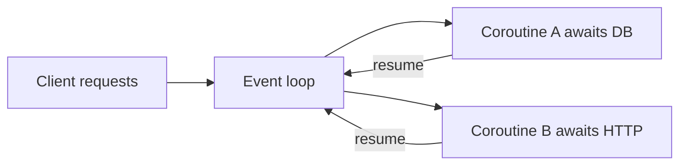

# D13-T002 — Async/await

Topic ID: `D13-T002`
Domain: Concurrency and Parallel Processing
Subdomain: Async/await
Importance: core
Complexity: advanced
Dependencies: `D13-T001`, `D01-T001`, `D01-T002`, `D03-T001`, `D03-T002`
Execution status of the code in section F: executed (local interpreter where applicable)

## A. Topic Overview

**Async/await** is syntax to write non-blocking concurrent code that still reads like sequential logic. An `async` function returns a coroutine/task object; `await` yields control until an I/O or timer completes. It exists because callback pyramids are hard to maintain and thread-per-connection does not scale. Backend APIs use async stacks (Python `asyncio`, C# `async`, Kotlin coroutines) to serve many idle connections on few threads.

## B. First-Principles Explanation

Synchronous code blocks the calling thread until each step finishes. Async code registers interest in I/O with the kernel (epoll, IOCP, kqueue) and resumes the coroutine when data is ready. The runtime event loop polls completions and schedules ready tasks. `await` is a suspension point, not a new thread. CPU work on the event-loop thread still blocks other tasks unless you offload to a thread pool (`run_in_executor`, `Task.Run`, etc.).

## C. Internal Working and Architecture

Components: event loop, task queue, futures/promises, and optionally a thread pool for blocking calls. On an HTTP request, the handler awaits a DB driver that issues a non-blocking query; the loop serves other clients meanwhile. State for each request lives in stack frames captured by the coroutine until the next `await`. Libraries must be async-aware end-to-end; mixing blocking JDBC in an async handler defeats the model.

## D. Diagrams and Visual Models



Use the diagram as the mental model for ordering and ownership.

## E. Examples and Analogies

Analogy: a barista takes orders, starts espresso machines, and works other tickets while machines run—not one barista frozen per cup. Do not call `time.sleep` or blocking file I/O inside async handlers without an executor. Async improves throughput for I/O wait, not magic for CPU-bound Python loops.

## F. Code Examples

File: `EXERCISES/examples/d13_t002_asyncio_gather.py`

```python
import asyncio


async def fetch(n: int) -> int:
    await asyncio.sleep(0.01)
    return n * n


async def main() -> None:
    results = await asyncio.gather(*(fetch(i) for i in range(5)))
    print(sum(results))


asyncio.run(main())
```

How to run: `python EXERCISES/examples/d13_t002_asyncio_gather.py` from `backend-engineering-knowledge-base/`.

Expected output: `30` (sum of squares 0..4).

## G. Practical Backend Application

FastAPI/Starlette, Node, and ASP.NET Core use async to multiplex thousands of connections. Use structured timeouts on downstream calls, limit concurrent tasks, and push CPU work to workers. Observability: trace spans across `await` boundaries; log when thread-pool saturation occurs.

## H. Advantages, Limitations and Trade-offs

| Choice | Benefit | Cost | Choose when | Avoid when |
| --- | --- | --- | --- | --- |
| async/await | Readable concurrent I/O | Requires async stack | Many concurrent I/O waits | CPU-heavy pure Python |
| threads + blocking | Simple libraries | Memory per thread | Moderate concurrency | Huge connection counts |
| processes | Isolation | IPC | CPU + GIL limits | Shared in-proc cache |

## I. Common Mistakes and Misconceptions

- Treating `async def` as parallel on multiple cores by itself.
- Calling blocking ORM/drivers inside async routes without offload.
- Forgetting to `await`, creating a coroutine that never runs.
- Unbounded `create_task` without semaphores.
- Assuming `asyncio.gather` preserves order of side effects across failures without handling exceptions.

## J. Debugging and Troubleshooting

Symptoms: event loop lag, rising latency while CPU is idle, 'Task was destroyed but pending'. Check for blocking calls, missing `await`, and thread-pool queue depth. Mitigation: `asyncio.wait_for` timeouts, bulkheads, and blocking code in executors.

## K. Interview Preparation

### Beginner

#### Q1. What does `await` do?

**Answer:** It suspends the current async function until the awaited operation completes, returning control to the event loop so other tasks can run. It does not automatically create a new OS thread. When the operation finishes, the coroutine resumes after the `await` line. Interviewers check you know suspension is cooperative, not preemptive.

#### Q2. What is an event loop?

**Answer:** It is a scheduler that runs ready async tasks and polls I/O completion sources. When a task awaits I/O, the loop registers the fd and switches to other tasks. When the kernel signals readiness, the loop resumes the waiting coroutine. One loop thread can host many concurrent I/O-bound tasks.

#### Q3. Is async the same as multithreading?

**Answer:** No. Async multiplexes tasks on one or few threads via cooperative scheduling. Multithreading uses preemptive OS threads that can run in parallel on multiple cores. You can combine them by running blocking work on a thread pool from an async app.

#### Q4. When does async help a web API?

**Answer:** When requests spend time waiting on networks or databases rather than computing on CPU. Async lets one process accept more concurrent requests with less thread memory. It does not speed a tight numeric loop unless you offload that loop.

#### Q5. What happens if you forget to await?

**Answer:** You get a coroutine object that was never scheduled, so work does not run and warnings may appear at shutdown. The API might return before side effects finish. Always await or pass the coroutine to a runner that schedules it.

### Intermediate

#### Q1. How is `asyncio.gather` different from sequential await?

**Answer:** `gather` schedules multiple awaitables concurrently on the same loop, so independent I/O overlaps. Sequential `await` finishes one before starting the next. `gather` still runs on one thread unless you offload; overlap is about waiting, not parallel CPU.

#### Q2. Why must the DB driver be async for FastAPI?

**Answer:** A blocking driver call occupies the event-loop thread during the query, blocking all other coroutines. An async driver registers the socket and yields until rows arrive. Mixing blocking drivers forces a thread pool and reduces scalability benefits.

#### Q3. What is `run_in_executor` for?

**Answer:** It runs a blocking callable on a thread pool and awaits a future wrapping the result. Use it for legacy libraries without async APIs. Size the pool; an oversized pool recreates thread-per-request problems.

#### Q4. How do cancellation and timeouts interact with await?

**Answer:** Timeouts (`wait_for`, `asyncio.timeout`) cancel the awaited task on expiry if the library supports cancellation. Cancellation raises `CancelledError` at the next `await`. You must handle cleanup in `finally` blocks for connections.

#### Q5. Compare async to Node callbacks.

**Answer:** Both use an event loop. `async/await` is syntactic sugar over promises/callbacks with clearer stack traces. Node still runs JavaScript on one thread per isolate; CPU work blocks the loop unless worker threads are used (`D13-T019`).

### Advanced

#### Q1. Can async tasks run truly in parallel on Python?

**Answer:** I/O-overlapped tasks run concurrently on one thread. CPU-bound Python bytecode still contends on the GIL unless you use multiple processes or native code releasing the GIL. `asyncio` is not a substitute for multiprocessing on compute-heavy workloads.

#### Q2. What is task starvation on an event loop?

**Answer:** A coroutine that never awaits monopolizes the loop thread, delaying timers and I/O callbacks. Long CPU sections should move to executors or separate workers. Fairness is the developer's responsibility, not the kernel scheduler's.

#### Q3. How does structured concurrency relate?

**Answer:** Parent scopes own child tasks and wait for them to finish (`asyncio.TaskGroup`, trio nurseries). Fire-and-forget tasks outlive requests and leak work. Structured concurrency ties task lifetime to a scope (`D13-T022`).

#### Q4. What backpressure looks like in async pipelines?

**Answer:** Unbounded queues between async stages let producers outrun consumers and grow memory. Use bounded queues and await `put` when full (`D13-T011`). Apply semaphores to limit in-flight requests (`D13-T020`).

#### Q5. How do you test async code?

**Answer:** Use the framework's async test runner (`pytest-asyncio`, `unittest.IsolatedAsyncioTestCase`). Patch clocks with loop time manipulation where supported. Integration tests should still assert cleanup on cancellation.

### Scenarios

#### Q1. p99 spikes but CPU is low. DB latency normal. What do you check in an async service?

**Answer:** Look for blocking calls on the event-loop thread, synchronous logging, or lock contention in middleware. Profile with loop debug mode or instrumentation that flags slow callbacks. A single blocking ORM call can stall all requests.

#### Q2. `RuntimeWarning: coroutine was never awaited` after deploy.

**Answer:** A code path returns a coroutine without awaiting, often after a refactor from sync to async. Search for `async def` handlers called without `await`. Add lint rules or type checking to catch coroutine objects used as values.

#### Q3. Should you make every endpoint `async def` in FastAPI?

**Answer:** Only if the stack awaits non-blocking I/O. CPU-only endpoints may be plain `def` so FastAPI runs them in a thread pool without blocking the loop. Mixed services should document which pool serves which routes.

#### Q4. Two downstream calls are independent. How do you cut latency?

**Answer:** Await them together with `gather` or `TaskGroup` so waits overlap. Keep shared client sessions (HTTP connection pooling) across awaits. Set per-call timeouts so one slow peer does not hold the request open forever.

#### Q5. Traffic doubled; memory rose linearly with open requests.

**Answer:** Likely unbounded task creation or buffering entire bodies in memory. Add concurrency limits, stream responses, and bound queues between stages. Measure in-flight tasks per endpoint.

### Follow-ups

#### Q1. How does this relate to futures/promises?

**Answer:** An awaited object is often a Future/Promise representing completion (`D13-T005`). The event loop completes futures when I/O finishes.

#### Q2. How does event-driven architecture differ?

**Answer:** Event-driven systems react to messages or fds (`D13-T003`). Async/await is one programming style atop that model.

#### Q3. Where do thread pools fit?

**Answer:** They execute blocking segments while the loop keeps serving I/O (`D13-T004`). Size pools as a bulkhead.

## L. Practical Exercises

Solutions are in `EXERCISES/solutions/D13-T002.md`. Try these before opening that file.

### Exercise 1 — implementation

Implement `async def parallel_squares(n)` using `asyncio.gather` and `asyncio.sleep(0)` stubs; return sum of squares 0..n-1.

### Exercise 2 — debugging

A route uses `requests.get` inside `async def`. Name the failure mode and show the fix with `httpx.AsyncClient` or executor.

### Exercise 3 — trade-off

Choose async vs threaded Spring WebMVC for 5k RPS, 40ms DB latency, team knows blocking JDBC only.

## M. Revision Notes

- `await` suspends; loop runs other tasks.
- Async helps I/O wait, not CPU GIL.
- No blocking on the loop thread.
- `gather` overlaps independent waits.
- Use executors for legacy blocking libs.

## N. Related Topics

Before: `D13-T001`. Next: `D13-T003` event-driven, `D13-T005` futures. Confused with: parallelism.

## O. Completion Criteria

- Explain suspension vs threads.
- Spot blocking in async handlers.
- Use `gather` with timeouts.
- Choose async vs threads for a workload.
- Trace a request across awaits.
