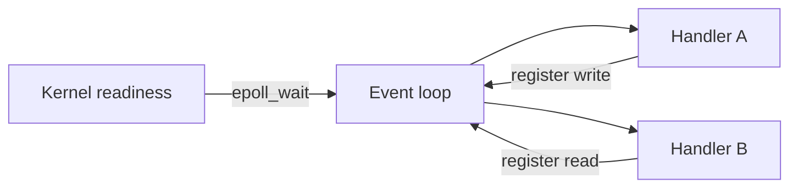

# D13-T003 — Event-driven concurrency

Topic ID: `D13-T003`
Domain: Concurrency and Parallel Processing
Subdomain: Event-driven concurrency
Importance: core
Complexity: advanced
Dependencies: `D13-T002`, `D13-T001`, `D01-T001`, `D01-T002`, `D03-T001`, `D03-T002`
Execution status of the code in section F: unexecuted

## A. Topic Overview

**Event-driven concurrency** means progress is driven by notifications (I/O ready, timer fired, message arrived) rather than by threads blocking in turn on each operation. A small number of threads run an **event loop** that dispatches handlers when the kernel or runtime reports readiness.

It exists because blocking one OS thread per connection does not scale to hundreds of thousands of idle clients. Servers multiplex many logical tasks on few threads using non-blocking sockets and readiness APIs (`epoll`, `kqueue`, `IOCP`, `io_uring`).

Backends use it in Node.js, asyncio, Netty, and many proxies. Interviewers test whether you confuse event-driven with “no parallelism” and whether you know CPU work must leave the loop.

Prerequisites: `D13-T002`, `D13-T001`, `D01-T001`, `D01-T002`, `D03-T001`, `D03-T002`. Builds toward later concurrency topics in domain 13.

## B. First-Principles Explanation

A thread asks the OS which file descriptors are readable/writable without blocking (`select`/`poll`/`epoll`). When data arrives, the loop calls the registered callback or resumes an async task. No thread sits idle in `recv` for every connection.

Callback style nests handlers; `async`/`await` compiles to the same state machine with clearer control flow (`D13-T002`). The loop is cooperative: long CPU sections stall every other task on that thread.

Why it works: one thread can serve many I/O-bound sessions with low stack memory. Limits: one core for the loop unless you add worker threads or processes; blocking syscalls and CPU-heavy JS/Python on the loop hurt tail latency.

## C. Internal Working and Architecture

Components: event demultiplexer (kernel), reactor loop, handler registry, optional thread pool for blocking work, timers, and outbound write queues.

Typical flow: accept new connection → register for read → on readable parse request → start downstream I/O → on completion write response → unregister or keep alive for keep-alive HTTP.

Data stays on connection-local objects or task frames; shared caches need locks or external stores. Backpressure appears when handlers produce faster than the socket drains (`D13-T011`).

## D. Diagrams and Visual Models



One thread cycles: wait for events, run short handlers, re-register interest.

## E. Examples and Analogies

Analogy: a receptionist (loop) does not stand at each guest's door; guests ring a bell (event) when they need service.

Backend: an API gateway handling 50k idle WebSockets on one asyncio process—memory is mostly connection state, not 50k thread stacks.

Do not run image resize on the loop thread. Do not call blocking `time.sleep` or synchronous DB drivers without a thread pool.

## F. Code Examples

File: `EXERCISES/examples/d13_t003_event_loop.py`

```python
import asyncio


async def handle_client(reader: asyncio.StreamReader, writer: asyncio.StreamWriter) -> None:
    data = await reader.readline()
    writer.write(b"HTTP/1.1 200 OK\r\nContent-Length: 2\r\n\r\nOK")
    await writer.drain()
    writer.close()


async def main() -> None:
    server = await asyncio.start_server(handle_client, "127.0.0.1", 0)
    port = server.sockets[0].getsockname()[1]
    print("listening", port)
    async with server:
        await server.serve_forever()


if __name__ == "__main__":
    asyncio.run(main())
```

How to run: `python EXERCISES/examples/d13_t003_event_loop.py` from `backend-engineering-knowledge-base/`.

Demo starts a minimal async HTTP responder; production uses frameworks but the loop pattern is the same.

## G. Practical Backend Application

Edge proxies and Node services use event loops for connection churn. Combine with worker processes for CPU isolation. Metrics: event loop lag, handler duration histogram, open FD count.

## H. Advantages, Limitations and Trade-offs

| Choice | Benefit | Cost | Choose when | Avoid when |
| --- | --- | --- | --- | --- |
| Single-threaded reactor | Low memory, simple locals | No parallel CPU on loop | Many idle connections | Heavy per-request CPU |
| Reactor + thread pool | Offload blocking/CPU | Pool sizing, cross-thread marshaling | Mixed I/O and DB drivers | Tiny scripts |
| Multi-process reactors | Use all cores | No shared in-proc cache | Node cluster, Gunicorn+Uvicorn | Need huge shared heap |
| Blocking thread-per-request | Simple code | Stacks and context switches | Low concurrency JVM | C10k problem |

## I. Common Mistakes and Misconceptions

- Calling blocking I/O inside the event loop thread.
- Assuming event-driven implies thread-safe globals without discipline.
- Ignoring loop lag metrics until p99 explodes.
- Using callbacks without error propagation paths.
- Confusing concurrency on one core with parallel CPU across cores.

## J. Debugging and Troubleshooting

Measure event loop delay (Node `perf_hooks`, asyncio slow callback warnings). Profile handler times. Check for sync file I/O and DNS. If CPU is hot on one core, shard processes or move compute to workers.

## K. Interview Preparation

### Beginner

#### Q1. What is event-driven concurrency?

**Answer:** Work advances when events occur, not when threads round-robin through blocking calls. A loop waits for readiness, then runs small handlers and returns to wait again. Many connections can share one thread when they spend most time waiting on I/O. It is concurrent but not automatically parallel across CPU cores.

#### Q2. How does it differ from preemptive threads?

**Answer:** Threads can be interrupted by the OS scheduler at arbitrary points. Event handlers should run to completion or await without blocking the loop. Cooperative models need discipline; one slow handler delays others on that thread. Threads still exist underneath for thread pools and some runtimes.

#### Q3. What system calls enable this on Linux?

**Answer:** `epoll_wait` reports which sockets are readable/writable without scanning all FDs. Sockets are set non-blocking so `read` returns immediately when empty. The loop registers interest once and reacts on edge or level triggers. Similar ideas exist on BSD (`kqueue`) and Windows (`IOCP`).

#### Q4. Is Node.js single-threaded?

**Answer:** JavaScript user code on the main thread runs one at a time on the event loop. libuv uses a small thread pool for some blocking operations like file I/O. Worker threads and child processes add parallelism for CPU work. So it is event-driven concurrent with optional parallel helpers.

#### Q5. When is event-driven a poor fit?

**Answer:** CPU-bound work on the loop thread blocks all clients. Libraries that only offer blocking APIs need wrappers or pools. Very low-latency parallel compute may prefer threads or processes directly. Measure before rewriting; I/O-heavy APIs often still win.

### Intermediate

#### Q1. How does async/await relate to callbacks?

**Answer:** `await` suspends a coroutine and registers a resume callback on I/O completion. The event loop still drives progress; syntax is clearer than nested callbacks. Stack traces and cancellation propagate more cleanly with structured tasks. Under the hood it is still cooperative single-threaded execution per loop.

#### Q2. What is reactor versus proactor?

**Answer:** Reactor: app reads/writes when FD is ready (classic `epoll` + non-blocking I/O). Proactor: OS completes I/O and notifies the app (IOCP style). Both avoid one blocked thread per connection. Frameworks hide which style they use on each OS.

#### Q3. How do timers fit the loop?

**Answer:** Timeouts and `setTimeout` enqueue timer events with deadlines. The loop computes the next wait timeout alongside I/O interest. Missed deadlines indicate loop starvation from long handlers. Distributed timeouts still need clock sync at the system level.

#### Q4. How handle backpressure in evented servers?

**Answer:** Pause reading when downstream buffers are full (`D13-T011`). Stop accepting or return 503 when overload exceeds limits (`D13-T020`). Writers should respect `drain`/`writev` completion before sending more. Otherwise memory grows with unconsumed producer speed.

#### Q5. How does this pair with thread pools?

**Answer:** Offload blocking DB calls or CPU chunks to `run_in_executor` or pool threads. Results return via callbacks or futures to resume coroutines on the loop. Pool size bounds parallel blocking work without unbounded threads. Cross-thread posting must be thread-safe.

### Advanced

#### Q1. What is event loop lag?

**Answer:** Delay between scheduling a timer/callback and it actually running. High lag means handlers or GC are monopolizing the thread. It predicts p99 latency better than average handler time alone. Fix by shortening work, sharding loops, or moving CPU out.

#### Q2. Edge-triggered versus level-triggered epoll?

**Answer:** Edge: notification once when state changes; must drain buffers fully. Level: signals while condition remains true; can be easier but chatty. Bugs appear as stuck connections if edge mode leaves data unread. Libraries usually abstract this correctly if you use their APIs.

#### Q3. How do coroutines compare to OS threads for memory?

**Answer:** Coroutines use small frames on the heap; threads reserve large stacks upfront. Millions of goroutines or asyncio tasks are feasible; millions of threads are not. Still one CPU executing bytecode on one loop unless sharded. Choose based on workload mix, not headline marketing.

#### Q4. What about `SO_REUSEPORT` multi-loop?

**Answer:** Multiple processes or threads each run a loop and accept on the same port. Kernel load-balances new connections across listeners. True parallelism for accept + I/O on multi-core. Shared state still needs external coordination.

#### Q5. Failure modes under slow clients?

**Answer:** Slowloris-style attacks hold connections with tiny writes. Mitigate with read/write timeouts and connection limits. Idle timeouts reclaim FDs and memory. Rate limits at the edge complement in-app guards.

### Scenarios

#### Q1. Node API p99 spikes while CPU is one core at 100%.

**Answer:** Likely CPU-heavy JavaScript on the main event loop. Profile flame graphs; move hashing/JSON crunch to worker threads. Check accidental sync `fs` reads on hot paths. Consider clustering across cores with separate processes.

#### Q2. asyncio service freezes during deploy.

**Answer:** Long synchronous shutdown hooks or blocking DNS may run on the loop. Use `await` friendly libraries and thread offload for blocking steps. Ensure graceful drain with bounded wait then force close. Watch loop lag during rolling restarts.

#### Q3. 10k WebSockets, memory OK but latency grows.

**Answer:** Handler time or broadcast fan-out may be O(n) on the loop. Shard channels across instances; use pub/sub backplane. Batch writes and respect backpressure per socket. Measure per-tick work, not only connection count.

#### Q4. Mixed sync ORM in async FastAPI.

**Answer:** Blocking SQL in route handlers blocks the entire worker loop. Use async drivers, or `run_in_executor` with a sized pool. Pool too small queues requests; too large exhausts DB connections. Align pool with DB max connections (`D13-T020`).

#### Q5. Callback hell in legacy service.

**Answer:** Refactor hot paths to async/await incrementally behind interfaces. Centralize error handling instead of per-callback try/catch gaps. Add loop lag metrics before and after. Do not big-bang rewrite without traffic canary.

### Follow-ups

#### Q1. Link to thread pools?

**Answer:** Pools execute blocking segments; the loop stays responsive (`D13-T004`). Size pools from I/O wait and downstream limits. Futures bridge threads back to the loop (`D13-T005`). Bulkheads cap cross-effect (`D13-T020`).

#### Q2. Link to producer-consumer?

**Answer:** Handlers produce responses consumed by socket writes. Internal queues decouple stages (`D13-T010`). Bounded queues apply backpressure (`D13-T011`). Same pattern in streaming pipelines.

#### Q3. Link to Node worker threads?

**Answer:** Workers run CPU tasks off the main loop (`D13-T019`). Message passing copies or shares ArrayBuffers carefully. Main thread still owns most I/O. Choose workers over cluster when sharing state is hard.

## L. Practical Exercises

Solutions are in `EXERCISES/solutions/D13-T003.md`. Try these before opening that file.

### Exercise 1 — implementation

Implement a tiny asyncio TCP echo server that handles 100 concurrent clients without creating 100 threads.

### Exercise 2 — debugging

Logs show rising memory during traffic spike; handlers never await `drain`. Diagnose.

### Exercise 3 — trade-off

Team chooses Node cluster vs worker threads for PDF thumbnailing. Argue trade-offs.

## M. Revision Notes

- Event loop multiplexes I/O; handlers must not block.
- async/await is syntactic sugar over the reactor.
- Parallel CPU needs extra threads/processes.
- Backpressure and timeouts protect memory and latency.
- Measure loop lag and handler p99.

## N. Related Topics

Dependencies: `D13-T002`, `D13-T001`, `D01-T001`, `D01-T002`, `D03-T001`, `D03-T002`.

Next in chain: `D13-T004`.

See also: `D13-T002`, `D13-T004`, `D13-T019`, `D13-T011`.

## O. Completion Criteria

- Sketch reactor flow with epoll and handlers.
- Explain why blocking DB in asyncio hurts all clients.
- Name three ways to use multiple CPU cores with an evented app.
- Describe backpressure on a slow socket.
- Contrast cooperative handlers with preemptive threads.
