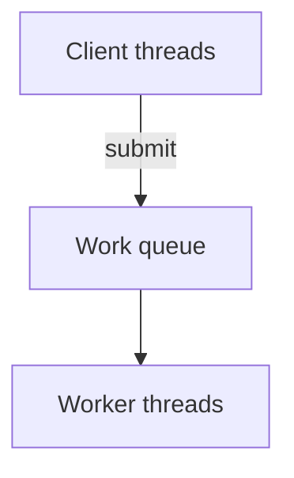

# D13-T004 — Thread pools and worker pools

Topic ID: `D13-T004`
Domain: Concurrency and Parallel Processing
Subdomain: Thread pools and worker pools
Importance: core
Complexity: advanced
Dependencies: `D13-T003`, `D13-T001`, `D01-T001`, `D01-T002`, `D03-T001`, `D03-T002`
Execution status of the code in section F: executed (CPython 3, local)

## A. Topic Overview

**Thread pools** reuse a fixed set of worker threads to run many tasks submitted through a shared queue. **Worker pools** are the same idea at the service layer (e.g., prefork HTTP workers).

Prerequisites: `D13-T003`, `D13-T001`, `D01-T001`, `D01-T002`, `D03-T001`, `D03-T002`. Builds toward later concurrency topics in domain 13.

## B. First-Principles Explanation

Thread creation costs kernel structures and stack memory; pools amortize that cost. Workers block on a queue, execute runnables, and loop. When the queue is bounded, submitters block or fail when full—this is intentional overload protection.

## C. Internal Working and Architecture

Queue + N workers + submit API + shutdown coordinator. Java `ExecutorService`, Python `ThreadPoolExecutor`, .NET `ThreadPool`. Process pools (`multiprocessing.Pool`) swap threads for processes for isolation.

## D. Diagrams and Visual Models



Read the diagram as control/data flow for this concurrency pattern.

## E. Examples and Analogies

Analogy: bank with four tellers and a line, not four thousand tellers. Backend: Jetty max threads. Avoid unbounded `Executors.newCachedThreadPool` on public APIs.

## F. Code Examples

File: `EXERCISES/examples/d13_t004_thread_pool.py`

```python
import concurrent.futures


def work(n: int) -> int:
    return sum(range(n))


if __name__ == "__main__":
    with concurrent.futures.ThreadPoolExecutor(max_workers=4) as ex:
        futs = [ex.submit(work, 1000) for _ in range(8)]
        total = sum(f.result() for f in futs)
    assert total == 8 * sum(range(1000))
    print("ok")
```

How to run: `python EXERCISES/examples/d13_t004_thread_pool.py` from `backend-engineering-knowledge-base/`.

Four workers run eight tasks sequentially in parallel chunks.

## G. Practical Backend Application

Size pools against CPU, stack memory, and downstream connection limits. Expose queue depth and rejection metrics. On shutdown, `shutdown()` then `awaitTermination` with timeout.

## H. Advantages, Limitations and Trade-offs

| Choice | Benefit | Cost | Choose when | Avoid when |
| --- | --- | --- | --- | --- |
| Fixed thread pool | Stable footprint | Wait under burst | HTTP services | Need unbounded threads |
| Process pool | GIL bypass / isolation | Pickle/IPC overhead | CPython CPU work | Tiny shared cache |
| Caller-runs policy | Backpressure to submitter | Risk blocking accept thread | Low load shedding | Latency SLO strict |
| Work stealing | Balances CPU tasks | Implementation cost | Recursive divide | Micro-tasks |

## I. Common Mistakes and Misconceptions

- Pool larger than database max connections.
- Unbounded queue masking overload.
- No shutdown hook on deploy.
- Sharing request context mutably across tasks.
- CPU-bound Python on thread pool expecting linear speedup.

## J. Debugging and Troubleshooting

Capture thread dump: all workers blocked on `pool.borrowConnection` → align JDBC/Hikari size with worker count. Watch `pool-queue-size` and rejection counters.

## K. Interview Preparation

### Beginner

#### Q1. What is a thread pool?

**Answer:** It reuses threads to run many tasks. Submitters enqueue work instead of spawning threads ad hoc. Workers wait on a queue and execute tasks serially per worker. This caps memory and scheduling overhead.

#### Q2. Why not unlimited threads?

**Answer:** Each thread reserves stack space and scheduler state. Too many threads increase context switching and lock contention. Downstream resources like DB connections also have hard caps. Pools make concurrency explicit and measurable.

#### Q3. What is a work queue?

**Answer:** It buffers tasks between producers and consumers. Workers dequeue and execute runnables. Bounded queues block or reject producers when full. Unbounded queues risk memory exhaustion under spikes.

#### Q4. What happens on pool shutdown?

**Answer:** Stop accepting new tasks; drain or cancel queued work. Workers finish in-flight tasks within a timeout. Forced shutdown may interrupt long tasks. Graceful deploy depends on this lifecycle.

#### Q5. Thread pool vs process pool?

**Answer:** Threads share one address space; processes are isolated. CPython threads do not parallelize CPU-heavy Python bytecode due to the GIL. Process pools use separate interpreters and IPC. Pick based on workload and isolation needs.

### Intermediate

#### Q1. Common rejection policies?

**Answer:** Abort throws `RejectedExecutionException` to the submitter. Caller-runs executes on the submitting thread as backpressure. Discard drops the task silently—dangerous for payments. Discard-oldest makes room for new tasks in some queues.

#### Q2. How size an HTTP thread pool?

**Answer:** Start near CPU cores for CPU-bound; higher for blocking I/O if DB allows. Never exceed connection pool times replicas without queuing at DB. Measure queue wait time and utilization. Virtual threads (Java 21+) change the cost model but not DB limits.

#### Q3. Daemon worker threads?

**Answer:** Daemon threads do not keep JVM alive when only daemons remain. Pool threads are often non-daemon so tasks finish on shutdown. Misconfigured daemons can truncate work at exit. Match lifecycle to service drain requirements.

#### Q4. ForkJoinPool use case?

**Answer:** Divide-and-conquer tasks spawn subtasks stolen by idle workers. Good for parallel streams and recursive algorithms. Less ideal for blocking I/O on pool threads. Combine with async I/O models for servers.

#### Q5. How relate to futures?

**Answer:** `submit` returns a `Future` representing async result (`D13-T005`). Callers compose or block on completion. Exceptions propagate when `get` is called. Keeps pool API non-blocking for submit path.

### Advanced

#### Q1. Work stealing intuition?

**Answer:** Idle workers take tasks from busy deques. Improves CPU utilization for uneven task trees. Overhead if tasks are tiny. Different from global FIFO fair queue.

#### Q2. Thread pinning issues?

**Answer:** Long tasks on few threads starve others sharing pool. Separate pools for admin vs customer traffic (bulkhead). Priority queues can invert fairness. Monitor per-pool latency histograms.

#### Q3. Virtual threads impact?

**Answer:** Cheap to create; still one carrier thread runs bytecode at a time per carrier. Blocking JDBC on virtual thread frees carrier if mounted correctly. Pinning to carrier occurs with some native locks. Not a substitute for DB connection limits.

#### Q4. LIFO vs FIFO queue?

**Answer:** LIFO can improve cache locality for nested tasks. FIFO is fairer for unrelated requests. `ThreadPoolExecutor` uses FIFO linked queue by default. Choose consciously for latency fairness.

#### Q5. Metrics that matter?

**Answer:** Active count, queue depth, completed rate, rejection rate, task wait time. Correlate with thread dump blocked frames. SLO on submit-to-start latency. Alert before OOM from queue growth.

### Scenarios

#### Q1. Sudden 503 `Thread pool exhausted`.

**Answer:** Arrival rate exceeded pool plus queue capacity. Increase pool only if DB and CPU allow; else shed load at gateway. Check for slow downstream causing thread hoarding. Add timeouts so threads return to pool.

#### Q2. Memory grows; millions of threads.

**Answer:** Likely `newCachedThreadPool` or thread-per-request leak. Threads not terminating because tasks block forever. Cap pools; fix connection leaks; thread dump. Never unbounded on edge API.

#### Q3. After fork, child hangs on lock.

**Answer:** Only forking thread copied; others' locks may be held forever in child. Do not fork after starting pools; use `spawn` multiprocessing. Prefork before threads or exec clean worker. Classic Unix gotcha (`D13-T001`).

#### Q4. 32 threads but DB max 10 connections.

**Answer:** 22 threads block on borrow; latency cascades. Lower HTTP threads or raise DB pool with DBA approval. Add short borrow timeout to fail fast. Align bulkheads (`D13-T020`).

#### Q5. Deploy kills in-flight payments.

**Answer:** Shutdown timeout too aggressive without drain. Use graceful period; reject new work at load balancer first. Idempotent retries on client. Coordinate queue depth zero before kill.

### Follow-ups

#### Q1. How futures help?

**Answer:** Decouple submission from result retrieval (`D13-T005`). Compose async pipelines without blocking pool threads unnecessarily. Handle errors per task. Bridge to async event loops.

#### Q2. Event loop relation?

**Answer:** Blocking pool offloads sync work from loop (`D13-T003`). Keep pool small and bounded. Return results via thread-safe queue to loop. Measure cross-thread overhead.

#### Q3. Bulkheads?

**Answer:** Separate pools per dependency (`D13-T020`). One slow partner cannot exhaust all threads. Combined with timeouts (`D13-T021`). Resilience pattern for microservices.

## L. Practical Exercises

Solutions are in `EXERCISES/solutions/D13-T004.md`. Try these before opening that file.

### Exercise 1 — implementation

Use `ThreadPoolExecutor` with 4 workers to compute eight partial sums and assert the total.

### Exercise 2 — debugging

All Tomcat threads BLOCKED on `HttpClient` pool borrow. Explain and fix sizing.

### Exercise 3 — trade-off

Debate cached vs fixed pool for a public REST API under viral traffic.

## M. Revision Notes

- Threads reused via queue.
- Bound queue + rejection.
- Match DB pool.
- Process pool for CPython CPU.
- Graceful shutdown.

## N. Related Topics

Dependencies: `D13-T003`, `D13-T001`, `D01-T001`, `D01-T002`, `D03-T001`, `D03-T002`.

Next in chain: `D13-T005`.

See also: `D13-T001`, `D13-T005`, `D13-T015`, `D13-T020`.

## O. Completion Criteria

- Draw submit queue workers.
- Explain CallerRuns.
- Size pool given 50 DB conns.
- Thread vs process pool in Python.
- Three overload signals.
