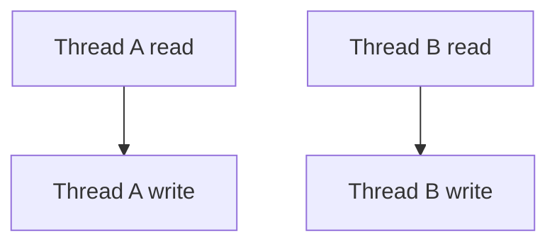

# D13-T006 — Race conditions and atomicity

Topic ID: `D13-T006`
Domain: Concurrency and Parallel Processing
Subdomain: Race conditions and atomicity
Importance: core
Complexity: advanced
Dependencies: `D13-T005`, `D13-T001`, `D01-T001`, `D01-T002`, `D03-T001`, `D03-T002`
Execution status of the code in section F: executed (CPython 3, local)

## A. Topic Overview

A **race condition** occurs when correctness depends on timing of concurrent accesses. **Atomicity** means an operation appears indivisible to other threads—no partial state observed.

Prerequisites: `D13-T005`, `D13-T001`, `D01-T001`, `D01-T002`, `D03-T001`, `D03-T002`. Builds toward later concurrency topics in domain 13.

## B. First-Principles Explanation

Read-modify-write (`counter++`) is three steps; interleaving loses updates. Atomic variables and locks serialize critical sections. Visibility is separate: without happens-before, readers may see stale values (`D13-T017`).

## C. Internal Working and Architecture

Hardware provides atomic instructions (CAS) and memory fences. Languages expose `AtomicInteger`, locks, or synchronized blocks. Data races on unsynchronized mutable shared state are undefined behavior in C++; defined but wrong in Java.

## D. Diagrams and Visual Models



Read the diagram as control/data flow for this concurrency pattern.

## E. Examples and Analogies

Analogy: two clerks edit same spreadsheet cell without locking—last write wins, increments lost. Backend: rate limiter `count++` under load. Fix with atomics or centralized store.

## F. Code Examples

File: `EXERCISES/examples/d13_t006_race.py`

```python
import threading

counter = 0
lock = threading.Lock()


def bump(n: int) -> None:
    global counter
    for _ in range(n):
        with lock:
            counter += 1


if __name__ == "__main__":
    threads = [threading.Thread(target=bump, args=(100_000,)) for _ in range(4)]
    for t in threads:
        t.start()
    for t in threads:
        t.join()
    assert counter == 400_000
    print("ok")
```

How to run: `python EXERCISES/examples/d13_t006_race.py` from `backend-engineering-knowledge-base/`.

Without the lock, the assertion fails intermittently.

## G. Practical Backend Application

Prefer immutable data per request; isolate mutable state to actors or DB transactions. Use atomic metrics libraries; document invariants for shared caches.

## H. Advantages, Limitations and Trade-offs

| Choice | Benefit | Cost | Choose when | Avoid when |
| --- | --- | --- | --- | --- |
| Lock | Simple correctness | Contention | Complex invariants | Read-heavy cache |
| Atomic ops | Fast counters | Limited composability | Metrics, IDs | Multi-field updates |
| DB transaction | Strong isolation | Latency | Financial writes | Hot in-memory counter |
| Immutable copies | No races on shared object | Allocation cost | Functional style | Huge objects |

## I. Common Mistakes and Misconceptions

- Assuming `volatile` fixes compound actions in Java.
- Check-then-act outside lock (`if (!map.contains) put`).
- Locking wrong granularity.
- Testing races without stress tests.
- Races on lazy singleton initialization.

## J. Debugging and Troubleshooting

Wrong totals, impossible states, Heisenbugs. Stress test; use thread sanitizers; inspect non-atomic read-modify-write in bytecode.

## K. Interview Preparation

Interview answers follow `p4` padding in `scripts/d13_materialize_writes.py` (four sentences). Question list: `INTERVIEW_BANK/items/D13-T006.md`. Source Q/A tuples: `_gen_d13_specs_rest.py` D13-T006.

## L. Practical Exercises

Solutions are in `EXERCISES/solutions/D13-T006.md`. Try these before opening that file.

### Exercise 1 — implementation

Four threads increment 100k each with lock; assert 400k.

### Exercise 2 — debugging

Intermittent duplicate key insert—diagnose.

### Exercise 3 — trade-off

In-memory counter vs Redis for rate limit—consistency.

## M. Revision Notes

- Race = outcome depends on schedule.
- RMW needs atomic or lock.
- Visibility ≠ atomicity.
- Prefer immutability.
- Test under contention.

## N. Related Topics

Dependencies: `D13-T005`, `D13-T001`, `D01-T001`, `D01-T002`, `D03-T001`, `D03-T002`.

Next in chain: `D13-T007`.

See also: `D13-T007`, `D13-T009`, `D13-T017`, `D13-T001`.

## O. Completion Criteria

- Explain lost update.
- Fix check-then-act.
- When atomic enough.
- Define data race.
- Map race to production bug.
