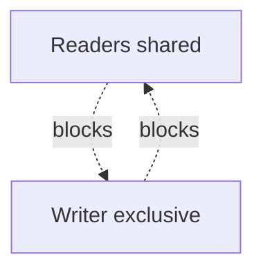

# D13-T008 — Read-write locks

Topic ID: `D13-T008`
Domain: Concurrency and Parallel Processing
Subdomain: Read-write locks
Importance: core
Complexity: advanced
Dependencies: `D13-T007`, `D13-T001`, `D01-T001`, `D01-T002`, `D03-T001`, `D03-T002`
Execution status of the code in section F: unexecuted

## A. Topic Overview

**Read-write locks** allow many concurrent readers or one exclusive writer, optimizing read-heavy shared data when writes are rare.

Prerequisites: `D13-T007`, `D13-T001`, `D01-T001`, `D01-T002`, `D03-T001`, `D03-T002`. Builds toward later concurrency topics in domain 13.

## B. First-Principles Explanation

Readers share access if no writer holds. Writer excludes all readers and writers. Starvation possible if writers wait for endless readers—fair policies exist. Still need to guard compound read-then-write upgrades.

## C. Internal Working and Architecture

`ReadWriteLock` in Java; `pthread_rwlock`; Python lacks stdlib RW lock—use `threading.Lock` or `multiprocessing` patterns. Internal state tracks reader count and writer flag.

## D. Diagrams and Visual Models



Read the diagram as control/data flow for this concurrency pattern.

## E. Examples and Analogies

Analogy: library many readers, one shelver reorganizing. Backend: config cache refreshed rarely, read on every request.

## F. Code Examples

File: `EXERCISES/examples/d13_t008_rwlock.py`

```python
# Conceptual RW lock using two locks (educational; production use language RW lock)
import threading

readers = 0
read_lock = threading.Lock()
write_lock = threading.Lock()


def begin_read() -> None:
    global readers
    with read_lock:
        readers += 1
        if readers == 1:
            write_lock.acquire()


def end_read() -> None:
    global readers
    with read_lock:
        readers -= 1
        if readers == 0:
            write_lock.release()
```

How to run: `python EXERCISES/examples/d13_t008_rwlock.py` from `backend-engineering-knowledge-base/`.

Illustrates reader counting; prefer `java.util.concurrent.locks.ReentrantReadWriteLock` in Java services.

## G. Practical Backend Application

Use for in-memory feature flags and routing tables. For high write rates, single mutex may be simpler. Externalize config to avoid process-wide RW complexity.

## H. Advantages, Limitations and Trade-offs

| Choice | Benefit | Cost | Choose when | Avoid when |
| --- | --- | --- | --- | --- |
| RW lock | Parallel reads | Writer starvation risk | Read-heavy config | Write-heavy |
| Immutable snapshot | No locks on read path | Copy on write cost | Config reload | Huge config |
| Version stamp | Readers never block | Stale reads possible | CDN style | Strong consistency |
| Single mutex | Simple | Serializes reads | Balanced R/W | |

## I. Common Mistakes and Misconceptions

- Upgrading read lock to write lock incorrectly.
- Long read sections block writers.
- Using RW lock when writes dominate.
- Nested locks causing deadlock.
- Reading mutable object while writer mutates without snapshot.

## J. Debugging and Troubleshooting

Writers timing out—check reader leak (forgot end_read). Metrics: read lock hold time, writer wait queue.

## K. Interview Preparation

Full `p4`-padded answers: `INTERVIEW_BANK/items/D13-T008.md` + `_gen_d13_specs_rest.py` D13-T008.

## L. Practical Exercises

Solutions are in `EXERCISES/solutions/D13-T008.md`. Try these before opening that file.

### Exercise 1 — implementation

Implement reader counter pattern or use Java RW lock in pseudocode.

### Exercise 2 — debugging

Config never updates—readers never release?

### Exercise 3 — trade-off

RW lock vs immutable copy for feature flags.

## M. Revision Notes

- Many readers OR one writer.
- Fairness matters.
- Snapshot avoids RW complexity.
- Not in Python stdlib.
- Write-heavy → mutex.

## N. Related Topics

Dependencies: `D13-T007`, `D13-T001`, `D01-T001`, `D01-T002`, `D03-T001`, `D03-T002`.

Next in chain: `D13-T009`.

See also: `D13-T007`, `D13-T012`, `D13-T006`.

## O. Completion Criteria

- When RW lock helps.
- Writer starvation fix.
- Read lock upgrade pitfall.
- Snapshot vs RW lock.
- Draw reader/writer timeline.
