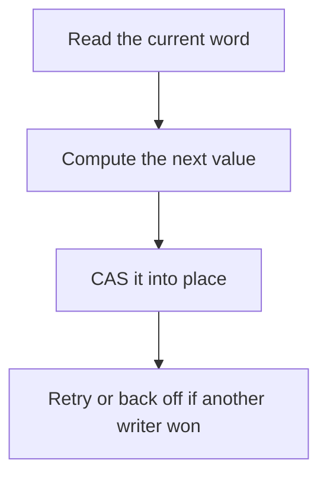

# D13-T009 — Lock-free programming basics

Topic ID: `D13-T009`
Domain: Concurrency and Parallel Processing
Subdomain: Lock-free programming basics
Importance: core
Complexity: advanced
Dependencies: `D13-T008`, `D13-T001`, `D01-T001`, `D01-T002`, `D03-T001`, `D03-T002`
Execution status of the code in section F: unexecuted

## A. Topic Overview

Lock-free programming updates shared data with atomic primitives such as compare-and-swap instead of a mutex. A thread that fails a CAS retries. Progress for the system continues even if one thread stalls, which is the usual lock-free guarantee. It is not wait-free, which would bound each thread's own steps. ABA, memory ordering, and a retry loop that livelocks under contention are the real bugs.

In production this shows up as follows: A metrics counter uses an atomic add, which is lock-free and the right size. A multi-field account update does not, because two words are not one CAS.

Interviewers use Lock-free programming basics to see whether you can state the failure mode, not only the definition. The failure to name is: an ABA bug or a CAS loop saturating a core while a mutex would have queued quietly

Prerequisites: `D13-T008`, `D13-T001`, `D01-T001`, `D01-T002`, `D03-T001`, `D03-T002`. Later notes should link here instead of repeating the mechanism.

## B. First-Principles Explanation

Lock-free programming updates shared data with atomic primitives such as compare-and-swap instead of a mutex. A thread that fails a CAS retries. Progress for the system continues even if one thread stalls, which is the usual lock-free guarantee. It is not wait-free, which would bound each thread's own steps. ABA, memory ordering, and a retry loop that livelocks under contention are the real bugs.

The useful picture is: Lock-free code is changing a number on the board only if it still shows the number you read. If someone else wrote first, you read again. Nobody holds a pen exclusively.

What has to be true:

1. Read the current word
2. Compute the next value
3. CAS it into place
4. Retry or back off if another writer won

It works when those steps preserve one invariant. It fails when an ABA bug or a CAS loop saturating a core while a mutex would have queued quietly. The alternative is: the invariant spans multiple words or the contention is high enough that a queueing lock is kinder

## C. Internal Working and Architecture

Components involved: the caller, the state Lock-free programming basics mutates or reads, and the observer that reports CAS failure rate and the number of retries before success.

Execution:

1. Read the current word
2. Compute the next value
3. CAS it into place
4. Retry or back off if another writer won

Data moves only along that path. A retry re-enters at step 1, so the operation must say what a duplicate does. Memory and locks stay inside this mechanism. Callers see the result or a typed error, not a half-updated invariant.

State to remember: choose this when the update is one word and the critical section is tiny. Do not choose it when the invariant spans multiple words or the contention is high enough that a queueing lock is kinder.

## D. Diagrams and Visual Models



Read the diagram from top to bottom. Each box is one step of Lock-free programming basics. The failure mode (an ABA bug or a CAS loop saturating a core while a mutex would have queued quietly) is what you look for when a later box never happens or happens twice.

## E. Examples and Analogies

Analogy: Lock-free code is changing a number on the board only if it still shows the number you read. If someone else wrote first, you read again. Nobody holds a pen exclusively.

Production example: A metrics counter uses an atomic add, which is lock-free and the right size. A multi-field account update does not, because two words are not one CAS.

A small counterexample is enough in an interview. Show the input, apply the steps, and show the broken outcome if someone uses the mechanism outside its rule: an ABA bug or a CAS loop saturating a core while a mutex would have queued quietly.

## F. Code Examples

The snippet is labeled unexecuted. It illustrates the shape of the idea. It is not a benchmark and it embeds no secret.

```python
def cas(expected, new, cell):
    if cell[0] == expected:
        cell[0] = new
        return True
    return False
```

After the snippet, check CAS failure rate and the number of retries before success. If that signal moves the wrong way, the snippet is the wrong tool for the workload.

## G. Practical Backend Application

Use Lock-free programming basics in a service when the update is one word and the critical section is tiny.

A typical place is the production case already stated: A metrics counter uses an atomic add, which is lock-free and the right size. A multi-field account update does not, because two words are not one CAS.

Operationally you alert on CAS failure rate and the number of retries before success. You do not alert only on process uptime. The dashboard should show the failure mode, a success rate, and the saturation signal (queue depth, lock wait, or latency) that predicts it.

## H. Advantages, Limitations and Trade-offs

| Choice | Benefit | Cost | Choose when | Avoid when |
| --- | --- | --- | --- | --- |
| Apply Lock-free programming basics | the update is one word and the critical section is tiny | Extra moving parts and a new failure mode | The failure you are preventing is already real | the invariant spans multiple words or the contention is high enough that a queueing lock is kinder |
| Simpler alternative | Less code and fewer dependencies | an ABA bug or a CAS loop saturating a core while a mutex would have queued quietly | The workload does not hit the limit | The invariant must hold under concurrency or failure |

Lock-free programming basics is a trade. State the benefit and the cost in the same sentence when you propose it in a design review.

## I. Common Mistakes and Misconceptions

- Calling a retry loop wait-free.
- Ignoring memory ordering.
- Using lock-free structures without a linearization argument.
- Treating a diagram of Lock-free programming basics as proof that the invariant holds in production.
- Copying a default configuration without naming CAS failure rate and the number of retries before success.

## J. Debugging and Troubleshooting

Symptom: an ABA bug or a CAS loop saturating a core while a mutex would have queued quietly

First check: CAS failure rate and the number of retries before success.

Then compare one healthy instance against one unhealthy instance. Confirm whether retries are duplicating work. Confirm whether a timeout is shorter than the work. Fix the invariant, then watch the same metric for a full peak, not only for the next minute.

Useful questions: did the step order in section C actually happen, or did a caller skip a step? Did a deploy change the data shape that Lock-free programming basics assumes?

## K. Interview Preparation

### Beginner

#### Q1. What problem does Lock-free programming basics solve?

**Answer:** Lock-free programming updates shared data with atomic primitives such as compare-and-swap instead of a mutex. A thread that fails a CAS retries. Progress for the system continues even if one thread stalls, which is the usual lock-free guarantee. It is not wait-free, which would bound each thread's own steps. ABA, memory ordering, and a retry loop that livelocks under contention are the real bugs. Without it, the usual backend failure is: an ABA bug or a CAS loop saturating a core while a mutex would have queued quietly.

#### Q2. Where does Lock-free programming basics sit on a request path?

**Answer:** Lock-free programming basics is not a library you sprinkle on every call. the update is one word and the critical section is tiny You notice it when CAS failure rate and the number of retries before success. Name the constraint that makes this choice correct. Say what you would measure to confirm it.

#### Q3. Give a concrete example of Lock-free programming basics.

**Answer:** A metrics counter uses an atomic add, which is lock-free and the right size. A multi-field account update does not, because two words are not one CAS. Walk the input, the state change, and the observable output. Name the constraint that makes this choice correct.

#### Q4. What is a common mix-up around Lock-free programming basics?

**Answer:** an ABA bug or a CAS loop saturating a core while a mutex would have queued quietly The corrective check is CAS failure rate and the number of retries before success. Name the constraint that makes this choice correct. Say what you would measure to confirm it. Say which alternative you rejected and why.

#### Q5. When would you skip Lock-free programming basics?

**Answer:** the invariant spans multiple words or the contention is high enough that a queueing lock is kinder Skipping is a decision with a measured cost, not a slogan. Name the constraint that makes this choice correct. Say what you would measure to confirm it. Say which alternative you rejected and why.

### Intermediate

#### Q1. What invariant makes Lock-free programming basics correct?

**Answer:** Lock-free programming updates shared data with atomic primitives such as compare-and-swap instead of a mutex. A thread that fails a CAS retries. Progress for the system continues even if one thread stalls, which is the usual lock-free guarantee. It is not wait-free, which would bound each thread's own steps. ABA, memory ordering, and a retry loop that livelocks under contention are the real bugs. State the invariant before you name the tool.

#### Q2. How do you test Lock-free programming basics?

**Answer:** Assert the failure mode directly: an ABA bug or a CAS loop saturating a core while a mutex would have queued quietly. The assertion should watch CAS failure rate and the number of retries before success. Include a concurrent or retry case if the bug only appears then. Name the constraint that makes this choice correct.

#### Q3. What signal tells you Lock-free programming basics is misbehaving in production?

**Answer:** Watch CAS failure rate and the number of retries before success. The user-visible symptom is usually an ABA bug or a CAS loop saturating a core while a mutex would have queued quietly. Name the constraint that makes this choice correct. Say what you would measure to confirm it.

#### Q4. How would you introduce Lock-free programming basics into a legacy service?

**Answer:** the update is one word and the critical section is tiny Ship it behind a metric so you can compare the old path. Roll back if an ABA bug or a CAS loop saturating a core while a mutex would have queued quietly gets worse. Name the constraint that makes this choice correct. Say what you would measure to confirm it.

#### Q5. What do you trade away by choosing Lock-free programming basics?

**Answer:** the update is one word and the critical section is tiny the invariant spans multiple words or the contention is high enough that a queueing lock is kinder Say the cost in latency, storage, or operational load. Name the constraint that makes this choice correct. Say what you would measure to confirm it. Say which alternative you rejected and why.

### Advanced

#### Q1. What breaks if a dependency of Lock-free programming basics is slow or down?

**Answer:** an ABA bug or a CAS loop saturating a core while a mutex would have queued quietly Degrade using the rule: the invariant spans multiple words or the contention is high enough that a queueing lock is kinder. Timeouts must be shorter than the caller's deadline. Name the constraint that makes this choice correct. Say what you would measure to confirm it.

#### Q2. How does Lock-free programming basics behave under retries?

**Answer:** Retries repeat work, so Lock-free programming basics must define what a duplicate does. an ABA bug or a CAS loop saturating a core while a mutex would have queued quietly Idempotency keys or fences belong next to the write, not in a comment. Name the constraint that makes this choice correct. Say what you would measure to confirm it.

#### Q3. What is the capacity limit of Lock-free programming basics?

**Answer:** The limit shows up as CAS failure rate and the number of retries before success. Add capacity only after you know whether the bottleneck is CPU, lock wait, or network. Name the constraint that makes this choice correct. Say what you would measure to confirm it.

#### Q4. How do you evolve Lock-free programming basics without a flag day?

**Answer:** the update is one word and the critical section is tiny Version the contract or the on-disk format. Readers should tolerate one old and one new shape during the rollout. Name the constraint that makes this choice correct. Say what you would measure to confirm it.

#### Q5. What security or correctness bug hides inside Lock-free programming basics?

**Answer:** an ABA bug or a CAS loop saturating a core while a mutex would have queued quietly Check authorization and tenancy at the same boundary as the mechanism. A cache or queue must not widen who can read the data. Name the constraint that makes this choice correct. Say what you would measure to confirm it.

### Scenario

#### Q1. Incident: an ABA bug or a CAS loop saturating a core while a mutex would have queued quietly. What do you check first?

**Answer:** Start with CAS failure rate and the number of retries before success. Compare a good host and a bad host before you restart anything. Lock-free programming updates shared data with atomic primitives such as compare-and-swap instead of a mutex. A thread that fails a CAS retries. Progress for the system continues even if one thread stalls, which is the usual lock-free guarantee. It is not wait-free, which would bound each thread's own steps. ABA, memory ordering, and a retry loop that livelocks under contention are the real bugs.

#### Q2. A reviewer wants the clever version. What data settles it?

**Answer:** the update is one word and the critical section is tiny the invariant spans multiple words or the contention is high enough that a queueing lock is kinder Bring CAS failure rate and the number of retries before success from a load test or from production, not a slogan. Name the constraint that makes this choice correct. Say what you would measure to confirm it. Say which alternative you rejected and why.

#### Q3. You have one hour to explain Lock-free programming basics at a whiteboard.

**Answer:** Draw the happy path in four boxes. Then draw the failure: an ABA bug or a CAS loop saturating a core while a mutex would have queued quietly. End with the metric you would page on. Name the constraint that makes this choice correct.

#### Q4. The bug only appears under two concurrent callers.

**Answer:** an ABA bug or a CAS loop saturating a core while a mutex would have queued quietly Reproduce with a barrier so both sides enter the critical window. Confirm the fix with CAS failure rate and the number of retries before success. Name the constraint that makes this choice correct. Say what you would measure to confirm it.

#### Q5. Leadership wants this on every service next week.

**Answer:** the invariant spans multiple words or the contention is high enough that a queueing lock is kinder the update is one word and the critical section is tiny Roll it out where the failure mode is already hurting users. Name the constraint that makes this choice correct. Say what you would measure to confirm it. Say which alternative you rejected and why.

### Follow-up

#### Q1. What did you assume about the data size or the clock?

**Answer:** Lock-free programming updates shared data with atomic primitives such as compare-and-swap instead of a mutex. A thread that fails a CAS retries. Progress for the system continues even if one thread stalls, which is the usual lock-free guarantee. It is not wait-free, which would bound each thread's own steps. ABA, memory ordering, and a retry loop that livelocks under contention are the real bugs. Clocks are not a total order across machines. State whether the algorithm needs bounded size or a single leader.

#### Q2. What would you measure after the change ships?

**Answer:** Page on CAS failure rate and the number of retries before success. Keep a before/after dashboard for one week. Alert on the failure mode, not only on CPU. Name the constraint that makes this choice correct.

#### Q3. Which neighboring topic did you deliberately not re-teach?

**Answer:** This note owns Lock-free programming basics. Related identifiers are in section N. Shared ideas are linked, not copied. Name the constraint that makes this choice correct.

## L. Practical Exercises

Solutions are in `EXERCISES/solutions/D13-T009.md`, not in this section.

1. Whiteboard the four steps of Lock-free programming basics and mark where `an ABA bug or a CAS loop saturating a core while a mutex would have queued quietly` enters.
2. Read the snippet in section F and write the assertion that would catch that failure. The assertion must mention `CAS failure rate and the number of retries before success`.
3. Argue for or against using Lock-free programming basics on a service you know. Use the choose and avoid rows from section H. Do not appeal to popularity.

## M. Revision Notes

- Mechanism: Lock-free programming updates shared data with atomic primitives such as compare-and-swap instead of a mutex.
- Failure: an ABA bug or a CAS loop saturating a core while a mutex would have queued quietly
- Metric: CAS failure rate and the number of retries before success
- Choose when: the update is one word and the critical section is tiny
- Avoid when: the invariant spans multiple words or the contention is high enough that a queueing lock is kinder

## N. Related Topics

Dependencies to review first: `D13-T008`, `D13-T001`, `D01-T001`, `D01-T002`, `D03-T001`, `D03-T002`.

Shared ideas stay in those notes. This note does not restate them.

## O. Completion Criteria

- You can explain Lock-free programming basics without reading this note, including the failure mode.
- You can draw the diagram in section D from memory.
- You can say when not to use it, using the avoid condition in section H.
- You can name the metric you would watch after shipping it.
