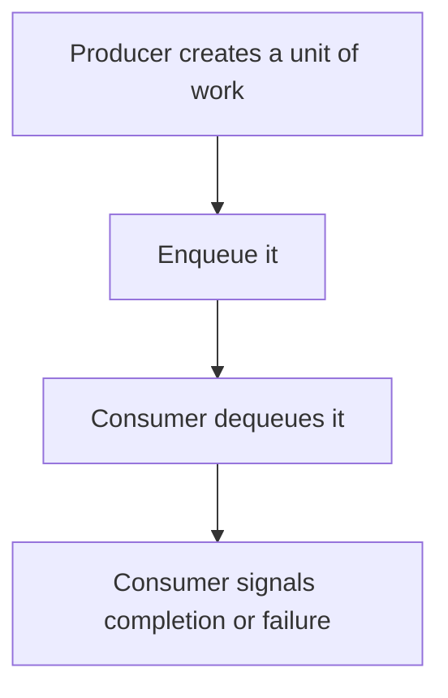

# D13-T010 — Producer-consumer pattern

Topic ID: `D13-T010`
Domain: Concurrency and Parallel Processing
Subdomain: Producer-consumer pattern
Importance: core
Complexity: advanced
Dependencies: `D13-T009`, `D13-T001`, `D01-T001`, `D01-T002`, `D03-T001`, `D03-T002`
Execution status of the code in section F: unexecuted

## A. Topic Overview

The producer-consumer pattern separates work creation from work execution through a queue. Producers enqueue. Consumers dequeue. The queue is the synchronization point. An unbounded queue hides a slow consumer until memory dies. Closing the queue is a signal that no more work is coming, and consumers must exit after draining.

In production this shows up as follows: A web request validates quickly and enqueues an email job. Worker processes consume the queue. When the queue age exceeds a minute, the API starts rejecting new jobs instead of pretending they will send.

Interviewers use Producer-consumer pattern to see whether you can state the failure mode, not only the definition. The failure to name is: an unbounded queue that grows until the process is killed, or a consumer that exits and leaves the queue unowned

Prerequisites: `D13-T009`, `D13-T001`, `D01-T001`, `D01-T002`, `D03-T001`, `D03-T002`. Later notes should link here instead of repeating the mechanism.

## B. First-Principles Explanation

The producer-consumer pattern separates work creation from work execution through a queue. Producers enqueue. Consumers dequeue. The queue is the synchronization point. An unbounded queue hides a slow consumer until memory dies. Closing the queue is a signal that no more work is coming, and consumers must exit after draining.

The useful picture is: Producers are cooks. Consumers are servers. The pass is the queue. If the pass has no limit, plates hit the floor as a pile, not as a handoff.

What has to be true:

1. Producer creates a unit of work
2. Enqueue it
3. Consumer dequeues it
4. Consumer signals completion or failure

It works when those steps preserve one invariant. It fails when an unbounded queue that grows until the process is killed, or a consumer that exits and leaves the queue unowned. The alternative is: the work is so small that the queue costs more than doing it inline

## C. Internal Working and Architecture

Components involved: the caller, the state Producer-consumer pattern mutates or reads, and the observer that reports queue depth and the age of the oldest item.

Execution:

1. Producer creates a unit of work
2. Enqueue it
3. Consumer dequeues it
4. Consumer signals completion or failure

Data moves only along that path. A retry re-enters at step 1, so the operation must say what a duplicate does. Memory and locks stay inside this mechanism. Callers see the result or a typed error, not a half-updated invariant.

State to remember: choose this when creation and execution have different speeds or lifetimes. Do not choose it when the work is so small that the queue costs more than doing it inline.

## D. Diagrams and Visual Models



Read the diagram from top to bottom. Each box is one step of Producer-consumer pattern. The failure mode (an unbounded queue that grows until the process is killed, or a consumer that exits and leaves the queue unowned) is what you look for when a later box never happens or happens twice.

## E. Examples and Analogies

Analogy: Producers are cooks. Consumers are servers. The pass is the queue. If the pass has no limit, plates hit the floor as a pile, not as a handoff.

Production example: A web request validates quickly and enqueues an email job. Worker processes consume the queue. When the queue age exceeds a minute, the API starts rejecting new jobs instead of pretending they will send.

A small counterexample is enough in an interview. Show the input, apply the steps, and show the broken outcome if someone uses the mechanism outside its rule: an unbounded queue that grows until the process is killed, or a consumer that exits and leaves the queue unowned.

## F. Code Examples

The snippet is labeled unexecuted. It illustrates the shape of the idea. It is not a benchmark and it embeds no secret.

```python
import queue
q = queue.Queue(maxsize=100)

def produce(item):
    q.put(item, timeout=1)
```

After the snippet, check queue depth and the age of the oldest item. If that signal moves the wrong way, the snippet is the wrong tool for the workload.

## G. Practical Backend Application

Use Producer-consumer pattern in a service when creation and execution have different speeds or lifetimes.

A typical place is the production case already stated: A web request validates quickly and enqueues an email job. Worker processes consume the queue. When the queue age exceeds a minute, the API starts rejecting new jobs instead of pretending they will send.

Operationally you alert on queue depth and the age of the oldest item. You do not alert only on process uptime. The dashboard should show the failure mode, a success rate, and the saturation signal (queue depth, lock wait, or latency) that predicts it.

## H. Advantages, Limitations and Trade-offs

| Choice | Benefit | Cost | Choose when | Avoid when |
| --- | --- | --- | --- | --- |
| Apply Producer-consumer pattern | creation and execution have different speeds or lifetimes | Extra moving parts and a new failure mode | The failure you are preventing is already real | the work is so small that the queue costs more than doing it inline |
| Simpler alternative | Less code and fewer dependencies | an unbounded queue that grows until the process is killed, or a consumer that exits and leaves the queue unowned | The workload does not hit the limit | The invariant must hold under concurrency or failure |

Producer-consumer pattern is a trade. State the benefit and the cost in the same sentence when you propose it in a design review.

## I. Common Mistakes and Misconceptions

- An unbounded queue.
- No poison-message handling.
- Assuming the enqueue is the same as the work being done.
- Treating a diagram of Producer-consumer pattern as proof that the invariant holds in production.
- Copying a default configuration without naming queue depth and the age of the oldest item.

## J. Debugging and Troubleshooting

Symptom: an unbounded queue that grows until the process is killed, or a consumer that exits and leaves the queue unowned

First check: queue depth and the age of the oldest item.

Then compare one healthy instance against one unhealthy instance. Confirm whether retries are duplicating work. Confirm whether a timeout is shorter than the work. Fix the invariant, then watch the same metric for a full peak, not only for the next minute.

Useful questions: did the step order in section C actually happen, or did a caller skip a step? Did a deploy change the data shape that Producer-consumer pattern assumes?

## K. Interview Preparation

### Beginner

#### Q1. What problem does Producer-consumer pattern solve?

**Answer:** The producer-consumer pattern separates work creation from work execution through a queue. Producers enqueue. Consumers dequeue. The queue is the synchronization point. An unbounded queue hides a slow consumer until memory dies. Closing the queue is a signal that no more work is coming, and consumers must exit after draining. Without it, the usual backend failure is: an unbounded queue that grows until the process is killed, or a consumer that exits and leaves the queue unowned.

#### Q2. Where does Producer-consumer pattern sit on a request path?

**Answer:** Producer-consumer pattern is not a library you sprinkle on every call. creation and execution have different speeds or lifetimes You notice it when queue depth and the age of the oldest item. Name the constraint that makes this choice correct. Say what you would measure to confirm it.

#### Q3. Give a concrete example of Producer-consumer pattern.

**Answer:** A web request validates quickly and enqueues an email job. Worker processes consume the queue. When the queue age exceeds a minute, the API starts rejecting new jobs instead of pretending they will send. Walk the input, the state change, and the observable output.

#### Q4. What is a common mix-up around Producer-consumer pattern?

**Answer:** an unbounded queue that grows until the process is killed, or a consumer that exits and leaves the queue unowned The corrective check is queue depth and the age of the oldest item. Name the constraint that makes this choice correct. Say what you would measure to confirm it. Say which alternative you rejected and why.

#### Q5. When would you skip Producer-consumer pattern?

**Answer:** the work is so small that the queue costs more than doing it inline Skipping is a decision with a measured cost, not a slogan. Name the constraint that makes this choice correct. Say what you would measure to confirm it. Say which alternative you rejected and why.

### Intermediate

#### Q1. What invariant makes Producer-consumer pattern correct?

**Answer:** The producer-consumer pattern separates work creation from work execution through a queue. Producers enqueue. Consumers dequeue. The queue is the synchronization point. An unbounded queue hides a slow consumer until memory dies. Closing the queue is a signal that no more work is coming, and consumers must exit after draining. State the invariant before you name the tool.

#### Q2. How do you test Producer-consumer pattern?

**Answer:** Assert the failure mode directly: an unbounded queue that grows until the process is killed, or a consumer that exits and leaves the queue unowned. The assertion should watch queue depth and the age of the oldest item. Include a concurrent or retry case if the bug only appears then. Name the constraint that makes this choice correct.

#### Q3. What signal tells you Producer-consumer pattern is misbehaving in production?

**Answer:** Watch queue depth and the age of the oldest item. The user-visible symptom is usually an unbounded queue that grows until the process is killed, or a consumer that exits and leaves the queue unowned. Name the constraint that makes this choice correct. Say what you would measure to confirm it.

#### Q4. How would you introduce Producer-consumer pattern into a legacy service?

**Answer:** creation and execution have different speeds or lifetimes Ship it behind a metric so you can compare the old path. Roll back if an unbounded queue that grows until the process is killed, or a consumer that exits and leaves the queue unowned gets worse. Name the constraint that makes this choice correct. Say what you would measure to confirm it.

#### Q5. What do you trade away by choosing Producer-consumer pattern?

**Answer:** creation and execution have different speeds or lifetimes the work is so small that the queue costs more than doing it inline Say the cost in latency, storage, or operational load. Name the constraint that makes this choice correct. Say what you would measure to confirm it. Say which alternative you rejected and why.

### Advanced

#### Q1. What breaks if a dependency of Producer-consumer pattern is slow or down?

**Answer:** an unbounded queue that grows until the process is killed, or a consumer that exits and leaves the queue unowned Degrade using the rule: the work is so small that the queue costs more than doing it inline. Timeouts must be shorter than the caller's deadline. Name the constraint that makes this choice correct. Say what you would measure to confirm it.

#### Q2. How does Producer-consumer pattern behave under retries?

**Answer:** Retries repeat work, so Producer-consumer pattern must define what a duplicate does. an unbounded queue that grows until the process is killed, or a consumer that exits and leaves the queue unowned Idempotency keys or fences belong next to the write, not in a comment. Name the constraint that makes this choice correct. Say what you would measure to confirm it.

#### Q3. What is the capacity limit of Producer-consumer pattern?

**Answer:** The limit shows up as queue depth and the age of the oldest item. Add capacity only after you know whether the bottleneck is CPU, lock wait, or network. Name the constraint that makes this choice correct. Say what you would measure to confirm it.

#### Q4. How do you evolve Producer-consumer pattern without a flag day?

**Answer:** creation and execution have different speeds or lifetimes Version the contract or the on-disk format. Readers should tolerate one old and one new shape during the rollout. Name the constraint that makes this choice correct. Say what you would measure to confirm it.

#### Q5. What security or correctness bug hides inside Producer-consumer pattern?

**Answer:** an unbounded queue that grows until the process is killed, or a consumer that exits and leaves the queue unowned Check authorization and tenancy at the same boundary as the mechanism. A cache or queue must not widen who can read the data. Name the constraint that makes this choice correct. Say what you would measure to confirm it.

### Scenario

#### Q1. Incident: an unbounded queue that grows until the process is killed, or a consumer that exits and leaves the queue unowned. What do you check first?

**Answer:** Start with queue depth and the age of the oldest item. Compare a good host and a bad host before you restart anything. The producer-consumer pattern separates work creation from work execution through a queue. Producers enqueue. Consumers dequeue. The queue is the synchronization point. An unbounded queue hides a slow consumer until memory dies. Closing the queue is a signal that no more work is coming, and consumers must exit after draining.

#### Q2. A reviewer wants the clever version. What data settles it?

**Answer:** creation and execution have different speeds or lifetimes the work is so small that the queue costs more than doing it inline Bring queue depth and the age of the oldest item from a load test or from production, not a slogan. Name the constraint that makes this choice correct. Say what you would measure to confirm it. Say which alternative you rejected and why.

#### Q3. You have one hour to explain Producer-consumer pattern at a whiteboard.

**Answer:** Draw the happy path in four boxes. Then draw the failure: an unbounded queue that grows until the process is killed, or a consumer that exits and leaves the queue unowned. End with the metric you would page on. Name the constraint that makes this choice correct.

#### Q4. The bug only appears under two concurrent callers.

**Answer:** an unbounded queue that grows until the process is killed, or a consumer that exits and leaves the queue unowned Reproduce with a barrier so both sides enter the critical window. Confirm the fix with queue depth and the age of the oldest item. Name the constraint that makes this choice correct. Say what you would measure to confirm it.

#### Q5. Leadership wants this on every service next week.

**Answer:** the work is so small that the queue costs more than doing it inline creation and execution have different speeds or lifetimes Roll it out where the failure mode is already hurting users. Name the constraint that makes this choice correct. Say what you would measure to confirm it. Say which alternative you rejected and why.

### Follow-up

#### Q1. What did you assume about the data size or the clock?

**Answer:** The producer-consumer pattern separates work creation from work execution through a queue. Producers enqueue. Consumers dequeue. The queue is the synchronization point. An unbounded queue hides a slow consumer until memory dies. Closing the queue is a signal that no more work is coming, and consumers must exit after draining. Clocks are not a total order across machines. State whether the algorithm needs bounded size or a single leader.

#### Q2. What would you measure after the change ships?

**Answer:** Page on queue depth and the age of the oldest item. Keep a before/after dashboard for one week. Alert on the failure mode, not only on CPU. Name the constraint that makes this choice correct.

#### Q3. Which neighboring topic did you deliberately not re-teach?

**Answer:** This note owns Producer-consumer pattern. Related identifiers are in section N. Shared ideas are linked, not copied. Name the constraint that makes this choice correct.

## L. Practical Exercises

Solutions are in `EXERCISES/solutions/D13-T010.md`, not in this section.

1. Whiteboard the four steps of Producer-consumer pattern and mark where `an unbounded queue that grows until the process is killed, or a consumer that exits and leaves the queue unowned` enters.
2. Read the snippet in section F and write the assertion that would catch that failure. The assertion must mention `queue depth and the age of the oldest item`.
3. Argue for or against using Producer-consumer pattern on a service you know. Use the choose and avoid rows from section H. Do not appeal to popularity.

## M. Revision Notes

- Mechanism: The producer-consumer pattern separates work creation from work execution through a queue.
- Failure: an unbounded queue that grows until the process is killed, or a consumer that exits and leaves the queue unowned
- Metric: queue depth and the age of the oldest item
- Choose when: creation and execution have different speeds or lifetimes
- Avoid when: the work is so small that the queue costs more than doing it inline

## N. Related Topics

Dependencies to review first: `D13-T009`, `D13-T001`, `D01-T001`, `D01-T002`, `D03-T001`, `D03-T002`.

Shared ideas stay in those notes. This note does not restate them.

## O. Completion Criteria

- You can explain Producer-consumer pattern without reading this note, including the failure mode.
- You can draw the diagram in section D from memory.
- You can say when not to use it, using the avoid condition in section H.
- You can name the metric you would watch after shipping it.
