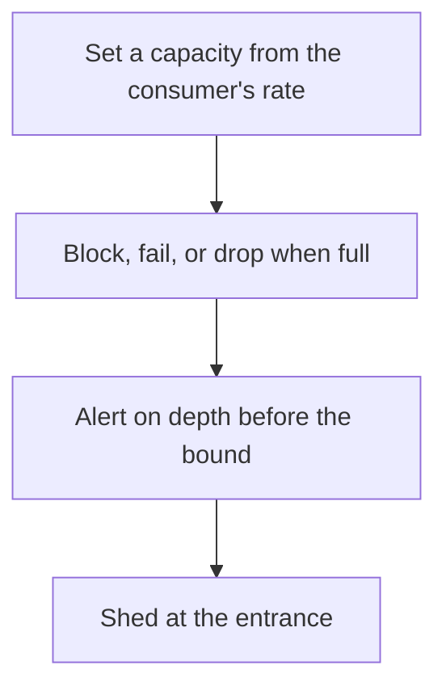

# D13-T011 — Bounded queues and backpressure

Topic ID: `D13-T011`
Domain: Concurrency and Parallel Processing
Subdomain: Bounded queues and backpressure
Importance: core
Complexity: advanced
Dependencies: `D13-T010`, `D13-T001`, `D01-T001`, `D01-T002`, `D03-T001`, `D03-T002`
Execution status of the code in section F: unexecuted

## A. Topic Overview

A bounded queue has a fixed capacity. When it is full, a producer blocks, fails, or drops, which is backpressure. Backpressure pushes the overload to the edge that can say no, instead of letting it pile up in memory. The bound is part of the SLO. A timeout on put tells the caller the system is saturated.

In production this shows up as follows: An API puts jobs on a queue of 1,000. When the offer fails, it returns 429. Callers retry. The worker pool stays at a size the database can handle.

Interviewers use Bounded queues and backpressure to see whether you can state the failure mode, not only the definition. The failure to name is: a full queue whose producers block forever and stall request threads, or a drop policy that loses the one message you needed

Prerequisites: `D13-T010`, `D13-T001`, `D01-T001`, `D01-T002`, `D03-T001`, `D03-T002`. Later notes should link here instead of repeating the mechanism.

## B. First-Principles Explanation

A bounded queue has a fixed capacity. When it is full, a producer blocks, fails, or drops, which is backpressure. Backpressure pushes the overload to the edge that can say no, instead of letting it pile up in memory. The bound is part of the SLO. A timeout on put tells the caller the system is saturated.

The useful picture is: A bounded queue is a restaurant that stops seating when every table is full. Backpressure is the host saying 'not tonight' instead of stacking guests in the kitchen.

What has to be true:

1. Set a capacity from the consumer's rate
2. Block, fail, or drop when full
3. Alert on depth before the bound
4. Shed at the entrance

It works when those steps preserve one invariant. It fails when a full queue whose producers block forever and stall request threads, or a drop policy that loses the one message you needed. The alternative is: you block request threads on a full queue with no timeout

## C. Internal Working and Architecture

Components involved: the caller, the state Bounded queues and backpressure mutates or reads, and the observer that reports queue depth versus capacity, and the rate of rejected puts.

Execution:

1. Set a capacity from the consumer's rate
2. Block, fail, or drop when full
3. Alert on depth before the bound
4. Shed at the entrance

Data moves only along that path. A retry re-enters at step 1, so the operation must say what a duplicate does. Memory and locks stay inside this mechanism. Callers see the result or a typed error, not a half-updated invariant.

State to remember: choose this when producers can outrun consumers. Do not choose it when you block request threads on a full queue with no timeout.

## D. Diagrams and Visual Models



Read the diagram from top to bottom. Each box is one step of Bounded queues and backpressure. The failure mode (a full queue whose producers block forever and stall request threads, or a drop policy that loses the one message you needed) is what you look for when a later box never happens or happens twice.

## E. Examples and Analogies

Analogy: A bounded queue is a restaurant that stops seating when every table is full. Backpressure is the host saying 'not tonight' instead of stacking guests in the kitchen.

Production example: An API puts jobs on a queue of 1,000. When the offer fails, it returns 429. Callers retry. The worker pool stays at a size the database can handle.

A small counterexample is enough in an interview. Show the input, apply the steps, and show the broken outcome if someone uses the mechanism outside its rule: a full queue whose producers block forever and stall request threads, or a drop policy that loses the one message you needed.

## F. Code Examples

The snippet is labeled unexecuted. It illustrates the shape of the idea. It is not a benchmark and it embeds no secret.

```python
def offer(q, item, capacity):
    if len(q) >= capacity:
        return False
    q.append(item)
    return True
```

After the snippet, check queue depth versus capacity, and the rate of rejected puts. If that signal moves the wrong way, the snippet is the wrong tool for the workload.

## G. Practical Backend Application

Use Bounded queues and backpressure in a service when producers can outrun consumers.

A typical place is the production case already stated: An API puts jobs on a queue of 1,000. When the offer fails, it returns 429. Callers retry. The worker pool stays at a size the database can handle.

Operationally you alert on queue depth versus capacity, and the rate of rejected puts. You do not alert only on process uptime. The dashboard should show the failure mode, a success rate, and the saturation signal (queue depth, lock wait, or latency) that predicts it.

## H. Advantages, Limitations and Trade-offs

| Choice | Benefit | Cost | Choose when | Avoid when |
| --- | --- | --- | --- | --- |
| Apply Bounded queues and backpressure | producers can outrun consumers | Extra moving parts and a new failure mode | The failure you are preventing is already real | you block request threads on a full queue with no timeout |
| Simpler alternative | Less code and fewer dependencies | a full queue whose producers block forever and stall request threads, or a drop policy that loses the one message you needed | The workload does not hit the limit | The invariant must hold under concurrency or failure |

Bounded queues and backpressure is a trade. State the benefit and the cost in the same sentence when you propose it in a design review.

## I. Common Mistakes and Misconceptions

- An infinite buffer called a safety net.
- Dropping payments.
- No metric on depth.
- Treating a diagram of Bounded queues and backpressure as proof that the invariant holds in production.
- Copying a default configuration without naming queue depth versus capacity, and the rate of rejected puts.

## J. Debugging and Troubleshooting

Symptom: a full queue whose producers block forever and stall request threads, or a drop policy that loses the one message you needed

First check: queue depth versus capacity, and the rate of rejected puts.

Then compare one healthy instance against one unhealthy instance. Confirm whether retries are duplicating work. Confirm whether a timeout is shorter than the work. Fix the invariant, then watch the same metric for a full peak, not only for the next minute.

Useful questions: did the step order in section C actually happen, or did a caller skip a step? Did a deploy change the data shape that Bounded queues and backpressure assumes?

## K. Interview Preparation

### Beginner

#### Q1. What problem does Bounded queues and backpressure solve?

**Answer:** A bounded queue has a fixed capacity. When it is full, a producer blocks, fails, or drops, which is backpressure. Backpressure pushes the overload to the edge that can say no, instead of letting it pile up in memory. The bound is part of the SLO. A timeout on put tells the caller the system is saturated. Without it, the usual backend failure is: a full queue whose producers block forever and stall request threads, or a drop policy that loses the one message you needed.

#### Q2. Where does Bounded queues and backpressure sit on a request path?

**Answer:** Bounded queues and backpressure is not a library you sprinkle on every call. producers can outrun consumers You notice it when queue depth versus capacity, and the rate of rejected puts. Name the constraint that makes this choice correct. Say what you would measure to confirm it.

#### Q3. Give a concrete example of Bounded queues and backpressure.

**Answer:** An API puts jobs on a queue of 1,000. When the offer fails, it returns 429. Callers retry. The worker pool stays at a size the database can handle. Walk the input, the state change, and the observable output.

#### Q4. What is a common mix-up around Bounded queues and backpressure?

**Answer:** a full queue whose producers block forever and stall request threads, or a drop policy that loses the one message you needed The corrective check is queue depth versus capacity, and the rate of rejected puts. Name the constraint that makes this choice correct. Say what you would measure to confirm it. Say which alternative you rejected and why.

#### Q5. When would you skip Bounded queues and backpressure?

**Answer:** you block request threads on a full queue with no timeout Skipping is a decision with a measured cost, not a slogan. Name the constraint that makes this choice correct. Say what you would measure to confirm it. Say which alternative you rejected and why.

### Intermediate

#### Q1. What invariant makes Bounded queues and backpressure correct?

**Answer:** A bounded queue has a fixed capacity. When it is full, a producer blocks, fails, or drops, which is backpressure. Backpressure pushes the overload to the edge that can say no, instead of letting it pile up in memory. The bound is part of the SLO. A timeout on put tells the caller the system is saturated. State the invariant before you name the tool.

#### Q2. How do you test Bounded queues and backpressure?

**Answer:** Assert the failure mode directly: a full queue whose producers block forever and stall request threads, or a drop policy that loses the one message you needed. The assertion should watch queue depth versus capacity, and the rate of rejected puts. Include a concurrent or retry case if the bug only appears then. Name the constraint that makes this choice correct.

#### Q3. What signal tells you Bounded queues and backpressure is misbehaving in production?

**Answer:** Watch queue depth versus capacity, and the rate of rejected puts. The user-visible symptom is usually a full queue whose producers block forever and stall request threads, or a drop policy that loses the one message you needed. Name the constraint that makes this choice correct. Say what you would measure to confirm it.

#### Q4. How would you introduce Bounded queues and backpressure into a legacy service?

**Answer:** producers can outrun consumers Ship it behind a metric so you can compare the old path. Roll back if a full queue whose producers block forever and stall request threads, or a drop policy that loses the one message you needed gets worse. Name the constraint that makes this choice correct. Say what you would measure to confirm it.

#### Q5. What do you trade away by choosing Bounded queues and backpressure?

**Answer:** producers can outrun consumers you block request threads on a full queue with no timeout Say the cost in latency, storage, or operational load. Name the constraint that makes this choice correct. Say what you would measure to confirm it. Say which alternative you rejected and why.

### Advanced

#### Q1. What breaks if a dependency of Bounded queues and backpressure is slow or down?

**Answer:** a full queue whose producers block forever and stall request threads, or a drop policy that loses the one message you needed Degrade using the rule: you block request threads on a full queue with no timeout. Timeouts must be shorter than the caller's deadline. Name the constraint that makes this choice correct. Say what you would measure to confirm it.

#### Q2. How does Bounded queues and backpressure behave under retries?

**Answer:** Retries repeat work, so Bounded queues and backpressure must define what a duplicate does. a full queue whose producers block forever and stall request threads, or a drop policy that loses the one message you needed Idempotency keys or fences belong next to the write, not in a comment. Name the constraint that makes this choice correct. Say what you would measure to confirm it.

#### Q3. What is the capacity limit of Bounded queues and backpressure?

**Answer:** The limit shows up as queue depth versus capacity, and the rate of rejected puts. Add capacity only after you know whether the bottleneck is CPU, lock wait, or network. Name the constraint that makes this choice correct. Say what you would measure to confirm it.

#### Q4. How do you evolve Bounded queues and backpressure without a flag day?

**Answer:** producers can outrun consumers Version the contract or the on-disk format. Readers should tolerate one old and one new shape during the rollout. Name the constraint that makes this choice correct. Say what you would measure to confirm it.

#### Q5. What security or correctness bug hides inside Bounded queues and backpressure?

**Answer:** a full queue whose producers block forever and stall request threads, or a drop policy that loses the one message you needed Check authorization and tenancy at the same boundary as the mechanism. A cache or queue must not widen who can read the data. Name the constraint that makes this choice correct. Say what you would measure to confirm it.

### Scenario

#### Q1. Incident: a full queue whose producers block forever and stall request threads, or a drop policy that loses the one message you needed. What do you check first?

**Answer:** Start with queue depth versus capacity, and the rate of rejected puts. Compare a good host and a bad host before you restart anything. A bounded queue has a fixed capacity. When it is full, a producer blocks, fails, or drops, which is backpressure. Backpressure pushes the overload to the edge that can say no, instead of letting it pile up in memory. The bound is part of the SLO. A timeout on put tells the caller the system is saturated.

#### Q2. A reviewer wants the clever version. What data settles it?

**Answer:** producers can outrun consumers you block request threads on a full queue with no timeout Bring queue depth versus capacity, and the rate of rejected puts from a load test or from production, not a slogan. Name the constraint that makes this choice correct. Say what you would measure to confirm it. Say which alternative you rejected and why.

#### Q3. You have one hour to explain Bounded queues and backpressure at a whiteboard.

**Answer:** Draw the happy path in four boxes. Then draw the failure: a full queue whose producers block forever and stall request threads, or a drop policy that loses the one message you needed. End with the metric you would page on. Name the constraint that makes this choice correct.

#### Q4. The bug only appears under two concurrent callers.

**Answer:** a full queue whose producers block forever and stall request threads, or a drop policy that loses the one message you needed Reproduce with a barrier so both sides enter the critical window. Confirm the fix with queue depth versus capacity, and the rate of rejected puts. Name the constraint that makes this choice correct. Say what you would measure to confirm it.

#### Q5. Leadership wants this on every service next week.

**Answer:** you block request threads on a full queue with no timeout producers can outrun consumers Roll it out where the failure mode is already hurting users. Name the constraint that makes this choice correct. Say what you would measure to confirm it. Say which alternative you rejected and why.

### Follow-up

#### Q1. What did you assume about the data size or the clock?

**Answer:** A bounded queue has a fixed capacity. When it is full, a producer blocks, fails, or drops, which is backpressure. Backpressure pushes the overload to the edge that can say no, instead of letting it pile up in memory. The bound is part of the SLO. A timeout on put tells the caller the system is saturated. Clocks are not a total order across machines. State whether the algorithm needs bounded size or a single leader.

#### Q2. What would you measure after the change ships?

**Answer:** Page on queue depth versus capacity, and the rate of rejected puts. Keep a before/after dashboard for one week. Alert on the failure mode, not only on CPU. Name the constraint that makes this choice correct.

#### Q3. Which neighboring topic did you deliberately not re-teach?

**Answer:** This note owns Bounded queues and backpressure. Related identifiers are in section N. Shared ideas are linked, not copied. Name the constraint that makes this choice correct.

## L. Practical Exercises

Solutions are in `EXERCISES/solutions/D13-T011.md`, not in this section.

1. Whiteboard the four steps of Bounded queues and backpressure and mark where `a full queue whose producers block forever and stall request threads, or a drop policy that loses the one message you needed` enters.
2. Read the snippet in section F and write the assertion that would catch that failure. The assertion must mention `queue depth versus capacity, and the rate of rejected puts`.
3. Argue for or against using Bounded queues and backpressure on a service you know. Use the choose and avoid rows from section H. Do not appeal to popularity.

## M. Revision Notes

- Mechanism: A bounded queue has a fixed capacity.
- Failure: a full queue whose producers block forever and stall request threads, or a drop policy that loses the one message you needed
- Metric: queue depth versus capacity, and the rate of rejected puts
- Choose when: producers can outrun consumers
- Avoid when: you block request threads on a full queue with no timeout

## N. Related Topics

Dependencies to review first: `D13-T010`, `D13-T001`, `D01-T001`, `D01-T002`, `D03-T001`, `D03-T002`.

Shared ideas stay in those notes. This note does not restate them.

## O. Completion Criteria

- You can explain Bounded queues and backpressure without reading this note, including the failure mode.
- You can draw the diagram in section D from memory.
- You can say when not to use it, using the avoid condition in section H.
- You can name the metric you would watch after shipping it.
