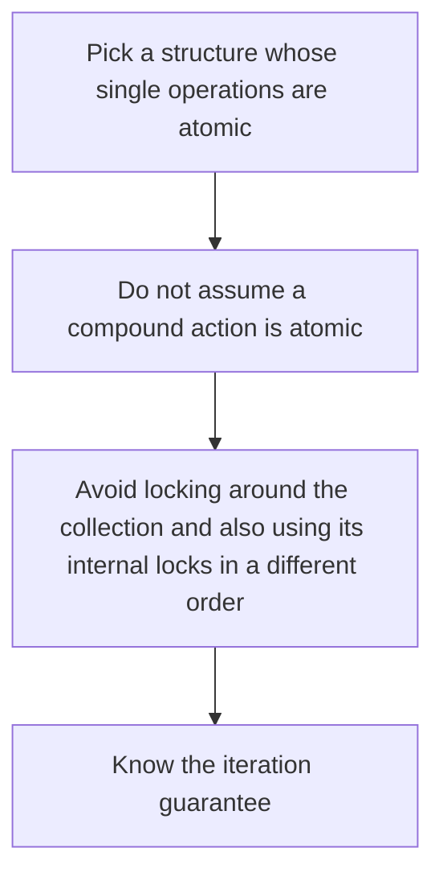

# D13-T012 — Concurrent collections

Topic ID: `D13-T012`
Domain: Concurrency and Parallel Processing
Subdomain: Concurrent collections
Importance: core
Complexity: advanced
Dependencies: `D13-T011`, `D13-T001`, `D01-T001`, `D01-T002`, `D03-T001`, `D03-T002`
Execution status of the code in section F: unexecuted

## A. Topic Overview

Concurrent collections provide atomic operations on a data structure so callers do not wrap every access in the same coarse lock. A concurrent hash map can update one key without locking the whole map. Iteration may be weakly consistent and miss or duplicate an entry that is updated mid-scan. They do not make a compound check-then-act atomic. Size is approximate on some implementations.

In production this shows up as follows: A request deduplicator uses put-if-absent on an idempotency key. Two separate calls, contains then put, both create the charge. One atomic put-if-absent does not.

Interviewers use Concurrent collections to see whether you can state the failure mode, not only the definition. The failure to name is: a check-then-put that two threads both pass, or a deadlock between the collection lock and an external lock

Prerequisites: `D13-T011`, `D13-T001`, `D01-T001`, `D01-T002`, `D03-T001`, `D03-T002`. Later notes should link here instead of repeating the mechanism.

## B. First-Principles Explanation

Concurrent collections provide atomic operations on a data structure so callers do not wrap every access in the same coarse lock. A concurrent hash map can update one key without locking the whole map. Iteration may be weakly consistent and miss or duplicate an entry that is updated mid-scan. They do not make a compound check-then-act atomic. Size is approximate on some implementations.

The useful picture is: A concurrent map is a set of drawers that each close individually. Looking in a drawer and then deciding to fill it is two actions, and someone else can slip a folder in between.

What has to be true:

1. Pick a structure whose single operations are atomic
2. Do not assume a compound action is atomic
3. Avoid locking around the collection and also using its internal locks in a different order
4. Know the iteration guarantee

It works when those steps preserve one invariant. It fails when a check-then-put that two threads both pass, or a deadlock between the collection lock and an external lock. The alternative is: the invariant covers two keys or a check followed by an action

## C. Internal Working and Architecture

Components involved: the caller, the state Concurrent collections mutates or reads, and the observer that reports lost updates in a stress test of a compound action, and lock-order deadlocks.

Execution:

1. Pick a structure whose single operations are atomic
2. Do not assume a compound action is atomic
3. Avoid locking around the collection and also using its internal locks in a different order
4. Know the iteration guarantee

Data moves only along that path. A retry re-enters at step 1, so the operation must say what a duplicate does. Memory and locks stay inside this mechanism. Callers see the result or a typed error, not a half-updated invariant.

State to remember: choose this when many keys are updated by different threads and each update is one operation. Do not choose it when the invariant covers two keys or a check followed by an action.

## D. Diagrams and Visual Models



Read the diagram from top to bottom. Each box is one step of Concurrent collections. The failure mode (a check-then-put that two threads both pass, or a deadlock between the collection lock and an external lock) is what you look for when a later box never happens or happens twice.

## E. Examples and Analogies

Analogy: A concurrent map is a set of drawers that each close individually. Looking in a drawer and then deciding to fill it is two actions, and someone else can slip a folder in between.

Production example: A request deduplicator uses put-if-absent on an idempotency key. Two separate calls, contains then put, both create the charge. One atomic put-if-absent does not.

A small counterexample is enough in an interview. Show the input, apply the steps, and show the broken outcome if someone uses the mechanism outside its rule: a check-then-put that two threads both pass, or a deadlock between the collection lock and an external lock.

## F. Code Examples

The snippet is labeled unexecuted. It illustrates the shape of the idea. It is not a benchmark and it embeds no secret.

```python
box = {}
lock = __import__('threading').Lock()

def put_if_absent(key, value):
    with lock:
        if key not in box:
            box[key] = value
            return True
        return False
```

After the snippet, check lost updates in a stress test of a compound action, and lock-order deadlocks. If that signal moves the wrong way, the snippet is the wrong tool for the workload.

## G. Practical Backend Application

Use Concurrent collections in a service when many keys are updated by different threads and each update is one operation.

A typical place is the production case already stated: A request deduplicator uses put-if-absent on an idempotency key. Two separate calls, contains then put, both create the charge. One atomic put-if-absent does not.

Operationally you alert on lost updates in a stress test of a compound action, and lock-order deadlocks. You do not alert only on process uptime. The dashboard should show the failure mode, a success rate, and the saturation signal (queue depth, lock wait, or latency) that predicts it.

## H. Advantages, Limitations and Trade-offs

| Choice | Benefit | Cost | Choose when | Avoid when |
| --- | --- | --- | --- | --- |
| Apply Concurrent collections | many keys are updated by different threads and each update is one operation | Extra moving parts and a new failure mode | The failure you are preventing is already real | the invariant covers two keys or a check followed by an action |
| Simpler alternative | Less code and fewer dependencies | a check-then-put that two threads both pass, or a deadlock between the collection lock and an external lock | The workload does not hit the limit | The invariant must hold under concurrency or failure |

Concurrent collections is a trade. State the benefit and the cost in the same sentence when you propose it in a design review.

## I. Common Mistakes and Misconceptions

- Assuming iteration locks a snapshot.
- Coarse-locking a concurrent structure and deadlocking.
- Using a plain dict from many threads.
- Treating a diagram of Concurrent collections as proof that the invariant holds in production.
- Copying a default configuration without naming lost updates in a stress test of a compound action, and lock-order deadlocks.

## J. Debugging and Troubleshooting

Symptom: a check-then-put that two threads both pass, or a deadlock between the collection lock and an external lock

First check: lost updates in a stress test of a compound action, and lock-order deadlocks.

Then compare one healthy instance against one unhealthy instance. Confirm whether retries are duplicating work. Confirm whether a timeout is shorter than the work. Fix the invariant, then watch the same metric for a full peak, not only for the next minute.

Useful questions: did the step order in section C actually happen, or did a caller skip a step? Did a deploy change the data shape that Concurrent collections assumes?

## K. Interview Preparation

### Beginner

#### Q1. What problem does Concurrent collections solve?

**Answer:** Concurrent collections provide atomic operations on a data structure so callers do not wrap every access in the same coarse lock. A concurrent hash map can update one key without locking the whole map. Iteration may be weakly consistent and miss or duplicate an entry that is updated mid-scan. They do not make a compound check-then-act atomic. Size is approximate on some implementations. Without it, the usual backend failure is: a check-then-put that two threads both pass, or a deadlock between the collection lock and an external lock.

#### Q2. Where does Concurrent collections sit on a request path?

**Answer:** Concurrent collections is not a library you sprinkle on every call. many keys are updated by different threads and each update is one operation You notice it when lost updates in a stress test of a compound action, and lock-order deadlocks. Name the constraint that makes this choice correct. Say what you would measure to confirm it.

#### Q3. Give a concrete example of Concurrent collections.

**Answer:** A request deduplicator uses put-if-absent on an idempotency key. Two separate calls, contains then put, both create the charge. One atomic put-if-absent does not. Walk the input, the state change, and the observable output.

#### Q4. What is a common mix-up around Concurrent collections?

**Answer:** a check-then-put that two threads both pass, or a deadlock between the collection lock and an external lock The corrective check is lost updates in a stress test of a compound action, and lock-order deadlocks. Name the constraint that makes this choice correct. Say what you would measure to confirm it. Say which alternative you rejected and why.

#### Q5. When would you skip Concurrent collections?

**Answer:** the invariant covers two keys or a check followed by an action Skipping is a decision with a measured cost, not a slogan. Name the constraint that makes this choice correct. Say what you would measure to confirm it. Say which alternative you rejected and why.

### Intermediate

#### Q1. What invariant makes Concurrent collections correct?

**Answer:** Concurrent collections provide atomic operations on a data structure so callers do not wrap every access in the same coarse lock. A concurrent hash map can update one key without locking the whole map. Iteration may be weakly consistent and miss or duplicate an entry that is updated mid-scan. They do not make a compound check-then-act atomic. Size is approximate on some implementations. State the invariant before you name the tool.

#### Q2. How do you test Concurrent collections?

**Answer:** Assert the failure mode directly: a check-then-put that two threads both pass, or a deadlock between the collection lock and an external lock. The assertion should watch lost updates in a stress test of a compound action, and lock-order deadlocks. Include a concurrent or retry case if the bug only appears then. Name the constraint that makes this choice correct.

#### Q3. What signal tells you Concurrent collections is misbehaving in production?

**Answer:** Watch lost updates in a stress test of a compound action, and lock-order deadlocks. The user-visible symptom is usually a check-then-put that two threads both pass, or a deadlock between the collection lock and an external lock. Name the constraint that makes this choice correct. Say what you would measure to confirm it.

#### Q4. How would you introduce Concurrent collections into a legacy service?

**Answer:** many keys are updated by different threads and each update is one operation Ship it behind a metric so you can compare the old path. Roll back if a check-then-put that two threads both pass, or a deadlock between the collection lock and an external lock gets worse. Name the constraint that makes this choice correct. Say what you would measure to confirm it.

#### Q5. What do you trade away by choosing Concurrent collections?

**Answer:** many keys are updated by different threads and each update is one operation the invariant covers two keys or a check followed by an action Say the cost in latency, storage, or operational load. Name the constraint that makes this choice correct. Say what you would measure to confirm it. Say which alternative you rejected and why.

### Advanced

#### Q1. What breaks if a dependency of Concurrent collections is slow or down?

**Answer:** a check-then-put that two threads both pass, or a deadlock between the collection lock and an external lock Degrade using the rule: the invariant covers two keys or a check followed by an action. Timeouts must be shorter than the caller's deadline. Name the constraint that makes this choice correct. Say what you would measure to confirm it.

#### Q2. How does Concurrent collections behave under retries?

**Answer:** Retries repeat work, so Concurrent collections must define what a duplicate does. a check-then-put that two threads both pass, or a deadlock between the collection lock and an external lock Idempotency keys or fences belong next to the write, not in a comment. Name the constraint that makes this choice correct. Say what you would measure to confirm it.

#### Q3. What is the capacity limit of Concurrent collections?

**Answer:** The limit shows up as lost updates in a stress test of a compound action, and lock-order deadlocks. Add capacity only after you know whether the bottleneck is CPU, lock wait, or network. Name the constraint that makes this choice correct. Say what you would measure to confirm it.

#### Q4. How do you evolve Concurrent collections without a flag day?

**Answer:** many keys are updated by different threads and each update is one operation Version the contract or the on-disk format. Readers should tolerate one old and one new shape during the rollout. Name the constraint that makes this choice correct. Say what you would measure to confirm it.

#### Q5. What security or correctness bug hides inside Concurrent collections?

**Answer:** a check-then-put that two threads both pass, or a deadlock between the collection lock and an external lock Check authorization and tenancy at the same boundary as the mechanism. A cache or queue must not widen who can read the data. Name the constraint that makes this choice correct. Say what you would measure to confirm it.

### Scenario

#### Q1. Incident: a check-then-put that two threads both pass, or a deadlock between the collection lock and an external lock. What do you check first?

**Answer:** Start with lost updates in a stress test of a compound action, and lock-order deadlocks. Compare a good host and a bad host before you restart anything. Concurrent collections provide atomic operations on a data structure so callers do not wrap every access in the same coarse lock. A concurrent hash map can update one key without locking the whole map. Iteration may be weakly consistent and miss or duplicate an entry that is updated mid-scan. They do not make a compound check-then-act atomic. Size is approximate on some implementations.

#### Q2. A reviewer wants the clever version. What data settles it?

**Answer:** many keys are updated by different threads and each update is one operation the invariant covers two keys or a check followed by an action Bring lost updates in a stress test of a compound action, and lock-order deadlocks from a load test or from production, not a slogan. Name the constraint that makes this choice correct. Say what you would measure to confirm it. Say which alternative you rejected and why.

#### Q3. You have one hour to explain Concurrent collections at a whiteboard.

**Answer:** Draw the happy path in four boxes. Then draw the failure: a check-then-put that two threads both pass, or a deadlock between the collection lock and an external lock. End with the metric you would page on. Name the constraint that makes this choice correct.

#### Q4. The bug only appears under two concurrent callers.

**Answer:** a check-then-put that two threads both pass, or a deadlock between the collection lock and an external lock Reproduce with a barrier so both sides enter the critical window. Confirm the fix with lost updates in a stress test of a compound action, and lock-order deadlocks. Name the constraint that makes this choice correct. Say what you would measure to confirm it.

#### Q5. Leadership wants this on every service next week.

**Answer:** the invariant covers two keys or a check followed by an action many keys are updated by different threads and each update is one operation Roll it out where the failure mode is already hurting users. Name the constraint that makes this choice correct. Say what you would measure to confirm it. Say which alternative you rejected and why.

### Follow-up

#### Q1. What did you assume about the data size or the clock?

**Answer:** Concurrent collections provide atomic operations on a data structure so callers do not wrap every access in the same coarse lock. A concurrent hash map can update one key without locking the whole map. Iteration may be weakly consistent and miss or duplicate an entry that is updated mid-scan. They do not make a compound check-then-act atomic. Size is approximate on some implementations. Clocks are not a total order across machines. State whether the algorithm needs bounded size or a single leader.

#### Q2. What would you measure after the change ships?

**Answer:** Page on lost updates in a stress test of a compound action, and lock-order deadlocks. Keep a before/after dashboard for one week. Alert on the failure mode, not only on CPU. Name the constraint that makes this choice correct.

#### Q3. Which neighboring topic did you deliberately not re-teach?

**Answer:** This note owns Concurrent collections. Related identifiers are in section N. Shared ideas are linked, not copied. Name the constraint that makes this choice correct.

## L. Practical Exercises

Solutions are in `EXERCISES/solutions/D13-T012.md`, not in this section.

1. Whiteboard the four steps of Concurrent collections and mark where `a check-then-put that two threads both pass, or a deadlock between the collection lock and an external lock` enters.
2. Read the snippet in section F and write the assertion that would catch that failure. The assertion must mention `lost updates in a stress test of a compound action, and lock-order deadlocks`.
3. Argue for or against using Concurrent collections on a service you know. Use the choose and avoid rows from section H. Do not appeal to popularity.

## M. Revision Notes

- Mechanism: Concurrent collections provide atomic operations on a data structure so callers do not wrap every access in the same coarse lock.
- Failure: a check-then-put that two threads both pass, or a deadlock between the collection lock and an external lock
- Metric: lost updates in a stress test of a compound action, and lock-order deadlocks
- Choose when: many keys are updated by different threads and each update is one operation
- Avoid when: the invariant covers two keys or a check followed by an action

## N. Related Topics

Dependencies to review first: `D13-T011`, `D13-T001`, `D01-T001`, `D01-T002`, `D03-T001`, `D03-T002`.

Shared ideas stay in those notes. This note does not restate them.

## O. Completion Criteria

- You can explain Concurrent collections without reading this note, including the failure mode.
- You can draw the diagram in section D from memory.
- You can say when not to use it, using the avoid condition in section H.
- You can name the metric you would watch after shipping it.
