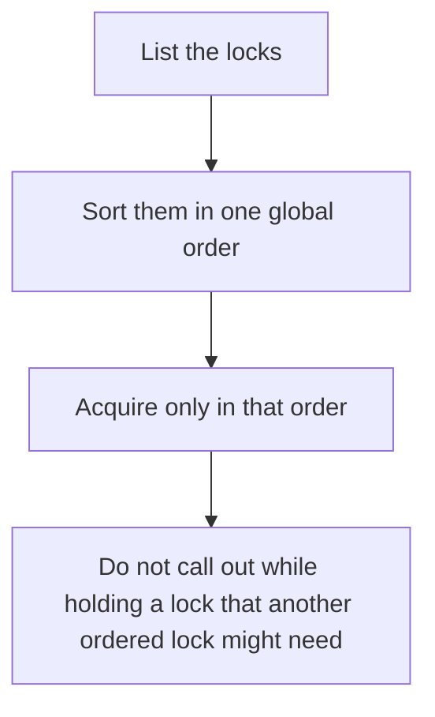

# D13-T013 — Deadlock prevention

Topic ID: `D13-T013`
Domain: Concurrency and Parallel Processing
Subdomain: Deadlock prevention
Importance: core
Complexity: advanced
Dependencies: `D13-T012`, `D13-T001`, `D01-T001`, `D01-T002`, `D03-T001`, `D03-T002`
Execution status of the code in section F: unexecuted

## A. Topic Overview

Deadlock prevention stops a wait cycle from forming. The practical rule is a global lock order: every thread acquires locks in the same sequence. Try-lock with a timeout plus releasing what you hold also prevents a permanent cycle, at the cost of retries. You prevent deadlock by breaking circular wait, not by detecting it after users are stuck. Nested lock acquisition is the moment to audit.

In production this shows up as follows: Account transfers lock the lower account id first. The cycle between A-to-B and B-to-A disappears. A new code path that locks 'the one in the request first' reintroduces it.

Interviewers use Deadlock prevention to see whether you can state the failure mode, not only the definition. The failure to name is: two services locking rows in opposite orders, or a timeout retry that livelocks

Prerequisites: `D13-T012`, `D13-T001`, `D01-T001`, `D01-T002`, `D03-T001`, `D03-T002`. Later notes should link here instead of repeating the mechanism.

## B. First-Principles Explanation

Deadlock prevention stops a wait cycle from forming. The practical rule is a global lock order: every thread acquires locks in the same sequence. Try-lock with a timeout plus releasing what you hold also prevents a permanent cycle, at the cost of retries. You prevent deadlock by breaking circular wait, not by detecting it after users are stuck. Nested lock acquisition is the moment to audit.

The useful picture is: Prevention is everyone agreeing to pick up the left shoe before the right shoe, so nobody is holding the right shoe and waiting for the left.

What has to be true:

1. List the locks
2. Sort them in one global order
3. Acquire only in that order
4. Do not call out while holding a lock that another ordered lock might need

It works when those steps preserve one invariant. It fails when two services locking rows in opposite orders, or a timeout retry that livelocks. The alternative is: you can take one lock, or the database can lock a sorted set of rows in one statement

## C. Internal Working and Architecture

Components involved: the caller, the state Deadlock prevention mutates or reads, and the observer that reports deadlock rollback count and lock-wait timeouts.

Execution:

1. List the locks
2. Sort them in one global order
3. Acquire only in that order
4. Do not call out while holding a lock that another ordered lock might need

Data moves only along that path. A retry re-enters at step 1, so the operation must say what a duplicate does. Memory and locks stay inside this mechanism. Callers see the result or a typed error, not a half-updated invariant.

State to remember: choose this when a thread may hold more than one lock. Do not choose it when you can take one lock, or the database can lock a sorted set of rows in one statement.

## D. Diagrams and Visual Models



Read the diagram from top to bottom. Each box is one step of Deadlock prevention. The failure mode (two services locking rows in opposite orders, or a timeout retry that livelocks) is what you look for when a later box never happens or happens twice.

## E. Examples and Analogies

Analogy: Prevention is everyone agreeing to pick up the left shoe before the right shoe, so nobody is holding the right shoe and waiting for the left.

Production example: Account transfers lock the lower account id first. The cycle between A-to-B and B-to-A disappears. A new code path that locks 'the one in the request first' reintroduces it.

A small counterexample is enough in an interview. Show the input, apply the steps, and show the broken outcome if someone uses the mechanism outside its rule: two services locking rows in opposite orders, or a timeout retry that livelocks.

## F. Code Examples

The snippet is labeled unexecuted. It illustrates the shape of the idea. It is not a benchmark and it embeds no secret.

```python
def order(locks):
    return sorted(locks, key=lambda item: item.name)
```

After the snippet, check deadlock rollback count and lock-wait timeouts. If that signal moves the wrong way, the snippet is the wrong tool for the workload.

## G. Practical Backend Application

Use Deadlock prevention in a service when a thread may hold more than one lock.

A typical place is the production case already stated: Account transfers lock the lower account id first. The cycle between A-to-B and B-to-A disappears. A new code path that locks 'the one in the request first' reintroduces it.

Operationally you alert on deadlock rollback count and lock-wait timeouts. You do not alert only on process uptime. The dashboard should show the failure mode, a success rate, and the saturation signal (queue depth, lock wait, or latency) that predicts it.

## H. Advantages, Limitations and Trade-offs

| Choice | Benefit | Cost | Choose when | Avoid when |
| --- | --- | --- | --- | --- |
| Apply Deadlock prevention | a thread may hold more than one lock | Extra moving parts and a new failure mode | The failure you are preventing is already real | you can take one lock, or the database can lock a sorted set of rows in one statement |
| Simpler alternative | Less code and fewer dependencies | two services locking rows in opposite orders, or a timeout retry that livelocks | The workload does not hit the limit | The invariant must hold under concurrency or failure |

Deadlock prevention is a trade. State the benefit and the cost in the same sentence when you propose it in a design review.

## I. Common Mistakes and Misconceptions

- Detection as the only strategy.
- Lock order that depends on a map's iteration.
- Holding locks across RPC.
- Treating a diagram of Deadlock prevention as proof that the invariant holds in production.
- Copying a default configuration without naming deadlock rollback count and lock-wait timeouts.

## J. Debugging and Troubleshooting

Symptom: two services locking rows in opposite orders, or a timeout retry that livelocks

First check: deadlock rollback count and lock-wait timeouts.

Then compare one healthy instance against one unhealthy instance. Confirm whether retries are duplicating work. Confirm whether a timeout is shorter than the work. Fix the invariant, then watch the same metric for a full peak, not only for the next minute.

Useful questions: did the step order in section C actually happen, or did a caller skip a step? Did a deploy change the data shape that Deadlock prevention assumes?

## K. Interview Preparation

### Beginner

#### Q1. What problem does Deadlock prevention solve?

**Answer:** Deadlock prevention stops a wait cycle from forming. The practical rule is a global lock order: every thread acquires locks in the same sequence. Try-lock with a timeout plus releasing what you hold also prevents a permanent cycle, at the cost of retries. You prevent deadlock by breaking circular wait, not by detecting it after users are stuck. Nested lock acquisition is the moment to audit. Without it, the usual backend failure is: two services locking rows in opposite orders, or a timeout retry that livelocks.

#### Q2. Where does Deadlock prevention sit on a request path?

**Answer:** Deadlock prevention is not a library you sprinkle on every call. a thread may hold more than one lock You notice it when deadlock rollback count and lock-wait timeouts. Name the constraint that makes this choice correct. Say what you would measure to confirm it.

#### Q3. Give a concrete example of Deadlock prevention.

**Answer:** Account transfers lock the lower account id first. The cycle between A-to-B and B-to-A disappears. A new code path that locks 'the one in the request first' reintroduces it. Walk the input, the state change, and the observable output.

#### Q4. What is a common mix-up around Deadlock prevention?

**Answer:** two services locking rows in opposite orders, or a timeout retry that livelocks The corrective check is deadlock rollback count and lock-wait timeouts. Name the constraint that makes this choice correct. Say what you would measure to confirm it. Say which alternative you rejected and why.

#### Q5. When would you skip Deadlock prevention?

**Answer:** you can take one lock, or the database can lock a sorted set of rows in one statement Skipping is a decision with a measured cost, not a slogan. Name the constraint that makes this choice correct. Say what you would measure to confirm it. Say which alternative you rejected and why.

### Intermediate

#### Q1. What invariant makes Deadlock prevention correct?

**Answer:** Deadlock prevention stops a wait cycle from forming. The practical rule is a global lock order: every thread acquires locks in the same sequence. Try-lock with a timeout plus releasing what you hold also prevents a permanent cycle, at the cost of retries. You prevent deadlock by breaking circular wait, not by detecting it after users are stuck. Nested lock acquisition is the moment to audit. State the invariant before you name the tool.

#### Q2. How do you test Deadlock prevention?

**Answer:** Assert the failure mode directly: two services locking rows in opposite orders, or a timeout retry that livelocks. The assertion should watch deadlock rollback count and lock-wait timeouts. Include a concurrent or retry case if the bug only appears then. Name the constraint that makes this choice correct.

#### Q3. What signal tells you Deadlock prevention is misbehaving in production?

**Answer:** Watch deadlock rollback count and lock-wait timeouts. The user-visible symptom is usually two services locking rows in opposite orders, or a timeout retry that livelocks. Name the constraint that makes this choice correct. Say what you would measure to confirm it.

#### Q4. How would you introduce Deadlock prevention into a legacy service?

**Answer:** a thread may hold more than one lock Ship it behind a metric so you can compare the old path. Roll back if two services locking rows in opposite orders, or a timeout retry that livelocks gets worse. Name the constraint that makes this choice correct. Say what you would measure to confirm it.

#### Q5. What do you trade away by choosing Deadlock prevention?

**Answer:** a thread may hold more than one lock you can take one lock, or the database can lock a sorted set of rows in one statement Say the cost in latency, storage, or operational load. Name the constraint that makes this choice correct. Say what you would measure to confirm it. Say which alternative you rejected and why.

### Advanced

#### Q1. What breaks if a dependency of Deadlock prevention is slow or down?

**Answer:** two services locking rows in opposite orders, or a timeout retry that livelocks Degrade using the rule: you can take one lock, or the database can lock a sorted set of rows in one statement. Timeouts must be shorter than the caller's deadline. Name the constraint that makes this choice correct. Say what you would measure to confirm it.

#### Q2. How does Deadlock prevention behave under retries?

**Answer:** Retries repeat work, so Deadlock prevention must define what a duplicate does. two services locking rows in opposite orders, or a timeout retry that livelocks Idempotency keys or fences belong next to the write, not in a comment. Name the constraint that makes this choice correct. Say what you would measure to confirm it.

#### Q3. What is the capacity limit of Deadlock prevention?

**Answer:** The limit shows up as deadlock rollback count and lock-wait timeouts. Add capacity only after you know whether the bottleneck is CPU, lock wait, or network. Name the constraint that makes this choice correct. Say what you would measure to confirm it.

#### Q4. How do you evolve Deadlock prevention without a flag day?

**Answer:** a thread may hold more than one lock Version the contract or the on-disk format. Readers should tolerate one old and one new shape during the rollout. Name the constraint that makes this choice correct. Say what you would measure to confirm it.

#### Q5. What security or correctness bug hides inside Deadlock prevention?

**Answer:** two services locking rows in opposite orders, or a timeout retry that livelocks Check authorization and tenancy at the same boundary as the mechanism. A cache or queue must not widen who can read the data. Name the constraint that makes this choice correct. Say what you would measure to confirm it.

### Scenario

#### Q1. Incident: two services locking rows in opposite orders, or a timeout retry that livelocks. What do you check first?

**Answer:** Start with deadlock rollback count and lock-wait timeouts. Compare a good host and a bad host before you restart anything. Deadlock prevention stops a wait cycle from forming. The practical rule is a global lock order: every thread acquires locks in the same sequence. Try-lock with a timeout plus releasing what you hold also prevents a permanent cycle, at the cost of retries. You prevent deadlock by breaking circular wait, not by detecting it after users are stuck. Nested lock acquisition is the moment to audit.

#### Q2. A reviewer wants the clever version. What data settles it?

**Answer:** a thread may hold more than one lock you can take one lock, or the database can lock a sorted set of rows in one statement Bring deadlock rollback count and lock-wait timeouts from a load test or from production, not a slogan. Name the constraint that makes this choice correct. Say what you would measure to confirm it. Say which alternative you rejected and why.

#### Q3. You have one hour to explain Deadlock prevention at a whiteboard.

**Answer:** Draw the happy path in four boxes. Then draw the failure: two services locking rows in opposite orders, or a timeout retry that livelocks. End with the metric you would page on. Name the constraint that makes this choice correct.

#### Q4. The bug only appears under two concurrent callers.

**Answer:** two services locking rows in opposite orders, or a timeout retry that livelocks Reproduce with a barrier so both sides enter the critical window. Confirm the fix with deadlock rollback count and lock-wait timeouts. Name the constraint that makes this choice correct. Say what you would measure to confirm it.

#### Q5. Leadership wants this on every service next week.

**Answer:** you can take one lock, or the database can lock a sorted set of rows in one statement a thread may hold more than one lock Roll it out where the failure mode is already hurting users. Name the constraint that makes this choice correct. Say what you would measure to confirm it. Say which alternative you rejected and why.

### Follow-up

#### Q1. What did you assume about the data size or the clock?

**Answer:** Deadlock prevention stops a wait cycle from forming. The practical rule is a global lock order: every thread acquires locks in the same sequence. Try-lock with a timeout plus releasing what you hold also prevents a permanent cycle, at the cost of retries. You prevent deadlock by breaking circular wait, not by detecting it after users are stuck. Nested lock acquisition is the moment to audit. Clocks are not a total order across machines. State whether the algorithm needs bounded size or a single leader.

#### Q2. What would you measure after the change ships?

**Answer:** Page on deadlock rollback count and lock-wait timeouts. Keep a before/after dashboard for one week. Alert on the failure mode, not only on CPU. Name the constraint that makes this choice correct.

#### Q3. Which neighboring topic did you deliberately not re-teach?

**Answer:** This note owns Deadlock prevention. Related identifiers are in section N. Shared ideas are linked, not copied. Name the constraint that makes this choice correct.

## L. Practical Exercises

Solutions are in `EXERCISES/solutions/D13-T013.md`, not in this section.

1. Whiteboard the four steps of Deadlock prevention and mark where `two services locking rows in opposite orders, or a timeout retry that livelocks` enters.
2. Read the snippet in section F and write the assertion that would catch that failure. The assertion must mention `deadlock rollback count and lock-wait timeouts`.
3. Argue for or against using Deadlock prevention on a service you know. Use the choose and avoid rows from section H. Do not appeal to popularity.

## M. Revision Notes

- Mechanism: Deadlock prevention stops a wait cycle from forming.
- Failure: two services locking rows in opposite orders, or a timeout retry that livelocks
- Metric: deadlock rollback count and lock-wait timeouts
- Choose when: a thread may hold more than one lock
- Avoid when: you can take one lock, or the database can lock a sorted set of rows in one statement

## N. Related Topics

Dependencies to review first: `D13-T012`, `D13-T001`, `D01-T001`, `D01-T002`, `D03-T001`, `D03-T002`.

Shared ideas stay in those notes. This note does not restate them.

## O. Completion Criteria

- You can explain Deadlock prevention without reading this note, including the failure mode.
- You can draw the diagram in section D from memory.
- You can say when not to use it, using the avoid condition in section H.
- You can name the metric you would watch after shipping it.
