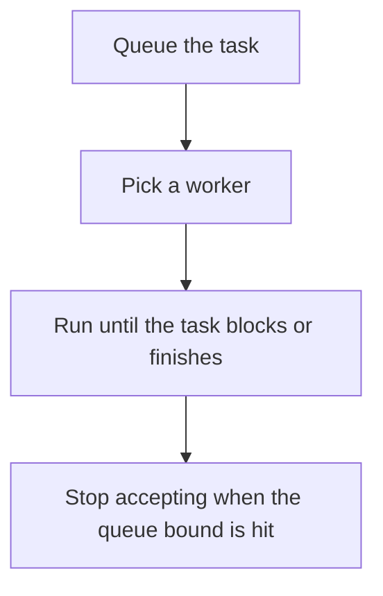

# D13-T014 — Task scheduling

Topic ID: `D13-T014`
Domain: Concurrency and Parallel Processing
Subdomain: Task scheduling
Importance: core
Complexity: advanced
Dependencies: `D13-T013`, `D13-T001`, `D01-T001`, `D01-T002`, `D03-T001`, `D03-T002`
Execution status of the code in section F: unexecuted

## A. Topic Overview

Task scheduling decides which runnable task a worker executes next. A FIFO queue is fair and can suffer head-of-line blocking. Priorities help latency and can starve low priority unless you age them. Work stealing lets an idle worker take a task from a busy worker's deque. The scheduler does not create CPU. A blocking task occupies a worker until it returns.

In production this shows up as follows: A worker pool runs HTTP handlers FIFO. A few slow report tasks at the head delay health checks. Splitting interactive and batch pools is the scheduling decision.

Interviewers use Task scheduling to see whether you can state the failure mode, not only the definition. The failure to name is: a priority policy that never runs low-priority cleanup, or a blocking call that shrinks the effective pool to zero

Prerequisites: `D13-T013`, `D13-T001`, `D01-T001`, `D01-T002`, `D03-T001`, `D03-T002`. Later notes should link here instead of repeating the mechanism.

## B. First-Principles Explanation

Task scheduling decides which runnable task a worker executes next. A FIFO queue is fair and can suffer head-of-line blocking. Priorities help latency and can starve low priority unless you age them. Work stealing lets an idle worker take a task from a busy worker's deque. The scheduler does not create CPU. A blocking task occupies a worker until it returns.

The useful picture is: Scheduling is the host choosing the next table. Priority seating without a rule for waiting guests is how a quiet table never gets served.

What has to be true:

1. Queue the task
2. Pick a worker
3. Run until the task blocks or finishes
4. Stop accepting when the queue bound is hit

It works when those steps preserve one invariant. It fails when a priority policy that never runs low-priority cleanup, or a blocking call that shrinks the effective pool to zero. The alternative is: you have one task, where a queue only adds latency

## C. Internal Working and Architecture

Components involved: the caller, the state Task scheduling mutates or reads, and the observer that reports queue age by priority, worker utilization, and starved-task count.

Execution:

1. Queue the task
2. Pick a worker
3. Run until the task blocks or finishes
4. Stop accepting when the queue bound is hit

Data moves only along that path. A retry re-enters at step 1, so the operation must say what a duplicate does. Memory and locks stay inside this mechanism. Callers see the result or a typed error, not a half-updated invariant.

State to remember: choose this when more runnable tasks exist than workers. Do not choose it when you have one task, where a queue only adds latency.

## D. Diagrams and Visual Models



Read the diagram from top to bottom. Each box is one step of Task scheduling. The failure mode (a priority policy that never runs low-priority cleanup, or a blocking call that shrinks the effective pool to zero) is what you look for when a later box never happens or happens twice.

## E. Examples and Analogies

Analogy: Scheduling is the host choosing the next table. Priority seating without a rule for waiting guests is how a quiet table never gets served.

Production example: A worker pool runs HTTP handlers FIFO. A few slow report tasks at the head delay health checks. Splitting interactive and batch pools is the scheduling decision.

A small counterexample is enough in an interview. Show the input, apply the steps, and show the broken outcome if someone uses the mechanism outside its rule: a priority policy that never runs low-priority cleanup, or a blocking call that shrinks the effective pool to zero.

## F. Code Examples

The snippet is labeled unexecuted. It illustrates the shape of the idea. It is not a benchmark and it embeds no secret.

```python
import heapq

def pop(ready):
    return heapq.heappop(ready)
```

After the snippet, check queue age by priority, worker utilization, and starved-task count. If that signal moves the wrong way, the snippet is the wrong tool for the workload.

## G. Practical Backend Application

Use Task scheduling in a service when more runnable tasks exist than workers.

A typical place is the production case already stated: A worker pool runs HTTP handlers FIFO. A few slow report tasks at the head delay health checks. Splitting interactive and batch pools is the scheduling decision.

Operationally you alert on queue age by priority, worker utilization, and starved-task count. You do not alert only on process uptime. The dashboard should show the failure mode, a success rate, and the saturation signal (queue depth, lock wait, or latency) that predicts it.

## H. Advantages, Limitations and Trade-offs

| Choice | Benefit | Cost | Choose when | Avoid when |
| --- | --- | --- | --- | --- |
| Apply Task scheduling | more runnable tasks exist than workers | Extra moving parts and a new failure mode | The failure you are preventing is already real | you have one task, where a queue only adds latency |
| Simpler alternative | Less code and fewer dependencies | a priority policy that never runs low-priority cleanup, or a blocking call that shrinks the effective pool to zero | The workload does not hit the limit | The invariant must hold under concurrency or failure |

Task scheduling is a trade. State the benefit and the cost in the same sentence when you propose it in a design review.

## I. Common Mistakes and Misconceptions

- Unbounded queues.
- Priorities without aging.
- Blocking the only worker.
- Treating a diagram of Task scheduling as proof that the invariant holds in production.
- Copying a default configuration without naming queue age by priority, worker utilization, and starved-task count.

## J. Debugging and Troubleshooting

Symptom: a priority policy that never runs low-priority cleanup, or a blocking call that shrinks the effective pool to zero

First check: queue age by priority, worker utilization, and starved-task count.

Then compare one healthy instance against one unhealthy instance. Confirm whether retries are duplicating work. Confirm whether a timeout is shorter than the work. Fix the invariant, then watch the same metric for a full peak, not only for the next minute.

Useful questions: did the step order in section C actually happen, or did a caller skip a step? Did a deploy change the data shape that Task scheduling assumes?

## K. Interview Preparation

### Beginner

#### Q1. What problem does Task scheduling solve?

**Answer:** Task scheduling decides which runnable task a worker executes next. A FIFO queue is fair and can suffer head-of-line blocking. Priorities help latency and can starve low priority unless you age them. Work stealing lets an idle worker take a task from a busy worker's deque. The scheduler does not create CPU. A blocking task occupies a worker until it returns. Without it, the usual backend failure is: a priority policy that never runs low-priority cleanup, or a blocking call that shrinks the effective pool to zero.

#### Q2. Where does Task scheduling sit on a request path?

**Answer:** Task scheduling is not a library you sprinkle on every call. more runnable tasks exist than workers You notice it when queue age by priority, worker utilization, and starved-task count. Name the constraint that makes this choice correct. Say what you would measure to confirm it.

#### Q3. Give a concrete example of Task scheduling.

**Answer:** A worker pool runs HTTP handlers FIFO. A few slow report tasks at the head delay health checks. Splitting interactive and batch pools is the scheduling decision. Walk the input, the state change, and the observable output.

#### Q4. What is a common mix-up around Task scheduling?

**Answer:** a priority policy that never runs low-priority cleanup, or a blocking call that shrinks the effective pool to zero The corrective check is queue age by priority, worker utilization, and starved-task count. Name the constraint that makes this choice correct. Say what you would measure to confirm it. Say which alternative you rejected and why.

#### Q5. When would you skip Task scheduling?

**Answer:** you have one task, where a queue only adds latency Skipping is a decision with a measured cost, not a slogan. Name the constraint that makes this choice correct. Say what you would measure to confirm it. Say which alternative you rejected and why.

### Intermediate

#### Q1. What invariant makes Task scheduling correct?

**Answer:** Task scheduling decides which runnable task a worker executes next. A FIFO queue is fair and can suffer head-of-line blocking. Priorities help latency and can starve low priority unless you age them. Work stealing lets an idle worker take a task from a busy worker's deque. The scheduler does not create CPU. A blocking task occupies a worker until it returns. State the invariant before you name the tool.

#### Q2. How do you test Task scheduling?

**Answer:** Assert the failure mode directly: a priority policy that never runs low-priority cleanup, or a blocking call that shrinks the effective pool to zero. The assertion should watch queue age by priority, worker utilization, and starved-task count. Include a concurrent or retry case if the bug only appears then. Name the constraint that makes this choice correct.

#### Q3. What signal tells you Task scheduling is misbehaving in production?

**Answer:** Watch queue age by priority, worker utilization, and starved-task count. The user-visible symptom is usually a priority policy that never runs low-priority cleanup, or a blocking call that shrinks the effective pool to zero. Name the constraint that makes this choice correct. Say what you would measure to confirm it.

#### Q4. How would you introduce Task scheduling into a legacy service?

**Answer:** more runnable tasks exist than workers Ship it behind a metric so you can compare the old path. Roll back if a priority policy that never runs low-priority cleanup, or a blocking call that shrinks the effective pool to zero gets worse. Name the constraint that makes this choice correct. Say what you would measure to confirm it.

#### Q5. What do you trade away by choosing Task scheduling?

**Answer:** more runnable tasks exist than workers you have one task, where a queue only adds latency Say the cost in latency, storage, or operational load. Name the constraint that makes this choice correct. Say what you would measure to confirm it. Say which alternative you rejected and why.

### Advanced

#### Q1. What breaks if a dependency of Task scheduling is slow or down?

**Answer:** a priority policy that never runs low-priority cleanup, or a blocking call that shrinks the effective pool to zero Degrade using the rule: you have one task, where a queue only adds latency. Timeouts must be shorter than the caller's deadline. Name the constraint that makes this choice correct. Say what you would measure to confirm it.

#### Q2. How does Task scheduling behave under retries?

**Answer:** Retries repeat work, so Task scheduling must define what a duplicate does. a priority policy that never runs low-priority cleanup, or a blocking call that shrinks the effective pool to zero Idempotency keys or fences belong next to the write, not in a comment. Name the constraint that makes this choice correct. Say what you would measure to confirm it.

#### Q3. What is the capacity limit of Task scheduling?

**Answer:** The limit shows up as queue age by priority, worker utilization, and starved-task count. Add capacity only after you know whether the bottleneck is CPU, lock wait, or network. Name the constraint that makes this choice correct. Say what you would measure to confirm it.

#### Q4. How do you evolve Task scheduling without a flag day?

**Answer:** more runnable tasks exist than workers Version the contract or the on-disk format. Readers should tolerate one old and one new shape during the rollout. Name the constraint that makes this choice correct. Say what you would measure to confirm it.

#### Q5. What security or correctness bug hides inside Task scheduling?

**Answer:** a priority policy that never runs low-priority cleanup, or a blocking call that shrinks the effective pool to zero Check authorization and tenancy at the same boundary as the mechanism. A cache or queue must not widen who can read the data. Name the constraint that makes this choice correct. Say what you would measure to confirm it.

### Scenario

#### Q1. Incident: a priority policy that never runs low-priority cleanup, or a blocking call that shrinks the effective pool to zero. What do you check first?

**Answer:** Start with queue age by priority, worker utilization, and starved-task count. Compare a good host and a bad host before you restart anything. Task scheduling decides which runnable task a worker executes next. A FIFO queue is fair and can suffer head-of-line blocking. Priorities help latency and can starve low priority unless you age them. Work stealing lets an idle worker take a task from a busy worker's deque. The scheduler does not create CPU. A blocking task occupies a worker until it returns.

#### Q2. A reviewer wants the clever version. What data settles it?

**Answer:** more runnable tasks exist than workers you have one task, where a queue only adds latency Bring queue age by priority, worker utilization, and starved-task count from a load test or from production, not a slogan. Name the constraint that makes this choice correct. Say what you would measure to confirm it. Say which alternative you rejected and why.

#### Q3. You have one hour to explain Task scheduling at a whiteboard.

**Answer:** Draw the happy path in four boxes. Then draw the failure: a priority policy that never runs low-priority cleanup, or a blocking call that shrinks the effective pool to zero. End with the metric you would page on. Name the constraint that makes this choice correct.

#### Q4. The bug only appears under two concurrent callers.

**Answer:** a priority policy that never runs low-priority cleanup, or a blocking call that shrinks the effective pool to zero Reproduce with a barrier so both sides enter the critical window. Confirm the fix with queue age by priority, worker utilization, and starved-task count. Name the constraint that makes this choice correct. Say what you would measure to confirm it.

#### Q5. Leadership wants this on every service next week.

**Answer:** you have one task, where a queue only adds latency more runnable tasks exist than workers Roll it out where the failure mode is already hurting users. Name the constraint that makes this choice correct. Say what you would measure to confirm it. Say which alternative you rejected and why.

### Follow-up

#### Q1. What did you assume about the data size or the clock?

**Answer:** Task scheduling decides which runnable task a worker executes next. A FIFO queue is fair and can suffer head-of-line blocking. Priorities help latency and can starve low priority unless you age them. Work stealing lets an idle worker take a task from a busy worker's deque. The scheduler does not create CPU. A blocking task occupies a worker until it returns. Clocks are not a total order across machines. State whether the algorithm needs bounded size or a single leader.

#### Q2. What would you measure after the change ships?

**Answer:** Page on queue age by priority, worker utilization, and starved-task count. Keep a before/after dashboard for one week. Alert on the failure mode, not only on CPU. Name the constraint that makes this choice correct.

#### Q3. Which neighboring topic did you deliberately not re-teach?

**Answer:** This note owns Task scheduling. Related identifiers are in section N. Shared ideas are linked, not copied. Name the constraint that makes this choice correct.

## L. Practical Exercises

Solutions are in `EXERCISES/solutions/D13-T014.md`, not in this section.

1. Whiteboard the four steps of Task scheduling and mark where `a priority policy that never runs low-priority cleanup, or a blocking call that shrinks the effective pool to zero` enters.
2. Read the snippet in section F and write the assertion that would catch that failure. The assertion must mention `queue age by priority, worker utilization, and starved-task count`.
3. Argue for or against using Task scheduling on a service you know. Use the choose and avoid rows from section H. Do not appeal to popularity.

## M. Revision Notes

- Mechanism: Task scheduling decides which runnable task a worker executes next.
- Failure: a priority policy that never runs low-priority cleanup, or a blocking call that shrinks the effective pool to zero
- Metric: queue age by priority, worker utilization, and starved-task count
- Choose when: more runnable tasks exist than workers
- Avoid when: you have one task, where a queue only adds latency

## N. Related Topics

Dependencies to review first: `D13-T013`, `D13-T001`, `D01-T001`, `D01-T002`, `D03-T001`, `D03-T002`.

Shared ideas stay in those notes. This note does not restate them.

## O. Completion Criteria

- You can explain Task scheduling without reading this note, including the failure mode.
- You can draw the diagram in section D from memory.
- You can say when not to use it, using the avoid condition in section H.
- You can name the metric you would watch after shipping it.
