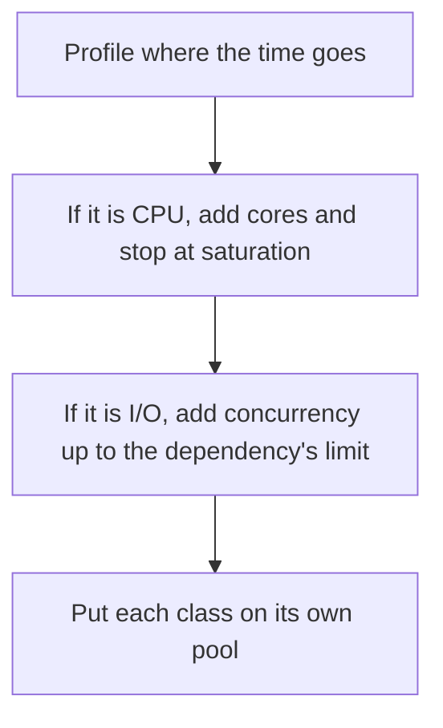

# D13-T015 — CPU-bound vs I/O-bound workloads

Topic ID: `D13-T015`
Domain: Concurrency and Parallel Processing
Subdomain: CPU-bound vs I/O-bound workloads
Importance: core
Complexity: advanced
Dependencies: `D13-T014`, `D13-T001`, `D01-T001`, `D01-T002`, `D03-T001`, `D03-T002`
Execution status of the code in section F: unexecuted

## A. Topic Overview

CPU-bound work spends its time computing, so more progress needs more cores until the machine is saturated. I/O-bound work spends its time waiting on disk, network, or another service, so more concurrent waiters can improve throughput on one core. The split decides threads versus async versus processes. A pool sized for the wrong class either thrashes or leaves the database idle.

In production this shows up as follows: Image resizing goes to a process pool sized to cores. Database calls stay on an I/O pool sized to the connection limit. One shared pool of 200 threads makes the resizes slower and the database overloaded.

Interviewers use CPU-bound vs I/O-bound workloads to see whether you can state the failure mode, not only the definition. The failure to name is: CPU work on an event loop, or thousands of threads for a CPU-bound hash

Prerequisites: `D13-T014`, `D13-T001`, `D01-T001`, `D01-T002`, `D03-T001`, `D03-T002`. Later notes should link here instead of repeating the mechanism.

## B. First-Principles Explanation

CPU-bound work spends its time computing, so more progress needs more cores until the machine is saturated. I/O-bound work spends its time waiting on disk, network, or another service, so more concurrent waiters can improve throughput on one core. The split decides threads versus async versus processes. A pool sized for the wrong class either thrashes or leaves the database idle.

The useful picture is: CPU-bound is chopping vegetables. More knives need more people. I/O-bound is waiting for the oven, and one person can watch several ovens.

What has to be true:

1. Profile where the time goes
2. If it is CPU, add cores and stop at saturation
3. If it is I/O, add concurrency up to the dependency's limit
4. Put each class on its own pool

It works when those steps preserve one invariant. It fails when CPU work on an event loop, or thousands of threads for a CPU-bound hash. The alternative is: you guess from the language default

## C. Internal Working and Architecture

Components involved: the caller, the state CPU-bound vs I/O-bound workloads mutates or reads, and the observer that reports CPU utilization versus wait time, and throughput as concurrency increases.

Execution:

1. Profile where the time goes
2. If it is CPU, add cores and stop at saturation
3. If it is I/O, add concurrency up to the dependency's limit
4. Put each class on its own pool

Data moves only along that path. A retry re-enters at step 1, so the operation must say what a duplicate does. Memory and locks stay inside this mechanism. Callers see the result or a typed error, not a half-updated invariant.

State to remember: choose this when you are sizing workers. Do not choose it when you guess from the language default.

## D. Diagrams and Visual Models



Read the diagram from top to bottom. Each box is one step of CPU-bound vs I/O-bound workloads. The failure mode (CPU work on an event loop, or thousands of threads for a CPU-bound hash) is what you look for when a later box never happens or happens twice.

## E. Examples and Analogies

Analogy: CPU-bound is chopping vegetables. More knives need more people. I/O-bound is waiting for the oven, and one person can watch several ovens.

Production example: Image resizing goes to a process pool sized to cores. Database calls stay on an I/O pool sized to the connection limit. One shared pool of 200 threads makes the resizes slower and the database overloaded.

A small counterexample is enough in an interview. Show the input, apply the steps, and show the broken outcome if someone uses the mechanism outside its rule: CPU work on an event loop, or thousands of threads for a CPU-bound hash.

## F. Code Examples

The snippet is labeled unexecuted. It illustrates the shape of the idea. It is not a benchmark and it embeds no secret.

```python
def pool_kind(cpu_bound: bool) -> str:
    return 'process-or-core-threads' if cpu_bound else 'async-or-io-threads'
```

After the snippet, check CPU utilization versus wait time, and throughput as concurrency increases. If that signal moves the wrong way, the snippet is the wrong tool for the workload.

## G. Practical Backend Application

Use CPU-bound vs I/O-bound workloads in a service when you are sizing workers.

A typical place is the production case already stated: Image resizing goes to a process pool sized to cores. Database calls stay on an I/O pool sized to the connection limit. One shared pool of 200 threads makes the resizes slower and the database overloaded.

Operationally you alert on CPU utilization versus wait time, and throughput as concurrency increases. You do not alert only on process uptime. The dashboard should show the failure mode, a success rate, and the saturation signal (queue depth, lock wait, or latency) that predicts it.

## H. Advantages, Limitations and Trade-offs

| Choice | Benefit | Cost | Choose when | Avoid when |
| --- | --- | --- | --- | --- |
| Apply CPU-bound vs I/O-bound workloads | you are sizing workers | Extra moving parts and a new failure mode | The failure you are preventing is already real | you guess from the language default |
| Simpler alternative | Less code and fewer dependencies | CPU work on an event loop, or thousands of threads for a CPU-bound hash | The workload does not hit the limit | The invariant must hold under concurrency or failure |

CPU-bound vs I/O-bound workloads is a trade. State the benefit and the cost in the same sentence when you propose it in a design review.

## I. Common Mistakes and Misconceptions

- Async for CPU-bound work.
- A thread per request for heavy compute.
- One pool for both.
- Treating a diagram of CPU-bound vs I/O-bound workloads as proof that the invariant holds in production.
- Copying a default configuration without naming CPU utilization versus wait time, and throughput as concurrency increases.

## J. Debugging and Troubleshooting

Symptom: CPU work on an event loop, or thousands of threads for a CPU-bound hash

First check: CPU utilization versus wait time, and throughput as concurrency increases.

Then compare one healthy instance against one unhealthy instance. Confirm whether retries are duplicating work. Confirm whether a timeout is shorter than the work. Fix the invariant, then watch the same metric for a full peak, not only for the next minute.

Useful questions: did the step order in section C actually happen, or did a caller skip a step? Did a deploy change the data shape that CPU-bound vs I/O-bound workloads assumes?

## K. Interview Preparation

### Beginner

#### Q1. What problem does CPU-bound vs I/O-bound workloads solve?

**Answer:** CPU-bound work spends its time computing, so more progress needs more cores until the machine is saturated. I/O-bound work spends its time waiting on disk, network, or another service, so more concurrent waiters can improve throughput on one core. The split decides threads versus async versus processes. A pool sized for the wrong class either thrashes or leaves the database idle. Without it, the usual backend failure is: CPU work on an event loop, or thousands of threads for a CPU-bound hash.

#### Q2. Where does CPU-bound vs I/O-bound workloads sit on a request path?

**Answer:** CPU-bound vs I/O-bound workloads is not a library you sprinkle on every call. you are sizing workers You notice it when CPU utilization versus wait time, and throughput as concurrency increases. Name the constraint that makes this choice correct. Say what you would measure to confirm it.

#### Q3. Give a concrete example of CPU-bound vs I/O-bound workloads.

**Answer:** Image resizing goes to a process pool sized to cores. Database calls stay on an I/O pool sized to the connection limit. One shared pool of 200 threads makes the resizes slower and the database overloaded. Walk the input, the state change, and the observable output.

#### Q4. What is a common mix-up around CPU-bound vs I/O-bound workloads?

**Answer:** CPU work on an event loop, or thousands of threads for a CPU-bound hash The corrective check is CPU utilization versus wait time, and throughput as concurrency increases. Name the constraint that makes this choice correct. Say what you would measure to confirm it. Say which alternative you rejected and why.

#### Q5. When would you skip CPU-bound vs I/O-bound workloads?

**Answer:** you guess from the language default Skipping is a decision with a measured cost, not a slogan. Name the constraint that makes this choice correct. Say what you would measure to confirm it. Say which alternative you rejected and why.

### Intermediate

#### Q1. What invariant makes CPU-bound vs I/O-bound workloads correct?

**Answer:** CPU-bound work spends its time computing, so more progress needs more cores until the machine is saturated. I/O-bound work spends its time waiting on disk, network, or another service, so more concurrent waiters can improve throughput on one core. The split decides threads versus async versus processes. A pool sized for the wrong class either thrashes or leaves the database idle. State the invariant before you name the tool.

#### Q2. How do you test CPU-bound vs I/O-bound workloads?

**Answer:** Assert the failure mode directly: CPU work on an event loop, or thousands of threads for a CPU-bound hash. The assertion should watch CPU utilization versus wait time, and throughput as concurrency increases. Include a concurrent or retry case if the bug only appears then. Name the constraint that makes this choice correct.

#### Q3. What signal tells you CPU-bound vs I/O-bound workloads is misbehaving in production?

**Answer:** Watch CPU utilization versus wait time, and throughput as concurrency increases. The user-visible symptom is usually CPU work on an event loop, or thousands of threads for a CPU-bound hash. Name the constraint that makes this choice correct. Say what you would measure to confirm it.

#### Q4. How would you introduce CPU-bound vs I/O-bound workloads into a legacy service?

**Answer:** you are sizing workers Ship it behind a metric so you can compare the old path. Roll back if CPU work on an event loop, or thousands of threads for a CPU-bound hash gets worse. Name the constraint that makes this choice correct. Say what you would measure to confirm it.

#### Q5. What do you trade away by choosing CPU-bound vs I/O-bound workloads?

**Answer:** you are sizing workers you guess from the language default Say the cost in latency, storage, or operational load. Name the constraint that makes this choice correct. Say what you would measure to confirm it. Say which alternative you rejected and why.

### Advanced

#### Q1. What breaks if a dependency of CPU-bound vs I/O-bound workloads is slow or down?

**Answer:** CPU work on an event loop, or thousands of threads for a CPU-bound hash Degrade using the rule: you guess from the language default. Timeouts must be shorter than the caller's deadline. Name the constraint that makes this choice correct. Say what you would measure to confirm it.

#### Q2. How does CPU-bound vs I/O-bound workloads behave under retries?

**Answer:** Retries repeat work, so CPU-bound vs I/O-bound workloads must define what a duplicate does. CPU work on an event loop, or thousands of threads for a CPU-bound hash Idempotency keys or fences belong next to the write, not in a comment. Name the constraint that makes this choice correct. Say what you would measure to confirm it.

#### Q3. What is the capacity limit of CPU-bound vs I/O-bound workloads?

**Answer:** The limit shows up as CPU utilization versus wait time, and throughput as concurrency increases. Add capacity only after you know whether the bottleneck is CPU, lock wait, or network. Name the constraint that makes this choice correct. Say what you would measure to confirm it.

#### Q4. How do you evolve CPU-bound vs I/O-bound workloads without a flag day?

**Answer:** you are sizing workers Version the contract or the on-disk format. Readers should tolerate one old and one new shape during the rollout. Name the constraint that makes this choice correct. Say what you would measure to confirm it.

#### Q5. What security or correctness bug hides inside CPU-bound vs I/O-bound workloads?

**Answer:** CPU work on an event loop, or thousands of threads for a CPU-bound hash Check authorization and tenancy at the same boundary as the mechanism. A cache or queue must not widen who can read the data. Name the constraint that makes this choice correct. Say what you would measure to confirm it.

### Scenario

#### Q1. Incident: CPU work on an event loop, or thousands of threads for a CPU-bound hash. What do you check first?

**Answer:** Start with CPU utilization versus wait time, and throughput as concurrency increases. Compare a good host and a bad host before you restart anything. CPU-bound work spends its time computing, so more progress needs more cores until the machine is saturated. I/O-bound work spends its time waiting on disk, network, or another service, so more concurrent waiters can improve throughput on one core. The split decides threads versus async versus processes. A pool sized for the wrong class either thrashes or leaves the database idle.

#### Q2. A reviewer wants the clever version. What data settles it?

**Answer:** you are sizing workers you guess from the language default Bring CPU utilization versus wait time, and throughput as concurrency increases from a load test or from production, not a slogan. Name the constraint that makes this choice correct. Say what you would measure to confirm it. Say which alternative you rejected and why.

#### Q3. You have one hour to explain CPU-bound vs I/O-bound workloads at a whiteboard.

**Answer:** Draw the happy path in four boxes. Then draw the failure: CPU work on an event loop, or thousands of threads for a CPU-bound hash. End with the metric you would page on. Name the constraint that makes this choice correct.

#### Q4. The bug only appears under two concurrent callers.

**Answer:** CPU work on an event loop, or thousands of threads for a CPU-bound hash Reproduce with a barrier so both sides enter the critical window. Confirm the fix with CPU utilization versus wait time, and throughput as concurrency increases. Name the constraint that makes this choice correct. Say what you would measure to confirm it.

#### Q5. Leadership wants this on every service next week.

**Answer:** you guess from the language default you are sizing workers Roll it out where the failure mode is already hurting users. Name the constraint that makes this choice correct. Say what you would measure to confirm it. Say which alternative you rejected and why.

### Follow-up

#### Q1. What did you assume about the data size or the clock?

**Answer:** CPU-bound work spends its time computing, so more progress needs more cores until the machine is saturated. I/O-bound work spends its time waiting on disk, network, or another service, so more concurrent waiters can improve throughput on one core. The split decides threads versus async versus processes. A pool sized for the wrong class either thrashes or leaves the database idle. Clocks are not a total order across machines. State whether the algorithm needs bounded size or a single leader.

#### Q2. What would you measure after the change ships?

**Answer:** Page on CPU utilization versus wait time, and throughput as concurrency increases. Keep a before/after dashboard for one week. Alert on the failure mode, not only on CPU. Name the constraint that makes this choice correct.

#### Q3. Which neighboring topic did you deliberately not re-teach?

**Answer:** This note owns CPU-bound vs I/O-bound workloads. Related identifiers are in section N. Shared ideas are linked, not copied. Name the constraint that makes this choice correct.

## L. Practical Exercises

Solutions are in `EXERCISES/solutions/D13-T015.md`, not in this section.

1. Whiteboard the four steps of CPU-bound vs I/O-bound workloads and mark where `CPU work on an event loop, or thousands of threads for a CPU-bound hash` enters.
2. Read the snippet in section F and write the assertion that would catch that failure. The assertion must mention `CPU utilization versus wait time, and throughput as concurrency increases`.
3. Argue for or against using CPU-bound vs I/O-bound workloads on a service you know. Use the choose and avoid rows from section H. Do not appeal to popularity.

## M. Revision Notes

- Mechanism: CPU-bound work spends its time computing, so more progress needs more cores until the machine is saturated.
- Failure: CPU work on an event loop, or thousands of threads for a CPU-bound hash
- Metric: CPU utilization versus wait time, and throughput as concurrency increases
- Choose when: you are sizing workers
- Avoid when: you guess from the language default

## N. Related Topics

Dependencies to review first: `D13-T014`, `D13-T001`, `D01-T001`, `D01-T002`, `D03-T001`, `D03-T002`.

Shared ideas stay in those notes. This note does not restate them.

## O. Completion Criteria

- You can explain CPU-bound vs I/O-bound workloads without reading this note, including the failure mode.
- You can draw the diagram in section D from memory.
- You can say when not to use it, using the avoid condition in section H.
- You can name the metric you would watch after shipping it.
