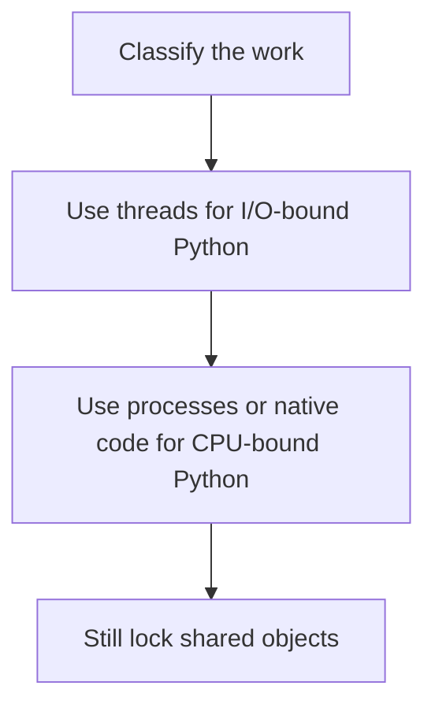

# D13-T016 — Python GIL and multiprocessing

Topic ID: `D13-T016`
Domain: Concurrency and Parallel Processing
Subdomain: Python GIL and multiprocessing
Importance: advanced
Complexity: advanced
Dependencies: `D13-T015`, `D13-T001`, `D01-T001`, `D01-T002`, `D03-T001`, `D03-T002`
Execution status of the code in section F: unexecuted

## A. Topic Overview

CPython's GIL lets one thread execute Python bytecode at a time in a process. Threads still help for I/O, because a thread releases the GIL while it waits. CPU-bound Python does not speed up with threads. Processes, native extensions that release the GIL, or another runtime do. The GIL is not a substitute for locks on your own invariants.

In production this shows up as follows: A Flask or Django handler that waits on SQL benefits from threads. A pure-Python image filter needs processes. A list append from two threads still needs synchronization for the application's invariant.

Interviewers use Python GIL and multiprocessing to see whether you can state the failure mode, not only the definition. The failure to name is: expecting a CPU-bound Python loop to scale across threads, or skipping locks because 'the GIL makes it safe'

Prerequisites: `D13-T015`, `D13-T001`, `D01-T001`, `D01-T002`, `D03-T001`, `D03-T002`. Later notes should link here instead of repeating the mechanism.

## B. First-Principles Explanation

CPython's GIL lets one thread execute Python bytecode at a time in a process. Threads still help for I/O, because a thread releases the GIL while it waits. CPU-bound Python does not speed up with threads. Processes, native extensions that release the GIL, or another runtime do. The GIL is not a substitute for locks on your own invariants.

The useful picture is: The GIL is one microphone for the bytecode. Threads can put the microphone down while they wait on the network. They cannot sing a CPU chorus with it.

What has to be true:

1. Classify the work
2. Use threads for I/O-bound Python
3. Use processes or native code for CPU-bound Python
4. Still lock shared objects

It works when those steps preserve one invariant. It fails when expecting a CPU-bound Python loop to scale across threads, or skipping locks because 'the GIL makes it safe'. The alternative is: you assume another interpreter has the same GIL

## C. Internal Working and Architecture

Components involved: the caller, the state Python GIL and multiprocessing mutates or reads, and the observer that reports cores used during a CPU benchmark with threads versus processes.

Execution:

1. Classify the work
2. Use threads for I/O-bound Python
3. Use processes or native code for CPU-bound Python
4. Still lock shared objects

Data moves only along that path. A retry re-enters at step 1, so the operation must say what a duplicate does. Memory and locks stay inside this mechanism. Callers see the result or a typed error, not a half-updated invariant.

State to remember: choose this when you are choosing concurrency inside CPython. Do not choose it when you assume another interpreter has the same GIL.

## D. Diagrams and Visual Models



Read the diagram from top to bottom. Each box is one step of Python GIL and multiprocessing. The failure mode (expecting a CPU-bound Python loop to scale across threads, or skipping locks because 'the GIL makes it safe') is what you look for when a later box never happens or happens twice.

## E. Examples and Analogies

Analogy: The GIL is one microphone for the bytecode. Threads can put the microphone down while they wait on the network. They cannot sing a CPU chorus with it.

Production example: A Flask or Django handler that waits on SQL benefits from threads. A pure-Python image filter needs processes. A list append from two threads still needs synchronization for the application's invariant.

A small counterexample is enough in an interview. Show the input, apply the steps, and show the broken outcome if someone uses the mechanism outside its rule: expecting a CPU-bound Python loop to scale across threads, or skipping locks because 'the GIL makes it safe'.

## F. Code Examples

The snippet is labeled unexecuted. It illustrates the shape of the idea. It is not a benchmark and it embeds no secret.

```python
from multiprocessing import Pool

def cpu_pool(n, fn, items):
    with Pool(n) as pool:
        return pool.map(fn, items)
```

After the snippet, check cores used during a CPU benchmark with threads versus processes. If that signal moves the wrong way, the snippet is the wrong tool for the workload.

## G. Practical Backend Application

Use Python GIL and multiprocessing in a service when you are choosing concurrency inside CPython.

A typical place is the production case already stated: A Flask or Django handler that waits on SQL benefits from threads. A pure-Python image filter needs processes. A list append from two threads still needs synchronization for the application's invariant.

Operationally you alert on cores used during a CPU benchmark with threads versus processes. You do not alert only on process uptime. The dashboard should show the failure mode, a success rate, and the saturation signal (queue depth, lock wait, or latency) that predicts it.

## H. Advantages, Limitations and Trade-offs

| Choice | Benefit | Cost | Choose when | Avoid when |
| --- | --- | --- | --- | --- |
| Apply Python GIL and multiprocessing | you are choosing concurrency inside CPython | Extra moving parts and a new failure mode | The failure you are preventing is already real | you assume another interpreter has the same GIL |
| Simpler alternative | Less code and fewer dependencies | expecting a CPU-bound Python loop to scale across threads, or skipping locks because 'the GIL makes it safe' | The workload does not hit the limit | The invariant must hold under concurrency or failure |

Python GIL and multiprocessing is a trade. State the benefit and the cost in the same sentence when you propose it in a design review.

## I. Common Mistakes and Misconceptions

- Threads for CPU-bound loops.
- No locks because of the GIL.
- Processes that share memory by accident through a parent fork.
- Treating a diagram of Python GIL and multiprocessing as proof that the invariant holds in production.
- Copying a default configuration without naming cores used during a CPU benchmark with threads versus processes.

## J. Debugging and Troubleshooting

Symptom: expecting a CPU-bound Python loop to scale across threads, or skipping locks because 'the GIL makes it safe'

First check: cores used during a CPU benchmark with threads versus processes.

Then compare one healthy instance against one unhealthy instance. Confirm whether retries are duplicating work. Confirm whether a timeout is shorter than the work. Fix the invariant, then watch the same metric for a full peak, not only for the next minute.

Useful questions: did the step order in section C actually happen, or did a caller skip a step? Did a deploy change the data shape that Python GIL and multiprocessing assumes?

## K. Interview Preparation

### Beginner

#### Q1. What problem does Python GIL and multiprocessing solve?

**Answer:** CPython's GIL lets one thread execute Python bytecode at a time in a process. Threads still help for I/O, because a thread releases the GIL while it waits. CPU-bound Python does not speed up with threads. Processes, native extensions that release the GIL, or another runtime do. The GIL is not a substitute for locks on your own invariants. Without it, the usual backend failure is: expecting a CPU-bound Python loop to scale across threads, or skipping locks because 'the GIL makes it safe'.

#### Q2. Where does Python GIL and multiprocessing sit on a request path?

**Answer:** Python GIL and multiprocessing is not a library you sprinkle on every call. you are choosing concurrency inside CPython You notice it when cores used during a CPU benchmark with threads versus processes. Name the constraint that makes this choice correct. Say what you would measure to confirm it.

#### Q3. Give a concrete example of Python GIL and multiprocessing.

**Answer:** A Flask or Django handler that waits on SQL benefits from threads. A pure-Python image filter needs processes. A list append from two threads still needs synchronization for the application's invariant. Walk the input, the state change, and the observable output.

#### Q4. What is a common mix-up around Python GIL and multiprocessing?

**Answer:** expecting a CPU-bound Python loop to scale across threads, or skipping locks because 'the GIL makes it safe' The corrective check is cores used during a CPU benchmark with threads versus processes. Name the constraint that makes this choice correct. Say what you would measure to confirm it. Say which alternative you rejected and why.

#### Q5. When would you skip Python GIL and multiprocessing?

**Answer:** you assume another interpreter has the same GIL Skipping is a decision with a measured cost, not a slogan. Name the constraint that makes this choice correct. Say what you would measure to confirm it. Say which alternative you rejected and why.

### Intermediate

#### Q1. What invariant makes Python GIL and multiprocessing correct?

**Answer:** CPython's GIL lets one thread execute Python bytecode at a time in a process. Threads still help for I/O, because a thread releases the GIL while it waits. CPU-bound Python does not speed up with threads. Processes, native extensions that release the GIL, or another runtime do. The GIL is not a substitute for locks on your own invariants. State the invariant before you name the tool.

#### Q2. How do you test Python GIL and multiprocessing?

**Answer:** Assert the failure mode directly: expecting a CPU-bound Python loop to scale across threads, or skipping locks because 'the GIL makes it safe'. The assertion should watch cores used during a CPU benchmark with threads versus processes. Include a concurrent or retry case if the bug only appears then. Name the constraint that makes this choice correct.

#### Q3. What signal tells you Python GIL and multiprocessing is misbehaving in production?

**Answer:** Watch cores used during a CPU benchmark with threads versus processes. The user-visible symptom is usually expecting a CPU-bound Python loop to scale across threads, or skipping locks because 'the GIL makes it safe'. Name the constraint that makes this choice correct. Say what you would measure to confirm it.

#### Q4. How would you introduce Python GIL and multiprocessing into a legacy service?

**Answer:** you are choosing concurrency inside CPython Ship it behind a metric so you can compare the old path. Roll back if expecting a CPU-bound Python loop to scale across threads, or skipping locks because 'the GIL makes it safe' gets worse. Name the constraint that makes this choice correct. Say what you would measure to confirm it.

#### Q5. What do you trade away by choosing Python GIL and multiprocessing?

**Answer:** you are choosing concurrency inside CPython you assume another interpreter has the same GIL Say the cost in latency, storage, or operational load. Name the constraint that makes this choice correct. Say what you would measure to confirm it. Say which alternative you rejected and why.

### Advanced

#### Q1. What breaks if a dependency of Python GIL and multiprocessing is slow or down?

**Answer:** expecting a CPU-bound Python loop to scale across threads, or skipping locks because 'the GIL makes it safe' Degrade using the rule: you assume another interpreter has the same GIL. Timeouts must be shorter than the caller's deadline. Name the constraint that makes this choice correct. Say what you would measure to confirm it.

#### Q2. How does Python GIL and multiprocessing behave under retries?

**Answer:** Retries repeat work, so Python GIL and multiprocessing must define what a duplicate does. expecting a CPU-bound Python loop to scale across threads, or skipping locks because 'the GIL makes it safe' Idempotency keys or fences belong next to the write, not in a comment. Name the constraint that makes this choice correct. Say what you would measure to confirm it.

#### Q3. What is the capacity limit of Python GIL and multiprocessing?

**Answer:** The limit shows up as cores used during a CPU benchmark with threads versus processes. Add capacity only after you know whether the bottleneck is CPU, lock wait, or network. Name the constraint that makes this choice correct. Say what you would measure to confirm it.

#### Q4. How do you evolve Python GIL and multiprocessing without a flag day?

**Answer:** you are choosing concurrency inside CPython Version the contract or the on-disk format. Readers should tolerate one old and one new shape during the rollout. Name the constraint that makes this choice correct. Say what you would measure to confirm it.

#### Q5. What security or correctness bug hides inside Python GIL and multiprocessing?

**Answer:** expecting a CPU-bound Python loop to scale across threads, or skipping locks because 'the GIL makes it safe' Check authorization and tenancy at the same boundary as the mechanism. A cache or queue must not widen who can read the data. Name the constraint that makes this choice correct. Say what you would measure to confirm it.

### Scenario

#### Q1. Incident: expecting a CPU-bound Python loop to scale across threads, or skipping locks because 'the GIL makes it safe'. What do you check first?

**Answer:** Start with cores used during a CPU benchmark with threads versus processes. Compare a good host and a bad host before you restart anything. CPython's GIL lets one thread execute Python bytecode at a time in a process. Threads still help for I/O, because a thread releases the GIL while it waits. CPU-bound Python does not speed up with threads. Processes, native extensions that release the GIL, or another runtime do. The GIL is not a substitute for locks on your own invariants.

#### Q2. A reviewer wants the clever version. What data settles it?

**Answer:** you are choosing concurrency inside CPython you assume another interpreter has the same GIL Bring cores used during a CPU benchmark with threads versus processes from a load test or from production, not a slogan. Name the constraint that makes this choice correct. Say what you would measure to confirm it. Say which alternative you rejected and why.

#### Q3. You have one hour to explain Python GIL and multiprocessing at a whiteboard.

**Answer:** Draw the happy path in four boxes. Then draw the failure: expecting a CPU-bound Python loop to scale across threads, or skipping locks because 'the GIL makes it safe'. End with the metric you would page on. Name the constraint that makes this choice correct.

#### Q4. The bug only appears under two concurrent callers.

**Answer:** expecting a CPU-bound Python loop to scale across threads, or skipping locks because 'the GIL makes it safe' Reproduce with a barrier so both sides enter the critical window. Confirm the fix with cores used during a CPU benchmark with threads versus processes. Name the constraint that makes this choice correct. Say what you would measure to confirm it.

#### Q5. Leadership wants this on every service next week.

**Answer:** you assume another interpreter has the same GIL you are choosing concurrency inside CPython Roll it out where the failure mode is already hurting users. Name the constraint that makes this choice correct. Say what you would measure to confirm it. Say which alternative you rejected and why.

### Follow-up

#### Q1. What did you assume about the data size or the clock?

**Answer:** CPython's GIL lets one thread execute Python bytecode at a time in a process. Threads still help for I/O, because a thread releases the GIL while it waits. CPU-bound Python does not speed up with threads. Processes, native extensions that release the GIL, or another runtime do. The GIL is not a substitute for locks on your own invariants. Clocks are not a total order across machines. State whether the algorithm needs bounded size or a single leader.

#### Q2. What would you measure after the change ships?

**Answer:** Page on cores used during a CPU benchmark with threads versus processes. Keep a before/after dashboard for one week. Alert on the failure mode, not only on CPU. Name the constraint that makes this choice correct.

#### Q3. Which neighboring topic did you deliberately not re-teach?

**Answer:** This note owns Python GIL and multiprocessing. Related identifiers are in section N. Shared ideas are linked, not copied. Name the constraint that makes this choice correct.

## L. Practical Exercises

Solutions are in `EXERCISES/solutions/D13-T016.md`, not in this section.

1. Whiteboard the four steps of Python GIL and multiprocessing and mark where `expecting a CPU-bound Python loop to scale across threads, or skipping locks because 'the GIL makes it safe'` enters.
2. Read the snippet in section F and write the assertion that would catch that failure. The assertion must mention `cores used during a CPU benchmark with threads versus processes`.
3. Argue for or against using Python GIL and multiprocessing on a service you know. Use the choose and avoid rows from section H. Do not appeal to popularity.

## M. Revision Notes

- Mechanism: CPython's GIL lets one thread execute Python bytecode at a time in a process.
- Failure: expecting a CPU-bound Python loop to scale across threads, or skipping locks because 'the GIL makes it safe'
- Metric: cores used during a CPU benchmark with threads versus processes
- Choose when: you are choosing concurrency inside CPython
- Avoid when: you assume another interpreter has the same GIL

## N. Related Topics

Dependencies to review first: `D13-T015`, `D13-T001`, `D01-T001`, `D01-T002`, `D03-T001`, `D03-T002`.

Shared ideas stay in those notes. This note does not restate them.

## O. Completion Criteria

- You can explain Python GIL and multiprocessing without reading this note, including the failure mode.
- You can draw the diagram in section D from memory.
- You can say when not to use it, using the avoid condition in section H.
- You can name the metric you would watch after shipping it.
