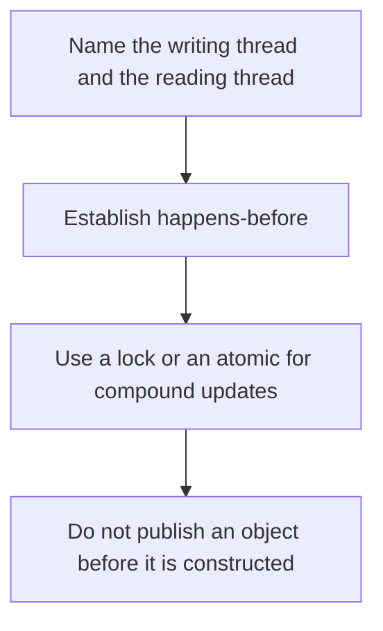

# D13-T017 — Java memory model

Topic ID: `D13-T017`
Domain: Concurrency and Parallel Processing
Subdomain: Java memory model
Importance: core
Complexity: advanced
Dependencies: `D13-T016`, `D13-T001`, `D01-T001`, `D01-T002`, `D03-T001`, `D03-T002`
Execution status of the code in section F: unexecuted

## A. Topic Overview

The Java Memory Model defines when a write in one thread becomes visible to a read in another. Without a happens-before edge, a read may see a stale value and may see writes out of order. Locks, volatile, thread start and join, and atomic classes create those edges. A data race is a bug even if the test passed on one laptop. Declaring a field volatile does not make a compound increment atomic.

In production this shows up as follows: A stopped boolean in a Java service is volatile or the worker never sees the shutdown. A request counter uses AtomicInteger or LongAdder, not a volatile int plus plus.

Interviewers use Java memory model to see whether you can state the failure mode, not only the definition. The failure to name is: a flag that never appears true to another thread, or a compound increment lost under volatile

Prerequisites: `D13-T016`, `D13-T001`, `D01-T001`, `D01-T002`, `D03-T001`, `D03-T002`. Later notes should link here instead of repeating the mechanism.

## B. First-Principles Explanation

The Java Memory Model defines when a write in one thread becomes visible to a read in another. Without a happens-before edge, a read may see a stale value and may see writes out of order. Locks, volatile, thread start and join, and atomic classes create those edges. A data race is a bug even if the test passed on one laptop. Declaring a field volatile does not make a compound increment atomic.

The useful picture is: The memory model is the rule for when a note stuck on one desk is required to be seen from another desk. Without the rule, the other desk may keep looking at a blank page.

What has to be true:

1. Name the writing thread and the reading thread
2. Establish happens-before
3. Use a lock or an atomic for compound updates
4. Do not publish an object before it is constructed

It works when those steps preserve one invariant. It fails when a flag that never appears true to another thread, or a compound increment lost under volatile. The alternative is: the state is confined to one thread or is immutable and safely published

## C. Internal Working and Architecture

Components involved: the caller, the state Java memory model mutates or reads, and the observer that reports a stress test that fails when a visibility bug is forced, not only a green run on one core.

Execution:

1. Name the writing thread and the reading thread
2. Establish happens-before
3. Use a lock or an atomic for compound updates
4. Do not publish an object before it is constructed

Data moves only along that path. A retry re-enters at step 1, so the operation must say what a duplicate does. Memory and locks stay inside this mechanism. Callers see the result or a typed error, not a half-updated invariant.

State to remember: choose this when two Java threads share mutable state. Do not choose it when the state is confined to one thread or is immutable and safely published.

## D. Diagrams and Visual Models



Read the diagram from top to bottom. Each box is one step of Java memory model. The failure mode (a flag that never appears true to another thread, or a compound increment lost under volatile) is what you look for when a later box never happens or happens twice.

## E. Examples and Analogies

Analogy: The memory model is the rule for when a note stuck on one desk is required to be seen from another desk. Without the rule, the other desk may keep looking at a blank page.

Production example: A stopped boolean in a Java service is volatile or the worker never sees the shutdown. A request counter uses AtomicInteger or LongAdder, not a volatile int plus plus.

A small counterexample is enough in an interview. Show the input, apply the steps, and show the broken outcome if someone uses the mechanism outside its rule: a flag that never appears true to another thread, or a compound increment lost under volatile.

## F. Code Examples

The snippet is labeled unexecuted. It illustrates the shape of the idea. It is not a benchmark and it embeds no secret.

```java
import java.util.concurrent.atomic.AtomicInteger;
class C { final AtomicInteger n = new AtomicInteger(); }
```

After the snippet, check a stress test that fails when a visibility bug is forced, not only a green run on one core. If that signal moves the wrong way, the snippet is the wrong tool for the workload.

## G. Practical Backend Application

Use Java memory model in a service when two Java threads share mutable state.

A typical place is the production case already stated: A stopped boolean in a Java service is volatile or the worker never sees the shutdown. A request counter uses AtomicInteger or LongAdder, not a volatile int plus plus.

Operationally you alert on a stress test that fails when a visibility bug is forced, not only a green run on one core. You do not alert only on process uptime. The dashboard should show the failure mode, a success rate, and the saturation signal (queue depth, lock wait, or latency) that predicts it.

## H. Advantages, Limitations and Trade-offs

| Choice | Benefit | Cost | Choose when | Avoid when |
| --- | --- | --- | --- | --- |
| Apply Java memory model | two Java threads share mutable state | Extra moving parts and a new failure mode | The failure you are preventing is already real | the state is confined to one thread or is immutable and safely published |
| Simpler alternative | Less code and fewer dependencies | a flag that never appears true to another thread, or a compound increment lost under volatile | The workload does not hit the limit | The invariant must hold under concurrency or failure |

Java memory model is a trade. State the benefit and the cost in the same sentence when you propose it in a design review.

## I. Common Mistakes and Misconceptions

- Volatile for increment.
- Assuming a lock-free read of a long is atomic on every hardware platform without the JMM tools.
- Publishing this before the constructor finishes.
- Treating a diagram of Java memory model as proof that the invariant holds in production.
- Copying a default configuration without naming a stress test that fails when a visibility bug is forced, not only a green run on one core.

## J. Debugging and Troubleshooting

Symptom: a flag that never appears true to another thread, or a compound increment lost under volatile

First check: a stress test that fails when a visibility bug is forced, not only a green run on one core.

Then compare one healthy instance against one unhealthy instance. Confirm whether retries are duplicating work. Confirm whether a timeout is shorter than the work. Fix the invariant, then watch the same metric for a full peak, not only for the next minute.

Useful questions: did the step order in section C actually happen, or did a caller skip a step? Did a deploy change the data shape that Java memory model assumes?

## K. Interview Preparation

### Beginner

#### Q1. What problem does Java memory model solve?

**Answer:** The Java Memory Model defines when a write in one thread becomes visible to a read in another. Without a happens-before edge, a read may see a stale value and may see writes out of order. Locks, volatile, thread start and join, and atomic classes create those edges. A data race is a bug even if the test passed on one laptop. Declaring a field volatile does not make a compound increment atomic. Without it, the usual backend failure is: a flag that never appears true to another thread, or a compound increment lost under volatile.

#### Q2. Where does Java memory model sit on a request path?

**Answer:** Java memory model is not a library you sprinkle on every call. two Java threads share mutable state You notice it when a stress test that fails when a visibility bug is forced, not only a green run on one core. Name the constraint that makes this choice correct. Say what you would measure to confirm it.

#### Q3. Give a concrete example of Java memory model.

**Answer:** A stopped boolean in a Java service is volatile or the worker never sees the shutdown. A request counter uses AtomicInteger or LongAdder, not a volatile int plus plus. Walk the input, the state change, and the observable output. Name the constraint that makes this choice correct.

#### Q4. What is a common mix-up around Java memory model?

**Answer:** a flag that never appears true to another thread, or a compound increment lost under volatile The corrective check is a stress test that fails when a visibility bug is forced, not only a green run on one core. Name the constraint that makes this choice correct. Say what you would measure to confirm it. Say which alternative you rejected and why.

#### Q5. When would you skip Java memory model?

**Answer:** the state is confined to one thread or is immutable and safely published Skipping is a decision with a measured cost, not a slogan. Name the constraint that makes this choice correct. Say what you would measure to confirm it. Say which alternative you rejected and why.

### Intermediate

#### Q1. What invariant makes Java memory model correct?

**Answer:** The Java Memory Model defines when a write in one thread becomes visible to a read in another. Without a happens-before edge, a read may see a stale value and may see writes out of order. Locks, volatile, thread start and join, and atomic classes create those edges. A data race is a bug even if the test passed on one laptop. Declaring a field volatile does not make a compound increment atomic. State the invariant before you name the tool.

#### Q2. How do you test Java memory model?

**Answer:** Assert the failure mode directly: a flag that never appears true to another thread, or a compound increment lost under volatile. The assertion should watch a stress test that fails when a visibility bug is forced, not only a green run on one core. Include a concurrent or retry case if the bug only appears then. Name the constraint that makes this choice correct.

#### Q3. What signal tells you Java memory model is misbehaving in production?

**Answer:** Watch a stress test that fails when a visibility bug is forced, not only a green run on one core. The user-visible symptom is usually a flag that never appears true to another thread, or a compound increment lost under volatile. Name the constraint that makes this choice correct. Say what you would measure to confirm it.

#### Q4. How would you introduce Java memory model into a legacy service?

**Answer:** two Java threads share mutable state Ship it behind a metric so you can compare the old path. Roll back if a flag that never appears true to another thread, or a compound increment lost under volatile gets worse. Name the constraint that makes this choice correct. Say what you would measure to confirm it.

#### Q5. What do you trade away by choosing Java memory model?

**Answer:** two Java threads share mutable state the state is confined to one thread or is immutable and safely published Say the cost in latency, storage, or operational load. Name the constraint that makes this choice correct. Say what you would measure to confirm it. Say which alternative you rejected and why.

### Advanced

#### Q1. What breaks if a dependency of Java memory model is slow or down?

**Answer:** a flag that never appears true to another thread, or a compound increment lost under volatile Degrade using the rule: the state is confined to one thread or is immutable and safely published. Timeouts must be shorter than the caller's deadline. Name the constraint that makes this choice correct. Say what you would measure to confirm it.

#### Q2. How does Java memory model behave under retries?

**Answer:** Retries repeat work, so Java memory model must define what a duplicate does. a flag that never appears true to another thread, or a compound increment lost under volatile Idempotency keys or fences belong next to the write, not in a comment. Name the constraint that makes this choice correct. Say what you would measure to confirm it.

#### Q3. What is the capacity limit of Java memory model?

**Answer:** The limit shows up as a stress test that fails when a visibility bug is forced, not only a green run on one core. Add capacity only after you know whether the bottleneck is CPU, lock wait, or network. Name the constraint that makes this choice correct. Say what you would measure to confirm it.

#### Q4. How do you evolve Java memory model without a flag day?

**Answer:** two Java threads share mutable state Version the contract or the on-disk format. Readers should tolerate one old and one new shape during the rollout. Name the constraint that makes this choice correct. Say what you would measure to confirm it.

#### Q5. What security or correctness bug hides inside Java memory model?

**Answer:** a flag that never appears true to another thread, or a compound increment lost under volatile Check authorization and tenancy at the same boundary as the mechanism. A cache or queue must not widen who can read the data. Name the constraint that makes this choice correct. Say what you would measure to confirm it.

### Scenario

#### Q1. Incident: a flag that never appears true to another thread, or a compound increment lost under volatile. What do you check first?

**Answer:** Start with a stress test that fails when a visibility bug is forced, not only a green run on one core. Compare a good host and a bad host before you restart anything. The Java Memory Model defines when a write in one thread becomes visible to a read in another. Without a happens-before edge, a read may see a stale value and may see writes out of order. Locks, volatile, thread start and join, and atomic classes create those edges. A data race is a bug even if the test passed on one laptop. Declaring a field volatile does not make a compound increment atomic.

#### Q2. A reviewer wants the clever version. What data settles it?

**Answer:** two Java threads share mutable state the state is confined to one thread or is immutable and safely published Bring a stress test that fails when a visibility bug is forced, not only a green run on one core from a load test or from production, not a slogan. Name the constraint that makes this choice correct. Say what you would measure to confirm it. Say which alternative you rejected and why.

#### Q3. You have one hour to explain Java memory model at a whiteboard.

**Answer:** Draw the happy path in four boxes. Then draw the failure: a flag that never appears true to another thread, or a compound increment lost under volatile. End with the metric you would page on. Name the constraint that makes this choice correct.

#### Q4. The bug only appears under two concurrent callers.

**Answer:** a flag that never appears true to another thread, or a compound increment lost under volatile Reproduce with a barrier so both sides enter the critical window. Confirm the fix with a stress test that fails when a visibility bug is forced, not only a green run on one core. Name the constraint that makes this choice correct. Say what you would measure to confirm it.

#### Q5. Leadership wants this on every service next week.

**Answer:** the state is confined to one thread or is immutable and safely published two Java threads share mutable state Roll it out where the failure mode is already hurting users. Name the constraint that makes this choice correct. Say what you would measure to confirm it. Say which alternative you rejected and why.

### Follow-up

#### Q1. What did you assume about the data size or the clock?

**Answer:** The Java Memory Model defines when a write in one thread becomes visible to a read in another. Without a happens-before edge, a read may see a stale value and may see writes out of order. Locks, volatile, thread start and join, and atomic classes create those edges. A data race is a bug even if the test passed on one laptop. Declaring a field volatile does not make a compound increment atomic. Clocks are not a total order across machines. State whether the algorithm needs bounded size or a single leader.

#### Q2. What would you measure after the change ships?

**Answer:** Page on a stress test that fails when a visibility bug is forced, not only a green run on one core. Keep a before/after dashboard for one week. Alert on the failure mode, not only on CPU. Name the constraint that makes this choice correct.

#### Q3. Which neighboring topic did you deliberately not re-teach?

**Answer:** This note owns Java memory model. Related identifiers are in section N. Shared ideas are linked, not copied. Name the constraint that makes this choice correct.

## L. Practical Exercises

Solutions are in `EXERCISES/solutions/D13-T017.md`, not in this section.

1. Whiteboard the four steps of Java memory model and mark where `a flag that never appears true to another thread, or a compound increment lost under volatile` enters.
2. Read the snippet in section F and write the assertion that would catch that failure. The assertion must mention `a stress test that fails when a visibility bug is forced, not only a green run on one core`.
3. Argue for or against using Java memory model on a service you know. Use the choose and avoid rows from section H. Do not appeal to popularity.

## M. Revision Notes

- Mechanism: The Java Memory Model defines when a write in one thread becomes visible to a read in another.
- Failure: a flag that never appears true to another thread, or a compound increment lost under volatile
- Metric: a stress test that fails when a visibility bug is forced, not only a green run on one core
- Choose when: two Java threads share mutable state
- Avoid when: the state is confined to one thread or is immutable and safely published

## N. Related Topics

Dependencies to review first: `D13-T016`, `D13-T001`, `D01-T001`, `D01-T002`, `D03-T001`, `D03-T002`.

Shared ideas stay in those notes. This note does not restate them.

## O. Completion Criteria

- You can explain Java memory model without reading this note, including the failure mode.
- You can draw the diagram in section D from memory.
- You can say when not to use it, using the avoid condition in section H.
- You can name the metric you would watch after shipping it.
