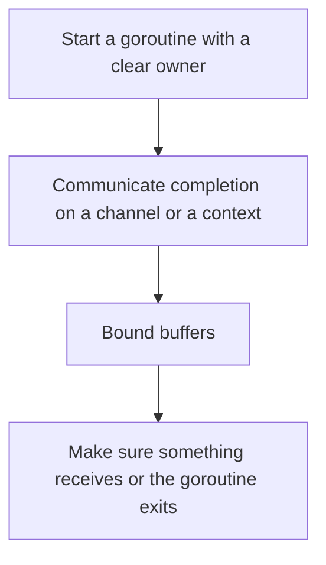

# D13-T018 — Go goroutines and channels

Topic ID: `D13-T018`
Domain: Concurrency and Parallel Processing
Subdomain: Go goroutines and channels
Importance: core
Complexity: advanced
Dependencies: `D13-T017`, `D13-T001`, `D01-T001`, `D01-T002`, `D03-T001`, `D03-T002`
Execution status of the code in section F: unexecuted

## A. Topic Overview

A goroutine is a lightweight task scheduled by the Go runtime onto OS threads. Channels pass values between goroutines. An unbuffered channel synchronizes sender and receiver. A buffered channel queues a bounded number of values. Closing a channel signals no more sends. Sending on a closed channel panics. Select waits on several operations. The runtime does not prevent a blocked goroutine leak.

In production this shows up as follows: An HTTP handler starts a goroutine to call a webhook and returns without a timeout. Under load the process holds millions of stuck goroutines. A context with a deadline and a bounded worker pool fixes the lifetime.

Interviewers use Go goroutines and channels to see whether you can state the failure mode, not only the definition. The failure to name is: a goroutine blocked forever on a send to a channel nobody receives, leaking until the process dies

Prerequisites: `D13-T017`, `D13-T001`, `D01-T001`, `D01-T002`, `D03-T001`, `D03-T002`. Later notes should link here instead of repeating the mechanism.

## B. First-Principles Explanation

A goroutine is a lightweight task scheduled by the Go runtime onto OS threads. Channels pass values between goroutines. An unbuffered channel synchronizes sender and receiver. A buffered channel queues a bounded number of values. Closing a channel signals no more sends. Sending on a closed channel panics. Select waits on several operations. The runtime does not prevent a blocked goroutine leak.

The useful picture is: A goroutine is a slip of work. A channel is a handoff. If you hand someone a slip and walk away, and they are not there, you stand in the hallway forever.

What has to be true:

1. Start a goroutine with a clear owner
2. Communicate completion on a channel or a context
3. Bound buffers
4. Make sure something receives or the goroutine exits

It works when those steps preserve one invariant. It fails when a goroutine blocked forever on a send to a channel nobody receives, leaking until the process dies. The alternative is: you start a goroutine per item with no bound and no cancellation

## C. Internal Working and Architecture

Components involved: the caller, the state Go goroutines and channels mutates or reads, and the observer that reports goroutine count over time and blocked-send age.

Execution:

1. Start a goroutine with a clear owner
2. Communicate completion on a channel or a context
3. Bound buffers
4. Make sure something receives or the goroutine exits

Data moves only along that path. A retry re-enters at step 1, so the operation must say what a duplicate does. Memory and locks stay inside this mechanism. Callers see the result or a typed error, not a half-updated invariant.

State to remember: choose this when you want many concurrent tasks in one Go process. Do not choose it when you start a goroutine per item with no bound and no cancellation.

## D. Diagrams and Visual Models



Read the diagram from top to bottom. Each box is one step of Go goroutines and channels. The failure mode (a goroutine blocked forever on a send to a channel nobody receives, leaking until the process dies) is what you look for when a later box never happens or happens twice.

## E. Examples and Analogies

Analogy: A goroutine is a slip of work. A channel is a handoff. If you hand someone a slip and walk away, and they are not there, you stand in the hallway forever.

Production example: An HTTP handler starts a goroutine to call a webhook and returns without a timeout. Under load the process holds millions of stuck goroutines. A context with a deadline and a bounded worker pool fixes the lifetime.

A small counterexample is enough in an interview. Show the input, apply the steps, and show the broken outcome if someone uses the mechanism outside its rule: a goroutine blocked forever on a send to a channel nobody receives, leaking until the process dies.

## F. Code Examples

The snippet is labeled unexecuted. It illustrates the shape of the idea. It is not a benchmark and it embeds no secret.

```go
func worker(jobs <-chan int, done chan<- struct{}) {
    for range jobs {
    }
    done <- struct{}{}
}
```

After the snippet, check goroutine count over time and blocked-send age. If that signal moves the wrong way, the snippet is the wrong tool for the workload.

## G. Practical Backend Application

Use Go goroutines and channels in a service when you want many concurrent tasks in one Go process.

A typical place is the production case already stated: An HTTP handler starts a goroutine to call a webhook and returns without a timeout. Under load the process holds millions of stuck goroutines. A context with a deadline and a bounded worker pool fixes the lifetime.

Operationally you alert on goroutine count over time and blocked-send age. You do not alert only on process uptime. The dashboard should show the failure mode, a success rate, and the saturation signal (queue depth, lock wait, or latency) that predicts it.

## H. Advantages, Limitations and Trade-offs

| Choice | Benefit | Cost | Choose when | Avoid when |
| --- | --- | --- | --- | --- |
| Apply Go goroutines and channels | you want many concurrent tasks in one Go process | Extra moving parts and a new failure mode | The failure you are preventing is already real | you start a goroutine per item with no bound and no cancellation |
| Simpler alternative | Less code and fewer dependencies | a goroutine blocked forever on a send to a channel nobody receives, leaking until the process dies | The workload does not hit the limit | The invariant must hold under concurrency or failure |

Go goroutines and channels is a trade. State the benefit and the cost in the same sentence when you propose it in a design review.

## I. Common Mistakes and Misconceptions

- Unbuffered sends from a request with no receiver.
- Ranging a channel that is never closed.
- Shared maps without synchronization.
- Treating a diagram of Go goroutines and channels as proof that the invariant holds in production.
- Copying a default configuration without naming goroutine count over time and blocked-send age.

## J. Debugging and Troubleshooting

Symptom: a goroutine blocked forever on a send to a channel nobody receives, leaking until the process dies

First check: goroutine count over time and blocked-send age.

Then compare one healthy instance against one unhealthy instance. Confirm whether retries are duplicating work. Confirm whether a timeout is shorter than the work. Fix the invariant, then watch the same metric for a full peak, not only for the next minute.

Useful questions: did the step order in section C actually happen, or did a caller skip a step? Did a deploy change the data shape that Go goroutines and channels assumes?

## K. Interview Preparation

### Beginner

#### Q1. What problem does Go goroutines and channels solve?

**Answer:** A goroutine is a lightweight task scheduled by the Go runtime onto OS threads. Channels pass values between goroutines. An unbuffered channel synchronizes sender and receiver. A buffered channel queues a bounded number of values. Closing a channel signals no more sends. Sending on a closed channel panics. Select waits on several operations. The runtime does not prevent a blocked goroutine leak. Without it, the usual backend failure is: a goroutine blocked forever on a send to a channel nobody receives, leaking until the process dies.

#### Q2. Where does Go goroutines and channels sit on a request path?

**Answer:** Go goroutines and channels is not a library you sprinkle on every call. you want many concurrent tasks in one Go process You notice it when goroutine count over time and blocked-send age. Name the constraint that makes this choice correct. Say what you would measure to confirm it.

#### Q3. Give a concrete example of Go goroutines and channels.

**Answer:** An HTTP handler starts a goroutine to call a webhook and returns without a timeout. Under load the process holds millions of stuck goroutines. A context with a deadline and a bounded worker pool fixes the lifetime. Walk the input, the state change, and the observable output.

#### Q4. What is a common mix-up around Go goroutines and channels?

**Answer:** a goroutine blocked forever on a send to a channel nobody receives, leaking until the process dies The corrective check is goroutine count over time and blocked-send age. Name the constraint that makes this choice correct. Say what you would measure to confirm it. Say which alternative you rejected and why.

#### Q5. When would you skip Go goroutines and channels?

**Answer:** you start a goroutine per item with no bound and no cancellation Skipping is a decision with a measured cost, not a slogan. Name the constraint that makes this choice correct. Say what you would measure to confirm it. Say which alternative you rejected and why.

### Intermediate

#### Q1. What invariant makes Go goroutines and channels correct?

**Answer:** A goroutine is a lightweight task scheduled by the Go runtime onto OS threads. Channels pass values between goroutines. An unbuffered channel synchronizes sender and receiver. A buffered channel queues a bounded number of values. Closing a channel signals no more sends. Sending on a closed channel panics. Select waits on several operations. The runtime does not prevent a blocked goroutine leak. State the invariant before you name the tool.

#### Q2. How do you test Go goroutines and channels?

**Answer:** Assert the failure mode directly: a goroutine blocked forever on a send to a channel nobody receives, leaking until the process dies. The assertion should watch goroutine count over time and blocked-send age. Include a concurrent or retry case if the bug only appears then. Name the constraint that makes this choice correct.

#### Q3. What signal tells you Go goroutines and channels is misbehaving in production?

**Answer:** Watch goroutine count over time and blocked-send age. The user-visible symptom is usually a goroutine blocked forever on a send to a channel nobody receives, leaking until the process dies. Name the constraint that makes this choice correct. Say what you would measure to confirm it.

#### Q4. How would you introduce Go goroutines and channels into a legacy service?

**Answer:** you want many concurrent tasks in one Go process Ship it behind a metric so you can compare the old path. Roll back if a goroutine blocked forever on a send to a channel nobody receives, leaking until the process dies gets worse. Name the constraint that makes this choice correct. Say what you would measure to confirm it.

#### Q5. What do you trade away by choosing Go goroutines and channels?

**Answer:** you want many concurrent tasks in one Go process you start a goroutine per item with no bound and no cancellation Say the cost in latency, storage, or operational load. Name the constraint that makes this choice correct. Say what you would measure to confirm it. Say which alternative you rejected and why.

### Advanced

#### Q1. What breaks if a dependency of Go goroutines and channels is slow or down?

**Answer:** a goroutine blocked forever on a send to a channel nobody receives, leaking until the process dies Degrade using the rule: you start a goroutine per item with no bound and no cancellation. Timeouts must be shorter than the caller's deadline. Name the constraint that makes this choice correct. Say what you would measure to confirm it.

#### Q2. How does Go goroutines and channels behave under retries?

**Answer:** Retries repeat work, so Go goroutines and channels must define what a duplicate does. a goroutine blocked forever on a send to a channel nobody receives, leaking until the process dies Idempotency keys or fences belong next to the write, not in a comment. Name the constraint that makes this choice correct. Say what you would measure to confirm it.

#### Q3. What is the capacity limit of Go goroutines and channels?

**Answer:** The limit shows up as goroutine count over time and blocked-send age. Add capacity only after you know whether the bottleneck is CPU, lock wait, or network. Name the constraint that makes this choice correct. Say what you would measure to confirm it.

#### Q4. How do you evolve Go goroutines and channels without a flag day?

**Answer:** you want many concurrent tasks in one Go process Version the contract or the on-disk format. Readers should tolerate one old and one new shape during the rollout. Name the constraint that makes this choice correct. Say what you would measure to confirm it.

#### Q5. What security or correctness bug hides inside Go goroutines and channels?

**Answer:** a goroutine blocked forever on a send to a channel nobody receives, leaking until the process dies Check authorization and tenancy at the same boundary as the mechanism. A cache or queue must not widen who can read the data. Name the constraint that makes this choice correct. Say what you would measure to confirm it.

### Scenario

#### Q1. Incident: a goroutine blocked forever on a send to a channel nobody receives, leaking until the process dies. What do you check first?

**Answer:** Start with goroutine count over time and blocked-send age. Compare a good host and a bad host before you restart anything. A goroutine is a lightweight task scheduled by the Go runtime onto OS threads. Channels pass values between goroutines. An unbuffered channel synchronizes sender and receiver. A buffered channel queues a bounded number of values. Closing a channel signals no more sends. Sending on a closed channel panics. Select waits on several operations. The runtime does not prevent a blocked goroutine leak.

#### Q2. A reviewer wants the clever version. What data settles it?

**Answer:** you want many concurrent tasks in one Go process you start a goroutine per item with no bound and no cancellation Bring goroutine count over time and blocked-send age from a load test or from production, not a slogan. Name the constraint that makes this choice correct. Say what you would measure to confirm it. Say which alternative you rejected and why.

#### Q3. You have one hour to explain Go goroutines and channels at a whiteboard.

**Answer:** Draw the happy path in four boxes. Then draw the failure: a goroutine blocked forever on a send to a channel nobody receives, leaking until the process dies. End with the metric you would page on. Name the constraint that makes this choice correct.

#### Q4. The bug only appears under two concurrent callers.

**Answer:** a goroutine blocked forever on a send to a channel nobody receives, leaking until the process dies Reproduce with a barrier so both sides enter the critical window. Confirm the fix with goroutine count over time and blocked-send age. Name the constraint that makes this choice correct. Say what you would measure to confirm it.

#### Q5. Leadership wants this on every service next week.

**Answer:** you start a goroutine per item with no bound and no cancellation you want many concurrent tasks in one Go process Roll it out where the failure mode is already hurting users. Name the constraint that makes this choice correct. Say what you would measure to confirm it. Say which alternative you rejected and why.

### Follow-up

#### Q1. What did you assume about the data size or the clock?

**Answer:** A goroutine is a lightweight task scheduled by the Go runtime onto OS threads. Channels pass values between goroutines. An unbuffered channel synchronizes sender and receiver. A buffered channel queues a bounded number of values. Closing a channel signals no more sends. Sending on a closed channel panics. Select waits on several operations. The runtime does not prevent a blocked goroutine leak. Clocks are not a total order across machines. State whether the algorithm needs bounded size or a single leader.

#### Q2. What would you measure after the change ships?

**Answer:** Page on goroutine count over time and blocked-send age. Keep a before/after dashboard for one week. Alert on the failure mode, not only on CPU. Name the constraint that makes this choice correct.

#### Q3. Which neighboring topic did you deliberately not re-teach?

**Answer:** This note owns Go goroutines and channels. Related identifiers are in section N. Shared ideas are linked, not copied. Name the constraint that makes this choice correct.

## L. Practical Exercises

Solutions are in `EXERCISES/solutions/D13-T018.md`, not in this section.

1. Whiteboard the four steps of Go goroutines and channels and mark where `a goroutine blocked forever on a send to a channel nobody receives, leaking until the process dies` enters.
2. Read the snippet in section F and write the assertion that would catch that failure. The assertion must mention `goroutine count over time and blocked-send age`.
3. Argue for or against using Go goroutines and channels on a service you know. Use the choose and avoid rows from section H. Do not appeal to popularity.

## M. Revision Notes

- Mechanism: A goroutine is a lightweight task scheduled by the Go runtime onto OS threads.
- Failure: a goroutine blocked forever on a send to a channel nobody receives, leaking until the process dies
- Metric: goroutine count over time and blocked-send age
- Choose when: you want many concurrent tasks in one Go process
- Avoid when: you start a goroutine per item with no bound and no cancellation

## N. Related Topics

Dependencies to review first: `D13-T017`, `D13-T001`, `D01-T001`, `D01-T002`, `D03-T001`, `D03-T002`.

Shared ideas stay in those notes. This note does not restate them.

## O. Completion Criteria

- You can explain Go goroutines and channels without reading this note, including the failure mode.
- You can draw the diagram in section D from memory.
- You can say when not to use it, using the avoid condition in section H.
- You can name the metric you would watch after shipping it.
