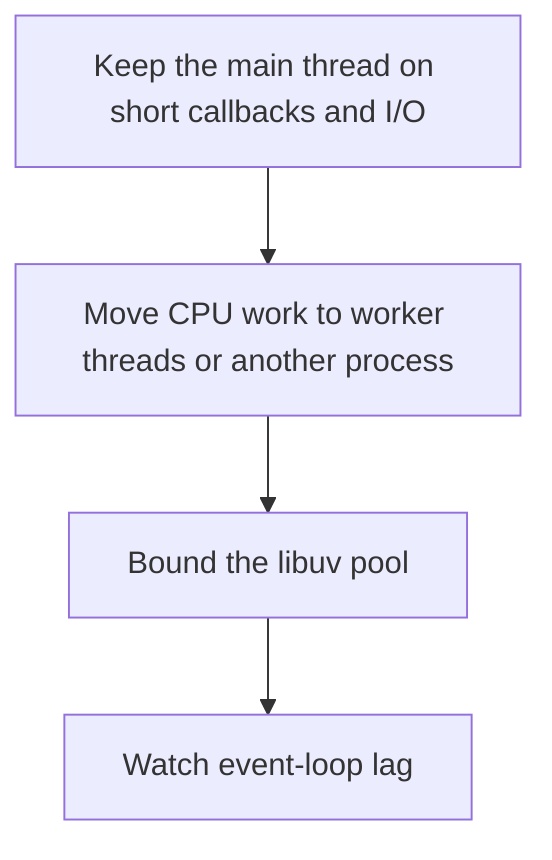

# D13-T019 — Node.js event loop and worker threads

Topic ID: `D13-T019`
Domain: Concurrency and Parallel Processing
Subdomain: Node.js event loop and worker threads
Importance: core
Complexity: advanced
Dependencies: `D13-T018`, `D13-T001`, `D01-T001`, `D01-T002`, `D03-T001`, `D03-T002`
Execution status of the code in section F: unexecuted

## A. Topic Overview

Node.js runs JavaScript on one thread with an event loop. I/O uses a non-blocking interface and callbacks or promises. CPU-heavy JavaScript blocks the loop. Worker threads run JavaScript in parallel and communicate by message, not by shared objects. The libuv thread pool is a small pool for some blocking filesystem and DNS calls. A blocking call in the main thread delays every client.

In production this shows up as follows: A Node API that gzip-compresses large payloads on the request path blocks every other request. Moving compression to a worker or to a proxy brings loop lag back down.

Interviewers use Node.js event loop and worker threads to see whether you can state the failure mode, not only the definition. The failure to name is: JSON parsing or compression on the main thread so health checks time out

Prerequisites: `D13-T018`, `D13-T001`, `D01-T001`, `D01-T002`, `D03-T001`, `D03-T002`. Later notes should link here instead of repeating the mechanism.

## B. First-Principles Explanation

Node.js runs JavaScript on one thread with an event loop. I/O uses a non-blocking interface and callbacks or promises. CPU-heavy JavaScript blocks the loop. Worker threads run JavaScript in parallel and communicate by message, not by shared objects. The libuv thread pool is a small pool for some blocking filesystem and DNS calls. A blocking call in the main thread delays every client.

The useful picture is: The main thread is one clerk at a window. Worker threads are extra rooms. If the clerk starts doing a long calculation, the line does not move, even though the phones are modern.

What has to be true:

1. Keep the main thread on short callbacks and I/O
2. Move CPU work to worker threads or another process
3. Bound the libuv pool
4. Watch event-loop lag

It works when those steps preserve one invariant. It fails when JSON parsing or compression on the main thread so health checks time out. The alternative is: the hot path is CPU-bound JavaScript on the main thread

## C. Internal Working and Architecture

Components involved: the caller, the state Node.js event loop and worker threads mutates or reads, and the observer that reports event-loop lag and libuv pool queue length.

Execution:

1. Keep the main thread on short callbacks and I/O
2. Move CPU work to worker threads or another process
3. Bound the libuv pool
4. Watch event-loop lag

Data moves only along that path. A retry re-enters at step 1, so the operation must say what a duplicate does. Memory and locks stay inside this mechanism. Callers see the result or a typed error, not a half-updated invariant.

State to remember: choose this when the service is I/O with small bursts of JavaScript. Do not choose it when the hot path is CPU-bound JavaScript on the main thread.

## D. Diagrams and Visual Models



Read the diagram from top to bottom. Each box is one step of Node.js event loop and worker threads. The failure mode (JSON parsing or compression on the main thread so health checks time out) is what you look for when a later box never happens or happens twice.

## E. Examples and Analogies

Analogy: The main thread is one clerk at a window. Worker threads are extra rooms. If the clerk starts doing a long calculation, the line does not move, even though the phones are modern.

Production example: A Node API that gzip-compresses large payloads on the request path blocks every other request. Moving compression to a worker or to a proxy brings loop lag back down.

A small counterexample is enough in an interview. Show the input, apply the steps, and show the broken outcome if someone uses the mechanism outside its rule: JSON parsing or compression on the main thread so health checks time out.

## F. Code Examples

The snippet is labeled unexecuted. It illustrates the shape of the idea. It is not a benchmark and it embeds no secret.

```javascript
const { Worker } = require('worker_threads');
function offload(path) { return new Worker(path); }
```

After the snippet, check event-loop lag and libuv pool queue length. If that signal moves the wrong way, the snippet is the wrong tool for the workload.

## G. Practical Backend Application

Use Node.js event loop and worker threads in a service when the service is I/O with small bursts of JavaScript.

A typical place is the production case already stated: A Node API that gzip-compresses large payloads on the request path blocks every other request. Moving compression to a worker or to a proxy brings loop lag back down.

Operationally you alert on event-loop lag and libuv pool queue length. You do not alert only on process uptime. The dashboard should show the failure mode, a success rate, and the saturation signal (queue depth, lock wait, or latency) that predicts it.

## H. Advantages, Limitations and Trade-offs

| Choice | Benefit | Cost | Choose when | Avoid when |
| --- | --- | --- | --- | --- |
| Apply Node.js event loop and worker threads | the service is I/O with small bursts of JavaScript | Extra moving parts and a new failure mode | The failure you are preventing is already real | the hot path is CPU-bound JavaScript on the main thread |
| Simpler alternative | Less code and fewer dependencies | JSON parsing or compression on the main thread so health checks time out | The workload does not hit the limit | The invariant must hold under concurrency or failure |

Node.js event loop and worker threads is a trade. State the benefit and the cost in the same sentence when you propose it in a design review.

## I. Common Mistakes and Misconceptions

- Worker threads for every tiny function.
- Blocking fs calls in the request path.
- Ignoring DNS as a blocking path when it hits the pool.
- Treating a diagram of Node.js event loop and worker threads as proof that the invariant holds in production.
- Copying a default configuration without naming event-loop lag and libuv pool queue length.

## J. Debugging and Troubleshooting

Symptom: JSON parsing or compression on the main thread so health checks time out

First check: event-loop lag and libuv pool queue length.

Then compare one healthy instance against one unhealthy instance. Confirm whether retries are duplicating work. Confirm whether a timeout is shorter than the work. Fix the invariant, then watch the same metric for a full peak, not only for the next minute.

Useful questions: did the step order in section C actually happen, or did a caller skip a step? Did a deploy change the data shape that Node.js event loop and worker threads assumes?

## K. Interview Preparation

### Beginner

#### Q1. What problem does Node.js event loop and worker threads solve?

**Answer:** Node.js runs JavaScript on one thread with an event loop. I/O uses a non-blocking interface and callbacks or promises. CPU-heavy JavaScript blocks the loop. Worker threads run JavaScript in parallel and communicate by message, not by shared objects. The libuv thread pool is a small pool for some blocking filesystem and DNS calls. A blocking call in the main thread delays every client. Without it, the usual backend failure is: JSON parsing or compression on the main thread so health checks time out.

#### Q2. Where does Node.js event loop and worker threads sit on a request path?

**Answer:** Node.js event loop and worker threads is not a library you sprinkle on every call. the service is I/O with small bursts of JavaScript You notice it when event-loop lag and libuv pool queue length. Name the constraint that makes this choice correct. Say what you would measure to confirm it.

#### Q3. Give a concrete example of Node.js event loop and worker threads.

**Answer:** A Node API that gzip-compresses large payloads on the request path blocks every other request. Moving compression to a worker or to a proxy brings loop lag back down. Walk the input, the state change, and the observable output. Name the constraint that makes this choice correct.

#### Q4. What is a common mix-up around Node.js event loop and worker threads?

**Answer:** JSON parsing or compression on the main thread so health checks time out The corrective check is event-loop lag and libuv pool queue length. Name the constraint that makes this choice correct. Say what you would measure to confirm it. Say which alternative you rejected and why.

#### Q5. When would you skip Node.js event loop and worker threads?

**Answer:** the hot path is CPU-bound JavaScript on the main thread Skipping is a decision with a measured cost, not a slogan. Name the constraint that makes this choice correct. Say what you would measure to confirm it. Say which alternative you rejected and why.

### Intermediate

#### Q1. What invariant makes Node.js event loop and worker threads correct?

**Answer:** Node.js runs JavaScript on one thread with an event loop. I/O uses a non-blocking interface and callbacks or promises. CPU-heavy JavaScript blocks the loop. Worker threads run JavaScript in parallel and communicate by message, not by shared objects. The libuv thread pool is a small pool for some blocking filesystem and DNS calls. A blocking call in the main thread delays every client. State the invariant before you name the tool.

#### Q2. How do you test Node.js event loop and worker threads?

**Answer:** Assert the failure mode directly: JSON parsing or compression on the main thread so health checks time out. The assertion should watch event-loop lag and libuv pool queue length. Include a concurrent or retry case if the bug only appears then. Name the constraint that makes this choice correct.

#### Q3. What signal tells you Node.js event loop and worker threads is misbehaving in production?

**Answer:** Watch event-loop lag and libuv pool queue length. The user-visible symptom is usually JSON parsing or compression on the main thread so health checks time out. Name the constraint that makes this choice correct. Say what you would measure to confirm it.

#### Q4. How would you introduce Node.js event loop and worker threads into a legacy service?

**Answer:** the service is I/O with small bursts of JavaScript Ship it behind a metric so you can compare the old path. Roll back if JSON parsing or compression on the main thread so health checks time out gets worse. Name the constraint that makes this choice correct. Say what you would measure to confirm it.

#### Q5. What do you trade away by choosing Node.js event loop and worker threads?

**Answer:** the service is I/O with small bursts of JavaScript the hot path is CPU-bound JavaScript on the main thread Say the cost in latency, storage, or operational load. Name the constraint that makes this choice correct. Say what you would measure to confirm it. Say which alternative you rejected and why.

### Advanced

#### Q1. What breaks if a dependency of Node.js event loop and worker threads is slow or down?

**Answer:** JSON parsing or compression on the main thread so health checks time out Degrade using the rule: the hot path is CPU-bound JavaScript on the main thread. Timeouts must be shorter than the caller's deadline. Name the constraint that makes this choice correct. Say what you would measure to confirm it.

#### Q2. How does Node.js event loop and worker threads behave under retries?

**Answer:** Retries repeat work, so Node.js event loop and worker threads must define what a duplicate does. JSON parsing or compression on the main thread so health checks time out Idempotency keys or fences belong next to the write, not in a comment. Name the constraint that makes this choice correct. Say what you would measure to confirm it.

#### Q3. What is the capacity limit of Node.js event loop and worker threads?

**Answer:** The limit shows up as event-loop lag and libuv pool queue length. Add capacity only after you know whether the bottleneck is CPU, lock wait, or network. Name the constraint that makes this choice correct. Say what you would measure to confirm it.

#### Q4. How do you evolve Node.js event loop and worker threads without a flag day?

**Answer:** the service is I/O with small bursts of JavaScript Version the contract or the on-disk format. Readers should tolerate one old and one new shape during the rollout. Name the constraint that makes this choice correct. Say what you would measure to confirm it.

#### Q5. What security or correctness bug hides inside Node.js event loop and worker threads?

**Answer:** JSON parsing or compression on the main thread so health checks time out Check authorization and tenancy at the same boundary as the mechanism. A cache or queue must not widen who can read the data. Name the constraint that makes this choice correct. Say what you would measure to confirm it.

### Scenario

#### Q1. Incident: JSON parsing or compression on the main thread so health checks time out. What do you check first?

**Answer:** Start with event-loop lag and libuv pool queue length. Compare a good host and a bad host before you restart anything. Node.js runs JavaScript on one thread with an event loop. I/O uses a non-blocking interface and callbacks or promises. CPU-heavy JavaScript blocks the loop. Worker threads run JavaScript in parallel and communicate by message, not by shared objects. The libuv thread pool is a small pool for some blocking filesystem and DNS calls. A blocking call in the main thread delays every client.

#### Q2. A reviewer wants the clever version. What data settles it?

**Answer:** the service is I/O with small bursts of JavaScript the hot path is CPU-bound JavaScript on the main thread Bring event-loop lag and libuv pool queue length from a load test or from production, not a slogan. Name the constraint that makes this choice correct. Say what you would measure to confirm it. Say which alternative you rejected and why.

#### Q3. You have one hour to explain Node.js event loop and worker threads at a whiteboard.

**Answer:** Draw the happy path in four boxes. Then draw the failure: JSON parsing or compression on the main thread so health checks time out. End with the metric you would page on. Name the constraint that makes this choice correct.

#### Q4. The bug only appears under two concurrent callers.

**Answer:** JSON parsing or compression on the main thread so health checks time out Reproduce with a barrier so both sides enter the critical window. Confirm the fix with event-loop lag and libuv pool queue length. Name the constraint that makes this choice correct. Say what you would measure to confirm it.

#### Q5. Leadership wants this on every service next week.

**Answer:** the hot path is CPU-bound JavaScript on the main thread the service is I/O with small bursts of JavaScript Roll it out where the failure mode is already hurting users. Name the constraint that makes this choice correct. Say what you would measure to confirm it. Say which alternative you rejected and why.

### Follow-up

#### Q1. What did you assume about the data size or the clock?

**Answer:** Node.js runs JavaScript on one thread with an event loop. I/O uses a non-blocking interface and callbacks or promises. CPU-heavy JavaScript blocks the loop. Worker threads run JavaScript in parallel and communicate by message, not by shared objects. The libuv thread pool is a small pool for some blocking filesystem and DNS calls. A blocking call in the main thread delays every client. Clocks are not a total order across machines. State whether the algorithm needs bounded size or a single leader.

#### Q2. What would you measure after the change ships?

**Answer:** Page on event-loop lag and libuv pool queue length. Keep a before/after dashboard for one week. Alert on the failure mode, not only on CPU. Name the constraint that makes this choice correct.

#### Q3. Which neighboring topic did you deliberately not re-teach?

**Answer:** This note owns Node.js event loop and worker threads. Related identifiers are in section N. Shared ideas are linked, not copied. Name the constraint that makes this choice correct.

## L. Practical Exercises

Solutions are in `EXERCISES/solutions/D13-T019.md`, not in this section.

1. Whiteboard the four steps of Node.js event loop and worker threads and mark where `JSON parsing or compression on the main thread so health checks time out` enters.
2. Read the snippet in section F and write the assertion that would catch that failure. The assertion must mention `event-loop lag and libuv pool queue length`.
3. Argue for or against using Node.js event loop and worker threads on a service you know. Use the choose and avoid rows from section H. Do not appeal to popularity.

## M. Revision Notes

- Mechanism: Node.
- Failure: JSON parsing or compression on the main thread so health checks time out
- Metric: event-loop lag and libuv pool queue length
- Choose when: the service is I/O with small bursts of JavaScript
- Avoid when: the hot path is CPU-bound JavaScript on the main thread

## N. Related Topics

Dependencies to review first: `D13-T018`, `D13-T001`, `D01-T001`, `D01-T002`, `D03-T001`, `D03-T002`.

Shared ideas stay in those notes. This note does not restate them.

## O. Completion Criteria

- You can explain Node.js event loop and worker threads without reading this note, including the failure mode.
- You can draw the diagram in section D from memory.
- You can say when not to use it, using the avoid condition in section H.
- You can name the metric you would watch after shipping it.
