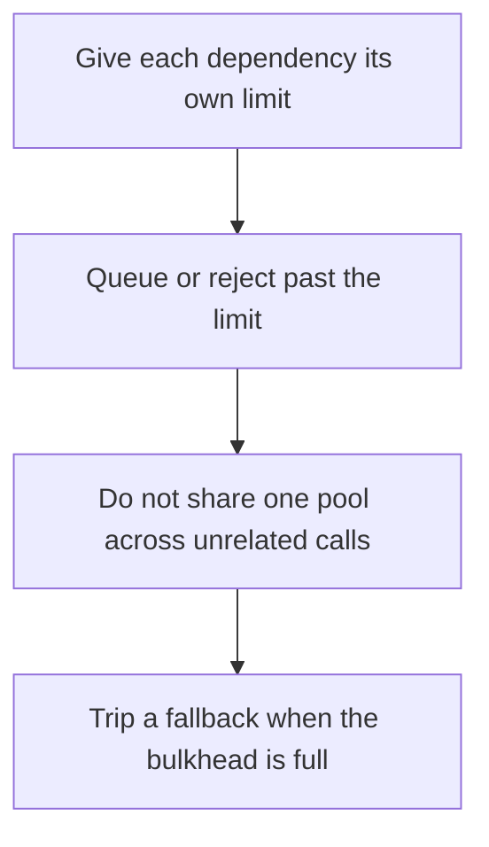

# D13-T020 — Concurrency limits and bulkheads

Topic ID: `D13-T020`
Domain: Concurrency and Parallel Processing
Subdomain: Concurrency limits and bulkheads
Importance: core
Complexity: advanced
Dependencies: `D13-T019`, `D13-T001`, `D01-T001`, `D01-T002`, `D03-T001`, `D03-T002`
Execution status of the code in section F: unexecuted

## A. Topic Overview

A concurrency limit caps how many operations of one kind may run at once. A bulkhead isolates that cap so a failure in one dependency cannot consume every thread. Separate pools for separate dependencies stop a slow payments call from occupying the threads the health check needs. The limit should match the dependency, not the size of the machine.

In production this shows up as follows: The checkout service allows 20 in-flight database calls and 5 payment calls. When the payment provider stalls, new checkouts fail fast and the product-read path still has its own pool.

Interviewers use Concurrency limits and bulkheads to see whether you can state the failure mode, not only the definition. The failure to name is: one slow dependency occupying the only thread pool so the process cannot serve even cached reads

Prerequisites: `D13-T019`, `D13-T001`, `D01-T001`, `D01-T002`, `D03-T001`, `D03-T002`. Later notes should link here instead of repeating the mechanism.

## B. First-Principles Explanation

A concurrency limit caps how many operations of one kind may run at once. A bulkhead isolates that cap so a failure in one dependency cannot consume every thread. Separate pools for separate dependencies stop a slow payments call from occupying the threads the health check needs. The limit should match the dependency, not the size of the machine.

The useful picture is: A bulkhead is a wall in a ship. A concurrency limit is how many people may stand in that compartment. When one compartment floods, the wall is what keeps the rest of the ship working.

What has to be true:

1. Give each dependency its own limit
2. Queue or reject past the limit
3. Do not share one pool across unrelated calls
4. Trip a fallback when the bulkhead is full

It works when those steps preserve one invariant. It fails when one slow dependency occupying the only thread pool so the process cannot serve even cached reads. The alternative is: you use one shared unbounded pool for every outbound call

## C. Internal Working and Architecture

Components involved: the caller, the state Concurrency limits and bulkheads mutates or reads, and the observer that reports pool saturation per dependency, and success of an isolated health check during that saturation.

Execution:

1. Give each dependency its own limit
2. Queue or reject past the limit
3. Do not share one pool across unrelated calls
4. Trip a fallback when the bulkhead is full

Data moves only along that path. A retry re-enters at step 1, so the operation must say what a duplicate does. Memory and locks stay inside this mechanism. Callers see the result or a typed error, not a half-updated invariant.

State to remember: choose this when one dependency can get slow. Do not choose it when you use one shared unbounded pool for every outbound call.

## D. Diagrams and Visual Models



Read the diagram from top to bottom. Each box is one step of Concurrency limits and bulkheads. The failure mode (one slow dependency occupying the only thread pool so the process cannot serve even cached reads) is what you look for when a later box never happens or happens twice.

## E. Examples and Analogies

Analogy: A bulkhead is a wall in a ship. A concurrency limit is how many people may stand in that compartment. When one compartment floods, the wall is what keeps the rest of the ship working.

Production example: The checkout service allows 20 in-flight database calls and 5 payment calls. When the payment provider stalls, new checkouts fail fast and the product-read path still has its own pool.

A small counterexample is enough in an interview. Show the input, apply the steps, and show the broken outcome if someone uses the mechanism outside its rule: one slow dependency occupying the only thread pool so the process cannot serve even cached reads.

## F. Code Examples

The snippet is labeled unexecuted. It illustrates the shape of the idea. It is not a benchmark and it embeds no secret.

```python
limits = {'db': 20, 'payments': 5, 'health': 2}
```

After the snippet, check pool saturation per dependency, and success of an isolated health check during that saturation. If that signal moves the wrong way, the snippet is the wrong tool for the workload.

## G. Practical Backend Application

Use Concurrency limits and bulkheads in a service when one dependency can get slow.

A typical place is the production case already stated: The checkout service allows 20 in-flight database calls and 5 payment calls. When the payment provider stalls, new checkouts fail fast and the product-read path still has its own pool.

Operationally you alert on pool saturation per dependency, and success of an isolated health check during that saturation. You do not alert only on process uptime. The dashboard should show the failure mode, a success rate, and the saturation signal (queue depth, lock wait, or latency) that predicts it.

## H. Advantages, Limitations and Trade-offs

| Choice | Benefit | Cost | Choose when | Avoid when |
| --- | --- | --- | --- | --- |
| Apply Concurrency limits and bulkheads | one dependency can get slow | Extra moving parts and a new failure mode | The failure you are preventing is already real | you use one shared unbounded pool for every outbound call |
| Simpler alternative | Less code and fewer dependencies | one slow dependency occupying the only thread pool so the process cannot serve even cached reads | The workload does not hit the limit | The invariant must hold under concurrency or failure |

Concurrency limits and bulkheads is a trade. State the benefit and the cost in the same sentence when you propose it in a design review.

## I. Common Mistakes and Misconceptions

- A limit larger than the dependency can handle.
- No rejection policy.
- Health checks sharing the saturated pool.
- Treating a diagram of Concurrency limits and bulkheads as proof that the invariant holds in production.
- Copying a default configuration without naming pool saturation per dependency, and success of an isolated health check during that saturation.

## J. Debugging and Troubleshooting

Symptom: one slow dependency occupying the only thread pool so the process cannot serve even cached reads

First check: pool saturation per dependency, and success of an isolated health check during that saturation.

Then compare one healthy instance against one unhealthy instance. Confirm whether retries are duplicating work. Confirm whether a timeout is shorter than the work. Fix the invariant, then watch the same metric for a full peak, not only for the next minute.

Useful questions: did the step order in section C actually happen, or did a caller skip a step? Did a deploy change the data shape that Concurrency limits and bulkheads assumes?

## K. Interview Preparation

### Beginner

#### Q1. What problem does Concurrency limits and bulkheads solve?

**Answer:** A concurrency limit caps how many operations of one kind may run at once. A bulkhead isolates that cap so a failure in one dependency cannot consume every thread. Separate pools for separate dependencies stop a slow payments call from occupying the threads the health check needs. The limit should match the dependency, not the size of the machine. Without it, the usual backend failure is: one slow dependency occupying the only thread pool so the process cannot serve even cached reads.

#### Q2. Where does Concurrency limits and bulkheads sit on a request path?

**Answer:** Concurrency limits and bulkheads is not a library you sprinkle on every call. one dependency can get slow You notice it when pool saturation per dependency, and success of an isolated health check during that saturation. Name the constraint that makes this choice correct. Say what you would measure to confirm it.

#### Q3. Give a concrete example of Concurrency limits and bulkheads.

**Answer:** The checkout service allows 20 in-flight database calls and 5 payment calls. When the payment provider stalls, new checkouts fail fast and the product-read path still has its own pool. Walk the input, the state change, and the observable output. Name the constraint that makes this choice correct.

#### Q4. What is a common mix-up around Concurrency limits and bulkheads?

**Answer:** one slow dependency occupying the only thread pool so the process cannot serve even cached reads The corrective check is pool saturation per dependency, and success of an isolated health check during that saturation. Name the constraint that makes this choice correct. Say what you would measure to confirm it. Say which alternative you rejected and why.

#### Q5. When would you skip Concurrency limits and bulkheads?

**Answer:** you use one shared unbounded pool for every outbound call Skipping is a decision with a measured cost, not a slogan. Name the constraint that makes this choice correct. Say what you would measure to confirm it. Say which alternative you rejected and why.

### Intermediate

#### Q1. What invariant makes Concurrency limits and bulkheads correct?

**Answer:** A concurrency limit caps how many operations of one kind may run at once. A bulkhead isolates that cap so a failure in one dependency cannot consume every thread. Separate pools for separate dependencies stop a slow payments call from occupying the threads the health check needs. The limit should match the dependency, not the size of the machine. State the invariant before you name the tool.

#### Q2. How do you test Concurrency limits and bulkheads?

**Answer:** Assert the failure mode directly: one slow dependency occupying the only thread pool so the process cannot serve even cached reads. The assertion should watch pool saturation per dependency, and success of an isolated health check during that saturation. Include a concurrent or retry case if the bug only appears then. Name the constraint that makes this choice correct.

#### Q3. What signal tells you Concurrency limits and bulkheads is misbehaving in production?

**Answer:** Watch pool saturation per dependency, and success of an isolated health check during that saturation. The user-visible symptom is usually one slow dependency occupying the only thread pool so the process cannot serve even cached reads. Name the constraint that makes this choice correct. Say what you would measure to confirm it.

#### Q4. How would you introduce Concurrency limits and bulkheads into a legacy service?

**Answer:** one dependency can get slow Ship it behind a metric so you can compare the old path. Roll back if one slow dependency occupying the only thread pool so the process cannot serve even cached reads gets worse. Name the constraint that makes this choice correct. Say what you would measure to confirm it.

#### Q5. What do you trade away by choosing Concurrency limits and bulkheads?

**Answer:** one dependency can get slow you use one shared unbounded pool for every outbound call Say the cost in latency, storage, or operational load. Name the constraint that makes this choice correct. Say what you would measure to confirm it. Say which alternative you rejected and why.

### Advanced

#### Q1. What breaks if a dependency of Concurrency limits and bulkheads is slow or down?

**Answer:** one slow dependency occupying the only thread pool so the process cannot serve even cached reads Degrade using the rule: you use one shared unbounded pool for every outbound call. Timeouts must be shorter than the caller's deadline. Name the constraint that makes this choice correct. Say what you would measure to confirm it.

#### Q2. How does Concurrency limits and bulkheads behave under retries?

**Answer:** Retries repeat work, so Concurrency limits and bulkheads must define what a duplicate does. one slow dependency occupying the only thread pool so the process cannot serve even cached reads Idempotency keys or fences belong next to the write, not in a comment. Name the constraint that makes this choice correct. Say what you would measure to confirm it.

#### Q3. What is the capacity limit of Concurrency limits and bulkheads?

**Answer:** The limit shows up as pool saturation per dependency, and success of an isolated health check during that saturation. Add capacity only after you know whether the bottleneck is CPU, lock wait, or network. Name the constraint that makes this choice correct. Say what you would measure to confirm it.

#### Q4. How do you evolve Concurrency limits and bulkheads without a flag day?

**Answer:** one dependency can get slow Version the contract or the on-disk format. Readers should tolerate one old and one new shape during the rollout. Name the constraint that makes this choice correct. Say what you would measure to confirm it.

#### Q5. What security or correctness bug hides inside Concurrency limits and bulkheads?

**Answer:** one slow dependency occupying the only thread pool so the process cannot serve even cached reads Check authorization and tenancy at the same boundary as the mechanism. A cache or queue must not widen who can read the data. Name the constraint that makes this choice correct. Say what you would measure to confirm it.

### Scenario

#### Q1. Incident: one slow dependency occupying the only thread pool so the process cannot serve even cached reads. What do you check first?

**Answer:** Start with pool saturation per dependency, and success of an isolated health check during that saturation. Compare a good host and a bad host before you restart anything. A concurrency limit caps how many operations of one kind may run at once. A bulkhead isolates that cap so a failure in one dependency cannot consume every thread. Separate pools for separate dependencies stop a slow payments call from occupying the threads the health check needs. The limit should match the dependency, not the size of the machine.

#### Q2. A reviewer wants the clever version. What data settles it?

**Answer:** one dependency can get slow you use one shared unbounded pool for every outbound call Bring pool saturation per dependency, and success of an isolated health check during that saturation from a load test or from production, not a slogan. Name the constraint that makes this choice correct. Say what you would measure to confirm it. Say which alternative you rejected and why.

#### Q3. You have one hour to explain Concurrency limits and bulkheads at a whiteboard.

**Answer:** Draw the happy path in four boxes. Then draw the failure: one slow dependency occupying the only thread pool so the process cannot serve even cached reads. End with the metric you would page on. Name the constraint that makes this choice correct.

#### Q4. The bug only appears under two concurrent callers.

**Answer:** one slow dependency occupying the only thread pool so the process cannot serve even cached reads Reproduce with a barrier so both sides enter the critical window. Confirm the fix with pool saturation per dependency, and success of an isolated health check during that saturation. Name the constraint that makes this choice correct. Say what you would measure to confirm it.

#### Q5. Leadership wants this on every service next week.

**Answer:** you use one shared unbounded pool for every outbound call one dependency can get slow Roll it out where the failure mode is already hurting users. Name the constraint that makes this choice correct. Say what you would measure to confirm it. Say which alternative you rejected and why.

### Follow-up

#### Q1. What did you assume about the data size or the clock?

**Answer:** A concurrency limit caps how many operations of one kind may run at once. A bulkhead isolates that cap so a failure in one dependency cannot consume every thread. Separate pools for separate dependencies stop a slow payments call from occupying the threads the health check needs. The limit should match the dependency, not the size of the machine. Clocks are not a total order across machines. State whether the algorithm needs bounded size or a single leader.

#### Q2. What would you measure after the change ships?

**Answer:** Page on pool saturation per dependency, and success of an isolated health check during that saturation. Keep a before/after dashboard for one week. Alert on the failure mode, not only on CPU. Name the constraint that makes this choice correct.

#### Q3. Which neighboring topic did you deliberately not re-teach?

**Answer:** This note owns Concurrency limits and bulkheads. Related identifiers are in section N. Shared ideas are linked, not copied. Name the constraint that makes this choice correct.

## L. Practical Exercises

Solutions are in `EXERCISES/solutions/D13-T020.md`, not in this section.

1. Whiteboard the four steps of Concurrency limits and bulkheads and mark where `one slow dependency occupying the only thread pool so the process cannot serve even cached reads` enters.
2. Read the snippet in section F and write the assertion that would catch that failure. The assertion must mention `pool saturation per dependency, and success of an isolated health check during that saturation`.
3. Argue for or against using Concurrency limits and bulkheads on a service you know. Use the choose and avoid rows from section H. Do not appeal to popularity.

## M. Revision Notes

- Mechanism: A concurrency limit caps how many operations of one kind may run at once.
- Failure: one slow dependency occupying the only thread pool so the process cannot serve even cached reads
- Metric: pool saturation per dependency, and success of an isolated health check during that saturation
- Choose when: one dependency can get slow
- Avoid when: you use one shared unbounded pool for every outbound call

## N. Related Topics

Dependencies to review first: `D13-T019`, `D13-T001`, `D01-T001`, `D01-T002`, `D03-T001`, `D03-T002`.

Shared ideas stay in those notes. This note does not restate them.

## O. Completion Criteria

- You can explain Concurrency limits and bulkheads without reading this note, including the failure mode.
- You can draw the diagram in section D from memory.
- You can say when not to use it, using the avoid condition in section H.
- You can name the metric you would watch after shipping it.
