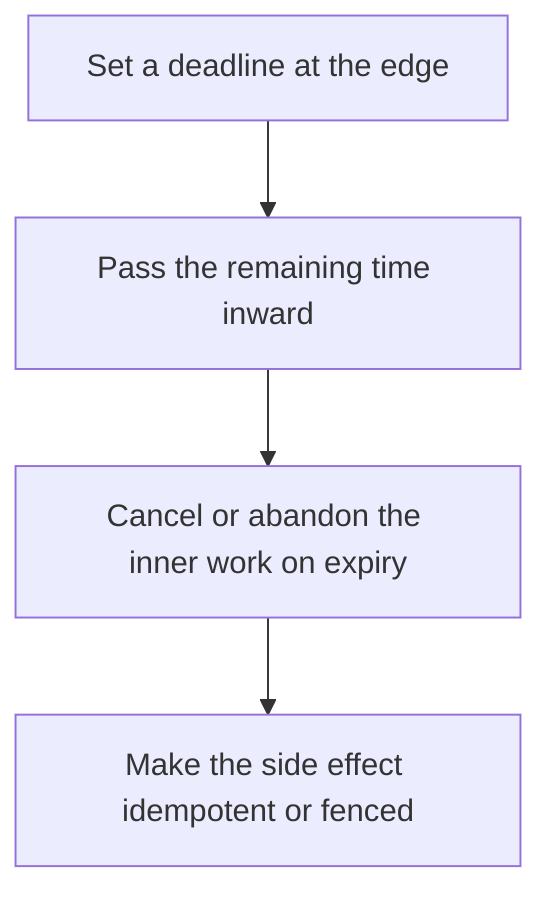

# D13-T021 — Cancellation and timeouts

Topic ID: `D13-T021`
Domain: Concurrency and Parallel Processing
Subdomain: Cancellation and timeouts
Importance: core
Complexity: advanced
Dependencies: `D13-T020`, `D13-T001`, `D01-T001`, `D01-T002`, `D03-T001`, `D03-T002`
Execution status of the code in section F: unexecuted

## A. Topic Overview

A timeout bounds how long a caller waits. Cancellation tells the callee to stop. A timeout without cancellation leaves the callee running and holding resources. Deadlines should shrink as they propagate so the inner call gives up before the outer call does. Retries need the remaining budget. A cancelled operation must still leave data consistent.

In production this shows up as follows: An API gateway sets a 800 ms deadline. The handler gives the database 500 ms and the rest to rendering. On timeout it cancels the query. The write path uses an idempotency key because cancel may arrive after the commit.

Interviewers use Cancellation and timeouts to see whether you can state the failure mode, not only the definition. The failure to name is: a timed-out request that still charges a card because nobody told the worker to stop, and the client retries

Prerequisites: `D13-T020`, `D13-T001`, `D01-T001`, `D01-T002`, `D03-T001`, `D03-T002`. Later notes should link here instead of repeating the mechanism.

## B. First-Principles Explanation

A timeout bounds how long a caller waits. Cancellation tells the callee to stop. A timeout without cancellation leaves the callee running and holding resources. Deadlines should shrink as they propagate so the inner call gives up before the outer call does. Retries need the remaining budget. A cancelled operation must still leave data consistent.

The useful picture is: A timeout is deciding you will leave the restaurant at 1:00. Cancellation is telling the kitchen to stop cooking. Leaving without telling them wastes the meal and you may be billed.

What has to be true:

1. Set a deadline at the edge
2. Pass the remaining time inward
3. Cancel or abandon the inner work on expiry
4. Make the side effect idempotent or fenced

It works when those steps preserve one invariant. It fails when a timed-out request that still charges a card because nobody told the worker to stop, and the client retries. The alternative is: you time out and retry a non-idempotent charge with no key

## C. Internal Working and Architecture

Components involved: the caller, the state Cancellation and timeouts mutates or reads, and the observer that reports cancel latency and duplicate side effects after a timeout.

Execution:

1. Set a deadline at the edge
2. Pass the remaining time inward
3. Cancel or abandon the inner work on expiry
4. Make the side effect idempotent or fenced

Data moves only along that path. A retry re-enters at step 1, so the operation must say what a duplicate does. Memory and locks stay inside this mechanism. Callers see the result or a typed error, not a half-updated invariant.

State to remember: choose this when a call can exceed the user's patience or the caller's deadline. Do not choose it when you time out and retry a non-idempotent charge with no key.

## D. Diagrams and Visual Models



Read the diagram from top to bottom. Each box is one step of Cancellation and timeouts. The failure mode (a timed-out request that still charges a card because nobody told the worker to stop, and the client retries) is what you look for when a later box never happens or happens twice.

## E. Examples and Analogies

Analogy: A timeout is deciding you will leave the restaurant at 1:00. Cancellation is telling the kitchen to stop cooking. Leaving without telling them wastes the meal and you may be billed.

Production example: An API gateway sets a 800 ms deadline. The handler gives the database 500 ms and the rest to rendering. On timeout it cancels the query. The write path uses an idempotency key because cancel may arrive after the commit.

A small counterexample is enough in an interview. Show the input, apply the steps, and show the broken outcome if someone uses the mechanism outside its rule: a timed-out request that still charges a card because nobody told the worker to stop, and the client retries.

## F. Code Examples

The snippet is labeled unexecuted. It illustrates the shape of the idea. It is not a benchmark and it embeds no secret.

```python
def remaining(deadline, now):
    return max(0, deadline - now)
```

After the snippet, check cancel latency and duplicate side effects after a timeout. If that signal moves the wrong way, the snippet is the wrong tool for the workload.

## G. Practical Backend Application

Use Cancellation and timeouts in a service when a call can exceed the user's patience or the caller's deadline.

A typical place is the production case already stated: An API gateway sets a 800 ms deadline. The handler gives the database 500 ms and the rest to rendering. On timeout it cancels the query. The write path uses an idempotency key because cancel may arrive after the commit.

Operationally you alert on cancel latency and duplicate side effects after a timeout. You do not alert only on process uptime. The dashboard should show the failure mode, a success rate, and the saturation signal (queue depth, lock wait, or latency) that predicts it.

## H. Advantages, Limitations and Trade-offs

| Choice | Benefit | Cost | Choose when | Avoid when |
| --- | --- | --- | --- | --- |
| Apply Cancellation and timeouts | a call can exceed the user's patience or the caller's deadline | Extra moving parts and a new failure mode | The failure you are preventing is already real | you time out and retry a non-idempotent charge with no key |
| Simpler alternative | Less code and fewer dependencies | a timed-out request that still charges a card because nobody told the worker to stop, and the client retries | The workload does not hit the limit | The invariant must hold under concurrency or failure |

Cancellation and timeouts is a trade. State the benefit and the cost in the same sentence when you propose it in a design review.

## I. Common Mistakes and Misconceptions

- Timeouts that do not cancel.
- Inner timeouts longer than the outer deadline.
- Ignoring the work that already committed.
- Treating a diagram of Cancellation and timeouts as proof that the invariant holds in production.
- Copying a default configuration without naming cancel latency and duplicate side effects after a timeout.

## J. Debugging and Troubleshooting

Symptom: a timed-out request that still charges a card because nobody told the worker to stop, and the client retries

First check: cancel latency and duplicate side effects after a timeout.

Then compare one healthy instance against one unhealthy instance. Confirm whether retries are duplicating work. Confirm whether a timeout is shorter than the work. Fix the invariant, then watch the same metric for a full peak, not only for the next minute.

Useful questions: did the step order in section C actually happen, or did a caller skip a step? Did a deploy change the data shape that Cancellation and timeouts assumes?

## K. Interview Preparation

### Beginner

#### Q1. What problem does Cancellation and timeouts solve?

**Answer:** A timeout bounds how long a caller waits. Cancellation tells the callee to stop. A timeout without cancellation leaves the callee running and holding resources. Deadlines should shrink as they propagate so the inner call gives up before the outer call does. Retries need the remaining budget. A cancelled operation must still leave data consistent. Without it, the usual backend failure is: a timed-out request that still charges a card because nobody told the worker to stop, and the client retries.

#### Q2. Where does Cancellation and timeouts sit on a request path?

**Answer:** Cancellation and timeouts is not a library you sprinkle on every call. a call can exceed the user's patience or the caller's deadline You notice it when cancel latency and duplicate side effects after a timeout. Name the constraint that makes this choice correct. Say what you would measure to confirm it.

#### Q3. Give a concrete example of Cancellation and timeouts.

**Answer:** An API gateway sets a 800 ms deadline. The handler gives the database 500 ms and the rest to rendering. On timeout it cancels the query. The write path uses an idempotency key because cancel may arrive after the commit. Walk the input, the state change, and the observable output.

#### Q4. What is a common mix-up around Cancellation and timeouts?

**Answer:** a timed-out request that still charges a card because nobody told the worker to stop, and the client retries The corrective check is cancel latency and duplicate side effects after a timeout. Name the constraint that makes this choice correct. Say what you would measure to confirm it. Say which alternative you rejected and why.

#### Q5. When would you skip Cancellation and timeouts?

**Answer:** you time out and retry a non-idempotent charge with no key Skipping is a decision with a measured cost, not a slogan. Name the constraint that makes this choice correct. Say what you would measure to confirm it. Say which alternative you rejected and why.

### Intermediate

#### Q1. What invariant makes Cancellation and timeouts correct?

**Answer:** A timeout bounds how long a caller waits. Cancellation tells the callee to stop. A timeout without cancellation leaves the callee running and holding resources. Deadlines should shrink as they propagate so the inner call gives up before the outer call does. Retries need the remaining budget. A cancelled operation must still leave data consistent. State the invariant before you name the tool.

#### Q2. How do you test Cancellation and timeouts?

**Answer:** Assert the failure mode directly: a timed-out request that still charges a card because nobody told the worker to stop, and the client retries. The assertion should watch cancel latency and duplicate side effects after a timeout. Include a concurrent or retry case if the bug only appears then. Name the constraint that makes this choice correct.

#### Q3. What signal tells you Cancellation and timeouts is misbehaving in production?

**Answer:** Watch cancel latency and duplicate side effects after a timeout. The user-visible symptom is usually a timed-out request that still charges a card because nobody told the worker to stop, and the client retries. Name the constraint that makes this choice correct. Say what you would measure to confirm it.

#### Q4. How would you introduce Cancellation and timeouts into a legacy service?

**Answer:** a call can exceed the user's patience or the caller's deadline Ship it behind a metric so you can compare the old path. Roll back if a timed-out request that still charges a card because nobody told the worker to stop, and the client retries gets worse. Name the constraint that makes this choice correct. Say what you would measure to confirm it.

#### Q5. What do you trade away by choosing Cancellation and timeouts?

**Answer:** a call can exceed the user's patience or the caller's deadline you time out and retry a non-idempotent charge with no key Say the cost in latency, storage, or operational load. Name the constraint that makes this choice correct. Say what you would measure to confirm it. Say which alternative you rejected and why.

### Advanced

#### Q1. What breaks if a dependency of Cancellation and timeouts is slow or down?

**Answer:** a timed-out request that still charges a card because nobody told the worker to stop, and the client retries Degrade using the rule: you time out and retry a non-idempotent charge with no key. Timeouts must be shorter than the caller's deadline. Name the constraint that makes this choice correct. Say what you would measure to confirm it.

#### Q2. How does Cancellation and timeouts behave under retries?

**Answer:** Retries repeat work, so Cancellation and timeouts must define what a duplicate does. a timed-out request that still charges a card because nobody told the worker to stop, and the client retries Idempotency keys or fences belong next to the write, not in a comment. Name the constraint that makes this choice correct. Say what you would measure to confirm it.

#### Q3. What is the capacity limit of Cancellation and timeouts?

**Answer:** The limit shows up as cancel latency and duplicate side effects after a timeout. Add capacity only after you know whether the bottleneck is CPU, lock wait, or network. Name the constraint that makes this choice correct. Say what you would measure to confirm it.

#### Q4. How do you evolve Cancellation and timeouts without a flag day?

**Answer:** a call can exceed the user's patience or the caller's deadline Version the contract or the on-disk format. Readers should tolerate one old and one new shape during the rollout. Name the constraint that makes this choice correct. Say what you would measure to confirm it.

#### Q5. What security or correctness bug hides inside Cancellation and timeouts?

**Answer:** a timed-out request that still charges a card because nobody told the worker to stop, and the client retries Check authorization and tenancy at the same boundary as the mechanism. A cache or queue must not widen who can read the data. Name the constraint that makes this choice correct. Say what you would measure to confirm it.

### Scenario

#### Q1. Incident: a timed-out request that still charges a card because nobody told the worker to stop, and the client retries. What do you check first?

**Answer:** Start with cancel latency and duplicate side effects after a timeout. Compare a good host and a bad host before you restart anything. A timeout bounds how long a caller waits. Cancellation tells the callee to stop. A timeout without cancellation leaves the callee running and holding resources. Deadlines should shrink as they propagate so the inner call gives up before the outer call does. Retries need the remaining budget. A cancelled operation must still leave data consistent.

#### Q2. A reviewer wants the clever version. What data settles it?

**Answer:** a call can exceed the user's patience or the caller's deadline you time out and retry a non-idempotent charge with no key Bring cancel latency and duplicate side effects after a timeout from a load test or from production, not a slogan. Name the constraint that makes this choice correct. Say what you would measure to confirm it. Say which alternative you rejected and why.

#### Q3. You have one hour to explain Cancellation and timeouts at a whiteboard.

**Answer:** Draw the happy path in four boxes. Then draw the failure: a timed-out request that still charges a card because nobody told the worker to stop, and the client retries. End with the metric you would page on. Name the constraint that makes this choice correct.

#### Q4. The bug only appears under two concurrent callers.

**Answer:** a timed-out request that still charges a card because nobody told the worker to stop, and the client retries Reproduce with a barrier so both sides enter the critical window. Confirm the fix with cancel latency and duplicate side effects after a timeout. Name the constraint that makes this choice correct. Say what you would measure to confirm it.

#### Q5. Leadership wants this on every service next week.

**Answer:** you time out and retry a non-idempotent charge with no key a call can exceed the user's patience or the caller's deadline Roll it out where the failure mode is already hurting users. Name the constraint that makes this choice correct. Say what you would measure to confirm it. Say which alternative you rejected and why.

### Follow-up

#### Q1. What did you assume about the data size or the clock?

**Answer:** A timeout bounds how long a caller waits. Cancellation tells the callee to stop. A timeout without cancellation leaves the callee running and holding resources. Deadlines should shrink as they propagate so the inner call gives up before the outer call does. Retries need the remaining budget. A cancelled operation must still leave data consistent. Clocks are not a total order across machines. State whether the algorithm needs bounded size or a single leader.

#### Q2. What would you measure after the change ships?

**Answer:** Page on cancel latency and duplicate side effects after a timeout. Keep a before/after dashboard for one week. Alert on the failure mode, not only on CPU. Name the constraint that makes this choice correct.

#### Q3. Which neighboring topic did you deliberately not re-teach?

**Answer:** This note owns Cancellation and timeouts. Related identifiers are in section N. Shared ideas are linked, not copied. Name the constraint that makes this choice correct.

## L. Practical Exercises

Solutions are in `EXERCISES/solutions/D13-T021.md`, not in this section.

1. Whiteboard the four steps of Cancellation and timeouts and mark where `a timed-out request that still charges a card because nobody told the worker to stop, and the client retries` enters.
2. Read the snippet in section F and write the assertion that would catch that failure. The assertion must mention `cancel latency and duplicate side effects after a timeout`.
3. Argue for or against using Cancellation and timeouts on a service you know. Use the choose and avoid rows from section H. Do not appeal to popularity.

## M. Revision Notes

- Mechanism: A timeout bounds how long a caller waits.
- Failure: a timed-out request that still charges a card because nobody told the worker to stop, and the client retries
- Metric: cancel latency and duplicate side effects after a timeout
- Choose when: a call can exceed the user's patience or the caller's deadline
- Avoid when: you time out and retry a non-idempotent charge with no key

## N. Related Topics

Dependencies to review first: `D13-T020`, `D13-T001`, `D01-T001`, `D01-T002`, `D03-T001`, `D03-T002`.

Shared ideas stay in those notes. This note does not restate them.

## O. Completion Criteria

- You can explain Cancellation and timeouts without reading this note, including the failure mode.
- You can draw the diagram in section D from memory.
- You can say when not to use it, using the avoid condition in section H.
- You can name the metric you would watch after shipping it.
