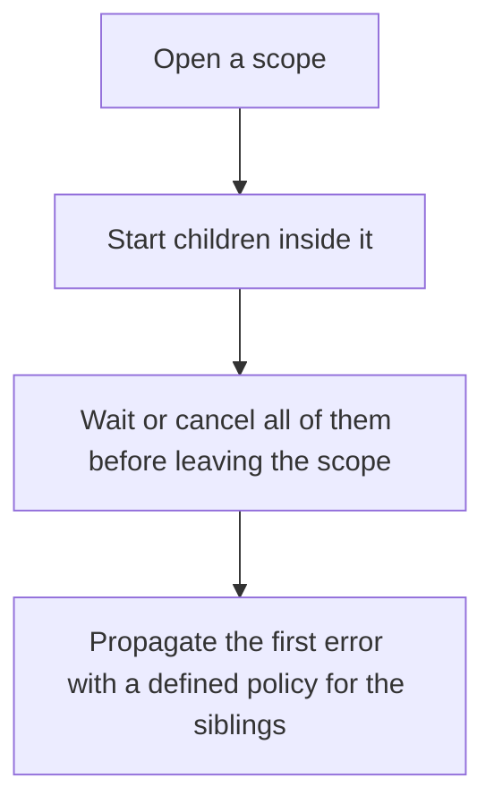

# D13-T022 — Structured concurrency concepts

Topic ID: `D13-T022`
Domain: Concurrency and Parallel Processing
Subdomain: Structured concurrency concepts
Importance: core
Complexity: advanced
Dependencies: `D13-T021`, `D13-T001`, `D01-T001`, `D01-T002`, `D03-T001`, `D03-T002`
Execution status of the code in section F: unexecuted

## A. Topic Overview

Structured concurrency keeps child tasks inside a parent's lifetime. The parent waits for the children, or cancels them, before it returns. Errors surface to the parent instead of disappearing into a detached callback. A nursery or a scope is the usual API. It stops the leak where a request ends and a background task still writes.

In production this shows up as follows: A request handler fans out two lookups in a task group. If the client disconnects, the scope cancels both lookups. A fire-and-forget task that writes an audit row needs its own scope owned by a worker, not by the request.

Interviewers use Structured concurrency concepts to see whether you can state the failure mode, not only the definition. The failure to name is: a detached task that outlives the request and writes a response nobody needs, or an error that is never observed

Prerequisites: `D13-T021`, `D13-T001`, `D01-T001`, `D01-T002`, `D03-T001`, `D03-T002`. Later notes should link here instead of repeating the mechanism.

## B. First-Principles Explanation

Structured concurrency keeps child tasks inside a parent's lifetime. The parent waits for the children, or cancels them, before it returns. Errors surface to the parent instead of disappearing into a detached callback. A nursery or a scope is the usual API. It stops the leak where a request ends and a background task still writes.

The useful picture is: Structured concurrency is a teacher who does not leave the museum until every student is back on the bus. Detached tasks are students you hope find their own way home.

What has to be true:

1. Open a scope
2. Start children inside it
3. Wait or cancel all of them before leaving the scope
4. Propagate the first error with a defined policy for the siblings

It works when those steps preserve one invariant. It fails when a detached task that outlives the request and writes a response nobody needs, or an error that is never observed. The alternative is: you detach a task and hope the process exit cleans it up

## C. Internal Working and Architecture

Components involved: the caller, the state Structured concurrency concepts mutates or reads, and the observer that reports tasks still running after the parent scope ends.

Execution:

1. Open a scope
2. Start children inside it
3. Wait or cancel all of them before leaving the scope
4. Propagate the first error with a defined policy for the siblings

Data moves only along that path. A retry re-enters at step 1, so the operation must say what a duplicate does. Memory and locks stay inside this mechanism. Callers see the result or a typed error, not a half-updated invariant.

State to remember: choose this when a unit of work has subtasks that must finish or be cancelled with it. Do not choose it when you detach a task and hope the process exit cleans it up.

## D. Diagrams and Visual Models



Read the diagram from top to bottom. Each box is one step of Structured concurrency concepts. The failure mode (a detached task that outlives the request and writes a response nobody needs, or an error that is never observed) is what you look for when a later box never happens or happens twice.

## E. Examples and Analogies

Analogy: Structured concurrency is a teacher who does not leave the museum until every student is back on the bus. Detached tasks are students you hope find their own way home.

Production example: A request handler fans out two lookups in a task group. If the client disconnects, the scope cancels both lookups. A fire-and-forget task that writes an audit row needs its own scope owned by a worker, not by the request.

A small counterexample is enough in an interview. Show the input, apply the steps, and show the broken outcome if someone uses the mechanism outside its rule: a detached task that outlives the request and writes a response nobody needs, or an error that is never observed.

## F. Code Examples

The snippet is labeled unexecuted. It illustrates the shape of the idea. It is not a benchmark and it embeds no secret.

```python
import asyncio

async def parent():
    async with asyncio.TaskGroup() as group:
        group.create_task(asyncio.sleep(0))
```

After the snippet, check tasks still running after the parent scope ends. If that signal moves the wrong way, the snippet is the wrong tool for the workload.

## G. Practical Backend Application

Use Structured concurrency concepts in a service when a unit of work has subtasks that must finish or be cancelled with it.

A typical place is the production case already stated: A request handler fans out two lookups in a task group. If the client disconnects, the scope cancels both lookups. A fire-and-forget task that writes an audit row needs its own scope owned by a worker, not by the request.

Operationally you alert on tasks still running after the parent scope ends. You do not alert only on process uptime. The dashboard should show the failure mode, a success rate, and the saturation signal (queue depth, lock wait, or latency) that predicts it.

## H. Advantages, Limitations and Trade-offs

| Choice | Benefit | Cost | Choose when | Avoid when |
| --- | --- | --- | --- | --- |
| Apply Structured concurrency concepts | a unit of work has subtasks that must finish or be cancelled with it | Extra moving parts and a new failure mode | The failure you are preventing is already real | you detach a task and hope the process exit cleans it up |
| Simpler alternative | Less code and fewer dependencies | a detached task that outlives the request and writes a response nobody needs, or an error that is never observed | The workload does not hit the limit | The invariant must hold under concurrency or failure |

Structured concurrency concepts is a trade. State the benefit and the cost in the same sentence when you propose it in a design review.

## I. Common Mistakes and Misconceptions

- Fire-and-forget on a request.
- Swallowing child errors.
- A scope that waits with no cancellation path.
- Treating a diagram of Structured concurrency concepts as proof that the invariant holds in production.
- Copying a default configuration without naming tasks still running after the parent scope ends.

## J. Debugging and Troubleshooting

Symptom: a detached task that outlives the request and writes a response nobody needs, or an error that is never observed

First check: tasks still running after the parent scope ends.

Then compare one healthy instance against one unhealthy instance. Confirm whether retries are duplicating work. Confirm whether a timeout is shorter than the work. Fix the invariant, then watch the same metric for a full peak, not only for the next minute.

Useful questions: did the step order in section C actually happen, or did a caller skip a step? Did a deploy change the data shape that Structured concurrency concepts assumes?

## K. Interview Preparation

### Beginner

#### Q1. What problem does Structured concurrency concepts solve?

**Answer:** Structured concurrency keeps child tasks inside a parent's lifetime. The parent waits for the children, or cancels them, before it returns. Errors surface to the parent instead of disappearing into a detached callback. A nursery or a scope is the usual API. It stops the leak where a request ends and a background task still writes. Without it, the usual backend failure is: a detached task that outlives the request and writes a response nobody needs, or an error that is never observed.

#### Q2. Where does Structured concurrency concepts sit on a request path?

**Answer:** Structured concurrency concepts is not a library you sprinkle on every call. a unit of work has subtasks that must finish or be cancelled with it You notice it when tasks still running after the parent scope ends. Name the constraint that makes this choice correct. Say what you would measure to confirm it.

#### Q3. Give a concrete example of Structured concurrency concepts.

**Answer:** A request handler fans out two lookups in a task group. If the client disconnects, the scope cancels both lookups. A fire-and-forget task that writes an audit row needs its own scope owned by a worker, not by the request. Walk the input, the state change, and the observable output.

#### Q4. What is a common mix-up around Structured concurrency concepts?

**Answer:** a detached task that outlives the request and writes a response nobody needs, or an error that is never observed The corrective check is tasks still running after the parent scope ends. Name the constraint that makes this choice correct. Say what you would measure to confirm it. Say which alternative you rejected and why.

#### Q5. When would you skip Structured concurrency concepts?

**Answer:** you detach a task and hope the process exit cleans it up Skipping is a decision with a measured cost, not a slogan. Name the constraint that makes this choice correct. Say what you would measure to confirm it. Say which alternative you rejected and why.

### Intermediate

#### Q1. What invariant makes Structured concurrency concepts correct?

**Answer:** Structured concurrency keeps child tasks inside a parent's lifetime. The parent waits for the children, or cancels them, before it returns. Errors surface to the parent instead of disappearing into a detached callback. A nursery or a scope is the usual API. It stops the leak where a request ends and a background task still writes. State the invariant before you name the tool.

#### Q2. How do you test Structured concurrency concepts?

**Answer:** Assert the failure mode directly: a detached task that outlives the request and writes a response nobody needs, or an error that is never observed. The assertion should watch tasks still running after the parent scope ends. Include a concurrent or retry case if the bug only appears then. Name the constraint that makes this choice correct.

#### Q3. What signal tells you Structured concurrency concepts is misbehaving in production?

**Answer:** Watch tasks still running after the parent scope ends. The user-visible symptom is usually a detached task that outlives the request and writes a response nobody needs, or an error that is never observed. Name the constraint that makes this choice correct. Say what you would measure to confirm it.

#### Q4. How would you introduce Structured concurrency concepts into a legacy service?

**Answer:** a unit of work has subtasks that must finish or be cancelled with it Ship it behind a metric so you can compare the old path. Roll back if a detached task that outlives the request and writes a response nobody needs, or an error that is never observed gets worse. Name the constraint that makes this choice correct. Say what you would measure to confirm it.

#### Q5. What do you trade away by choosing Structured concurrency concepts?

**Answer:** a unit of work has subtasks that must finish or be cancelled with it you detach a task and hope the process exit cleans it up Say the cost in latency, storage, or operational load. Name the constraint that makes this choice correct. Say what you would measure to confirm it. Say which alternative you rejected and why.

### Advanced

#### Q1. What breaks if a dependency of Structured concurrency concepts is slow or down?

**Answer:** a detached task that outlives the request and writes a response nobody needs, or an error that is never observed Degrade using the rule: you detach a task and hope the process exit cleans it up. Timeouts must be shorter than the caller's deadline. Name the constraint that makes this choice correct. Say what you would measure to confirm it.

#### Q2. How does Structured concurrency concepts behave under retries?

**Answer:** Retries repeat work, so Structured concurrency concepts must define what a duplicate does. a detached task that outlives the request and writes a response nobody needs, or an error that is never observed Idempotency keys or fences belong next to the write, not in a comment. Name the constraint that makes this choice correct. Say what you would measure to confirm it.

#### Q3. What is the capacity limit of Structured concurrency concepts?

**Answer:** The limit shows up as tasks still running after the parent scope ends. Add capacity only after you know whether the bottleneck is CPU, lock wait, or network. Name the constraint that makes this choice correct. Say what you would measure to confirm it.

#### Q4. How do you evolve Structured concurrency concepts without a flag day?

**Answer:** a unit of work has subtasks that must finish or be cancelled with it Version the contract or the on-disk format. Readers should tolerate one old and one new shape during the rollout. Name the constraint that makes this choice correct. Say what you would measure to confirm it.

#### Q5. What security or correctness bug hides inside Structured concurrency concepts?

**Answer:** a detached task that outlives the request and writes a response nobody needs, or an error that is never observed Check authorization and tenancy at the same boundary as the mechanism. A cache or queue must not widen who can read the data. Name the constraint that makes this choice correct. Say what you would measure to confirm it.

### Scenario

#### Q1. Incident: a detached task that outlives the request and writes a response nobody needs, or an error that is never observed. What do you check first?

**Answer:** Start with tasks still running after the parent scope ends. Compare a good host and a bad host before you restart anything. Structured concurrency keeps child tasks inside a parent's lifetime. The parent waits for the children, or cancels them, before it returns. Errors surface to the parent instead of disappearing into a detached callback. A nursery or a scope is the usual API. It stops the leak where a request ends and a background task still writes.

#### Q2. A reviewer wants the clever version. What data settles it?

**Answer:** a unit of work has subtasks that must finish or be cancelled with it you detach a task and hope the process exit cleans it up Bring tasks still running after the parent scope ends from a load test or from production, not a slogan. Name the constraint that makes this choice correct. Say what you would measure to confirm it. Say which alternative you rejected and why.

#### Q3. You have one hour to explain Structured concurrency concepts at a whiteboard.

**Answer:** Draw the happy path in four boxes. Then draw the failure: a detached task that outlives the request and writes a response nobody needs, or an error that is never observed. End with the metric you would page on. Name the constraint that makes this choice correct.

#### Q4. The bug only appears under two concurrent callers.

**Answer:** a detached task that outlives the request and writes a response nobody needs, or an error that is never observed Reproduce with a barrier so both sides enter the critical window. Confirm the fix with tasks still running after the parent scope ends. Name the constraint that makes this choice correct. Say what you would measure to confirm it.

#### Q5. Leadership wants this on every service next week.

**Answer:** you detach a task and hope the process exit cleans it up a unit of work has subtasks that must finish or be cancelled with it Roll it out where the failure mode is already hurting users. Name the constraint that makes this choice correct. Say what you would measure to confirm it. Say which alternative you rejected and why.

### Follow-up

#### Q1. What did you assume about the data size or the clock?

**Answer:** Structured concurrency keeps child tasks inside a parent's lifetime. The parent waits for the children, or cancels them, before it returns. Errors surface to the parent instead of disappearing into a detached callback. A nursery or a scope is the usual API. It stops the leak where a request ends and a background task still writes. Clocks are not a total order across machines. State whether the algorithm needs bounded size or a single leader.

#### Q2. What would you measure after the change ships?

**Answer:** Page on tasks still running after the parent scope ends. Keep a before/after dashboard for one week. Alert on the failure mode, not only on CPU. Name the constraint that makes this choice correct.

#### Q3. Which neighboring topic did you deliberately not re-teach?

**Answer:** This note owns Structured concurrency concepts. Related identifiers are in section N. Shared ideas are linked, not copied. Name the constraint that makes this choice correct.

## L. Practical Exercises

Solutions are in `EXERCISES/solutions/D13-T022.md`, not in this section.

1. Whiteboard the four steps of Structured concurrency concepts and mark where `a detached task that outlives the request and writes a response nobody needs, or an error that is never observed` enters.
2. Read the snippet in section F and write the assertion that would catch that failure. The assertion must mention `tasks still running after the parent scope ends`.
3. Argue for or against using Structured concurrency concepts on a service you know. Use the choose and avoid rows from section H. Do not appeal to popularity.

## M. Revision Notes

- Mechanism: Structured concurrency keeps child tasks inside a parent's lifetime.
- Failure: a detached task that outlives the request and writes a response nobody needs, or an error that is never observed
- Metric: tasks still running after the parent scope ends
- Choose when: a unit of work has subtasks that must finish or be cancelled with it
- Avoid when: you detach a task and hope the process exit cleans it up

## N. Related Topics

Dependencies to review first: `D13-T021`, `D13-T001`, `D01-T001`, `D01-T002`, `D03-T001`, `D03-T002`.

Shared ideas stay in those notes. This note does not restate them.

## O. Completion Criteria

- You can explain Structured concurrency concepts without reading this note, including the failure mode.
- You can draw the diagram in section D from memory.
- You can say when not to use it, using the avoid condition in section H.
- You can name the metric you would watch after shipping it.
