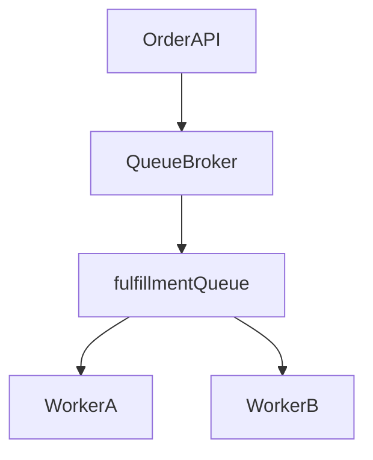
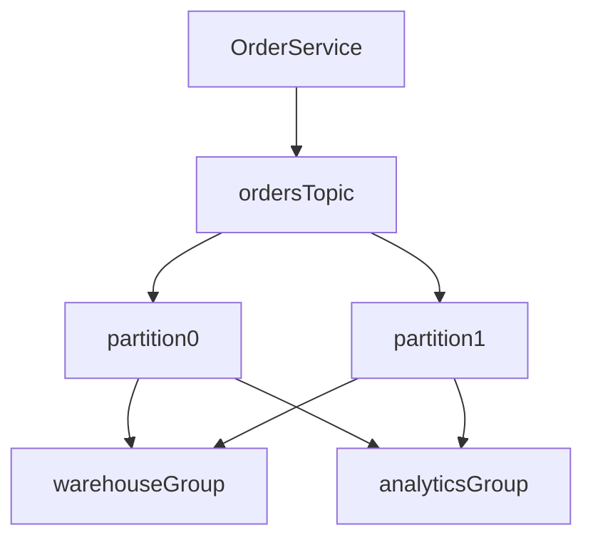

# D14-T001 — Message queues vs event streams

Topic ID: `D14-T001`
Domain: Messaging and Event-Driven Architecture
Subdomain: Message queues vs event streams
Importance: common
Complexity: advanced
Dependencies: `D04-T001`, `D04-T002`, `D05-T001`, `D05-T002`, `D13-T001`, `D13-T002`
Execution status of the code in section F: executed (CPython, local)

## A. Topic Overview

A message queue is a broker pattern where producers send work items to a queue and consumers compete to process each message until it is acknowledged or expired. An event stream is an append-only log where producers write ordered records to topics and many consumers can read the same history at their own pace. The distinction exists because backends need both task distribution and durable broadcast of facts.

Queues optimize for “do this job once” semantics: one consumer wins, the message disappears after ack, and the broker can push backpressure when workers are saturated. Streams optimize for “this happened” semantics: events stay for a retention window, replays are possible, and multiple independent pipelines can derive state from the same log.

In production you see queues for order fulfillment, email dispatch, and image resizing. You see streams for click analytics, CDC into warehouses, and event-sourced projections. Interviewers use this topic to see whether you pick the right abstraction for coupling, replay, ordering, and failure handling instead of treating “Kafka” and “RabbitMQ” as interchangeable labels.

Prerequisites: HTTP request lifecycle and basic concurrency. Later topics such as Kafka architecture (`D14-T003`) and delivery guarantees (`D14-T018`) build directly on this split.

## B. First-Principles Explanation

Both patterns move bytes across process boundaries, but they encode different contracts about retention, consumption, and meaning.

A queue stores messages as transient tasks. The broker’s job is to hand each message to exactly one active consumer in a competing-consumer group, then remove or dead-letter it after processing. The consumer’s ack is the commit point: until ack, the broker may redeliver. That makes queues natural for work stealing and horizontal scale of homogeneous workers.

A stream stores records in partitions as an ordered sequence identified by offset. Producers append; consumers track a cursor (offset) per partition. Retention is time- or size-based, not “until processed.” Multiple consumer groups can read the same topic without stealing messages from each other because each group maintains its own offsets.

What happens internally for a queue publish:

1. Producer serializes a payload and metadata (routing key, priority, TTL).
2. Broker persists to a queue structure (memory, disk, or replicated log depending on product).
3. Broker pushes or pulls to a consumer; unacked messages sit in an in-flight set.
4. Consumer processes and sends ack; broker deletes or marks complete.
5. On crash before ack, redelivery occurs—at-least-once unless the app deduplicates.

What happens internally for a stream publish:

1. Producer chooses topic and partition (key hash or explicit).
2. Broker appends the record to the partition log and replicates to followers.
3. Consumers poll or are pushed batches from their committed offset.
4. Processing advances offset only after the consumer chooses to commit (auto or manual).
5. Late consumers can rewind; compaction may retain only latest key per record key.

Why it works: queues minimize duplicate work among peers; streams maximize fan-out and auditability. Limitations: queues are poor at “every service saw the same history”; streams are poor at “only one worker should ever touch this job” without extra coordination. Alternatives include outbox tables plus CDC, direct RPC with idempotency, and hybrid systems (stream as log + queue-like consumer groups with partition assignment).

Terms: **competing consumers** share one subscription and split messages. **consumer group** in Kafka assigns each partition to one member at a time. **retention** is how long stream data remains readable. **visibility timeout** is how long a queue message stays invisible after a failed consumer claim.

## C. Internal Working and Architecture

Components in a typical queue deployment:

- Producers (API services, cron jobs) and a broker cluster (RabbitMQ, Amazon SQS, Azure Service Bus).
- Queues (named buffers) with optional exchanges for routing.
- Consumers (worker pools) that scale horizontally.
- Dead-letter queues (DLQ) for poison messages.
- Optional delay queues and priority lanes.

Components in a typical stream deployment:

- Producers writing to topics sharded into partitions.
- Broker cluster (Kafka, Pulsar, Kinesis) with replication per partition.
- ZooKeeper or KRaft (Kafka) for metadata; separate from data path in modern setups.
- Consumer groups with partition assignment and offset storage (broker or external).
- Connectors and stream processors reading the same log.

Data flow, queue path for “resize uploaded image”:

1. API accepts upload, stores blob, enqueues `{image_id, sizes}`.
2. Worker pulls message, downloads blob, writes derivatives, updates DB.
3. Worker acks; broker removes message from ready set.
4. If worker dies mid-resize, message becomes visible again; second worker must tolerate partial artifacts (idempotent writes).

Data flow, stream path for “order placed”:

1. Order service commits transaction, publishes `OrderPlaced` to `orders` topic.
2. Warehouse consumer group updates inventory projection.
3. Analytics consumer group loads raw events to the lake.
4. Email consumer group triggers notification; each group commits offsets independently.
5. A new fraud model can replay last seven days without republishing from the order service.

State: queues track per-message delivery state (ready, in-flight, dead). Streams track per-partition high-water mark and per-group offsets. Neither replaces a transactional database for authoritative business state; they buffer or broadcast facts.

Memory and disk: queues bound depth with TTL and max length policies. Streams bound with retention bytes and segment files; consumers lagging beyond retention lose history unless archived to object storage.

## D. Diagrams and Visual Models



Read this as competing consumers: each message leaves the queue once when a single worker acks.



Each consumer group reads all partitions; within a group, each partition is owned by one member at a time.

## E. Examples and Analogies

Analogy: a queue is a to-do tray on a shared desk—whoever grabs the top sticky note owns it until they mark it done. A stream is a company-wide minutes book—every team may read the same pages on their own schedule, and new pages append; nobody “consumes” a page off the book for others.

Technical example: sending password-reset email fits a queue. You want one delivery attempt chain per request, DLQ on repeated failure, and no need for marketing to replay every reset event from 2019.

Technical example: recording `PaymentCaptured` fits a stream. Finance, data warehouse, and risk engines each need the event; retention supports backfill when a new model launches.

Do not use a queue when multiple independent teams must read the same historical events without republishing. Do not use a raw stream partition as a mutex for global singleton work without keyed partitioning and idempotent handlers. Do not assume either pattern gives cross-service atomicity with your database write unless you implement outbox or transactional messaging carefully.

## F. Code Examples

File: `examples/d14_t001_queue_vs_stream.py`

Dependencies: Python 3 standard library only (in-memory simulation).

```python
from collections import deque
from dataclasses import dataclass
from typing import Callable, Deque, Dict, List, Set


@dataclass(frozen=True)
class Event:
    key: str
    payload: str


class InMemoryQueue:
    """Competing consumers: each message delivered to one worker until ack."""

    def __init__(self) -> None:
        self._ready: Deque[Event] = deque()
        self._inflight: Dict[int, Event] = {}
        self._seq = 0

    def publish(self, event: Event) -> None:
        self._ready.append(event)

    def receive(self) -> tuple[int, Event] | None:
        if not self._ready:
            return None
        event = self._ready.popleft()
        self._seq += 1
        tag = self._seq
        self._inflight[tag] = event
        return tag, event

    def ack(self, tag: int) -> None:
        self._inflight.pop(tag, None)


class InMemoryStream:
    """Append-only log; multiple consumer groups keep separate offsets."""

    def __init__(self) -> None:
        self._log: List[Event] = []
        self._offsets: Dict[str, int] = {}

    def append(self, event: Event) -> int:
        self._log.append(event)
        return len(self._log) - 1

    def poll(self, group: str, max_records: int = 10) -> List[tuple[int, Event]]:
        start = self._offsets.get(group, 0)
        batch = []
        for idx in range(start, min(start + max_records, len(self._log))):
            batch.append((idx, self._log[idx]))
        return batch

    def commit(self, group: str, offset: int) -> None:
        self._offsets[group] = offset + 1


def run_queue_demo() -> int:
    q = InMemoryQueue()
    q.publish(Event("job-1", "resize"))
    q.publish(Event("job-2", "resize"))
    first = q.receive()
    second = q.receive()
    assert first and second
    q.ack(first[0])
    q.ack(second[0])
    assert q.receive() is None
    return len({first[1].key, second[1].key})


def run_stream_demo() -> Set[str]:
    s = InMemoryStream()
    s.append(Event("o-1", "placed"))
    s.append(Event("o-2", "placed"))
    wh = {e.payload for _, e in s.poll("warehouse")}
    s.commit("warehouse", 1)
    an = {e.payload for _, e in s.poll("analytics")}
    s.commit("analytics", 1)
    assert wh == an == {"placed"}
    return wh


if __name__ == "__main__":
    jobs = run_queue_demo()
    payloads = run_stream_demo()
    print("ok", jobs, sorted(payloads))
```

How to run: `python examples/d14_t001_queue_vs_stream.py` from this topic folder, or `python backend-engineering-knowledge-base/EXERCISES/examples/d14_t001_queue_vs_stream.py` if copied there.

Expected output: `ok 2 ['placed']`

Important lines: `receive` moves a queue message to `_inflight` until `ack`, modeling at-least-once redelivery if the process dies before ack. `poll`/`commit` per `group` shows independent read positions on the same log. Production brokers add replication, auth, and backpressure; the control flow remains analogous.

Edge cases: duplicate `ack`, negative offsets, and committing before side effects complete (can skip events on crash). Real systems use idempotent consumers and store offsets after durable writes.

This example was executed with system Python; output matched above.

## G. Practical Backend Application

An e-commerce API commits an order row, then must notify fulfillment. If you only need one worker pool to pick jobs, enqueue `FulfillOrder` on SQS with a visibility timeout matching p99 processing time. If marketing, analytics, and anti-fraud each need the same `OrderPlaced` fact, publish to a Kafka topic with keyed partitions by `customer_id` to preserve per-customer ordering where needed.

Operational concerns: monitor queue depth (lag) and age of oldest message. For streams, monitor consumer lag per group and rebalance storms. Scale queue workers with autoscaling on depth. Scale stream consumers by adding group members up to partition count.

Error handling: route poison messages to DLQ after N receives; alert on DLQ rate. For streams, pause processing and fix code before committing bad offsets, or use quarantine topics.

Security: brokers sit on private networks; producers and consumers use TLS and ACLs per topic or queue. Never embed secrets in message bodies; pass references.

Observability: trace publish and consume spans with the same `correlation_id` carried in headers. Metrics: publish rate, consume rate, error rate, lag.

Exactly-once end-to-end processing is not free: it requires idempotent handlers, deduplication stores, and transactional coordination with external systems. Queues and streams typically provide at-least-once delivery; your application earns effective correctness.

## H. Advantages, Limitations and Trade-offs

| Choice | Benefit | Cost | Choose when | Avoid when |
| --- | --- | --- | --- | --- |
| Message queue | Simple work distribution, natural backpressure | Poor multi-subscriber history | Task queues, job runners | Many teams need same event log |
| Event stream | Fan-out, replay, ordered partitions | Operational complexity, partition limits | Analytics, CDC, event-driven sync | Single consumer job with strict once-only semantics |
| Push queue (broker to consumer) | Low latency wakeups | Consumer overload risk | Steady worker pools | Unpredictable burst without rate limits |
| Pull stream (consumer polls) | Consumer controls pace | Higher latency at low volume | High throughput pipelines | Tiny sporadic messages only |
| Short retention stream | Smaller disk bill | Cannot replay old data | Real-time only consumers | Regulatory audit needing years |
| Long retention stream | Backfill and new consumers | Storage and compaction cost | Data platform source of truth | Ephemeral tasks |

Under load, queue depth spikes when consumers are slower than producers—that is expected buffering. Stream lag spikes when one partition is hot; fixing it may require better key choice or more partitions with rebalancing cost.

Failure modes: unbounded queue growth exhausting disk; consumer stuck without ack causing redelivery loops; stream consumer committing offset before DB write then crashing (lost events on replay skip); competing consumers processing the same logical job twice without idempotency.

## I. Common Mistakes and Misconceptions

- Calling every Kafka topic a “queue.” Topics are logs; consumer groups provide queue-like assignment per partition, not global single consumption.
- Using a stream for task execution without idempotent handlers, then blaming the broker for duplicates after rebalance.
- Setting visibility timeout shorter than worst-case job runtime, causing parallel double processing on queues.
- Publishing before the database transaction commits, so consumers see events for orders that roll back.
- Assuming replay is free: downstream systems must handle duplicate or out-of-order events unless you engineer compaction and versioning.
- Picking streams only for resume-driven architecture fashion when a queue plus outbox would be simpler.

Weak interview answer: “Kafka is faster than RabbitMQ.” Strong answer: names retention, fan-out, ordering scope, and consumer model.

## J. Debugging and Troubleshooting

Symptoms: fulfillment backlog grows while API latency is fine. Analytics dashboard stale but order DB correct. Duplicate shipments after deploy. Consumer group stuck in rebalance.

Diagnosis:

1. Check queue approximate depth and oldest message age, or consumer lag per partition.
2. Compare publish rate to consume rate; identify hot keys in streams via partition metrics.
3. Inspect DLQ messages for deserialization or schema errors.
4. Verify ack/commit ordering relative to side effects in consumer code.
5. Confirm transaction boundaries: outbox relay lag if events should follow DB.

Example log line: `consumer lag 120000 offsets on topic orders group warehouse` means processing is 120k records behind producers.

Mitigation: scale consumers, increase partitions with planned rebalance, fix poison payloads, extend visibility timeout with heartbeat extension APIs, or shed load at producer with rate limits.

Metrics to watch: `messages_ready`, `consumer_lag`, `dlq_rate`, `rebalance_rate`, `publish_errors`.

## K. Interview Preparation

### Beginner

#### Q1. What is the main purpose of a message queue?

**Answer:** A message queue decouples producers from consumers in time so the producer does not wait for slow work to finish. Producers enqueue tasks or commands; consumers pull or receive them when capacity exists. The broker buffers during spikes instead of dropping requests at the API. Interviewers expect you to mention competing consumers: each message is typically processed by one worker in a pool, not broadcast to every service.

#### Q2. What is an event stream in messaging terms?

**Answer:** An event stream is an append-only sequence of records, usually partitioned for scale. Producers append events; consumers read by advancing an offset cursor. Retention keeps history for a configured window so new or recovering consumers can read past data. Unlike a classic queue, consumption by one application does not remove data for other applications on the same topic.

#### Q3. How do competing consumers differ from multiple consumer groups on a stream?

**Answer:** Competing consumers share one logical subscription and split messages so each message goes to one member. That matches job processing where duplicate work is wasteful or dangerous. Multiple consumer groups on a stream each maintain separate offsets, so every group sees the full retained log. That matches broadcasting the same fact to warehouse, billing, and search indexing without republishing from the origin service.

#### Q4. What does message acknowledgment mean for a queue?

**Answer:** Acknowledgment tells the broker the consumer finished handling the message safely. Until ack, the broker may redeliver if the consumer crashes or visibility expires. Ack-after-success gives at-least-once delivery; ack-before-processing risks loss. Interviewers want you to tie ack timing to idempotency because redelivery is normal, not a rare bug.

#### Q5. Why would you choose asynchronous messaging instead of synchronous HTTP?

**Answer:** Asynchronous messaging absorbs traffic bursts and isolates failure domains when downstream systems are slow or unavailable. The API can respond quickly after enqueueing durable work instead of waiting for every side effect. It also enables multiple downstream reactions without the producer orchestrating N HTTP calls. The trade-off is weaker immediate consistency and harder debugging without correlation and status APIs.

### Intermediate

#### Q1. When is a queue a better fit than a stream?

**Answer:** Choose a queue when you need one consumer to claim each unit of work and you do not need other services to read the same message history. Background jobs, email senders, and thumbnail generators fit this model. Queues expose depth metrics that map directly to worker scaling. Streams add operational overhead without benefit if only one homogeneous worker pool ever reads the data and replay is unnecessary.

#### Q2. When is a stream a better fit than a queue?

**Answer:** Choose a stream when several independent systems must react to the same events or when you need replay for new features and backfill. Event sourcing projections, CDC pipelines, and metrics aggregation commonly use streams. Ordering per key within a partition supports sequential processing for one entity. Retention turns the log into a integration point instead of a transient buffer.

#### Q3. How does partitioning affect ordering guarantees?

**Answer:** Brokers only guarantee order within a single partition, not across the whole topic. Messages with the same partition key land in one partition and keep publication order relative to that key. Cross-partition ordering requires application-level sequencing or a single partition bottleneck. Interviewers use this to test whether you over-promise global ordering on a sharded log.

#### Q4. What is a dead-letter queue and when do you use it?

**Answer:** A dead-letter queue holds messages that failed processing after a policy limit of retries or TTL expiry. It prevents poison messages from blocking the main queue indefinitely. Operators inspect DLQ payloads, fix schema or code, and replay or discard consciously. Without DLQ, one bad message can cycle forever and hide systemic consumer bugs behind endless redelivery.

#### Q5. How does backpressure differ between queues and streams?

**Answer:** Queues naturally apply backpressure when depth grows: producers may block, drop, or shed load depending on configuration. Streams backpressure appears as consumer lag; producers can still append until disk or quota limits. Slow consumers on streams do not stop fast producers unless you add flow control or quotas. Designing for lag alerts and retention prevents unbounded disk use when consumers fall behind.

### Advanced

#### Q1. How does the transactional outbox pattern relate to queues and streams?

**Answer:** The outbox pattern writes business rows and an outbox row in one database transaction, then a relay publishes to the broker. That avoids the race where a message is published but the transaction rolls back. Relays may target either a queue or a stream depending on fan-out needs. The pattern does not make brokers transactional with the database; it aligns publication with commit boundaries and still requires at-least-once relay handling.

#### Q2. What happens to delivery semantics during consumer rebalance in a stream?

**Answer:** When group membership changes, partition ownership moves between consumers. In-flight messages may be processed twice if offsets commit after work but rebalance happens mid-batch. Cooperative sticky assignors reduce stop-the-world pauses but do not remove duplicate risk. Safe consumers use idempotent writes, transactional reads-process-writes, or store offsets only after durable side effects.

#### Q3. Can you get exactly-once processing by using a stream alone?

**Answer:** Broker features may offer idempotent producers and transactional writes within the log, but end-to-end exactly-once across databases and external APIs is not automatic or free. External side effects still need deduplication keys and consistent stores. Teams often implement effective exactly-once as at-least-once delivery plus idempotent consumers and atomic offset commits with state. Interviewers penalize answers that treat marketing claims as zero application work.

#### Q4. How do retention and compaction change stream behavior?

**Answer:** Time or size retention deletes old segments, after which consumers cannot rewind beyond the window. Compaction retains the latest record per key for changelog topics, shrinking disk for keyed state. Compaction is not instantaneous; tombstones and grace periods matter. Choosing wrong policies loses audit history or breaks consumers that expected full replay.

#### Q5. How would you migrate from a queue-centric design to an event stream?

**Answer:** Start by publishing the same domain events to a stream while workers still drain the legacy queue, or dual-write with an outbox relay. Normalize schemas and versioning before multiple consumers depend on the log. Move consumers one by one, verifying lag and duplicate handling. Decommission the queue only when no producer enqueues and DLQs are empty; keep a rollback path during the transition.

### Scenarios

#### Q1. Order API publishes to Kafka before the DB commit succeeds. Users see shipments for cancelled orders. What failed?

**Answer:** The failure is ordering between persistence and publication, not the broker brand. Consumers treated the event as truth before the transaction became durable. Fix with outbox or commit-then-publish in the same failure domain. Replay may be needed to reconcile phantom events. Add monitors on relay lag and consumer handlers that validate foreign keys before side effects.

#### Q2. SQS depth is flat but customers complain of slow fulfillment. What else could be wrong?

**Answer:** Flat depth can mean producers stopped enqueueing while workers idle, or messages flow straight to DLQ. Check DLQ rate, worker error logs, and upstream feature flags disabling publish. Visibility timeout too low can cause duplicate long jobs that appear done while still running. Trace a single `order_id` from API through enqueue attributes to consumer spans.

#### Q3. You add a second consumer group for search indexing on `orders`. Warehouse group lag jumps. Why?

**Answer:** The groups are independent; warehouse lag should not rise solely from a new group unless they share broker resources or disk I/O is saturated. More often the deploy changed partition count, rebalance stalled processing, or producers suddenly increased rate. Misconfigured fetch sizes or shared thread pools in one JVM hosting both consumers can also couple them if you colocated processes against guidance.

#### Q4. Marketing asks to replay last year of `UserSignedUp` from the stream. What risks do you raise?

**Answer:** Retention may have deleted data unless archived to cold storage. Replay duplicates downstream sends unless email and CRM systems dedupe on event id. Load spikes on consumers and partner APIs can trigger rate limits. You need a dedicated replay consumer group, throttling, and communication about inconsistent counts in dashboards during backfill.

#### Q5. One partition on `payments` has ten times the lag of others. What is the likely cause?

**Answer:** Skewed partition keys route hot merchants or currencies into one partition. That partition’s single consumer becomes the bottleneck while peers idle. Mitigations include salting keys, more partitions with rebalancing, or splitting hot tenants to dedicated topics. Interviewers want key design and observability per partition, not only “add more consumers.”

### Follow-ups

#### Q1. How does this connect to synchronous vs asynchronous communication?

**Answer:** Queues and streams are the main async transports behind event-driven architectures. Sync HTTP remains for query paths needing immediate answers. The next topic `D14-T002` compares when to hold the connection open versus hand off to messaging. Choosing async without idempotency imports distributed failure modes into every consumer.

#### Q2. How does this connect to Kafka architecture?

**Answer:** Kafka is the canonical stream implementation in many shops; its brokers, partitions, and consumer groups instantiate the stream model concretely. `D14-T003` covers leaders, replicas, and controller roles. Understanding queue versus stream first prevents misusing Kafka as a dumb work queue without considering retention and consumer groups.

#### Q3. How does this connect to delivery guarantees?

**Answer:** At-most-once, at-least-once, and effective exactly-once are defined at the consumer and end-to-end level. Brokers expose acks, commits, and idempotent producer settings, but application code decides safety. See `D15-T018` and `D14-T018` for guarantee mechanics. Queues emphasize visibility timeout and ack; streams emphasize offset commit ordering.

## L. Practical Exercises

Solutions are in `EXERCISES/solutions/D14-T001.md`. Try these before opening that file.

### Exercise 1 — implementation

Extend the in-memory models: add `nack` on the queue that returns a message to `_ready`, and add a `duplicate_receive` test proving unacked messages can be received again. Acceptance: after `nack`, a second worker can `receive` the same payload; after `ack`, `receive` returns `None`.

### Exercise 2 — debugging

A team uses a stream for image resize jobs and sees double uploads to object storage after deploys. List three code or config causes tied to queue-vs-stream semantics, and the fix for each. Acceptance: mentions offset commit order, rebalance, or competing consumer misunderstanding.

### Exercise 3 — trade-off

Design messaging for `OrderPlaced` where warehouse needs once-only job execution and analytics needs full replay for six months. Specify queue, stream, or both, and where the outbox sits. Acceptance: does not put two competing consumers on the same subscription for analytics and warehouse without explaining fan-out.

## M. Revision Notes

- Queues: transient tasks, competing consumers, ack removes work.
- Streams: append-only log, retention, independent consumer groups.
- Ordering is per partition, not global.
- Publish after commit (outbox) avoids phantom events.
- At-least-once is common; exactly-once end-to-end costs application design.
- DLQ and lag metrics are primary ops signals.

Flashcards:

- What is consumer lag? How far a group’s offset trails the log end.
- What is visibility timeout? Queue message hidden period after claim.
- Why fan-out favors streams? Multiple groups read the same retained log.

## N. Related Topics

Understand this before: `D04-T002` request lifecycle, `D13-T001` threads versus processes for worker pools.

This topic supports: `D14-T002` sync vs async, `D14-T003` Kafka architecture, `D14-T004` partitions and offsets.

Often confused with: message queue vs topic in Kafka (topic is a stream; queue semantics come from consumer group assignment).

Interviewers combine this with `D15-T018` delivery semantics and `D16-T001` requirements gathering for event-driven boundaries.

## O. Completion Criteria

- Explain queue versus stream using retention and fan-out, without reading this note.
- Draw competing consumers on a queue and two consumer groups on one stream.
- Implement or describe ack versus offset commit and when duplicates appear.
- Choose queue, stream, or hybrid for a given product scenario with ordering needs.
- Debug lag, DLQ, and hot-partition skew using metrics named in section J.
- State why exactly-once across services is not provided for free by the broker alone.
