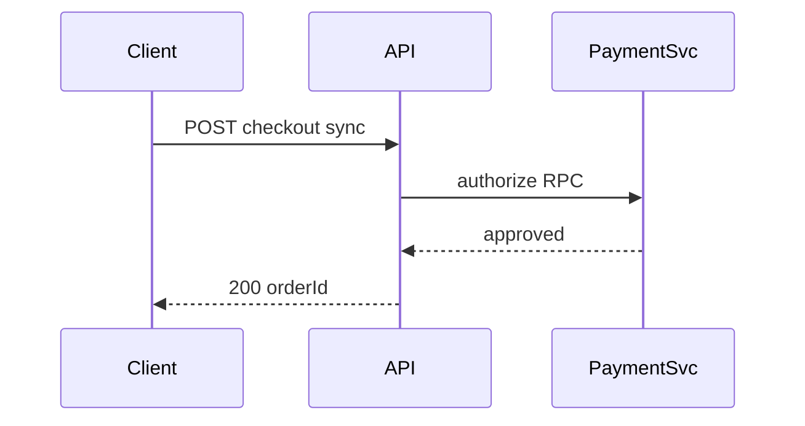
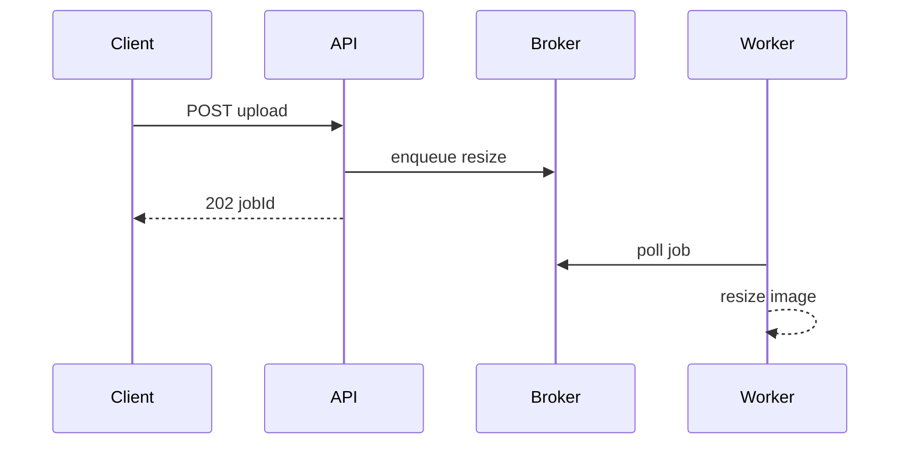

# D14-T002 — Synchronous vs asynchronous communication

Topic ID: `D14-T002`
Domain: Messaging and Event-Driven Architecture
Subdomain: Synchronous vs asynchronous communication
Importance: common
Complexity: advanced
Dependencies: `D14-T001`, `D04-T001`, `D04-T002`, `D05-T001`, `D05-T002`, `D13-T001`
Execution status of the code in section F: executed (CPython, local)

## A. Topic Overview

Synchronous communication means the caller waits for a response before continuing, usually over HTTP or gRPC with the connection held open until success or error. Asynchronous communication means the caller hands off work or an event and proceeds without blocking on downstream completion, typically via a message broker, queue, or stream. The distinction exists because user-facing latency, failure isolation, and consistency requirements differ across use cases.

Sync fits read paths and decisions that must be visible immediately: “Is this seat available?” Async fits side effects that can lag: “Send receipt email” or “Update search index.” Mixing them without clear boundaries produces APIs that time out while work still runs, or UIs that show stale state because nothing polled for completion.

In production, checkout often sync-calls payments for authorization while async-enqueueing fulfillment. Interviewers use sync versus async to test whether you understand coupling, timeout budgets, and user-visible semantics instead of labeling every microservice call “async because Kafka exists.”

Prerequisites: `D14-T001` queue versus stream, HTTP lifecycle. Supports event choreography (`D14-T032`) and API design timeouts (`D06-T012`).

## B. First-Principles Explanation

A synchronous call creates a happens-before relationship visible to the caller: the response body (or error) is the outcome of remote work within the timeout window. The caller’s thread or coroutine is a scheduling dependency of the callee’s capacity. Backpressure propagates immediately as HTTP 503 or slow responses.

Asynchronous handoff breaks that dependency. The producer’s obligation ends when the broker accepts the message (or when local outbox relay succeeds), not when consumers finish. Completion becomes a separate observable: status table, webhook, polling endpoint, or derived read model.

Internal steps for sync RPC:

1. Client serializes request, opens connection, sets deadline.
2. Server authenticates, executes handler, touches databases.
3. Server serializes response; client unmarshals or handles error.
4. If the deadline fires first, client sees timeout—outcome may be unknown on the server.

Internal steps for async publish:

1. Producer validates and persists intent (often in DB).
2. Producer publishes to broker or inserts outbox row.
3. API returns 202 Accepted or 200 with “processing” state.
4. Consumer processes later; retries and duplicates are consumer concerns.

Why both exist: humans and UIs need fast answers for queries; the platform needs resilience for fan-out work. Limitations: async adds eventual consistency and operational complexity; sync chains multiply tail latency. Hybrid patterns (sync read of async-written state) need explicit status models.

## C. Internal Working and Architecture

Sync stack: client SDK → load balancer → service mesh or gateway → service instances → databases and cache. Timeouts nest: outer user deadline must exceed inner sum of hops or you cancel work that would have succeeded.

Async stack: API → transactional outbox → relay → broker → consumer workers → idempotency store → side effects. Observability requires correlation IDs spanning sync and async legs.

Request-driven sync path for “get account balance”:

1. API validates JWT, calls ledger service synchronously.
2. Ledger reads primary or strongly consistent replica.
3. Response returns within SLA; no broker involved.

Event-driven async path for “account closed”:

1. API marks account closed in DB, writes `AccountClosed` to outbox.
2. Relay publishes to stream; API returns closure confirmation without waiting for email archival.
3. Multiple consumers react; each commits offsets after idempotent handling.

State: sync calls are stateless on the wire but may leave server transactions open until response. Async workflows need durable workflow state (saga, process manager) when multiple steps must complete.

## D. Diagrams and Visual Models





## E. Examples and Analogies

Analogy: synchronous is a phone call—you wait on hold until you get an answer. Asynchronous is leaving voicemail— you hang up and check later whether someone acted. Product must tell users when “later” is acceptable.

Do not make payment authorization async without a strong status model. Do not make every read async via cache invalidation events when a simple sync query meets latency goals. Do not chain five sync RPCs for a mobile screen without aggregating at a BFF.

## F. Code Examples

File: `examples/d14_t002_sync_async.py`

```python
import time
from dataclasses import dataclass
from enum import Enum
from typing import Callable


class Outcome(Enum):
    OK = "ok"
    TIMEOUT = "timeout"
    FAILED = "failed"


@dataclass
class Job:
    job_id: str


def sync_charge(charge_fn: Callable[[str], None], order_id: str, deadline_s: float) -> Outcome:
    start = time.monotonic()
    try:
        charge_fn(order_id)
        if time.monotonic() - start > deadline_s:
            return Outcome.TIMEOUT
        return Outcome.OK
    except TimeoutError:
        return Outcome.TIMEOUT
    except ValueError:
        return Outcome.FAILED


def async_enqueue(enqueue_fn: Callable[[Job], None], job: Job) -> str:
    enqueue_fn(job)
    return job.job_id


if __name__ == "__main__":
    def fast_charge(_: str) -> None:
        return

    def slow_charge(_: str) -> None:
        time.sleep(0.05)

    assert sync_charge(fast_charge, "o1", 1.0) == Outcome.OK
    assert sync_charge(slow_charge, "o2", 0.01) == Outcome.TIMEOUT
    jobs: list[Job] = []

    def capture(job: Job) -> None:
        jobs.append(job)

    jid = async_enqueue(capture, Job("j1"))
    assert jid == "j1" and len(jobs) == 1
    print("ok", jid)
```

Expected output: `ok j1`

Sync path blocks until charge returns or deadline; async returns after enqueue only.

## G. Practical Backend Application

Define per endpoint whether the client needs the final outcome or only acceptance. Use sync for authZ checks, inventory holds that must be visible on refresh, and pricing. Use async for notifications, analytics, and long transcoding.

Pass `correlation_id` from HTTP into message headers. Expose `GET /jobs/{id}` or webhooks for async completion. Set client-facing timeouts shorter than upstream sums only when you have compensating status APIs.

## H. Advantages, Limitations and Trade-offs

| Choice | Benefit | Cost | Choose when | Avoid when |
| --- | --- | --- | --- | --- |
| Sync HTTP/gRPC | Simple mental model, immediate errors | Coupling, tail latency | Queries, small fan-out | Long jobs, many hops |
| Async messaging | Decoupling, smoothing peaks | Eventual consistency | Side effects, fan-out | User waits for result inline |
| 202 + status API | Clear async contract | Extra polling or webhooks | Minutes-long work | Sub-100ms needs |
| Sync orchestration in API | One response aggregates | API becomes bottleneck | ≤2 dependencies | Deep graphs |

## I. Common Mistakes and Misconceptions

- Returning 200 before work is durable, then losing messages on crash.
- Using async to hide slow sync chains without fixing fan-out.
- Ignoring unknown outcomes on sync timeouts (same as `D15-T001`).
- Assuming message publish implies downstream success.

## J. Debugging and Troubleshooting

Symptoms: UI spinner forever; duplicate charges after retries; “success” API but email never sent.

Steps: trace correlation ID across RPC and broker; compare API response time to consumer lag; check whether client retries POST without idempotency keys.

## K. Interview Preparation

### Beginner

#### Q1. What is synchronous communication between services?

**Answer:** The caller sends a request and blocks until it receives a response or hits a timeout. The typical transport is HTTP or gRPC with a direct connection to a known endpoint. Success or failure is determined from the status code and body in that single interaction. This pattern is easy to reason about but ties availability of the caller to every dependency in the critical path.

#### Q2. What is asynchronous communication between services?

**Answer:** The caller sends a message or event and continues without waiting for downstream processing to finish. A broker or queue buffers work between producer and consumer processes. Completion is observed later through status endpoints, webhooks, or updated read models. This improves resilience but introduces delay between acceptance and full side effects.

#### Q3. When should a user-facing API stay synchronous?

**Answer:** Stay synchronous when the client must show the outcome immediately to proceed, such as login, payment authorization, or reserving a limited seat. The user is waiting on the screen, so returning 202 without a clear next step frustrates product flows. Latency budgets still apply, which is why you keep the sync path short and aggregate where possible. Long work should move async only after recording intent the user can track.

#### Q4. What HTTP status code often signals asynchronous acceptance?

**Answer:** `202 Accepted` indicates the request was valid and queued for processing but not completed. It should pair with a location or job identifier the client can poll. Returning `200` with a partial body is acceptable only if the contract documents incomplete state explicitly. Misusing `200` for “we will try later” hides failures from clients and monitors.

#### Q5. How do timeouts affect synchronous calls?

**Answer:** A timeout ends waiting on the client even if the server is still working. That creates an unknown outcome unless the operation is idempotent and reconciled. Shorter timeouts improve perceived speed but increase false failures. Nested timeouts must be ordered so inner services fail before the outer user deadline without leaking hung threads.

### Intermediate

#### Q1. How does async messaging reduce coupling?

**Answer:** Producers depend on the broker contract, not on consumer uptime at the instant of publish. Consumers can scale independently and catch up from lag when traffic drops. Schema versioning on events becomes the integration point instead of shared deployment schedules. Coupling is reduced in time, not eliminated in data—consumers still must understand event semantics.

#### Q2. What is the danger of a long synchronous call chain?

**Answer:** Latencies add and tail percentiles multiply across hops. One slow dependency stalls the entire user request. Failure probability grows with each additional service in series. Mitigations include parallel fetch, caching, circuit breakers, or moving noncritical legs async.

#### Q3. How do correlation IDs help across sync and async?

**Answer:** The same ID in HTTP headers and message metadata lets you stitch logs for one user action. Support can follow checkout from API through payment RPC into fulfillment queue processing. Without propagation, async legs look like orphan errors. Correlation does not replace idempotency but makes debugging feasible at scale.

#### Q4. When is fire-and-forget HTTP still a bad idea?

**Answer:** Fire-and-forget without durable enqueue loses work if the process crashes after responding. It also provides no retry or DLQ for downstream failure. Prefer broker or outbox persistence before telling the client success. If you must fire-and-forget, limit to best-effort metrics where loss is acceptable.

#### Q5. How do you choose between gRPC sync and message-based async for internal calls?

**Answer:** Use gRPC when you need an immediate decision and tight error propagation between two teams’ services. Use messaging when multiple subscribers react, traffic is bursty, or processing exceeds RPC timeout budgets. Hybrid designs sync for the commit decision and async for propagation. Cost and operability of the broker matter for small teams.

### Advanced

#### Q1. How does the outbox pattern bridge sync API and async consumers?

**Answer:** The API transaction writes business state and an outbox row atomically, then returns sync response about persisted intent. A relay process publishes outbox rows to the broker asynchronously. Consumers see events only after commit, avoiding phantom messages. Relay failures retry; consumers still need at-least-once handling.

#### Q2. What is temporal coupling and how does async address it?

**Answer:** Temporal coupling means two components must be alive at the same instant to make progress. Sync RPC requires both sides up during the call. Async allows the consumer to be down while messages accumulate within retention limits. Extreme lag still violates business deadlines, so async is not infinite slack.

#### Q3. How do sagas relate to sync versus async boundaries?

**Answer:** Sagas coordinate multi-step business processes with compensating actions when steps fail. Each step may be a sync call or an async event handler. The orchestration choice affects where state lives and how visible progress is to users. Choreographed sagas over events reduce central orchestrator load but complicate global visibility.

#### Q4. Can you make an async flow feel synchronous to users?

**Answer:** Yes, with short polling, server-sent events, or websockets pushing job completion. The backend remains async while the UI waits on a channel. You still need durable job state and idempotent completion handlers. Timeouts and cancel semantics must be product-defined.

#### Q5. How does backpressure differ in sync versus async systems?

**Answer:** Sync backpressure manifests as slower responses and thread pool saturation at the server. Clients naturally slow if they wait for responses. Async backpressure shows as queue depth or consumer lag while producers may continue until limits hit. Producers need rate limits and drop policies when brokers are full.

### Scenarios

#### Q1. Checkout sync-calls email service; p99 latency doubles. What do you change?

**Answer:** Move email to async enqueue after order commit while keeping payment sync. Return order confirmation without waiting for SMTP. Preserve idempotency on email consumer to handle duplicates. Monitor queue lag separately from checkout latency.

#### Q2. Mobile app receives 202 but never learns job failed. What contract is missing?

**Answer:** Missing status API, webhook, or push notification on terminal failure. Add `GET /jobs/{id}` with failed state and error code. Ensure consumer updates job table before acking broker message. Client should poll or subscribe with backoff.

#### Q3. Two services use sync RPC in a circle during peak. What breaks?

**Answer:** Circular waits can exhaust connection pools and cause deadlocks under load. Traffic amplifies as each retry adds more calls. Break the cycle with async events or consolidate into one service boundary. Add timeouts and circuit breakers as immediate relief.

#### Q4. API returns 200 before DB commit due to wrong transaction boundary. How do clients see bugs?

**Answer:** Clients believe order exists but refresh shows nothing, or downstream events never fire. Fix transaction scope so response follows commit. Use outbox inside the same transaction for async side effects. Add integration tests asserting row visibility after response.

#### Q5. You must meet read-your-writes after async indexing. Options?

**Answer:** Route reads to primary DB until index catches up, or block search on version tokens. Publish index events with sequence numbers clients can compare. Do not claim search is sync if it is eventually consistent without user messaging.

### Follow-ups

#### Q1. How does this connect to message queues versus streams?

**Answer:** Async communication usually lands on a queue for tasks or a stream for events, per `D14-T001`. The sync versus async decision precedes broker choice. Streams support multiple async consumers; queues focus work delegation.

#### Q2. How does this connect to partial failures?

**Answer:** Sync timeouts create unknown outcomes; async redelivery creates duplicates. `D15-T002` covers partial failure reasoning that applies once you split sync and async legs. Design each leg with appropriate idempotency.

#### Q3. How does this connect to API design?

**Answer:** REST semantics for 200 versus 202, idempotency keys on POST, and problem details for errors belong in API design topics. Timeouts and retry guidance should appear in client SDK docs. Sync aggregation shapes BFF endpoints.

## L. Practical Exercises

Solutions are in `EXERCISES/solutions/D14-T002.md`.

### Exercise 1 — implementation

Wrap `sync_charge` with an idempotency key store so duplicate sync retries within 24h return the same `Outcome` without double charge simulation.

### Exercise 2 — debugging

Map a timeout on payment RPC to user-visible states: succeeded, failed, processing—without double capture.

### Exercise 3 — trade-off

Design checkout: sync payment authorize, async fulfillment and email; list endpoints and status fields.

## M. Revision Notes

- Sync: caller waits; outcome in one round trip.
- Async: accept then process; need status or events.
- Timeouts create unknowns on sync paths.
- Outbox aligns DB commit with publish.
- Keep user-critical paths short; fan-out async.

## N. Related Topics

Understand: `D14-T001`, `D04-T002`.

Supports: `D14-T032` orchestration vs choreography, `D15-T021` retries.

## O. Completion Criteria

- Contrast sync and async with coupling and timeout effects.
- Sketch sequence diagrams for both patterns.
- Choose sync vs async for a multi-step product flow.
- Explain 202 and job status APIs.
- Debug missing side effects after 200 responses.
