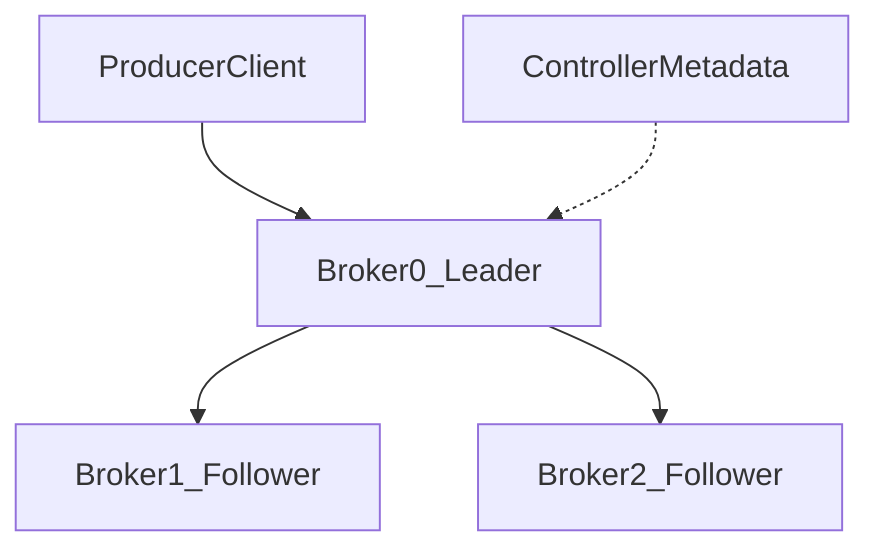

# D14-T003 — Kafka architecture

Topic ID: `D14-T003`
Domain: Messaging and Event-Driven Architecture
Subdomain: Kafka architecture
Importance: common
Complexity: advanced
Dependencies: `D14-T002`, `D14-T001`, `D04-T001`, `D04-T002`, `D05-T001`, `D05-T002`
Execution status of the code in section F: not executed (local)

## A. Topic Overview

Apache Kafka is a distributed commit log: brokers store topic partitions as ordered, append-only segment files on disk.

A cluster controller (KRaft or legacy ZooKeeper metadata) tracks partition leadership and ISR membership.

Producers send batches to the leader partition; followers replicate for durability before ack depending on `acks` setting.

Kafka scales horizontally by adding brokers and partitions; clients discover metadata via bootstrap servers.

## B. First-Principles Explanation

Kafka architecture sits in the messaging layer between domain services and operational observability.

Brokers provide durability and fan-out but do not understand your business invariants.

Application code must define retries, idempotency, and schema contracts explicitly.

Failure is normal; design for at-least-once and measurable lag.

## C. Internal Working and Architecture

Kafka brokers, controller, and replication.

Leaders, coordinators, and client libraries implement the wire protocol; operators tune JVM heap, disk, and network.

Client configuration (acks, commits, prefetch) often matters more than broker version bumps.

Cross-region replication adds latency to ISR acknowledgment and consumer fetch.

## D. Diagrams and Visual Models



Read the diagram as a data-flow or lifecycle model for this topic.

## E. Examples and Analogies

When discussing Kafka architecture, use concrete nouns: orders topic, payments queue, outbox relay, DLQ alert.

Weak answers stay product-marketing level; strong answers mention partitions, acks, or exchange type.

Tie to a user-visible symptom: duplicate email, stale dashboard, or lost refund event.

## F. Code Examples

File: `examples/d14_t003.py` (illustrative; not executed in CI).

```python
def dedupe_processed(event_id: str, seen: set[str]) -> bool:
    """Return True if this event_id was already applied (idempotent consumer sketch)."""
    if event_id in seen:
        return False
    seen.add(event_id)
    return True


if __name__ == "__main__":
    processed: set[str] = set()
    assert dedupe_processed("evt-1", processed) is True
    assert dedupe_processed("evt-1", processed) is False
    print("ok")
```

Run locally with Python 3. The snippet models application-side patterns; wire real brokers in integration tests.

## G. Practical Backend Application

Document delivery semantics and idempotency strategy in service README.

Dashboard lag per partition and DLQ depth for on-call.

Load test with broker failures, not only happy path.

Version schemas before rolling producers.

## H. Advantages, Limitations and Trade-offs

| Choice | Benefit | Cost | Choose when | Avoid when |
| --- | --- | --- | --- | --- |
| Strict ordering | Correct per-entity timeline | Limits scale | Inventory per SKU | Global analytics |
| More partitions | Higher parallelism | Rebalance cost | Kafka throughput | Tiny ordered log |
| Manual ack | Safer processing | Slower on failure | Rabbit tasks | Fire-and-forget metrics |
| Long retention | Replay for fixes | Disk cost | Compliance, CDC | Ephemeral tasks |

## I. Common Mistakes and Misconceptions

- Treating Kafka architecture as guaranteeing exactly-once end-to-end without application deduplication.
- Committing offsets before side effects complete.
- Ignoring hot partition skew.
- Skipping schema compatibility checks on deploy.

## J. Debugging and Troubleshooting

Correlate producer trace id through Kafka architecture to consumer logs.

Compare broker metric with application error rate during incidents.

Inspect DLQ sample messages for schema or poison payloads.

## K. Interview Preparation

### Beginner

#### Q1. What problem does Kafka cluster solve in event-driven systems?

**Answer:** It addresses Kafka cluster so services can evolve without tight synchronous coupling. Producers and consumers agree on contracts while the broker handles buffering and delivery attempts. Operational teams monitor lag, errors, and broker health separately from application CPU. It is a building block, not a substitute for domain modeling or idempotent handlers.

#### Q2. Name one failure mode specific to Kafka cluster.

**Answer:** Partial failures include broker unavailability, consumer crashes mid-processing, and network partitions. At-least-once delivery means duplicates unless consumers deduplicate or use idempotency keys. Misconfigured acknowledgments can cause message loss or unbounded redelivery. Runbooks should distinguish transient errors from poison messages.

#### Q3. How does Kafka cluster interact with database transactions?

**Answer:** Brokers do not join your local database transaction automatically. Patterns like transactional outbox or CDC bridge the commit boundary. Dual-write without outbox risks events never published or published without commit. Exactly-once across DB and broker requires careful design and still has limits.

#### Q4. What metric would you alert on for Kafka cluster?

**Answer:** Consumer lag, queue depth, DLQ rate, and error ratio are common starting alerts. Broker disk usage and ISR shrink matter for Kafka clusters. Sudden publish rate drops may indicate producer failures or throttling. Correlate metrics with deployment times to catch regressions.

#### Q5. Is Kafka cluster the same as exactly-once delivery?

**Answer:** No. Exactly-once is an end-to-end property with cost and scope limits. Kafka offers idempotent producers and transactions within the cluster, not free global exactly-once. Application side effects still need idempotent consumers or deduplication stores. Interviewers expect you to say at-least-once plus idempotency is the pragmatic default.

### Intermediate

#### Q1. How would you scale Kafka cluster under 10x traffic?

**Answer:** Scale consumers horizontally within partition or queue limits. For Kafka, increasing partitions requires planning because keys and ordering change. Tune batching, fetch sizes, and processing parallelism without breaking ordering guarantees. Load test producers and consumers together, not in isolation.

#### Q2. How does ordering work with Kafka cluster?

**Answer:** Global order is expensive; per-key or per-partition order is the usual compromise. Multiple consumers on one partition are not allowed in Kafka groups. RabbitMQ ordering holds per queue only with a single active consumer. Design partition keys around entities that must serialize.

#### Q3. How do retries interact with Kafka cluster?

**Answer:** Retries amplify duplicates under at-least-once. Use exponential backoff and max attempts before DLQ. Retry storms can starve healthy messages unless isolated topics or queues. Classify errors: 4xx domain bugs should not infinite retry.

#### Q4. How do you test Kafka cluster locally?

**Answer:** Use docker-compose with broker plus testcontainers in CI. Contract tests validate schema compatibility before deploy. Integration tests should assert offset commit and side effects with idempotency. Chaos tests restart brokers during consumption to surface rebalance bugs.

#### Q5. Security concerns for Kafka cluster?

**Answer:** TLS, authentication (SASL), and ACLs on topics or queues. Prevent arbitrary publish by compromised services via IAM or ACL least privilege. Encrypt sensitive payloads or use field-level encryption when needed. Audit admin operations on cluster configuration.

### Advanced

#### Q1. Kafka ISR and Kafka cluster—what should producers know?

**Answer:** In-sync replicas (ISR) are followers caught up within lag bounds. Producers with `acks=all` wait for ISR acknowledgment; `min.insync.replicas` gates durability. If ISR shrinks below min ISR, producers may fail rather than accept data loss risk. This is durability configuration, not application idempotency.

#### Q2. Explain at-most-once vs at-least-once for Kafka cluster.

**Answer:** At-most-once may commit offset before processing or ack before handling, risking loss. At-least-once processes then commits, risking duplicates on crash. Exactly-once streaming needs transactions and still does not cover all external systems. Pick semantics consciously per use case; do not assume broker defaults are correct.

#### Q3. How does Kafka cluster relate to sagas?

**Answer:** Sagas coordinate multi-step business flows with compensations. They assume messages arrive at-least-once and handlers are idempotent. Choreography publishes events; orchestration drives commands via a coordinator. Failure in one step triggers compensating events or rollback policies.

#### Q4. Outbox vs CDC for publishing after Kafka cluster?

**Answer:** Transactional outbox writes events in the same DB transaction as domain rows. A relay publishes to the broker; duplicates possible, consumers must dedupe. CDC reads database WAL/binlog and streams changes; captures all mutations including legacy writers. CDC adds operational complexity but avoids application double-write bugs.

#### Q5. Capacity planning for Kafka cluster?

**Answer:** Estimate peak publish TPS, average message size, retention, and consumer processing time. Kafka disk is retention times ingress; consumers need CPU for deserialization and IO for writes. Rabbit memory can fill if consumers slow unless quotas and TTLs exist. Plan partition count up front; increasing partitions later changes key distribution.

### Scenarios

#### Q1. Lag spikes after deploy touching Kafka cluster. First steps?

**Answer:** Check consumer error logs, schema compatibility, and rebalance storms. Compare publish rate vs consume rate per partition. Roll back if deserialization fails across all instances. Pause processing and drain DLQ after fix if poison messages appeared.

#### Q2. Duplicate charges after enabling Kafka cluster. Root cause?

**Answer:** At-least-once redelivery without idempotent payment handler is the usual culprit. Offset committed before DB transaction creates duplicates on replay. Add business idempotency key stored in database unique constraint. Exactly-once Kafka does not fix external payment API duplicates alone.

#### Q3. Broker outage during peak—how does Kafka cluster recover?

**Answer:** Producers should retry with backoff; surface degraded mode if broker down too long. Consumers rebalance when cluster returns; expect duplicate delivery. Verify ISR and leader election completed before declaring healthy. Replay backlog may take hours; communicate SLA impact.

#### Q4. Compliance needs audit trail—does Kafka cluster suffice?

**Answer:** Immutable retained logs or warehouse ingest may be required beyond short retention queues. Encrypt and restrict access to topics with PII. Compaction drops history per key—unsuitable for full audit. Pair streaming with long-term object storage if mandated.

#### Q5. Team wants to change schema for Kafka cluster without downtime.

**Answer:** Use backward/forward compatible schema rules in registry. Deploy consumers before producers or vice versa per compatibility mode. Dual-write two event versions during migration window. Monitor deserialization errors as canary.

### Follow-ups

#### Q1. How does Kafka architecture connect to partition keys (`D14-T007`)?

**Answer:** Partition keys route related events to one partition for order. Changing key strategy reshuffles ordering guarantees. Hot keys create partition skew and lag hotspots. Design keys around aggregate ids, not random UUIDs when order matters.

#### Q2. How does Kafka architecture connect to DLQs (`D14-T013`)?

**Answer:** DLQs quarantine poison messages after retry exhaustion. Operators inspect DLQ to fix data or code before replay. Kafka may use dead-letter topics with separate consumer. DLQ without alerting rots failures silently.

#### Q3. How does Kafka architecture connect to replay (`D14-T031`)?

**Answer:** Replay resets offsets or consumes from timestamp to reprocess history. Idempotent sinks required to avoid duplicate side effects. Retention window bounds how far back replay reaches. Use separate replay consumer group to avoid disturbing production offsets.

## L. Practical Exercises

Solutions are in `EXERCISES/solutions/D14-T003.md`. Try these before opening that file.

### Exercise 1 — implementation

Implement or diagram how Kafka cluster fits in a three-service order flow.

### Exercise 2 — debugging

Given duplicate events, explain which layer should dedupe for Kafka architecture.

### Exercise 3 — trade-off

Choose Kafka vs Rabbit for a new Kafka cluster requirement with replay and routing constraints.

## M. Revision Notes

- Kafka architecture: know failure modes and metrics.
- At-least-once + idempotency default.
- Exactly-once is scoped and costly.

## N. Related Topics

See `D14-T001` and neighbors in domain 14. Depends on inventory deps for `D14-T003`.

## O. Completion Criteria

- Explain Kafka architecture without confusing broker guarantees and app idempotency.
- Name one metric and one failure mode.
- Sketch architecture with ack or offset commit placement.
