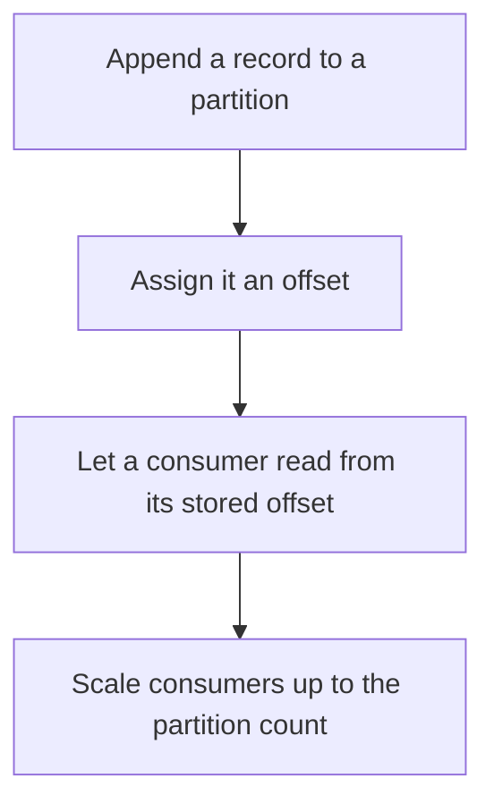

# D14-T004 — Topics, partitions and offsets

Topic ID: `D14-T004`
Domain: Messaging and Event-Driven Architecture
Subdomain: Topics, partitions and offsets
Importance: common
Complexity: advanced
Dependencies: `D14-T003`, `D14-T001`, `D04-T001`, `D04-T002`, `D05-T001`, `D05-T002`
Execution status of the code in section F: unexecuted

## A. Topic Overview

A topic is a named log. A partition is an ordered, append-only shard of that topic. An offset is a consumer's position in a partition. Ordering is guaranteed inside one partition, not across partitions. The partition count bounds consumer parallelism. Keys choose a partition. Changing the partition count changes key placement.

In production this shows up as follows: Orders are partitioned by customer id so one customer's events stay ordered. A dashboard that needs a global sequence cannot read two partitions and assume their offsets compare.

Interviewers use Topics, partitions and offsets to see whether you can state the failure mode, not only the definition. The failure to name is: assuming a global order across partitions, or adding partitions and silently changing which consumer sees a key

Prerequisites: `D14-T003`, `D14-T001`, `D04-T001`, `D04-T002`, `D05-T001`, `D05-T002`. Later notes should link here instead of repeating the mechanism.

## B. First-Principles Explanation

A topic is a named log. A partition is an ordered, append-only shard of that topic. An offset is a consumer's position in a partition. Ordering is guaranteed inside one partition, not across partitions. The partition count bounds consumer parallelism. Keys choose a partition. Changing the partition count changes key placement.

The useful picture is: A topic is a newspaper. Partitions are separate printing presses. Offsets are the edition number on one press. Two presses do not share a single edition number.

What has to be true:

1. Append a record to a partition
2. Assign it an offset
3. Let a consumer read from its stored offset
4. Scale consumers up to the partition count

It works when those steps preserve one invariant. It fails when assuming a global order across partitions, or adding partitions and silently changing which consumer sees a key. The alternative is: you need a total order for every event in the system

## C. Internal Working and Architecture

Components involved: the caller, the state Topics, partitions and offsets mutates or reads, and the observer that reports consumer lag per partition and whether key order still matches the business rule.

Execution:

1. Append a record to a partition
2. Assign it an offset
3. Let a consumer read from its stored offset
4. Scale consumers up to the partition count

Data moves only along that path. A retry re-enters at step 1, so the operation must say what a duplicate does. Memory and locks stay inside this mechanism. Callers see the result or a typed error, not a half-updated invariant.

State to remember: choose this when you need an ordered log that several consumers can share. Do not choose it when you need a total order for every event in the system.

## D. Diagrams and Visual Models



Read the diagram from top to bottom. Each box is one step of Topics, partitions and offsets. The failure mode (assuming a global order across partitions, or adding partitions and silently changing which consumer sees a key) is what you look for when a later box never happens or happens twice.

## E. Examples and Analogies

Analogy: A topic is a newspaper. Partitions are separate printing presses. Offsets are the edition number on one press. Two presses do not share a single edition number.

Production example: Orders are partitioned by customer id so one customer's events stay ordered. A dashboard that needs a global sequence cannot read two partitions and assume their offsets compare.

A small counterexample is enough in an interview. Show the input, apply the steps, and show the broken outcome if someone uses the mechanism outside its rule: assuming a global order across partitions, or adding partitions and silently changing which consumer sees a key.

## F. Code Examples

The snippet is labeled unexecuted. It illustrates the shape of the idea. It is not a benchmark and it embeds no secret.

```python
def partition_for(key, n):
    return hash(key) % n
```

After the snippet, check consumer lag per partition and whether key order still matches the business rule. If that signal moves the wrong way, the snippet is the wrong tool for the workload.

## G. Practical Backend Application

Use Topics, partitions and offsets in a service when you need an ordered log that several consumers can share.

A typical place is the production case already stated: Orders are partitioned by customer id so one customer's events stay ordered. A dashboard that needs a global sequence cannot read two partitions and assume their offsets compare.

Operationally you alert on consumer lag per partition and whether key order still matches the business rule. You do not alert only on process uptime. The dashboard should show the failure mode, a success rate, and the saturation signal (queue depth, lock wait, or latency) that predicts it.

## H. Advantages, Limitations and Trade-offs

| Choice | Benefit | Cost | Choose when | Avoid when |
| --- | --- | --- | --- | --- |
| Apply Topics, partitions and offsets | you need an ordered log that several consumers can share | Extra moving parts and a new failure mode | The failure you are preventing is already real | you need a total order for every event in the system |
| Simpler alternative | Less code and fewer dependencies | assuming a global order across partitions, or adding partitions and silently changing which consumer sees a key | The workload does not hit the limit | The invariant must hold under concurrency or failure |

Topics, partitions and offsets is a trade. State the benefit and the cost in the same sentence when you propose it in a design review.

## I. Common Mistakes and Misconceptions

- One partition for everything.
- Using offsets as timestamps.
- Changing partition count without a migration plan.
- Treating a diagram of Topics, partitions and offsets as proof that the invariant holds in production.
- Copying a default configuration without naming consumer lag per partition and whether key order still matches the business rule.

## J. Debugging and Troubleshooting

Symptom: assuming a global order across partitions, or adding partitions and silently changing which consumer sees a key

First check: consumer lag per partition and whether key order still matches the business rule.

Then compare one healthy instance against one unhealthy instance. Confirm whether retries are duplicating work. Confirm whether a timeout is shorter than the work. Fix the invariant, then watch the same metric for a full peak, not only for the next minute.

Useful questions: did the step order in section C actually happen, or did a caller skip a step? Did a deploy change the data shape that Topics, partitions and offsets assumes?

## K. Interview Preparation

### Beginner

#### Q1. What problem does Topics, partitions and offsets solve?

**Answer:** A topic is a named log. A partition is an ordered, append-only shard of that topic. An offset is a consumer's position in a partition. Ordering is guaranteed inside one partition, not across partitions. The partition count bounds consumer parallelism. Keys choose a partition. Changing the partition count changes key placement. Without it, the usual backend failure is: assuming a global order across partitions, or adding partitions and silently changing which consumer sees a key.

#### Q2. Where does Topics, partitions and offsets sit on a request path?

**Answer:** Topics, partitions and offsets is not a library you sprinkle on every call. you need an ordered log that several consumers can share You notice it when consumer lag per partition and whether key order still matches the business rule. Name the constraint that makes this choice correct. Say what you would measure to confirm it.

#### Q3. Give a concrete example of Topics, partitions and offsets.

**Answer:** Orders are partitioned by customer id so one customer's events stay ordered. A dashboard that needs a global sequence cannot read two partitions and assume their offsets compare. Walk the input, the state change, and the observable output. Name the constraint that makes this choice correct.

#### Q4. What is a common mix-up around Topics, partitions and offsets?

**Answer:** assuming a global order across partitions, or adding partitions and silently changing which consumer sees a key The corrective check is consumer lag per partition and whether key order still matches the business rule. Name the constraint that makes this choice correct. Say what you would measure to confirm it. Say which alternative you rejected and why.

#### Q5. When would you skip Topics, partitions and offsets?

**Answer:** you need a total order for every event in the system Skipping is a decision with a measured cost, not a slogan. Name the constraint that makes this choice correct. Say what you would measure to confirm it. Say which alternative you rejected and why.

### Intermediate

#### Q1. What invariant makes Topics, partitions and offsets correct?

**Answer:** A topic is a named log. A partition is an ordered, append-only shard of that topic. An offset is a consumer's position in a partition. Ordering is guaranteed inside one partition, not across partitions. The partition count bounds consumer parallelism. Keys choose a partition. Changing the partition count changes key placement. State the invariant before you name the tool.

#### Q2. How do you test Topics, partitions and offsets?

**Answer:** Assert the failure mode directly: assuming a global order across partitions, or adding partitions and silently changing which consumer sees a key. The assertion should watch consumer lag per partition and whether key order still matches the business rule. Include a concurrent or retry case if the bug only appears then. Name the constraint that makes this choice correct.

#### Q3. What signal tells you Topics, partitions and offsets is misbehaving in production?

**Answer:** Watch consumer lag per partition and whether key order still matches the business rule. The user-visible symptom is usually assuming a global order across partitions, or adding partitions and silently changing which consumer sees a key. Name the constraint that makes this choice correct. Say what you would measure to confirm it.

#### Q4. How would you introduce Topics, partitions and offsets into a legacy service?

**Answer:** you need an ordered log that several consumers can share Ship it behind a metric so you can compare the old path. Roll back if assuming a global order across partitions, or adding partitions and silently changing which consumer sees a key gets worse. Name the constraint that makes this choice correct. Say what you would measure to confirm it.

#### Q5. What do you trade away by choosing Topics, partitions and offsets?

**Answer:** you need an ordered log that several consumers can share you need a total order for every event in the system Say the cost in latency, storage, or operational load. Name the constraint that makes this choice correct. Say what you would measure to confirm it. Say which alternative you rejected and why.

### Advanced

#### Q1. What breaks if a dependency of Topics, partitions and offsets is slow or down?

**Answer:** assuming a global order across partitions, or adding partitions and silently changing which consumer sees a key Degrade using the rule: you need a total order for every event in the system. Timeouts must be shorter than the caller's deadline. Name the constraint that makes this choice correct. Say what you would measure to confirm it.

#### Q2. How does Topics, partitions and offsets behave under retries?

**Answer:** Retries repeat work, so Topics, partitions and offsets must define what a duplicate does. assuming a global order across partitions, or adding partitions and silently changing which consumer sees a key Idempotency keys or fences belong next to the write, not in a comment. Name the constraint that makes this choice correct. Say what you would measure to confirm it.

#### Q3. What is the capacity limit of Topics, partitions and offsets?

**Answer:** The limit shows up as consumer lag per partition and whether key order still matches the business rule. Add capacity only after you know whether the bottleneck is CPU, lock wait, or network. Name the constraint that makes this choice correct. Say what you would measure to confirm it.

#### Q4. How do you evolve Topics, partitions and offsets without a flag day?

**Answer:** you need an ordered log that several consumers can share Version the contract or the on-disk format. Readers should tolerate one old and one new shape during the rollout. Name the constraint that makes this choice correct. Say what you would measure to confirm it.

#### Q5. What security or correctness bug hides inside Topics, partitions and offsets?

**Answer:** assuming a global order across partitions, or adding partitions and silently changing which consumer sees a key Check authorization and tenancy at the same boundary as the mechanism. A cache or queue must not widen who can read the data. Name the constraint that makes this choice correct. Say what you would measure to confirm it.

### Scenario

#### Q1. Incident: assuming a global order across partitions, or adding partitions and silently changing which consumer sees a key. What do you check first?

**Answer:** Start with consumer lag per partition and whether key order still matches the business rule. Compare a good host and a bad host before you restart anything. A topic is a named log. A partition is an ordered, append-only shard of that topic. An offset is a consumer's position in a partition. Ordering is guaranteed inside one partition, not across partitions. The partition count bounds consumer parallelism. Keys choose a partition. Changing the partition count changes key placement.

#### Q2. A reviewer wants the clever version. What data settles it?

**Answer:** you need an ordered log that several consumers can share you need a total order for every event in the system Bring consumer lag per partition and whether key order still matches the business rule from a load test or from production, not a slogan. Name the constraint that makes this choice correct. Say what you would measure to confirm it. Say which alternative you rejected and why.

#### Q3. You have one hour to explain Topics, partitions and offsets at a whiteboard.

**Answer:** Draw the happy path in four boxes. Then draw the failure: assuming a global order across partitions, or adding partitions and silently changing which consumer sees a key. End with the metric you would page on. Name the constraint that makes this choice correct.

#### Q4. The bug only appears under two concurrent callers.

**Answer:** assuming a global order across partitions, or adding partitions and silently changing which consumer sees a key Reproduce with a barrier so both sides enter the critical window. Confirm the fix with consumer lag per partition and whether key order still matches the business rule. Name the constraint that makes this choice correct. Say what you would measure to confirm it.

#### Q5. Leadership wants this on every service next week.

**Answer:** you need a total order for every event in the system you need an ordered log that several consumers can share Roll it out where the failure mode is already hurting users. Name the constraint that makes this choice correct. Say what you would measure to confirm it. Say which alternative you rejected and why.

### Follow-up

#### Q1. What did you assume about the data size or the clock?

**Answer:** A topic is a named log. A partition is an ordered, append-only shard of that topic. An offset is a consumer's position in a partition. Ordering is guaranteed inside one partition, not across partitions. The partition count bounds consumer parallelism. Keys choose a partition. Changing the partition count changes key placement. Clocks are not a total order across machines. State whether the algorithm needs bounded size or a single leader.

#### Q2. What would you measure after the change ships?

**Answer:** Page on consumer lag per partition and whether key order still matches the business rule. Keep a before/after dashboard for one week. Alert on the failure mode, not only on CPU. Name the constraint that makes this choice correct.

#### Q3. Which neighboring topic did you deliberately not re-teach?

**Answer:** This note owns Topics, partitions and offsets. Related identifiers are in section N. Shared ideas are linked, not copied. Name the constraint that makes this choice correct.

## L. Practical Exercises

Solutions are in `EXERCISES/solutions/D14-T004.md`, not in this section.

1. Whiteboard the four steps of Topics, partitions and offsets and mark where `assuming a global order across partitions, or adding partitions and silently changing which consumer sees a key` enters.
2. Read the snippet in section F and write the assertion that would catch that failure. The assertion must mention `consumer lag per partition and whether key order still matches the business rule`.
3. Argue for or against using Topics, partitions and offsets on a service you know. Use the choose and avoid rows from section H. Do not appeal to popularity.

## M. Revision Notes

- Mechanism: A topic is a named log.
- Failure: assuming a global order across partitions, or adding partitions and silently changing which consumer sees a key
- Metric: consumer lag per partition and whether key order still matches the business rule
- Choose when: you need an ordered log that several consumers can share
- Avoid when: you need a total order for every event in the system

## N. Related Topics

Dependencies to review first: `D14-T003`, `D14-T001`, `D04-T001`, `D04-T002`, `D05-T001`, `D05-T002`.

Shared ideas stay in those notes. This note does not restate them.

## O. Completion Criteria

- You can explain Topics, partitions and offsets without reading this note, including the failure mode.
- You can draw the diagram in section D from memory.
- You can say when not to use it, using the avoid condition in section H.
- You can name the metric you would watch after shipping it.
